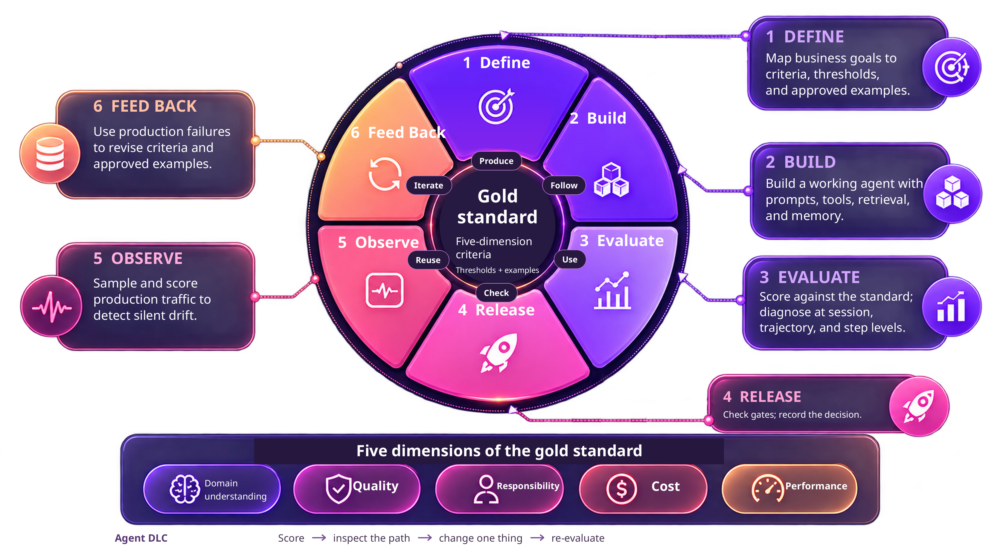

# 从原型到生产：Agent DLC 工程实践（From prototype to production: Engineering agents with Agent DLC）

> 原文：[From prototype to production: Engineering agents with Agent DLC](https://aws.amazon.com/blogs/machine-learning/from-prototype-to-production-engineering-agents-with-agent-dlc/) · AWS · 2026-11-12
> 本文由 Kimi CLI 使用 Kimi K3-256k 全文翻译，并由 Agent 校对；已取得全文翻译和转载授权。
> 作者：Yuan Wei、Tianqin Cai、Jiade Wu

过去一年里，AI 智能体（agent）已经从探索阶段走向了工程化阶段。企业团队正在交付能够调用工具、编排 API，并基于内部知识回答问题的大语言模型（LLM）系统。

一次成功的演示可以展示智能体的能力。但在发布之前，团队还需要回答一个更进一步的问题：“*这个智能体为生产环境做好准备了吗？*” 负责做出这一决策的人需要证据，证明该智能体满足约定好的要求。

为了始终如一地做出这一决策，团队需要一种可重复、负担得起的方法，来评估智能体当前的行为，以及最近的变更是否带来了改进。

在传统软件开发中，团队依靠单元测试、持续集成与持续交付（CI/CD）以及通过的构建来回答这些问题。这些机制对智能体而言是必要的，但并不充分，原因有三，每一项都需要额外的检查。本文将解释这三个属性，并展示一个有实测数据的案例：聚合指标如何掩盖了覆盖度问题。随后，本文将介绍智能体开发生命周期（Agent DLC）：一个生命周期、两个循环，以及一个用于评判每次变更的单一明确标准。

**术语说明：** 在本文中，*黄金标准（gold standard）* 指的是一个特定的制品（artifact）：一组可验证的标准、其阈值，以及用于检验这些标准的已批准示例的集合。业务负责人批准这一标准，作为验收决策的依据。

## 1. 需要额外工程实践的智能体三大属性

传统的软件测试和 CI/CD 仍然适用于智能体，但有三个属性需要额外的检查。第一，智能体是非确定性的：相同的输入可能产生不同的输出和执行路径。第二，对提示词、工具描述、检索设置或内存配置的修改，可能以仅靠文本审查无法揭示的方式改变行为。第三，模型端点、知识库和外部 API 可能独立于代码仓库而变化，并影响智能体的行为。表 1 总结了应对每个属性所需的工程实践。

*表 1. 每个属性使什么失效，以及它转而需要什么。*

|  |  |  |  |
| --- | --- | --- | --- |
| **属性** | **传统的答案** | **为何不够** | **Agent DLC 的要求** |
| 非确定性 | 在 CI 中每个用例一次断言 | 只测量了分布中的一个样本。通过与失败的原因可能与你的变更无关 | 每个示例运行 k 次。基于通过率和失败分布进行评判 |
| 提示词即源代码 | 审查差异（diff），批准变更 | 行为无法从提示词的文本中读出来 | 每次提示词、工具、检索和内存的变更都要版本化并附带评估，且保留其血缘记录 |
| 依赖自行变动 | 锁定版本，升级时验证 | 不会触发，因为你的仓库里没有任何变化 | 按计划定期重跑标准，并对偏离基线的情况发出告警 |

## 2. 一个实测示例：高检索精度可能掩盖信息缺失

下面的示例展示了指标的选择如何影响诊断。

我们构建了一个参考实现，用于端到端地演练这一方法：一个内部政策助手，基于文档知识库回答人力资源（HR）政策问题。我们选择了一个范围狭窄、界定清晰的领域，以便让评估和诊断易于理解。以下结果均在此参考实现上测得。它既不是客户成果，也不是基准测试结果。

[配套的 AWS Samples 仓库](https://github.com/aws-samples/sample-eval-first-building-enterprise-agents-with-agentcore)包含基础设施部署、HR 智能体、自定义评估器，以及用于基线评估和提示词变更后重评估的脚本（`09-run-eval.sh` 和 `10-optimize-prompt.sh`）。它还包括针对评判可重复性、模型对比、成本和延迟的可选检查。这些脚本可以复现这一工作流程。不同运行和不同仓库版本之间，得分可能会有所差异。

三个黄金问题，每个问题采用五项度量：

- **有据性（Groundedness）**：将答案分解为若干论断，并逐条对照检索到的来源进行核查。
- **块级来源精度（Chunk-level source precision）**：每个检索到的文本块作为一个整体，对回答这个问题是否必要？
- **事实级来源精度（Fact-level source precision）**：将每个文本块分解为单独的事实，并检查每个事实是否必要。
- **检索覆盖度（Retrieval coverage）**：对于每个子问题，是否存在某个检索到的文本块能够回答它？
- **回答精度（Response precision）**：在答案的论断中，有多少是必要的？

*表 2. 第一轮评估。在参考实现上测得。并非客户成果。*

|  |  |  |  |  |  |
| --- | --- | --- | --- | --- | --- |
| **问题** | **有据性** | **块级精度** | **事实级精度** | **检索覆盖度** | **结论** |
| 绩效评估 | 0.83 | 1.00 | 0.59 | 1.00 | 通过 |
| 福利登记 | 0.90 | 1.00 | 0.53 | 1.00 | 通过 |
| 病假证明 | 0.39 | 1.00 | 0.09 | 0.00 | 未通过 |

三个问题的块级精度都是 1.00。如果发布门禁仅基于这一项指标，它会接受全部三个答案。

事实级精度讲述的却是另一个故事：0.59、0.53、0.09。对于第三个问题，检索到的材料中大约十分之九的事实与所问内容无关。块级精度只询问一段文本是否与主题相关，它并不衡量这段文本中有多少比例是相关的。

随后我们只改了一个东西：系统提示词。我们添加了三条约束：严格依据检索到的内容作答、忽略无关的检索内容、保持答案聚焦。智能体、知识库、评估器和问题都保持不变，因此前后对比只差一个变量。

*表 3. 仅修改提示词之后。一次变更，两个相反的结果。*

|  |  |  |  |  |
| --- | --- | --- | --- | --- |
|  | **绩效评估，修改前** | **绩效评估，修改后** | **病假，修改前** | **病假，修改后** |
| 有据性 | 0.83 | 0.87 | 0.39（未通过） | 0.31（仍未通过） |
| 事实级精度 | 0.59 | 0.85 | 0.09 | 0.04 |
| 回答精度 | 0.58 | 0.73 | 0.33 | — |

第一个问题有了实质性的改善。第三个问题却变得更糟。

在我们做出变更之前，评估结果就已经提示了应该调查的方向。再看一下表 2 的第三行：块级精度 1.00，事实级精度 0.09，检索覆盖度 0.00。综合来看，这些分数指向一个知识覆盖问题：检索到的材料名义上与主题相关，但并没有回答所问的问题。告诉模型“严格依据检索到的内容作答”并不能补上缺失的信息。

我们针对实验中使用的源文档核查了这一诊断。语料库中缺少一份专门的病假政策文档，尽管休假管理政策中简要提及了病假。下一步应该是先解决政策覆盖问题，然后再检查检索，而不是继续修改提示词。

在这个案例中，源材料缺少回答问题所需的信息，因此仅靠修改提示词无法解决这一失败。

在这个示例中，评估帮助确定了在进行进一步修改之前需要调查的内容。

另一个结果说明了为什么有据性必须与其他标准一起检查。福利登记的答案以 0.90 的有据性通过了，但其中包含了这样一句话：*“我还从您的个人资料中注意到，您首选的联系方式是社交媒体（Social Media）。”* 这样的个人资料根本不存在。

政策文档将联系偏好列为某个流程步骤中的一个选项。公开的、众包的、充满噪声的 FAQ 语料中有一组问答用“社交媒体”回答了那个问题。模型把一个政策选项与一条无关的 FAQ 答案拼接在一起，并将其当作关于用户的事实呈现出来。高有据性分数没有捕获到这个虚假的个人化断言。通过质量阈值并不能证明责任约束得到了满足。

这些得分在不同运行之间可能会变化，一个处于临界值的“通过”可能变成“未通过”。应结合多次重复运行和底层证据来解读分数差异。第 5 节将讨论如何检查评估器的可靠性。

这个小型的参考实现示例说明了评估如何指导诊断。它并不能确立一个普遍的改进率，也不能用来验证生产发布。

## 3. Agent DLC：一个生命周期，两个循环

Agent DLC 围绕一个明确的黄金标准将六项活动连接起来：**定义（Define）**、**构建（Build）**、**评估（Evaluate）**、**发布（Release）**、**观察（Observe）** 和 **反馈（Feed Back）**。

评估驱动开发在此前的研究中已有描述，包括 Xia 等人的论文 [《LLM 智能体的评估驱动开发：过程模型与参考架构》](https://arxiv.org/abs/2411.13768)。Agent DLC 将这一方法应用于交付过程，通过六项活动，明确验收条件、发布权限和证据要求。

这种验收优先的方法也出现在 [Fotor 已发布的 AWS 客户案例研究](https://aws.amazon.com/cn/solutions/case-studies/hengtukeji/)中。该团队在迁移到 Amazon Bedrock AgentCore 的一项能力——AgentCore 运行时之前，先定义了可扩展性、成本、隔离性和架构灵活性标准，然后对照运营数据验证变更。该案例报告称，工作流开销从数分钟降至数秒（不含模型推理），并支持数千个并发活跃会话。它记录了在 Agent DLC 指导下完成的架构交付，并将质量评估列为下一步工作。

“定义”将业务目标转化为标准、阈值和已批准的示例。“构建”设计必须满足这些标准的提示词、工具、上下文、内存和运行时机制。“评估”产出证据，说明某个候选版本是否满足标准。当满足时，该版本进入受控发布。“观察”在生产环境中持续监视它。“反馈”则将生产环境带来的经验带回“定义”。

图 1：Agent DLC 的六项活动各自与中心的黄金标准相关联。定义产生它，构建遵循它，评估使用它。发布对照它检查，观察重用它，反馈迭代它。该标准的五个维度列于下方

图 1 展示了每项活动如何使用或更新标准，从而明确了标准在开发与发布中的角色。

在外层循环内部，运行着一个更快的内层循环：**评分 → 检查路径 → 修改一处 → 重新评估**。它作用于一个候选版本，回答两个问题：在哪里改，以及改动是否有帮助。

这两个循环承担不同的工作，而这种差异很重要。*内层循环*针对固定的标准改进智能体。*外层循环*允许标准本身发生变化。在开发中发现智能体在推荐产品时不检查库存，这是内层循环的问题。假设生产环境中的用户要求智能体代为查询其家庭成员的信息，但没有任何标准涵盖这种情况。这就需要外层循环：定义授权边界并添加示例。然后再用内层循环来满足更新后的标准。

混淆两者可能导致团队试图用提示词修改来修补缺失的标准。团队也可能在改进周期中放宽标准，结果无法判断是哪一次改动影响了分数。

两个循环都会构建可复用的资产：业务标准、经批准的示例、评估器，以及过往故障处理方式的记录。这些资产的生命周期超过模型和框架。更换模型时，用相同的标准和示例来评估替代模型。

接下来的四节将说明：如何定义*好*使其可以被检验（第 4 节），以及如何针对该标准改进智能体（第 5 节）。随后介绍通过生产反馈更新标准（第 6 节），以及如何设计架构以提供评估证据（第 7 节）。

## 4. 定义*好*：五个维度，三个层级

从由业务负责人定义的业务成果开始。对于一个推荐智能体，这可能是：“在保护客户信息的前提下，向回头客推荐合适的产品。”将该需求转化为覆盖五个维度的可验证标准。

*表 4. 定义标准时应考虑全部五个维度。*

|  |  |  |
| --- | --- | --- |
| **维度** | **关键问题** | **关注领域** |
| 领域理解 | 它真的理解你的业务吗？ | 术语、别名、多跳关系、企业内部知识 |
| 质量 | 它是否始终正确、完整且一致？ | 正确性、完整性、一致性、引用支持 |
| 责任 | 权限、边界、合规性和可审计性是否得到落实？ | 未授权访问、信息泄露、合规硬约束、可追溯性 |
| 成本 | 每次运行的成本是多少？在规模化时是否仍然经济？ | Token 消耗、评估器成本、冗余步骤 |
| 性能 | 它是否快速、稳定且能够承载负载？ | 延迟、吞吐量、稳定性、可用性 |

对于每项标准，明确说明如何验证以及由谁批准。“必须准确”是一个目标。“每项事实性陈述都必须可追溯到检索到的来源”则是可验证的。业务专家应批准那些将预期行为具体化的示例。

*表 5. 标准分为三个层级。决定某项标准是否阻止发布的是层级，而不是维度。*

|  |  |  |  |
| --- | --- | --- | --- |
| **层级** | **是否阻止发布？** | **表达方式** | **示例** |
| 硬约束 | 是 | 布尔值，每次运行评估 | 泄露其他客户的信息 |
| 发布门禁 | 达标前阻止 | k 次运行的通过率阈值 | 至少 95% 的引用条款可追溯到来源 |
| 仅监控 | 否 | 持续跟踪与评审，之后可升级 | 语气得体性，直到其评估器完成校准 |

为每项标准分配各自的层级，并在适用时设定阈值。绝不允许其他方面的高分抵消一次硬约束违规。

在推荐示例中，推荐质量是“质量”维度下的发布门禁，而保护其他客户的信息则是“责任”维度下的硬约束。一项业务需求会产生属于不同维度和层级的标准。每项标准都按其自身的验收条件进行评估。

这些标准还决定了系统必须暴露哪些证据。下一节将利用这些证据来改进智能体并决定是否发布。第 7 节将说明证据要求如何塑造架构。

## 5. 内层循环：评估、诊断与改进

评分。让评估器与标准相匹配。对于无歧义的规则使用代码；对于成本和延迟使用运行时遥测；对于容量和可用性使用负载测试和运行数据。对于需要判断的标准，使用基于模型的评判器，并以经人工评审的示例进行校准。在评估信息保护时，除了检查禁用字段外，还要纳入授权测试和跨用户隔离测试。每个示例运行 k 次，以评估行为的变化。

对于基于模型的评判器，重复评估以测量评分的波动，并将其判断与经人工评审的示例进行比较。小幅的分数提升需要支撑证据，才能算作改进。

检查路径。在三个层面定位故障：会话、轨迹和步骤。如果一次推荐暴露了电话号码，沿着受影响的会话追踪到响应组装环节，检查个人资料字段是在哪里进入草稿的。如第 2 节所示，原因可能位于可见症状的上游。

修改一处，然后重新评估。修正已确定的原因，并在相同条件下针对未改变的标准重复评估。验证泄露已经停止，且推荐质量仍然满足其门禁。

按任务类型（即意图）分别评估发布就绪程度。只发布那些满足其标准的意图，未发布意图的任何回退方案也必须满足约定的发布条件。

*表 6. 按维度、层级和意图划分的发布决策。*

|  |  |
| --- | --- |
| **网格状态** | **决策** |
| 任何硬约束未通过 | 不发布。 |
| 所有硬约束通过，但一个或多个发布门禁未达标 | 不发布受影响的意图，除非事先批准了带有明确保障措施和停止条件的有限发布。否则，将其转交给人工处理。 |
| 所有硬约束通过，且所有发布门禁达标 | 全面发布。 |

有限发布需要在评估之前约定验收条件、保障措施和停止条件。它不能凌驾于硬约束之上，也不能在结果失败后降低阈值。

发布前，将被阻止和被拒绝的请求纳入评估，检查每个请求是否按预期处理。记录标准、阈值、评估器版本和发布决策，以便团队能够追溯某个版本获批的原因。

通过这些检查，可以在已测试的范围内支持发布。随后，生产监控会检验随着使用量和依赖项的变化，智能体是否持续满足标准。

## 6. 外层循环：保持数据流动

从第一个测试请求起就记录执行轨迹，以便在开发和生产环境中诊断故障。对生产交互进行采样和评估以识别故障，然后与业务负责人一起评审，确认预期行为。将属于现有标准覆盖范围的案例加入回归集。当某个案例揭示出缺失的需求时，更新标准，并用内层循环来满足它。

定期运行评估，以捕捉由外部依赖引起的行为变化。当标准发生变化时，比较新旧两个版本下的结果，以区分智能体退化与测试覆盖范围的扩大。将每项结果与其对应的标准、测试集、评估器和智能体版本关联起来。

## 7. 设计支持评估的架构

评估与反馈循环需要架构必须提供的证据。从每项标准出发，反向推导验证它所需的系统行为和记录。

例如，为了区分工具选择错误与执行失败，需要定义工具的用途、接受的输入、输出和错误条件。在轨迹中暴露实际的输入、结果和错误，使评估器能够定位故障。

因此，验收标准同时塑造评估和架构。有了这些基础之后，从一个业务任务开始，建立基线。

## 8. 在 AWS 上开始

选择一个范围明确的业务任务，目标是在一周内建立初始评估基线。

- **第 1–2 天。** 让业务负责人和工程师就验收标准、层级和阈值达成一致。准备 20–30 个黄金示例，覆盖常见请求和重要边界情况，预期行为需经业务负责人批准。
- **第 3–5 天。** 实现第 5 节所述的评估器，并反复运行黄金示例集。发布基线，包括失败项以及调查它们所需的证据。
- **第 2 周。** 修改一处并在相同条件下重新评估。记录发布决策及其支撑证据。

评审基线之后，将评估集成到发布流程中并定期运行，以检测漂移。指定一名负责人评审生产故障，并将确认的案例反馈到标准中。

在 AWS 上，使用通过 Amazon Bedrock 提供的模型来构建智能体。[Amazon Bedrock AgentCore Evaluations](https://docs.aws.amazon.com/bedrock-agentcore/latest/devguide/evaluations.html) 是 Amazon Bedrock AgentCore 的一项能力，它使用[内置评估器](https://docs.aws.amazon.com/bedrock-agentcore/latest/devguide/built-in-evaluators-overview.html)评估智能体行为，并支持针对特定业务标准的自定义评估器。[AgentCore Observability](https://docs.aws.amazon.com/bedrock-agentcore/latest/devguide/observability.html) 是 Amazon Bedrock AgentCore 的一项能力，提供执行可见性，并由 Amazon CloudWatch 补充以进行运行时监控和诊断。AgentCore 运行时、Gateway、Identity 和 Memory 分别支持执行、工具集成、身份管理和内存管理。

---
