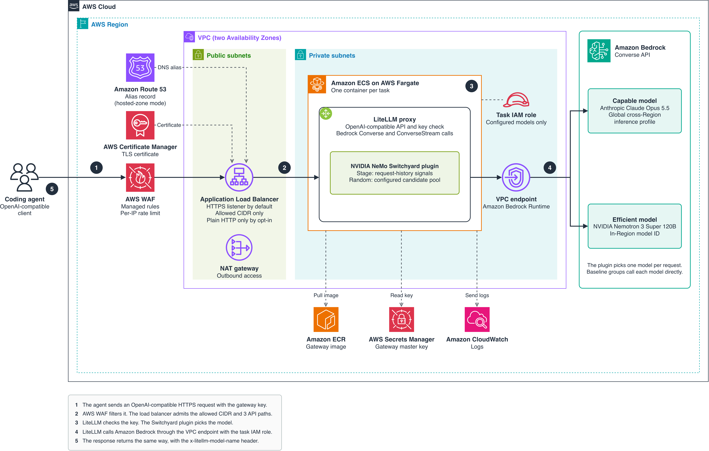

# 用 NVIDIA NeMo Switchyard 为编码 Agent 选择合适的模型（Route coding agent requests to the right model on Amazon Bedrock with NVIDIA NeMo Switchyard）

> 原文：[Route coding agent requests to the right model on Amazon Bedrock with NVIDIA NeMo Switchyard](https://aws.amazon.com/blogs/machine-learning/route-coding-agent-requests-to-the-right-model-on-amazon-bedrock-with-nvidia-nemo-switchyard/) · AWS · 2026-11-13
> 本文由 Kimi CLI 使用 Kimi K3-256k 全文翻译，并由 Agent 校对；已取得全文翻译和转载授权。
> 作者：Aswath Ram A Srinivasan、Anshika Saxena、Curt Lockhart、Ian Cairns、Kevon Mayers、Aris Tsakpinis

诸如 Claude Code 和 OpenAI Codex CLI 这样的编码智能体以任务为单位工作。开发者提出一项修改请求，智能体便读取文件、编辑代码并运行测试，直到工作完成。一个任务可能需要几次模型调用，也可能需要几十次。开发者付费的对象是任务，而不是单次调用。

仅凭每 token 的价格并不能告诉你一个完整任务的成本。总成本取决于模型需要多少个回合、每个回合重放多少历史上下文，以及任务需要重试的频率或最终未能完成的情况。你要为每一次尝试付费，包括那些从未完成的任务的尝试。因此，当你在多个模型之间路由编码智能体的请求时，应按“每个已解决任务的成本”来评判路由效果：即所有运行的总成本除以测试通过的运行次数。

[NVIDIA NeMo Switchyard](https://github.com/NVIDIA-NeMo/Switchyard) 是一个开源库，帮助 AI 智能体选择由哪个模型处理每个请求。你定义它可以使用的模型以及它遵循的策略。它的 [LiteLLM 集成](https://github.com/NVIDIA-NeMo/Switchyard/blob/21075c6652152dac88a5fbc6b878ca37d7617c1c/examples/litellm/README.md)支持两种策略。Stage 路由读取请求历史中最近的工具活动和结果，然后在两个候选模型中选择一个。Random 路由从配置的模型中（可选加权）进行选择，用于流量拆分和 A/B 对比。另一个值得探索的选项是 LiteLLM，它最近也发布了原生内置的 [Switchyard stage 路由器](https://docs.litellm.ai/blog/switchyard-tool-aware-routing)，作为一种自动路由策略。

在本文中，你将使用 AWS Cloud Development Kit（AWS CDK）在你的 AWS 账户中部署 LiteLLM——一个开源的大语言模型（LLM）网关——并配备 Switchyard 路由插件。LiteLLM 调用 [Amazon Bedrock](https://aws.amazon.com/bedrock/) 上的模型。然后，你将使用示例中的基准测试运行器，分别测量路由模型组和单模型基线组的每个已解决任务的成本，以便你能够针对自己的工作负载评估路由效果。

> **注意：** 本示例从 crates.io 安装 `switchyard-server` 0.3.0，并运行已发布的 LiteLLM v1.102.0 镜像。NVIDIA 将 `switchyard-server` 0.3.0 定位为演示和评估组件，其配置可能在各版本之间发生变化。本示例使用实验性的 Switchyard LiteLLM 集成，其配置和 API 可能在各版本之间发生变化。这是示例代码，仅供非生产环境使用。部署前请与你的安全和法务团队合作，以满足你所在组织的安全、监管和合规要求。请在非生产账户中部署该示例，并在依赖它之前进行测试。

## 解决方案概述

图 1 展示了该解决方案的架构。LiteLLM 和 Switchyard 插件运行在同一个容器镜像中，该容器部署在私有子网内 [AWS Fargate](https://aws.amazon.com/fargate/) 上的 [Amazon Elastic Container Service (Amazon ECS)](https://aws.amazon.com/ecs/) 中。

[](../../../assets/articles/762061e9584cb869/bd6d8ce7e02c3985d2f6d868.png)

图 1：解决方案架构

请求按以下步骤流转。编号与图中一致。

1. 编码智能体发送一个 OpenAI 兼容的请求，其中 model 字段设置为 `switchyard`（即由 Switchyard 路由的 LiteLLM 模型组），并在 `Authorization` 请求头中携带共享网关密钥。端点是你通过 HTTPS 访问的主机名，负载均衡器上配置了 [AWS Certificate Manager (ACM)](https://aws.amazon.com/certificate-manager/) 证书，并且只有你允许的 IPv4 CIDR 范围才能访问它。如果在 [Amazon Route 53](https://aws.amazon.com/route53/) 中有托管区域，Route 53 会将该主机名解析到负载均衡器。
2. [AWS WAF](https://aws.amazon.com/waf/) 使用 IP 信誉、已知恶意输入和按 IP 速率限制规则过滤请求。[Application Load Balancer](https://aws.amazon.com/elasticloadbalancing/application-load-balancer/) 仅将 `/v1/chat/completions`、`/v1/models` 和 `/health/liveliness` 转发到私有子网中的 ECS 任务，其他所有路径一律返回 404。
3. 该任务运行一个容器：内嵌 Switchyard 插件的 LiteLLM。LiteLLM 验证网关密钥并调用插件来选择模型。Stage 在一个能力强的模型和一个低成本的高效模型之间进行选择。它读取请求历史中的工具活动和结果，因此智能体必须发送完整的对话历史。Random 从一个加权池中选择。两种策略都不调用评判模型。
4. LiteLLM 通过 Amazon Bedrock 的 `Converse` 或 `ConverseStream` API 调用所选模型，使用任务的 [AWS Identity and Access Management (IAM)](https://aws.amazon.com/iam/) 角色提供凭证。该调用通过 [Amazon Virtual Private Cloud (Amazon VPC)](https://aws.amazon.com/vpc/) 中的 Amazon Bedrock Runtime 接口端点进行，因此推理流量始终留在 AWS 网络内。
5. 响应或 token 流经 LiteLLM 和负载均衡器返回。`x-litellm-model-name` 响应头指明实际作答的模型。响应体中的 `model` 字段保持为 `switchyard`。

LiteLLM 在容器内监听 4000 端口，是负载均衡器的目标，任务的安全组仅允许来自负载均衡器的访问。路径白名单使 LiteLLM 的管理 UI、API 文档和密钥管理路由不可达。[Amazon Elastic Container Registry (Amazon ECR)](https://aws.amazon.com/ecr/) 保存网关镜像。[AWS Secrets Manager](https://aws.amazon.com/secrets-manager/) 生成网关密钥背后的密钥，容器启动时会添加 `sk-` 前缀。任务定义通过 `LITELLM_CONFIG_TEXT` 和 `SWITCHYARD_CONFIG_TEXT` 传入配置文件，启动脚本在启动 LiteLLM 之前将它们写入 `/tmp`。日志发送到一个 [Amazon CloudWatch](https://aws.amazon.com/cloudwatch/) 日志组 `/<stack name>/litellm`，保留 30 天，Container Insights 负责收集指标。VPC 横跨两个可用区，一个 NAT 网关为镜像拉取和其他 AWS 服务提供出站访问。

该插件支持 Stage 路由（需要恰好两个候选）和 Random 路由（至少需要两个候选，并按权重拆分流量以进行 A/B 测试）。基于分类器的策略（如 Task 和 Composite 路由）需要中间模型调用，而此集成不支持。完整目录请参阅 [Switchyard 路由概述](https://nvidia-nemo.github.io/Switchyard/routing_algorithms/overview/)。

## 前提条件

要按照本演练操作，你需要：

- 一个非生产 AWS 账户，拥有 Amazon Bedrock 上 Claude Opus 5.5 和 NVIDIA Nemotron 3 Super 120B 的访问权限。该组合已在美国东部（弗吉尼亚北部）完成测试。对于其他 AWS 区域，请查看[按模型划分的区域可用性](https://docs.aws.amazon.com/bedrock/latest/userguide/models-region-compatibility.html)以及工具调用支持情况。
- 已配置凭证并明确指定 AWS 区域的 AWS Command Line Interface (AWS CLI) v2，且该账户和区域已[为 AWS CDK 完成引导（bootstrap）](https://docs.aws.amazon.com/cdk/v2/guide/bootstrapping-env.html)。
- Node.js 20 或更高版本、npm、带 BuildKit 的 Docker，以及 Python 3.11 或更高版本。
- 一个你拥有的主机名，并为其域名配置公共 Route 53 托管区域，或在部署区域中为其配置 ACM 证书。简短的纯 HTTP 测试两者都不需要。

## 演练

你将定义模型组、配置 Stage、部署并测试网关，然后测量成本。首先克隆示例仓库：

```bash
git clone https://github.com/aws-samples/sample-route-coding-agent-requests-Amazon-Bedrock-nemo-switchyard.git
cd sample-route-coding-agent-requests-Amazon-Bedrock-nemo-switchyard
```

### 第 1 步：在 LiteLLM 中定义模型组

LiteLLM 模型组是一个公共模型名称，背后对应一个或多个部署。示例将配置保存在 `profiles/` 下的部署配置档案中。每个配置档案将定义模型和网关设置的 `litellm.yaml` 与控制 Switchyard 如何选择模型的 `switchyard.toml` 配对。以下 `profiles/stage/litellm.yaml` 的摘录定义了被路由的 `switchyard` 组、两个单模型基线组以及插件注册：

```yaml
model_list:
  - model_name: switchyard
    litellm_params:
      model: bedrock/converse/global.anthropic.claude-opus-5-5
      aws_region_name: os.environ/AWS_REGION
  - model_name: switchyard
    litellm_params:
      model: bedrock/converse/nvidia.nemotron-super-3-120b
      aws_region_name: os.environ/AWS_REGION
  # One-model baseline groups, same model strings as the routed candidates.
  - model_name: claude-opus-5-5
    litellm_params:
      model: bedrock/converse/global.anthropic.claude-opus-5-5
      aws_region_name: os.environ/AWS_REGION
  - model_name: nemotron-super-3-120b
    litellm_params:
      model: bedrock/converse/nvidia.nemotron-super-3-120b
      aws_region_name: os.environ/AWS_REGION

# The same object selects a deployment and applies supported request changes.
router_settings:
  plugins:
    - switchyard_gateway.configured.ROUTING_PLUGIN
litellm_settings:
  callbacks:
    - switchyard_gateway.configured.ROUTING_PLUGIN
  drop_params: true
  request_timeout: 600
  num_retries: 2
general_settings:
  master_key: os.environ/LITELLM_MASTER_KEY
```

两个候选共享 `model_name: switchyard`，因此你的客户端发送 `"model": "switchyard"`，由 Switchyard 挑选候选。将能力强的模型列在前面，高效模型列在后面，因为 Stage 按此顺序读取角色。

`claude-opus-5-5` 和 `nemotron-super-3-120b` 组是单模型基线。每个组始终以自己的模型作答，因此你可以在同一部署中将路由组的成本和通过率分别与每个单独的模型进行比较。单独的 Stage 插件会拒绝没有两个候选的组，因此镜像注册了一个小型包装器 `switchyard_gateway.configured.ROUTING_PLUGIN`。它将 Switchyard 应用于具有两个或更多不同候选的组，并让单模型组直接通过。配置中注册了该包装器两次：一次用于选择模型，一次用于应用 Switchyard 记录的请求变更。

每个模型都使用 `bedrock/converse/<id>`，因此每个候选都通过 Amazon Bedrock 的 `Converse` API，验证会拒绝任何其他路由。LiteLLM 的 `request_timeout` 为 600 秒，与负载均衡器的 10 分钟空闲超时相匹配。

该文件不包含任何凭证。LiteLLM 从环境变量中读取网关密钥，AWS 凭证由任务角色提供。切勿在 `litellm_params` 下添加 `aws_access_key_id`、`aws_secret_access_key` 或 `api_key` 等凭证：堆栈会将整个 `litellm.yaml` 以明文形式复制到任务定义和 AWS CloudFormation 模板中。

堆栈从此文件派生任务角色的 Amazon Bedrock 权限。对于全球跨区域推理配置文件（inference profile），基础模型资源使用 `*` 区域和结尾的 `*`，因此它也会匹配具有相同前缀的其他模型 ID。部署前请检查派生的策略。

`global.` 前缀表示[全球跨区域推理配置文件](https://docs.aws.amazon.com/bedrock/latest/userguide/cross-region-inference.html)，Amazon Bedrock 可能会在全球支持的商用 AWS 区域处理这些请求。如果处理位置很重要，请改用地理区域配置文件或区域内模型 ID。对于 Nemotron 3 Super，配置文件使用区域内模型 ID `nvidia.nemotron-super-3-120b`，你可以将其换成任何模型进行测试。

### 第 2 步：配置 Stage 路由

Switchyard 从 `switchyard.toml` 读取其算法和设置。默认配置档案 `profiles/stage/switchyard.toml` 配置了 Stage：

```toml
# Model inventory is in litellm.yaml. This file configures selection behavior.
algorithm = "stage"
# Prefer the efficient candidate when history signals are inconclusive.
picker = "efficient_first"
confidence_threshold = 0.5
# Inspect the three most recent tool results for execution signals.
recent_window = 3
only_on_wrong_signal_escalation = true
```

各项设置的工作方式如下：

- `picker = "efficient_first"`：当历史记录中的信号无法得出结论时，Stage 使用高效模型。新请求还没有工具结果，因此会被发往 Nemotron 3 Super。
- `confidence_threshold`：Stage 为执行信号评分时的置信度阈值，取值范围为 0 到 1。
- `recent_window = 3`：Stage 检查最近的三个工具结果。
- `only_on_wrong_signal_escalation = true`：Switchyard 的默认值。它控制 Stage 何时添加可选的升级说明，而此配置文件不设置任何说明。

Stage 还接受可选的交接说明和分级系统提示（`escalation_note`、`deescalation_note`、`capable_system_prompt` 和 `efficient_system_prompt`）。示例配置文件均未设置这些内容。

对于 A/B 测试，`profiles/random/` 中的 Random 配置文件使用相同的模型，并设置 `algorithm = "random"` 和 `weights = [0.5, 0.5]`，按声明顺序为每个唯一候选项分配一个权重。要部署它，请在步骤 3 的 `cdk diff` 和 `cdk deploy` 命令中添加 `-c routingProfile=random`。

堆栈在合成时会一起验证这两个文件，预检脚本也会运行相同的检查。要单独检查配置文件的更改而不调用 AWS，请运行 `npm run validate:profile -- stage`。无效的设置会在 LiteLLM 启动时阻止它，不支持的消息结构会在推理之前失败。

### 可选：在本地运行网关

您可以在部署任何内容之前在自己的机器上试用网关。Docker Compose 会构建相同的镜像，并读取与堆栈部署到 Amazon ECS 时相同的配置文件。从仓库根目录运行：

```bash
npm ci
cp .env.example .env

export LITELLM_MASTER_KEY="sk-$(openssl rand -hex 24)"
eval "$(aws configure export-credentials --format env)"

ROUTING_PROFILE=stage docker compose up --build --wait
GATEWAY_URL=http://127.0.0.1:4000 ROUTING_PROFILE=stage scripts/smoke-test.sh
```

您导出的密钥优先于 `.env` 中的占位符，因此 Compose 和冒烟测试使用同一个密钥。AWS 凭证仅来自您的 shell，绝不会写入 `.env` 或配置文件。Compose 仅在 `127.0.0.1` 上发布网关。本地没有负载均衡器，因此冒烟测试会跳过其封闭路径检查。本地网关仍会调用 Amazon Bedrock，这些调用会产生费用。完成后，运行 `docker compose down`。

### 步骤 3：部署网关

网关在您拥有的主机名上提供 HTTPS 服务。将 `GATEWAY_DOMAIN` 设置为该主机名，并将 `HOSTED_ZONE` 设置为包含该主机名的现有 Route 53 公有托管区。然后，AWS CDK 会创建经过 DNS 验证的 ACM 证书和别名记录。从仓库根目录安装依赖项、运行只读预检检查并部署：

```bash
npm ci

export AWS_REGION=us-east-1
export AWS_DEFAULT_REGION="$AWS_REGION"
eval "$(aws configure export-credentials --format env)"
export CDK_DEFAULT_REGION="$AWS_REGION"
export CDK_DEFAULT_ACCOUNT="$(aws sts get-caller-identity --query Account --output text)"
export ALLOWED_CIDR="$(curl -4 -fsS --connect-timeout 5 --max-time 15 https://checkip.amazonaws.com)/32"
export GATEWAY_DOMAIN=llm-gateway.example.com
export HOSTED_ZONE=example.com

scripts/preflight.sh
npx cdk diff -c allowedCidr="$ALLOWED_CIDR" \
  -c domainName="$GATEWAY_DOMAIN" -c hostedZone="$HOSTED_ZONE"
npx cdk deploy -c allowedCidr="$ALLOWED_CIDR" \
  -c domainName="$GATEWAY_DOMAIN" -c hostedZone="$HOSTED_ZONE"
```

如果您的域名 DNS 不在 Route 53 中，请改用现有的 ACM 证书。将 `CERTIFICATE_ARN` 设置为部署区域中该主机名的 ACM 证书，并在两个命令中将 `-c hostedZone="$HOSTED_ZONE"` 替换为 `-c certificateArn="$CERTIFICATE_ARN"`。这样 AWS CDK 就不会创建证书和 DNS 记录。部署完成后，创建一条 CNAME 记录（或 Route 53 别名），将主机名指向 `LoadBalancerDnsName` 输出。

必需的 `allowedCidr` 值限制哪些网络可以访问负载均衡器，该命令将其设置为您当前的公有 IPv4 地址。请将其保持为您自己的 `/32`：共享允许地址的所有人（例如办公室 NAT 或 VPN 出口）都可以访问该端点。如果没有 `allowedCidr`、使用诸如 `0.0.0.0/0` 这样对全世界开放的范围，或使用 IPv6 范围，堆栈将拒绝合成。

预检会检查配置、您的工具以及您的 AWS 访问权限，包括对配置文件中每个模型的访问权限，但不会发出推理请求。AWS CDK 构建网关镜像，将其发布到 Amazon ECR，并部署堆栈。部署会打印以下输出：

|  |  |
| --- | --- |
| **输出** | **含义** |
| GatewayUrl | 基础 URL。与 OpenAI 兼容的 API 位于 `/v1` 之下。 |
| MasterKeySecretArn | 网关密钥背后的 Secrets Manager 密钥。完整密钥为 `sk-` 加上密钥值。 |
| MasterKeyCommand | 打印网关密钥的命令。 |
| SmokeTestCommand | 冒烟测试命令，已填入堆栈名称、区域和配置文件。 |
| RoutingProfile | 当前生效的路由配置文件，默认为 stage。 |
| ClusterName、ServiceName | ECS 集群和服务。密钥轮换步骤会用到它们。 |
| LoadBalancerDnsName | 仅在使用 certificateArn 时出现：您的主机名应指向的名称。 |

始终向客户端提供 `https://` URL。端口 80 保持开放仅用于重定向到 HTTPS；当重定向到达时，配置为 `http://` 的客户端已经以明文发送了密钥及其第一个请求。

负载均衡器的空闲超时为 10 分钟，以容纳耗时的智能体响应。Web ACL 使用 Amazon IP 信誉列表和已知恶意输入规则组。它还将每个 IP 地址限制为每 5 分钟 2,000 个请求。它省略了针对跨站脚本、SQL 注入和正文大小的通用正文规则，因为智能体请求中的源代码会触发这些规则。`allowedCidr` 范围和网关密钥仍然适用。

**通过纯 HTTP 快速测试。** 如果没有 HTTPS 设置，合成会报错并停止。对于没有域名的短期测试，您可以选择在负载均衡器的 DNS 名称上启用纯 HTTP：

```bash
npx cdk deploy -c allowedCidr="$ALLOWED_CIDR" -c allowPlainHttp=true
```

使用 `allowPlainHttp=true` 时，AWS CDK 每次合成堆栈都会打印警告。`Authorization` 标头中的网关密钥、您的提示、您的智能体发送的工具结果和源代码，以及模型响应，都会在您的客户端与负载均衡器之间以未加密的方式穿越网络。请仅将此选项用于来自您自己的 `/32` 的、涉及非敏感代码的短期测试。之后轮换密钥，并在完成后运行 `cdk destroy`。若要将同一堆栈稍后迁移到 HTTPS，请使用 HTTPS 设置并去掉 `allowPlainHttp` 重新部署。

### 步骤 4：测试网关

在您用于部署的同一终端中，读取 [AWS CloudFormation](https://aws.amazon.com/cloudformation/) 堆栈输出并构建网关密钥：

```bash
export STACK_NAME=SwitchyardGateway

output() {
  aws cloudformation describe-stacks --region "$AWS_REGION" --stack-name "$STACK_NAME" \
    --query "Stacks[0].Outputs[?OutputKey=='$1'].OutputValue" --output text
}

export GATEWAY_URL="$(output GatewayUrl)"
export LITELLM_MASTER_KEY="sk-$(aws secretsmanager get-secret-value --region "$AWS_REGION" \
  --secret-id "$(output MasterKeySecretArn)" --query SecretString --output text)"
```

向 `switchyard` 模型组发送一个请求：

```bash
curl -sS -i --connect-timeout 10 --max-time 180 "$GATEWAY_URL/v1/chat/completions" \
  -H "Authorization: Bearer $LITELLM_MASTER_KEY" \
  -H "Content-Type: application/json" \
  -d '{"model":"switchyard","messages":[{"role":"user","content":"Reply with the word hello."}],"max_tokens":128}'
```

查看是否返回 HTTP 200 和响应。`x-litellm-model-name` 响应标头以完整的 LiteLLM 模型字符串显示所选模型。新请求没有可供评分的工具结果，因此 Stage 会选择高效模型 `bedrock/converse/nvidia.nemotron-super-3-120b`。

要检查健康状态、身份验证和路由，请运行冒烟测试：

```bash
ROUTING_PROFILE="$(output RoutingProfile)" scripts/smoke-test.sh
```

冒烟测试会检查健康端点、诸如 `/ui` 之类的封闭路径是否获得负载均衡器自身的 404、没有密钥的请求是否得到 401，以及 `/v1/models` 是否列出每个模型组。对于 Stage，它会检查普通请求是否选择了高效模型，以及一段记录的反复失败历史是否会升级到强大模型。然后它向每个基准组发送一个请求。该请求和冒烟测试会产生计费的 Amazon Bedrock 调用。

要试用您自己的智能体，请将 `$GATEWAY_URL/v1` 用作其与 OpenAI 兼容的基础 URL，将网关密钥用作其 API 密钥，并将 `switchyard` 用作模型。Stage 需要每个请求都携带完整的受支持请求历史。上游适配器支持文本消息、函数工具调用和文本工具结果，不支持的消息结构会在推理之前失败。负载均衡器转发 Chat Completions 路径，但不转发 OpenAI Responses 或 Anthropic Messages 路径。使用这些 API 的客户端会得到 404，直到您添加该路径、针对本地容器进行测试并重新部署为止。

### 步骤 5：衡量每个已解决任务的成本

示例的编码运行器 `bench/run.py` 允许一个小型编码智能体通过网关列出和读取文件、替换源文件并运行随附的单元测试。当任务的测试在最后通过时（默认在六个模型轮次以内），该任务即视为已解决。列出任务，并从路由组上的 `slugify` 开始：

```bash
python3 bench/run.py --list-tasks
python3 bench/run.py --tasks slugify --model switchyard --max-turns 6
```

终端会显示任务、所选模型、工具操作、测试结果和最终代码差异。每次运行都会将其起始文件、最终工作区、对话记录、补丁和结果保存在 `bench/results/` 下。

|  |  |
| --- | --- |
| **任务** | **智能体必须做什么** |
| slugify | 修复一个构建 URL slug 的短函数。 |
| roman | 编写一个将整数转换为罗马数字的函数。 |
| calc | 编写一个不使用 `eval` 的表达式解析器，支持优先级、幂运算符、函数和错误处理。 |
| lru\_ttl | 编写一个线程安全的最近最少使用（LRU）缓存，支持按条目过期和精确计数器。 |

为了给算术解析器任务留出运行测试和尝试修复的空间，请提高轮次上限：

```bash
python3 bench/run.py --tasks calc --model switchyard --max-turns 12
```

运行结束后，运行器会为每个模型组打印一行，包含 RUNS、SOLVED、ERRORS、COST/TASK 和 COST/SOLVED 列。每个已解决任务的成本是某组上所有运行的估计成本除以测试通过的运行数。运行器根据响应中的 `x-litellm-model-name` 标头所示的模型和令牌用量，使用 `bench/run.py` 中的 PRICES 表为每个轮次定价。带有缓存输入的轮次、没有 PRICES 条目的模型，或缺少标头或令牌计数的响应，会保持未定价状态，而不是计为零。当您向配置文件添加模型时，请添加 PRICES 条目，并查看 [Amazon Bedrock 定价](https://aws.amazon.com/bedrock/pricing/) 了解当前价格。在两个任务上运行几次可以演示工作流程，但不足以就成本或质量得出结论。

当某个组的任何一次运行未定价时，该组会显示 n/a 并注明原因；当没有任何运行被解决时，COST/SOLVED 显示 `-`。要了解成本花在了哪里，请检查各个轮次：终端会打印为每个轮次服务的模型，`bench/results/` 下的对话记录也会记录它。

要比较完整对话，`bench/multiturn.py` 会在每个编码任务上运行一个智能体式循环，在第一个提示中包含项目文件，并在每次编辑后反馈测试输出。它还会运行四个七轮次的脚本化聊天，在简单轮次与设计、调试和代码编写轮次之间交替，并在每个轮次重放完整历史。带有低成本检查（预期文本、字数限制、项目符号或针对返回函数的断言）的轮次会记录检查是否通过。设计类响应不予评分。

```bash
python3 bench/multiturn.py --tasks slugify --scripts backend api --max-spend 2
```

`--max-conv-cost` 选项（默认 1 美元）限制每次对话的成本，`--max-spend` 阻止运行器启动新对话。摘要会针对每个模型组显示通过的编码对话数、通过的聊天检查数，以及每次编码对话、每次聊天和总计的估计成本。

运行器会在您的机器上执行模型编写的 Python 代码。运行测试的子进程环境中没有凭证，但它不是操作系统沙箱：代码可以读取您的用户可读取的任何文件，并可以访问网络。请使用磁盘上没有长期 AWS 凭证的一次性开发环境，并保护 `bench/results/` 下的文件，其中包含提示、模型响应、工具输出和生成的代码。

## 解读您的结果

示例中的任务规模较小，仅用于演示。要判断路由是否适合您的工作负载，请将其替换或扩展为能代表您自身代码库的任务，并在阅读运行器的输出时牢记以下几点。

- **先看 SOLVED，再看 COST/SOLVED ——** 一个解决任务较少的组可能显示出较低的 COST/TASK，但每个已解决任务的成本仍然更高，因为失败的运行会增加成本却不会增加已解决任务的数量。只有在比较了每个组分别解决了多少任务之后，再将路由组的 COST/SOLVED 与每个基线组进行比较。
- **单独查看困难任务 ——** 汇总数字可能会掩盖某个驱动整体结果的单一任务。请按任务拆分结果。Stage 根据历史记录中的失败情况做决策，因此它无法提前将困难任务路由到能力更强的候选模型。升级轮次还会重放整个失败的尝试，这可能使一次恢复的成本高于从一开始就使用能力更强的候选模型的运行。如果少数困难任务主导了您的成本，可以考虑将它们路由到一个专门的模型组，或者选择一个能解决更多此类任务的高效候选模型。
- **运行足够多次重复 ——** 模型输出在每次运行之间会有所波动。每个组只运行几次时，一两个已解决任务的差异可能只是噪声。增加 `--repeats`，直到您所关心的差异趋于稳定，并在根据差距采取行动之前应用统计检验，例如对解决率使用 Fisher 精确检验。
- **考虑轮次上限 ——** 较低的 `--max-turns` 值会对先探索再编辑的模型不利，因为它留给修复失败编辑的轮次更少。请将该上限设置为与您实际运行智能体的方式相匹配。
- **考虑输出上限 ——** 如果某个组的回复触及 `max_tokens`，测得的成本就是下限，而且被截短的回复也会缩短后续轮次所重放的历史记录。在比较聊天成本之前，请检查转录记录中是否存在被截断的回复。
- **将成本视为估算值 ——** 运行器根据 token 用量和 PRICES 表估算成本，而不是根据您的账单。提示缓存、批量推理和定价变化都会影响您的实际成本。请通过 [Amazon Bedrock 定价](https://aws.amazon.com/bedrock/pricing/) 和您的 AWS 成本与用量报告进行确认。
- **测试您计划实际运行的设置 ——** 结果仅适用于您所测量的模型、配置文件设置和任务。如果您更改了候选模型、Stage 设置，或切换到 Random 配置文件，请重新测量。

利用这些解读为每种工作负载在三个选项中做出选择：路由组、单模型组，或具有不同候选模型或设置的配置文件。当您更改模型、提示词或智能体行为时，请重新运行相同的测量。

## 清理

为避免持续产生费用，请删除该堆栈。AWS CDK 需要一个 `allowedCidr` 值来合成应用程序，但在这里该值无关紧要：

```bash
npx cdk destroy -c allowedCidr=203.0.113.0/24
```

CloudFormation 会删除主密钥且没有恢复窗口，因此如果您需要该密钥，请先将其复制。网关镜像仍保留在 Amazon ECR 的 AWS CDK 引导存储库中。

## 结论

在本文中，我们展示了如何在 AWS 上部署带有 NVIDIA NeMo Switchyard 路由插件的 LiteLLM，如何跨 Amazon Bedrock 上的模型配置 Stage 和 Random 路由，以及如何与单模型基线一起测量路由模型组每个已解决任务的成本。由于智能体任务的总成本取决于轮次、历史记录和重试，仅凭 token 单价并不是可靠的判断依据。在您自己的任务上测量每个已解决任务的成本，能为您提供选择配置的证据。

要开始使用，请在开发账户中部署[示例存储库](https://github.com/aws-samples/sample-route-coding-agent-requests-Amazon-Bedrock-nemo-switchyard)，并在来自您自身工作负载的任务上测量 Stage 路由和单模型基线。要了解更多信息，请参阅 [Switchyard LiteLLM 插件指南](https://github.com/NVIDIA-NeMo/Switchyard/blob/main/examples/litellm/README.md)和《[Amazon Bedrock 用户指南](https://docs.aws.amazon.com/bedrock/latest/userguide/what-is-bedrock.html)》。欢迎在评论区分享您的问题。

---
