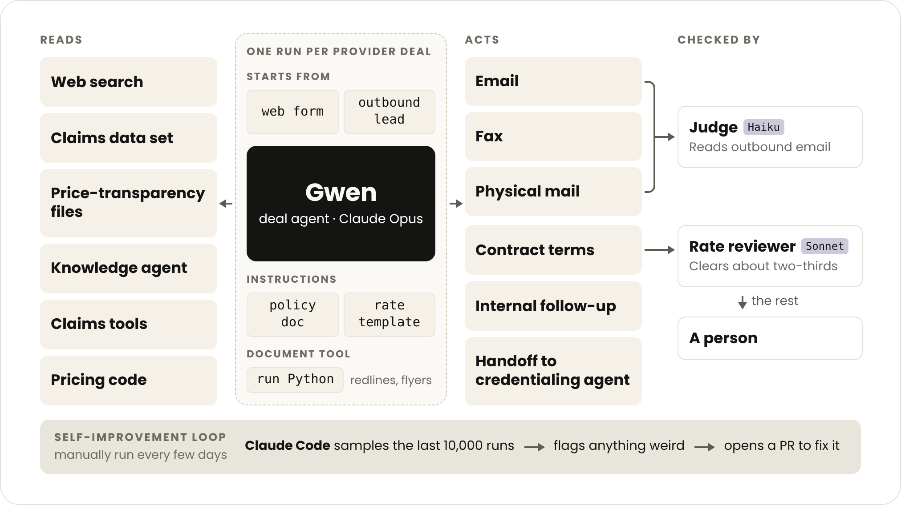
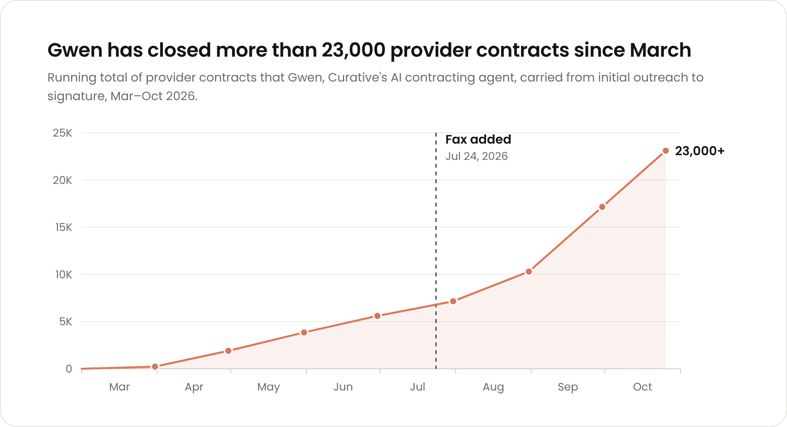

# Curative 如何借助 Claude 上的智能体构建全国医疗服务提供者网络（How Curative is building a national provider network with agents on Claude）

> 原文：[How Curative is building a national provider network with agents on Claude](https://claude.com/resources/articles/how-curative-is-building-a-national-provider-network-with-agents-on-claude) · Anthropic · 2026-11-10
> 本文由 Kimi CLI 使用 Kimi K3-256k 全文翻译，并由 Agent 校对；已取得全文翻译和转载授权。
> 作者：Camy Pearson、Michael Segner

Curative 如何构建基于 Claude 的智能体层级体系，使签约医疗服务提供商合同的速度比其团队在 2025 年快了约 50 倍。

*在我们的系列报道《初创公司如何用 Claude 构建》中，我们展示初创公司如何借助 AI 变革各自所在的行业。本文将分享 Curative 如何构建一套基于 Claude 的智能体层级体系，使其签约医疗服务提供商合同的速度比其团队在 2025 年快了约 50 倍。*

| 一句话速览 |  |
| --- | --- |
| 名称 | Curative |
| 成立时间 | 2020 年；于 2022 年推出健康保险计划 |
| 创始人 | Fred Turner（CEO）、Isaac Turner（CTO）、Tami Wilson-Ciranna（总裁） |
| 技术栈 | Claude Platform、Claude Code、自研理赔系统 |
| 增长情况 | [以 12.75 亿美元估值完成 1.5 亿美元 B 轮融资。拥有超过 16.5 万名会员和 1,200 多家雇主客户](https://www.businesswire.com/news/home/20251202857803/en/Curative-Raises-$150-Million-in-Series-B-Funding-to-Redefine-the-Future-of-Health-Insurance)（2025 年 12 月）。Gwen 已签署 23,000 份医疗服务提供商合同。每周新增 2,000 至 2,400 份合同，而 2025 年全年仅签下 2,100 份。 |

[Curative](https://curative.com/) 向雇主销售健康保险，会员完成一次 Baseline Visit（基线就诊）后，网络内就诊的自付额（copay）和免赔额（deductible）均为 0 美元。Curative 并非从保险业起家。它最初是一家实验室初创公司，根据其内部估算，最终处理了全美 10% 的 COVID-19 检测。因此，他们开始与全美几乎所有保险公司合作。

公司的英国创始人习惯于患者无需为医疗付费的体系，他们看到了其中的低效之处，于是着手打造一家以预防为核心的支付方（保险公司）。他们后来意识到，自己严重低估了构建全国性医疗服务网络的难度。

“有时候，天真对初创公司是好事，因为你不知道这件事是不可能的。然后在过程中你会想出办法，让它变得并非不可能，”Curative CEO Fred Turner 说。“去年我们签了 2,100 份合同，是前年的两倍，但按每年 2,000 份的速度，我们意识到这仍然需要 30 年才能建成。全国性网络之所以屈指可数、而且全都是大约 30 年前建成的，是有原因的。”

Curative 需要加速合同签署，但仅靠招人无法填补如此大的缺口。

他们的解决方案是：Gwen，一个负责从初次接洽到签署完成、全程跟进单笔医疗服务提供商交易的智能体，周围环绕着更小的智能体——负责审查费率、检查消息、回答问题，并把非标准定价上报给人类。

以下是他们构建这套系统的过程，以及途中遇到的问题。

## **Gwen：医疗服务提供商合同智能体**

Gwen 同时处理主动上门（inbound）和主动外拓（outbound）的线索。Gwen 的每次运行只处理一家医疗服务提供商，主要运行在 Claude Opus 上，因此其他交易的任何信息都不会影响它。

例如，如果一家诊所在 Curative 网站上填写了表单，Gwen 会对该诊所进行调研，并基于购买的理赔数据集以及支付方如今依法必须公布的价格透明文件，回复一份费率提案。Gwen 会向提供商展示这些市场费率数据，以协助谈判。

费率审查器运行在 Sonnet 上。当 Gwen 想要突破其标准费率模板时，它会写明理由，由审查器决定该费率是否合理。

“很长一段时间里有一个庞大的审批队列——只要 Gwen 想把费率提高到超出模板一定幅度，就必须获得批准，但随时间推移我们放宽了限制。让第二个智能体审查费率，比直接给 Gwen 更大的权限效果更好，”Fred 说。

Sonnet 费率审查器会放行 Gwen 大约三分之二的请求，其余所有非标准请求都会交给 Fred 审批。

“我看到的请求要么来自大型医疗集团，要么是一些古怪的请求——即使这不是由智能体主导的流程，这些也还是会送到我这里，”Fred 说。

外拓交易需要更多坚持，因为诊所都很忙。有些提供商是在收到第十四封邮件、第九份传真之后才回复的。

图片经 Curative 授权使用。

一个运行在 Haiku 上的评判器（judge）会在每条消息发出前进行审阅。Curative 之所以加上它，是因为 Gwen 曾把关于“出价上限可以到多高”的内部备注抄送给了提供商。被拦截的消息会连同原因一起退回，这样 Gwen 可以改写后再次尝试。

每份合同大约需要消耗 2,000 万 token 才能完成，大约是原始成本的十分之一。这些效率提升支撑了 Curative 的核心战略之一：签约那些常被大型网络忽视的小型提供商。

“无论你是大型医院系统还是单人执业的医生，智能体都会非常乐意给予同等程度的关注，”Fred 解释道。“从这个智能体的视角看，这家提供商就是它唯一的关注点。”

在谈判过程中，Gwen 会将诊所的修订意见（redline）与 Curative 的政策文档进行核对，然后编写 Python 代码，把双方的修改合并成最终文档。

从填写表单到签署完成，整个流程最快可以在一小时内完成。合同签署后，一个独立的资质认证（credentialing）智能体会核查该提供商的执业许可证，其他智能体则载入提供商的数据和合同，以便理赔能够据此定价。

自 Gwen 上线以来，Curative 的签约团队从 45 人增长到约 55 人，每个人的产出效率约为原来的 2.5 倍。他们把陌生外呼和文书工作交给 Gwen，自己则通过电话跟进已有意向的线索。Curative 对 Gwen 促成的交易同样向签约团队支付报酬，因此人类和智能体共享同一个目标。

“人们的工作变得更侧重于关系维护，而不是文书工作，”Fred 说。

Fred 还认为，更快的签约流程有助于小型诊所保持独立。“如果你开了一家诊所，而加入网络并完成资质认证需要三个月，那你这三个月就拿不到任何报酬，”他说。

Gwen 并非 Curative 唯一的智能体。Brad 是另一个基于 Opus 的智能体，主要通过保险经纪人向雇主销售 Curative 的保险计划。Brad 会就每份报价跟进经纪人，并从过去需要核保人员手工清理的电子表格中提取员工数据，帮助核保人员加快工作速度。

借助人机协作团队，Curative 现在可以在 30 分钟内回复通过电子邮件或传真发来的理赔争议，并附上一封针对该笔理赔的专属信函。“过去回复理赔争议大约需要 90 天，现在通过电子邮件或传真 30 分钟内就能完成，”Fred 说。“大多数支付方使用一组邮件合并拼接起来的模板。这会让提供商非常不满，因为模板通常并没有真正解释清楚发生了什么。现在提供商收到的是一封定制信函，说明该笔具体理赔的细节、发生了什么以及原因。”

他们的所有智能体都运行在经过定制的理赔、事先授权（prior authorization）和财务系统之上，这些系统由 13 名工程师今年借助 Claude Code 重建。该团队曾估算，仅构建一套理赔系统就需要 100 个工程师年。

“我们并不是想把（这些智能体）插进一个理赔系统里，”Fred 说。“这个理赔系统就是运行在 AWS 上的 Python，它有 MCP，也有 API，而且是 Claude 写的，所以它理解这个系统。”

## **Curative 在构建“与人谈判的智能体”中学到的经验**

以下是 Curative 团队在如何构建与人谈判的智能体方面总结的经验。

- **从一个通用工具开始。** “我们一开始想的是，‘哦，我们得给它配一堆工具’，但效果并不好，因为合同修订（redlining）相当复杂，”Fred 说。“我们发现最有效的做法是让模型只拥有一个工具——运行 Python——然后它用一个 docx 库完成所有修订工作。效果非常好。”
- **在人们习惯的渠道上与他们接触。** 一个传真工具让 Gwen 的成交率翻了一倍多。如今许多提供商会在打印出来的传真上手写回复，再传真回来。“这就是在人们所在的地方与他们相遇，”Curative CTO Isaac Turner 说。“没错，他们有电子邮件，但他们真正习惯的是传真。”
- **让每次运行保持隔离。** 每次 Gwen 运行只看到一家提供商，且跨交易不保留记忆。Curative 的销售智能体 Brad 确实保留记忆，这样做可行，但需要小心。“你可能最终记下错误的笔记，然后陷入‘厄运循环’——它带着一条永远无法清除的错误记忆，”Fred 指出。
- **从运行之外改进系统。** 每隔几天，Fred 会给 Claude Code 同一个提示：抽样最近 10,000 次运行，标记任何异常情况，并提交一个修复 PR。“改进循环来自于让 Claude Code 处理大量历史对话，并追问当时怎样才能做得更好，”他说。
- **先在远离 PHI 的环境做实验。** 在很长一段时间里，Gwen 被禁止接触受保护健康信息（PHI），因此早期的错误都发生在风险较低的场景中。如今凡涉及 PHI 的智能体，后端控制会限制哪些信息能进入对话，并且智能体的活动会被记录以供审计。“我们先在那里学会了怎么做，然后把经验迁移到了 PHI 领域，”Fred 说。签署商业伙伴协议（BAA）——即 HIPAA 要求供应商在处理 PHI 之前必须签订的合同——也变得更容易了。“Anthropic 尤其做得好，能非常快地推出符合 HIPAA 要求的最新服务版本，”Isaac 说。“尽管身处受监管的行业，我们还是能够非常快地采用这些新技术。”
- **留意智能体自发开始做的事情，确保它符合你的风险偏好。** 当提供商想要一份可供内部分享的宣传单时，Gwen 用它的 Python 工具做了一份——没有任何政策指示它这样做。当一名会员在网络内诊所被前台拒之门外时，Gwen 要求诊所培训其员工，随后还核实了该会员是否顺利就诊。

## **Curative 的下一步**

接下来，Curative 计划把智能体引入就医导航（care navigation），延伸现有 130 名为会员提供指导和辅导的团队成员的服务半径。

Fred 预计提供商一侧也会出现智能体。目前相当大比例的理赔争议函件似乎已经是智能体撰写的，他希望提供商也能用智能体来谈判合同。“存在一个市场出清价格，你越快找到这个出清价格，所有人就能越快回归提供医疗服务的本职，”他说。

| 来自 Curative 团队的最佳实践 |  |
| --- | --- |
| 智能体一开始应该被赋予多大的权限？ | 比你认为它能胜任的要少。Gwen 最初对任何超出模板的费率都设置了人工审批队列。Curative 先是针对更具确定性的决策逐步放宽了限制，随后又增加了费率审核员，而 Fred 仍会审批费率审核员未能通过的内容。 |
| 当智能体出错时会发生什么？ | 对此做好预案，并与替代方案进行比较。"标准并不是完美，"Isaac 说，"标准应该是：如果你让一千个人来签合同，他们会犯多少个让你后悔的错误？" |
| 如何审计数十万条消息？ | 记录所有内容，为每条外发消息配备一个评判智能体，并让 Claude Code 对运行记录进行抽样检查。 |

*现在就开始使用 [Claude 平台](https://platform.claude.com)进行构建吧。*
