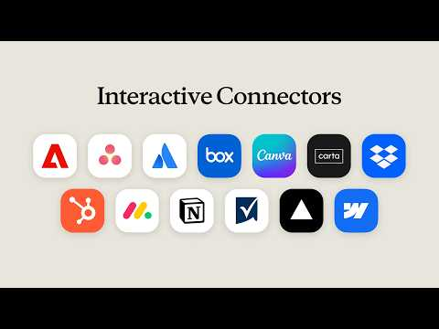
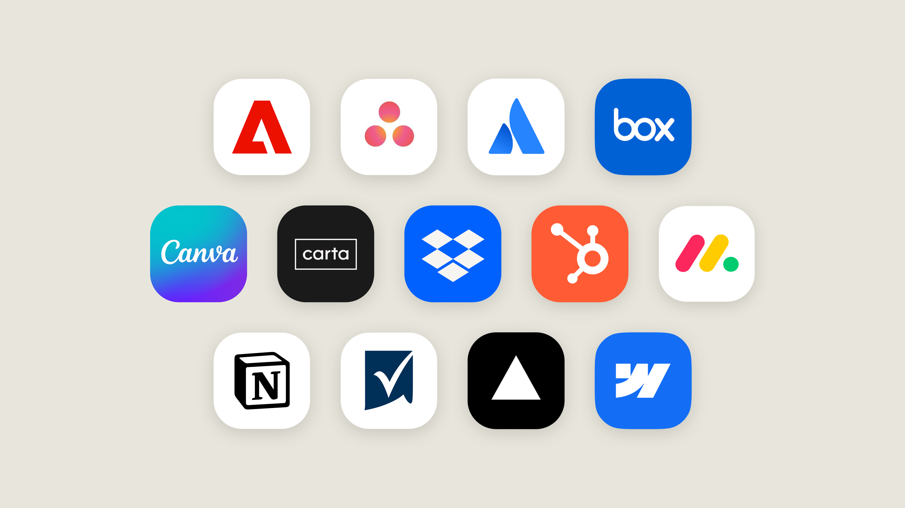

# 您的应用现在可以在 Claude 中打开，Claude 也能在其中工作（Your apps can now open in Claude, and Claude can work in them）

> 原文：[Your apps can now open in Claude, and Claude can work in them](https://claude.com/resources/articles/interactive-connectors-full-tool) · Anthropic · 2026-11-10
> 本文由 Kimi CLI 使用 Kimi K3-256k 全文翻译，并由 Agent 校对；已取得全文翻译和转载授权。

在连接器支持的情况下，交互式连接器现在可以在你的聊天旁边打开，或以全屏方式打开，这样你和 Claude 就能在同一个工具中协同工作。

今年早些时候，我们推出了[交互式连接器（在新标签页中打开）](https://claude.com/resources/articles/interactive-tools-in-claude)，将工具的实时小视图带入 Claude。从今天开始，在连接器支持的情况下，你可以在对话旁边打开一个工具，或将其扩展为全屏，并让 Claude 与你并肩工作、直接进行更改。

此功能正在网页版和 Claude 桌面应用上向所有套餐逐步推出，属于[全新 Claude 体验（在新标签页中打开）](https://claude.com/resources/articles/cowork-is-now-claude)的一部分，该体验将聊天与 Cowork 融为一体。当你的账户升级到新版 Claude，或你的组织启用该功能后，你就会看到这些特性。

*Claude 在 Confluence、Adobe 和 Box 中工作，编辑文档、照片和平面图。（在线内容）*

[Claude 在 Confluence、Adobe 和 Box 中工作，编辑文档、照片和平面图。（在线内容）](https://www.youtube-nocookie.com/embed/Gy1jSeSzAhk?enablejsapi=1&rel=0&playsinline=1&modestbranding=1)

新功能包括：

- **Claude 可以在你打开的工具中工作。** 你可以让 Claude 对你打开的页面、数据行或文件进行更改，并以与批准连接器操作相同的方式批准它的操作。更改会随着 Claude 的操作实时显示在工具中，因此你可以与它并肩继续工作。
- **整个工具** **在你的对话旁边打开。** 你可以在工具中工作，需要空间时隐藏聊天或切换为全屏。对于 Confluence 或 Notion 这样的工具，这意味着你可以使用登录了自己账户的完整编辑器，而不是功能受限的预览。
- **无需编写 Claude 提示词，即可直接打开已连接的工具。** 当你需要 Claude 的帮助时，可以在同一屏幕上直接提问。
- **固定你最常用的工具。** 你可以将它们与你的 [artifacts](https://claude.com/resources/articles/sheets-whiteboards-data) 排列在一起，并通过侧边栏和 + 菜单一键访问。

## 在你使用的工具中与 Claude 协作

我们正从目录中的一小部分工具开始，包括 Asana、Canva、Carta、Dropbox、monday.com、Smartsheet、Vercel 和 Webflow。

以下是你可以使用 Claude 中目前已有的一些工具做的事情：

- **Adobe。** 让 Claude 修饰、编辑照片并添加特效；高亮、编辑和遮盖 PDF。
- **Atlassian。** 在聊天旁边打开一个 Confluence 页面，让 Claude 撰写和编辑，并在页面上实时查看它的更改。
- **Box。** 在聊天旁边打开一个 Box 文件，让 Claude 修改它，并在保留更改之前并排比较各个版本。
- **HubSpot。** 确定销售管道任务和后续跟进事项的优先级，然后在 Claude 中执行它们。
- **Notion。** 让 Claude 创建 Notion 文档或数据库。边聊天边构建，或自己动手编辑，无需离开 Claude。

Figma、Harvey 和 Shopify 也正在构建集成，我们鼓励其他开发者同样加入。

## 面向开发者：基于 MCP Apps 构建

交互式连接器运行在 MCP Apps 之上，MCP Apps 是 [Model Context Protocol（在新标签页中打开）](https://modelcontextprotocol.io/docs/getting-started/intro)的开放扩展，允许 MCP 服务器将自己的界面带入 AI 应用。你构建的 MCP App 并不局限于 Claude，它可以在任何支持该[扩展（在新标签页中打开）](https://modelcontextprotocol.io/extensions/apps/overview)的 AI 应用中运行。

到目前为止，Claude 中的 MCP Apps 主要以对话中的交互式视图形式出现。Claude 现在支持该扩展的更多能力，例如应用工具（app tools）以及嵌入式站点，因此开发者的完整应用可以在 Claude 内部运行。

这些能力的支持目前处于面向开发者的公开预览阶段。开发者从今天起就可以开始使用它们进行构建。阅读我们的[文档（在新标签页中打开）](https://claude.com/docs/connectors/building/mcp-apps/getting-started)开始构建。

## 开始使用

你可以从[目录（在新标签页中打开）](https://claude.ai/directory/featured/interactive-connectors)连接我们上面提到的工具，然后从聊天中打开任何工具，或将其固定到侧边栏。

**面向管理员：** 如果你的组织已经允许某个连接器的所有工具，其新功能会随着推出而出现。管理员可以像今天一样限制某个连接器的工具。
