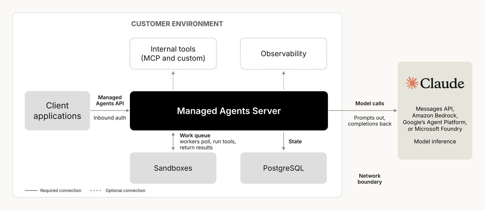

# 在您的安全边界内运行 Claude 托管智能体（Operate Claude Managed Agents inside your security perimeter）

> 原文：[Operate Claude Managed Agents inside your security perimeter](https://claude.com/resources/articles/self-hosted-claude-managed-agents) · Anthropic · 2026-11-12
> 本文由 Kimi CLI 使用 Kimi K3-256k 全文翻译，并由 Agent 校对；已取得全文翻译和转载授权。

隆重推出私有测试版自托管 Claude Managed Agents。现在，您可以在自己的环境中运行 Agent——无论是您自己的云环境还是本地部署环境。

[自托管 Claude Managed Agents](https://platform.claude.com/docs/en/managed-agents/self-hosted) 现已推出私有测试版。开发者可以构建直接在公司代码和内部系统中工作的 Agent，并在自己的环境中运行这些 Agent。

自托管是运行 [Managed Agents](https://claude.com/platform/claude-managed-agents) 的一种新方式。Managed Agents 是一套可组合的 API，用于构建和部署自主 Agent。Managed Agents 提供 Agent 运行框架（harness）、沙箱、凭据处理和会话历史记录，帮助长时间运行的 Agent 投入生产环境。

## 在您自己的环境中运行 Agent 控制平面

我们最初在 Claude 平台上将 Managed Agents 作为托管服务推出，由 Anthropic 为您运行基础设施。对于需要将代码保留在自己环境中的团队，我们又增加了[自托管沙箱](https://platform.claude.com/docs/en/managed-agents/self-hosted-sandboxes)。

从那时起，Agent 变得更加强大，开始承担更关键的工作，例如修复损坏的构建、测试发布版本、分类处理告警，以及清理积压的 bug。它们在无人值守的情况下操作您的代码，并需要访问您的内部系统。对于拥有这种访问权限级别的 Agent，一些团队希望整个服务都运行在自己的环境中，而不仅仅是沙箱。在此之前，这意味着他们需要自行构建平台。

借助自托管 Managed Agents，服务的每个部分都运行在您自己的云环境或本地部署环境中，包括运行框架、沙箱、凭据和会话历史记录。您负责运营 Managed Agents 服务器、其数据库，以及 Agent 运行其 shell 和文件工具的 worker。模型请求发送到您选择的目标——无论是直接发送到 Anthropic、您的云服务商（Amazon Bedrock、Google 的 Agent Platform 或 Microsoft Foundry），还是您自己的网关。您的开发者仍然使用与托管版 Managed Agents 服务相同的核心 API 来构建 Agent。

会话历史记录存储在您自己的数据库中。如果您的组织与 Anthropic 签订了[零数据保留（ZDR）](https://platform.claude.com/docs/en/manage-claude/api-and-data-retention#zero-data-retention-zdr-scope)协议，则该协议将以与任何其他 Messages API 调用相同的方式适用于发送到 Claude 的请求。

## 专为 Agent 安全而设计

当 Agent 在您的代码和系统中无人值守地运行时，您无法依赖人工检查每一步，因此限制必须内置于系统本身。这就是为什么 Agent 安全始于架构设计，也是我们围绕四项原则设计 Managed Agents 的原因。无论 Anthropic 托管所有内容、您仅托管沙箱，还是您托管整个服务，这些原则都同样适用。

**大脑与双手相分离**

运行框架（大脑）调用 Claude，而沙箱（双手）是 Agent 代码运行的地方。它们在设计上彼此分离。Agent 的代码在沙箱中运行，而 Agent 循环、会话历史记录和密钥库（vault）则位于沙箱之外。[将它们分离](https://www.anthropic.com/engineering/managed-agents)还意味着 Agent 不依赖于单个沙箱在整个运行期间存活：沙箱仅在工具需要时才启动，而会话历史记录作为事件日志保存在沙箱之外。

**凭据远离沙箱**

密钥库旨在让凭据远离沙箱。对于 MCP 工具和受支持的 API 调用，[位于沙箱之外的代理会将凭据添加到请求中](https://platform.claude.com/docs/en/managed-agents/vaults)。使用自托管 Managed Agents，您还可以将凭据存储在自己的密钥管理系统中。

**网络访问可受限制**

您可以将每个环境限制为[一个允许访问的主机列表](https://platform.claude.com/docs/en/managed-agents/secure-deployment)，对任何其他主机的请求都会被阻止。对于一个修复损坏构建的 Agent 来说，该列表可能只包含您的 Git 主机和软件包注册表。当您自己托管沙箱时，可以在自己的防火墙中设置相同的限制。

**每个会话都会留下完整记录**

Managed Agents 会记录 Agent 采取的每一个步骤，包括它发起的工具调用及其返回结果。该记录可通过 [OpenTelemetry](https://platform.claude.com/docs/en/manage-claude/opentelemetry) 导出，因此您可以将其发送到已在使用的监控工具中，与系统其余部分一起审查 Agent 活动。

## 开始使用

自托管 Claude Managed Agents 现已推出私有测试版。请联系您的 Anthropic 客户团队申请访问权限，或阅读[文档](https://platform.claude.com/docs/en/managed-agents/self-hosted)了解更多信息。
