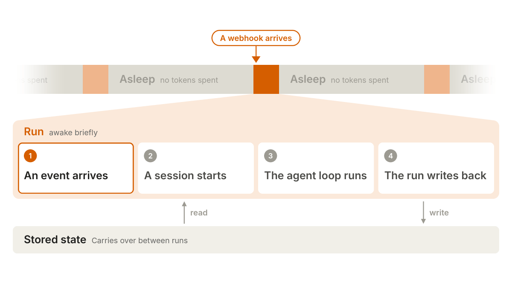
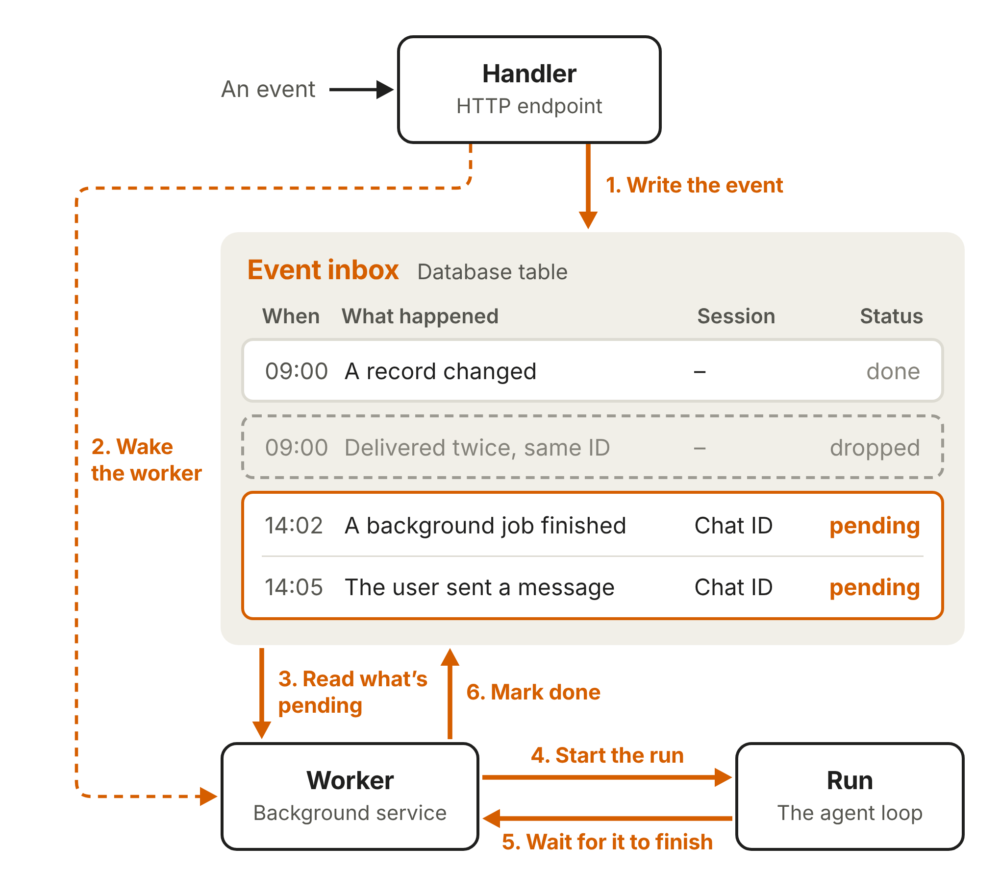
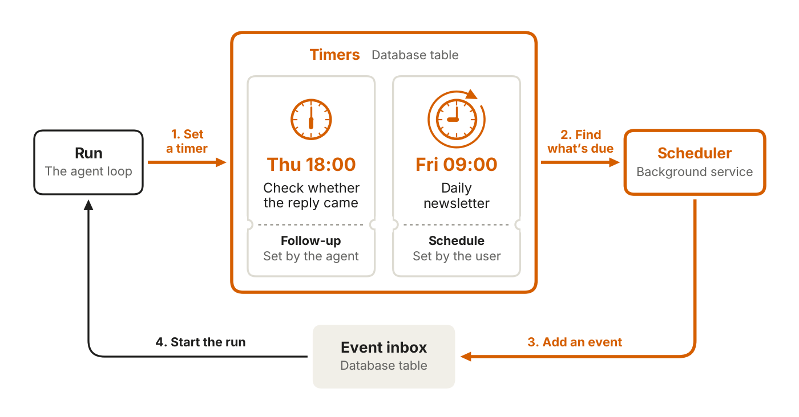
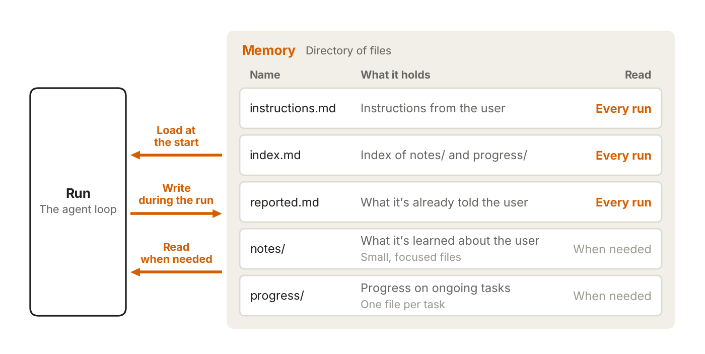
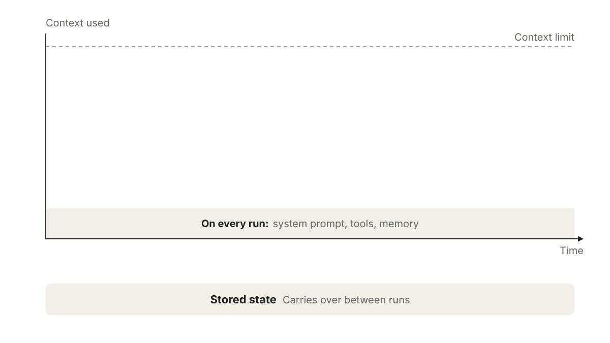
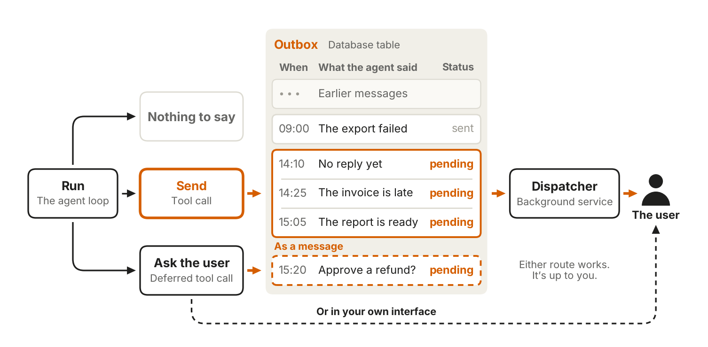
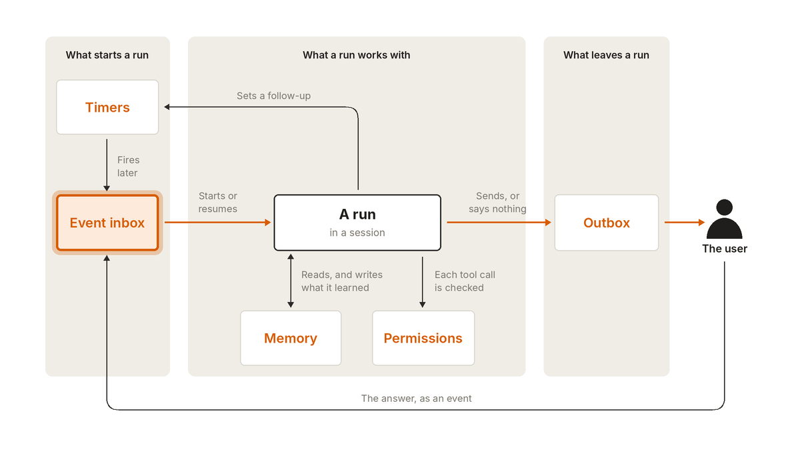

# 构建全天候运行的智能体（Building always-on agents）

> 原文：[Building always-on agents](https://claude.com/resources/articles/building-always-on-agents) · Anthropic · 2026-11-13
> 本文由 Kimi CLI 使用 Kimi K3-256k 全文翻译，并由 Agent 校对；已取得全文翻译和转载授权。
> 作者：William Hu

常驻型智能体（always-on agents）会无限期地运行，跨多个会话自主决定如何以及何时采取行动。本指南将介绍它们的核心原语（primitives），以及这些原语如何协同工作。

在过去几个月里，我们看到常驻型智能体重新兴起。

常驻型智能体是有状态且主动的，这意味着它们能够跨会话管理上下文，并在没有直接监督的情况下采取行动。在底层，它们与其他智能体一样运行在相同的[核心循环](https://www.anthropic.com/research/building-effective-agents)之上。不同之处在于外围架构，它由一系列原语构成，用于控制智能体何时苏醒、多次运行之间保留什么内容，以及它们的工作成果如何送达用户。

这波复兴很大程度上归功于近期的模型进步，这些进步让常驻型智能体的运行变得更加切实可行。首先，最新的模型具备更好的判断力：它们在理解用户意图和判断何时应该汇报方面更加可靠。其次，智能的成本正在下降，其中长周期任务受益最大。例如，在[一个长周期编码基准测试](https://platform.claude.com/docs/en/about-claude/models/optimizing-for-cost-and-intelligence)上，Opus 5.5 每解决一个任务的成本比 Opus 5 低 78%，而在典型工作负载上这一数字是低 40%。

客户已经开始向我们询问如何将这类体验整合到他们自己的产品中。一些公司希望让现有智能体变得更主动，而另一些则希望从零开始构建。

本文将拆解常驻型智能体背后的各个原语，并逐步说明它们如何组合在一起。

## 常驻型智能体背后的循环

常驻型智能体实际上并不是“永远在线”。这只是对用户体验的一种描述。

实际上，智能体大部分时间处于休眠状态，只是周期性地醒来执行工作。每一段工作称为一次**运行（run）**：智能体接收一个事件，完成其任务，然后保存所发生事情的相关信息。一次运行在一个**会话（session）**中进行，会话是消息和工具调用的记录。运行结束后，智能体重新进入休眠，这个循环无限重复。

## 核心原语

常驻型智能体的外围架构包含五个核心原语：事件收件箱（event inbox）、定时器（timers）、记忆（memory）、权限（permissions）和发件箱（outbox）。让我们逐一来看。

### 事件收件箱

大多数 AI 智能体只在用户发送消息时才运行。相比之下，常驻型智能体可以被多种类型的事件触发，包括 webhook、计划任务和后台作业。

一个诱人的做法是让每个事件来源直接调用智能体，但这会带来几种故障模式。例如，两个事件同时到达可能会启动相互竞争的运行，而一次崩溃则可能让整个事件彻底丢失。

这正是事件收件箱的用武之地。每个来源不再直接调用智能体，而是将事件发送到一个收件箱，由工作进程（worker）从中取出。

最简单的版本包含三个组件：

- 一个持久化的事件列表，通常是一张数据库表；
- 一个处理器（handler），通常是一个 HTTP 端点，负责将事件写入列表；
- 一个工作进程，通常是一个后台服务，负责从列表中读取事件。

收件箱应当跟踪每个事件的状态，并且可以基于来源提供的唯一标识符对事件进行去重。关系型数据库很适合用作收件箱，每个事件作为新的一行追加进去。我们建议从每个用户一个收件箱开始，但如果需要更高的并行度，也可以进一步拆分。

当新事件到达时，处理器将事件写入收件箱并唤醒工作进程。工作进程读取所有待处理的内容并启动一次运行。延续先前工作的事件（例如用户的回复）会恢复一个已有会话，而其他所有事件则启动一个新会话。

随后，工作进程将事件传递给智能体循环，等待运行完成，并将对应的事件标记为已完成。实现细节可能会比较棘手，以下是几条最佳实践：

- **处理器应快速确认事件**。某些来源（例如 webhook 提供方）会将响应缓慢视为失败。处理器仍可以执行轻量级检查，但更深入的验证（例如检查提示注入）应当在运行期间进行。
- **收件箱应是事实来源（source of truth）**。工作进程被唤醒时，应首先拉取收件箱中的最新事件。这样，如果工作进程在运行中途死掉，新的工作进程可以接手同一事件并重试。
- **一个收件箱同一时刻只能有一个活跃的工作进程**。这可以防止两次运行重复执行工作或相互覆盖。当运行中途出现新事件时，你可以把它推给下一次运行，把它合并进当前运行，或者中断并重新开始。
- **工作进程应将待处理事件批量合并**。例如，如果用户连续发送多条消息，工作进程可以将它们合并为一次运行，这样智能体只需回复一次。

### 定时器

定时器与事件收件箱一起，让常驻型智能体能够主动行动。定时器一般分为两类：跟进（follow-up）和计划（schedule）。跟进是智能体为自己设定的截止时间，例如检查某条回复的情况。而计划则是按已知周期重复发生的任务，例如每日简报。

定时器存放在自己独立的持久化存储中——通常是另一张数据库表——与收件箱分开。收件箱只应保存已经就绪、可以处理的事件。跟进和计划可以共用类似的表结构，但计划还需要跟踪其重复周期。

定时器本身不会启动运行。相反，一个调度器（通常是后台服务）以固定间隔轮询存储，并触发所有到期的定时器。每一轮，调度器会：

1. 扫描存储，找到到期的定时器。
2. 根据类别更新每个定时器。
   1. 跟进应被标记为已完成。
   2. 计划的到期时间应更新为下一次发生的时间。
3. 向收件箱添加一个事件并唤醒工作进程。

对于调度器，你可以构建自己的服务，也可以使用持久化执行引擎（durable execution engine）。

### 记忆

常驻型智能体跨许多互不连贯的运行工作，并依靠记忆来保持连续性。

与事件收件箱和定时器类似，记忆应当有自己独立的存储。在我们的产品中，例如 Claude Code 的[自动记忆](https://code.claude.com/docs/en/memory)和 Messages API 的[记忆工具](https://platform.claude.com/docs/en/agents-and-tools/tool-use/memory-tool)，这一能力是以文件目录的形式实现的。对于常驻型智能体，这些目录应映射到持久化存储，通常是数据库或对象存储。这样，记忆的寿命就能超过工作进程本身。

一条经验法则是：记忆只应保存智能体无法再次查到的内容。如果某些信息已经存在于另一个系统中（例如问题跟踪器），你应当保存一个指针。下面是常驻型智能体应当存储的记忆类型细分：

- **用户指令：** 任何来自用户的、关于智能体行为的指令，都应保存在单独的文件中，并在每次运行开始时加载。用户不会一直在场引导智能体，因此这些指令必须在多次运行之间延续。
- **用户笔记：** 智能体应保存它了解到的关于用户的信息，例如用户的角色、偏好，或者用户给出的任何纠正。你可以从单个文件开始，随着笔记增多再拆分为多个小文件。在后一种情况下，每次运行开始时只加载一个索引，但智能体可以在需要更多细节时把单个文件拉入上下文。
- **过往消息：** 智能体应记录它已经告诉用户的内容，以避免重复。它可以将这些内容保存在一个单独的文件中，在每次运行开始时加载；也可以由工作进程加载智能体与用户之间的最近几条消息。
- **任务进度：** 对于每个进行中的任务，智能体应维护一个进度文件，涵盖已完成的部分和剩余的部分。这样，任何新的运行都可以读取该文件，从上一次运行中断的地方继续。与用户笔记类似，每次运行开始时只加载一个索引，但智能体可以在需要更多细节时把单个文件拉入上下文。

下图展示了一个示例配置。

以上描述的都是运行期间保存的记忆。你还可以加入“做梦”（dreaming）机制，它会回顾过去的会话来整理记忆。做梦可以替换过期的条目，并发现只有在多次运行中才会显现的模式。如果你有兴趣进一步了解，我们关于[智能体记忆的文章](https://www.anthropic.com/research/components-of-agent-memory)对此有更详细的介绍。

#### 上下文窗口内部

在开展任何工作之前，智能体会加载系统提示词、工具定义和记忆文件。这部分初始上下文“开销”包含在每一次运行中，因此我们建议保持精简，并使用[提示词缓存](https://platform.claude.com/docs/en/build-with-claude/prompt-caching)来降低成本。

一个新会话开始时只带有这部分上下文开销和触发本次运行的事件。而已有会话则会带回来自其先前运行的消息和工具调用。

如果一个会话变得过长，你可以[压缩较早的消息](https://platform.claude.com/docs/en/build-with-claude/compaction)，或者开启一个新会话。两种方式都会丢失细节，因此任何需要持久保留的内容都应在过程中保存到记忆里。

### 权限

权限是始终在线智能体风险最高的地方。一次运行持有用户的访问权限，并且按设计是无人值守地运行的。对于每一次工具调用，智能体需要决定是自行继续执行、阻止该调用，还是等待批准。

权限所用的组件与其他智能体使用的组件相同：

- **凭证存储：** 始终在线智能体通常需要用户的敏感凭证（如密码或访问令牌）才能发挥作用。[推荐的模式](https://code.claude.com/docs/en/agent-sdk/secure-deployment#credential-management)是在智能体环境之外设置一个代理，由它为外发请求添加凭证。智能体发送的请求不带凭证，代理在转发之前注入真实的凭证。
- **自动模式（Auto mode）：** 始终在线智能体应当能够在不需要用户持续输入的情况下工作。我们已经在 Claude Code 中通过[自动模式](https://www.anthropic.com/research/claude-code-auto-mode)解决过这个问题的一个版本。自动模式使用分类器来审查风险较高的操作，并阻止那些被识别为危险的操作，从而让 Claude 找到更安全的方案。不过，对于最重要的决策，仍然需要用户审查。
- **延迟工具调用：** 在 Claude Code 中，[一个钩子可以延迟一次工具调用](https://code.claude.com/docs/en/hooks#defer-a-tool-call-for-later)，等待用户的额外输入。同样的模式也适用于始终在线智能体——它们在采取某些操作之前可能需要澄清或批准。当一次调用被延迟时，本次运行结束，会话在调用中途被保存。该请求会展示给用户（例如，通过用 [MCP Apps](https://modelcontextprotocol.io/extensions/apps/overview) 构建的交互式卡片），而用户的答复会作为收件箱中的一个事件返回。该事件会启动一次新的运行，并带着用户的输入恢复已保存的会话。在被延迟的调用等待响应期间，工作进程可以处理其他事件，因此智能体不会被阻塞。

### 发件箱（Outbox）

对于大多数 AI 智能体，响应在生成的同时以流式方式传送给用户，这样他们就可以跟随 Claude 推理问题、调用工具并写出答案的整个过程。

而始终在线智能体的大部分工作是在后台完成的。用户得到的是结果和一些细节，而不是完整的逐步分解。

一次运行可以以三种方式之一结束：

- 智能体向发件箱发送一条消息，
- 智能体判定无需发送任何内容，或者
- 智能体使用延迟工具调用来请求许可或额外输入。

大多数始终在线智能体只需要一个"发送"工具即可，该工具将消息直接投递给用户。只有当你想要控制智能体发送消息的节奏，或希望智能体能够从错误中恢复时，才需要正式的发件箱。

发件箱是一个独立的外发消息表，与事件收件箱相对应。还有一个调度器——通常是一个后台服务——与工作进程相对应。调度器读取待处理的消息，决定要投递哪些，然后将它们发送给用户。来自延迟工具调用的请求既可以经过发件箱，也可以直接展示在界面中。

除了投递之外，调整智能体发送消息的数量也很重要。发送太多消息的智能体会变得吵闹，而发送太少的智能体会遗漏用户需要知道的事情。我们建议构建评估来找到恰当的平衡。在实践中，更好的做法是让智能体一开始保持安静，然后随着时间推移逐渐赢得用户更多的关注。

## 各部分如何组合在一起

以下是这五个原语如何组合在一起：

每一次运行都始于收件箱中的一个事件，无论它是用户消息、webhook 还是定时器。当工作进程取出一个事件时，它会启动一次运行，并在新的或已有的会话中唤醒智能体。智能体读取自己的记忆以获得基线，在其权限范围内采取行动，然后用它学到的任何内容更新记忆。运行结束后，智能体向发件箱推送一行记录，由调度器将消息投递给用户。

这些部分共同构成一个循环。一次运行可以设置一个定时器，稍后再次唤醒智能体；而当用户回复一条消息时，他们的答复会作为事件回到收件箱中。每次运行都很短暂，但这个循环会无限持续下去——这正是让智能体感觉始终在线的原因。

## 致谢

*作者：William Hu。特别感谢 Rodrigo Olivares 和 Michael Segner 的贡献。*
