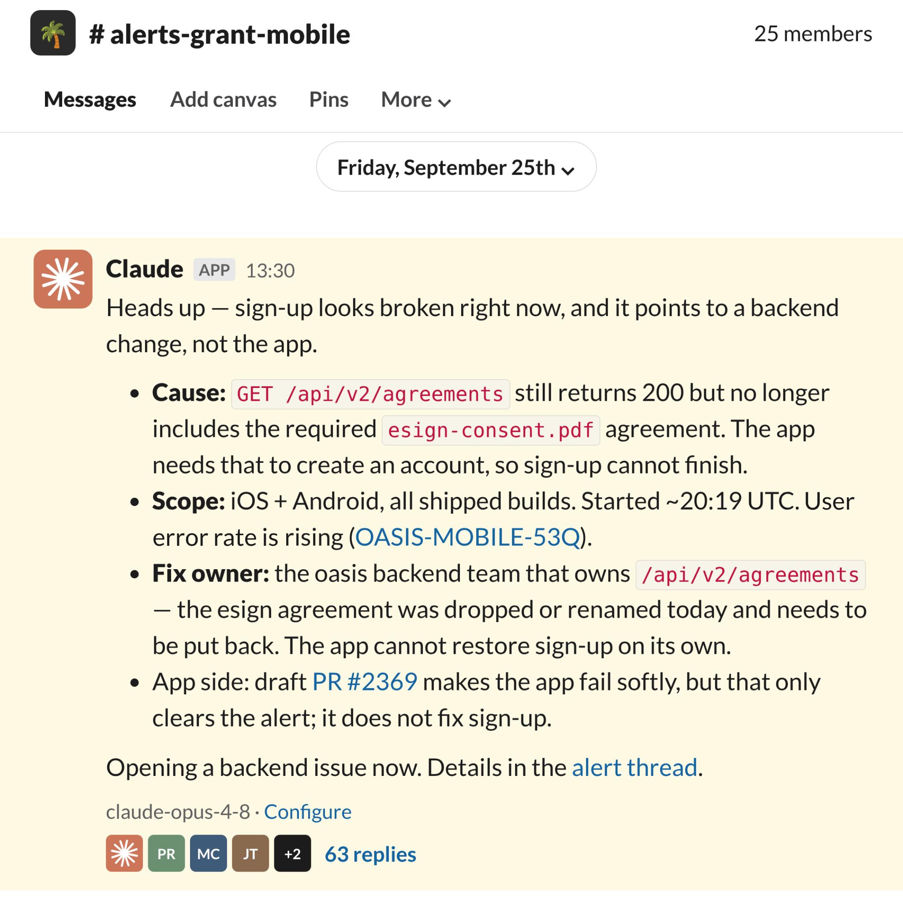
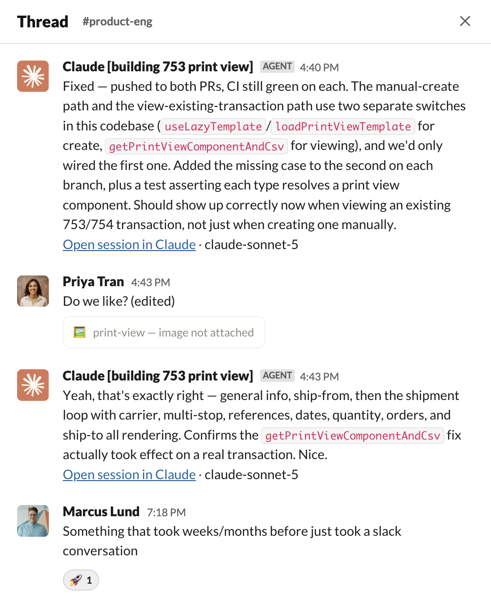
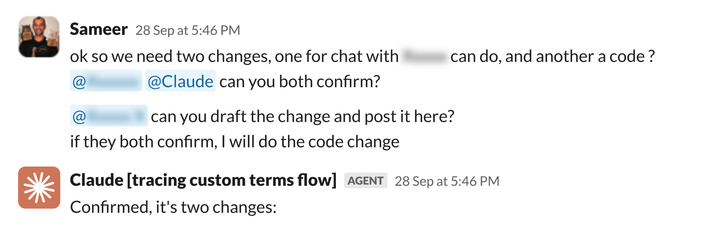
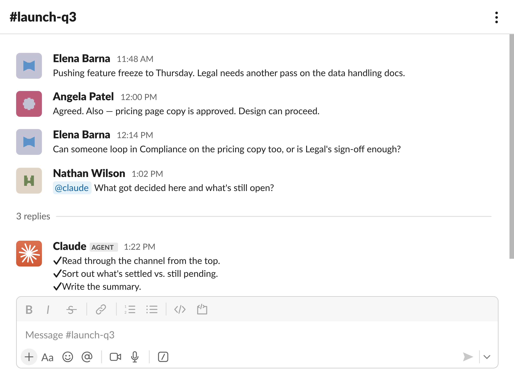
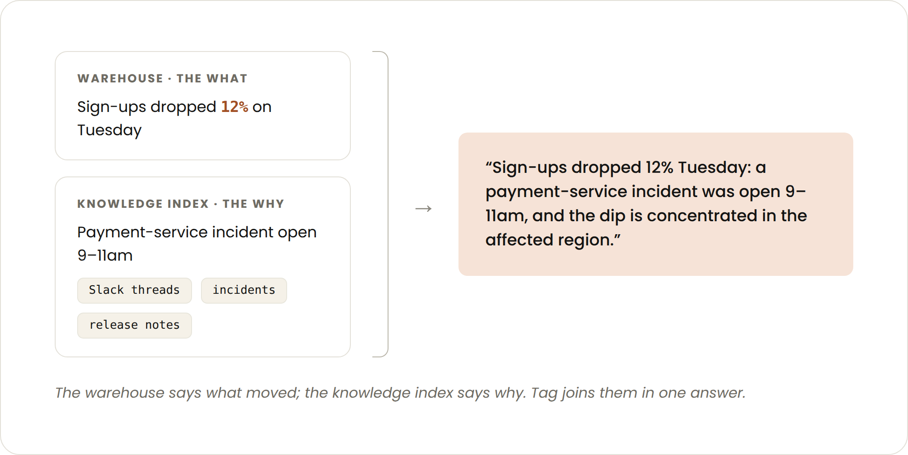
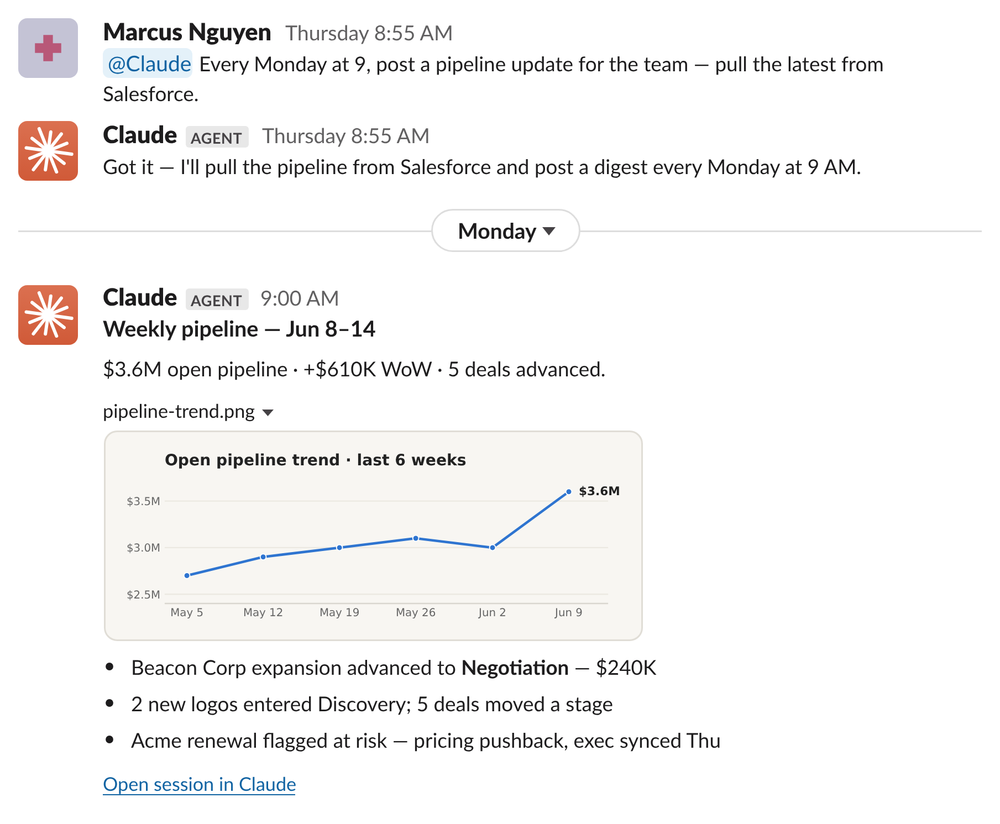
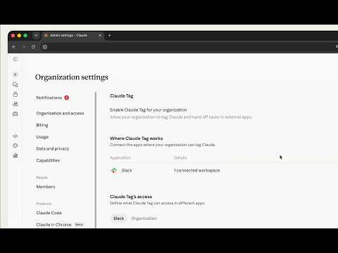
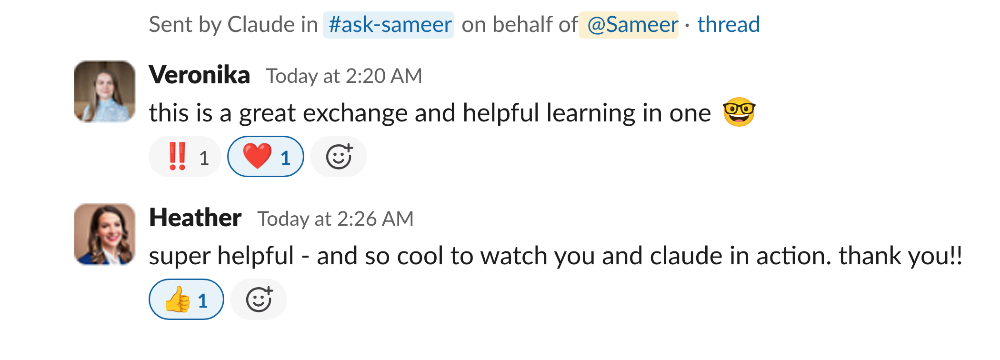
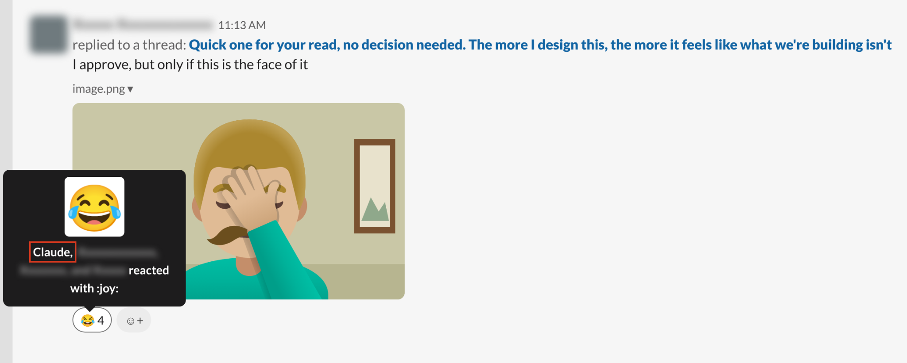

# 面向初创公司的 Claude Tag 指南（The Claude Tag guide for startups）

> 原文：[The Claude Tag guide for startups](https://claude.com/resources/articles/claude-tag-guide-for-startups) · Anthropic · 2026-11-13
> 本文由 Kimi CLI 使用 Kimi K3-256k 全文翻译，并由 Agent 校对；已取得全文翻译和转载授权。
> 作者：Michael Segner、Jacqueline Wibowo

创业公司应该先在哪些 Slack 频道里 @Claude：来自八家正在使用 Claude Tag 的创业公司的使用场景、入门指令和推广清单。

创业公司通常节奏很快，团队成员精简、身兼数职。在很多方面，[Claude Tag](https://claude.com/product/tag)（测试版）非常适合创业公司的工作方式。你在承载团队上下文的 Slack 频道中 @Claude，添加连接器，然后让团队一起分配并引导任务。

*在你已经在工作的地方 @Claude（在线内容）*

[在你已经在工作的地方 @Claude（在线内容）](https://www.youtube-nocookie.com/embed/VojDzHaciKQ?enablejsapi=1&rel=0&playsinline=1&modestbranding=1)

对于刚开始使用 Claude Tag 的创业团队来说，最常见的问题之一是：“我应该先把 Claude 添加到哪些频道？”为了帮助大家回答这个问题，我们采访了八家高增长的创业公司，了解 Claude Tag 在他们团队中的运作方式。

### 特约分享来自

- 
- 
- 
- 
- 
- 
- 
- 

我们听取的这些公司领导者，其愿景从重塑律师事务所到构建下一代资源规划软件不等。有的团队几乎把 Claude 添加到了每一个频道，而另一些则深入专注于一两个特定的使用场景。

| 公司 | 值班响应 | 讨论串到 PR | 公司大脑 | 自助数据 | 例行报告 |
| --- | --- | --- | --- | --- | --- |
| Kikoff | ● | ● |  | ● | ● |
| NavigateAI | ● | ● | ● |  | ● |
| Campfire | ● | ● | ● |  |  |
| Flagler Health | ● | ● | ● |  |  |
| Moritz |  |  | ● |  | ● |
| Orderful | ● | ● | ● | ● |  |
| Valence |  | ● | ● |  | ● |
| Descript |  | ● |  | ● | ● |

但每一位受访者都分享过一个“顿悟时刻”——他们意识到，一段几分钟的 Claude Tag 对话取代了数天的工作，或者挖掘出了原本会一直隐藏不见的洞察。

最常见的使用场景都收录在本指南中，每个场景都附有切实可行的实施细节，旨在帮助创始人找到并部署那些能真正推动团队进展的使用场景。以下是我们采访的创业公司实现突破的一些示例：

21

分钟：从 Slack 提及到打开 PR

134

个从 Slack 讨论串合并的拉取请求

5

分钟完成每日交接班更新，此前需要 1 小时

<1

小时：从客户需求到无代码解决方案

2

天：从 Slack 提问到生产环境

从天到小时

的周期性报告准备工作

在本指南中，我们分享了来自领先创业公司使用 Claude Tag 的最常见使用场景、频道以及集体洞察。

---

## 最值得 @Claude 的频道

我们采访的八家创业公司都在 Slack 中使用 Claude Tag，但有几个频道被反复提及，是最佳的起始选择。

## 01 Claude 值班响应

示例配置：

频道

`#on-call` `#alerts-ci` `#deploy-watch` `#support-escalations`

连接器

GitHub、GitLab、Sentry、dbt、PagerDuty、Linear、Datadog、Jira、Grafana、incident.io

讨论串与例程

事故响应、早间事故摘要、周一值班交接、每日健康摘要、每小时事故回顾

入门指令

@Claude 记住本频道的规则：监控告警，并立即在各自的讨论串中对每一条进行分诊。检查是否已有工单。先查询数据，再提出推测，并把已验证的内容与推断的内容分开。如果问题属实，指出可能的根本原因并附上链接，@负责人，仅在修复范围可控时打开一个草稿 PR。如果无需采取任何行动，就明确说明。每次事故之后，把你学到的东西添加到 [经验教训文件] 中。

分诊频道出了名的嘈杂。来自 Sentry 错误、Datadog 告警、客户 bug 报告和支持请求的持续干扰，让人很难从噪音中找到信号。这通常是团队交给 Claude 的第一项任务。

有了 Claude 作为频道中的[第一响应者](https://claude.com/resources/articles/ai-ci-cd-on-call)，第一轮排查往往在值班工程师打开笔记本电脑之前就已经完成。Claude 会阅读每一条新进来的信息，调查代码库和它能访问的工具，并分享它的发现。如果修复范围可控，它会打开一个草稿 PR；如果不行，它会附上调查结论，把问题路由给正确的人。在这些配置中，每个修复在合并之前都经过人工审查，只有真正的新问题才需要有人亲自启动调查。

Campfire 为财务团队构建 AI 原生的 ERP。一位工程师在一份报告上 @了 Claude，报告中提到其 AI 智能体的一些已完成回复没有送达用户。21 分钟后 Claude 就打开了一个 PR，当天下午便合并了。

### Kikoff：每个分诊频道里的第一响应者

Kikoff 是一家金融科技创业公司，帮助消费者建立信用、解决流动性需求并实现财务安全。Claude Tag 是公司各分诊频道中的第一响应者，包括：

- `#deploys`：Claude 决定每次发布后需要关注什么，并标记出它破坏的任何内容。
- `#alerts-ci`：当构建失败时，Claude 查明原因，并以草稿 PR 的形式提出修复方案。
- `#alerts-sentry-backend`：Claude 对 Sentry 异常和崩溃进行第一轮排查。
- `#dog-fooding`：Claude 调查员工在内部试用（dogfooding）时标记的问题，并 @正确的负责人。
- `#support`：Claude 对支持工单进行第一轮排查。

Kikoff 最初让 Claude 仅在被提及时才参与对话，而当团队允许它主动加入讨论后，最大的收益随之而来。当注册功能出故障时，Claude 将其追溯到一次后端变更，评估了影响范围，指出了负责修复的团队，并打开了一个草稿 PR，让应用在修复期间能够优雅降级。

Claude 标记出注册功能故障，将其追溯到一次后端变更，评估了影响范围，指出了负责修复的团队，并打开了一个草稿 PR，让应用得以优雅降级。这是对 Kikoff 一段对话的重现。姓名和图像已做修改。经 Kikoff 许可使用。

> “每当 Claude 比监控或人更早发现问题时，我总是特别兴奋。一个人能亲自管理的上下文终归有限，Claude Tag 帮助我们组织并掌握部分上下文，而我们则负责管理结果。”

Alex Dejeu，Kikoff 工程经理

### NavigateAI：用碎片化的上下文修复 bug

NavigateAI 为建筑现场团队构建 AI 副驾驶。他们在大约 90 个频道中运行 Claude Tag，用于告警分诊、bug 大扫除、快速功能构建和支持升级。自六月以来，Claude 已直接从 Slack 讨论串中打开了约 223 个 PR，其中 134 个已合并，从打开到合并的中位时间为两小时。

对 NavigateAI 来说，分诊是尤其有价值的使用场景。由于 Claude 拥有大量上下文，它能找到那些乍一看可能被忽略的问题背后反直觉的根本原因。

> “我们使用 Claude Tag 最震撼的时刻，是在排查一个负载问题的时候——它看起来像是由某个客户引起的（因为他们的调用失败了）。正常人的反应是继续追查那个客户。但因为 Claude 能访问如此多的其他数据源，它实际上发现问题来自一个未被监控的内部定时任务，恰好在同一时间段运行。”

Mike Chen，NavigateAI 工程负责人

有了 Claude，平均问题解决时间缩短了。有一个案例中，在 Sentry 告警触发八分钟后，Claude 就找到了根本原因，修复在告警后 93 分钟合并。

“快速发展的创业公司通常不得不在速度和结构之间做出取舍。Claude Tag 让我们两者兼得。它是一个能连接我们所有工具中信息点的大脑，所以我们无需自己构建，就获得了这种结构，”Mike 说。

提示

“投入建设一个技能仓库并让 Claude 访问该技能仓库，帮助非常大，”Mike 说。在 Anthropic，我们的值班配置把 Claude 的指令保存在一个仓库中的 `oncall.md` 文件里，Claude 会在每次事故后把学到的东西添加到一个 `lessons.md` 文件中。

## 02 讨论串到 PR

示例配置：

频道

`#quick-wins` `#bug-bash` `#product-feedback` `#feature-requests` `#ux-papercuts` `#tech-debt` `#design-polish`

连接器

GitHub、GitLab、Linear、Jira、Confluence、Notion、Figma、Sentry

讨论串与例程

每个讨论串一个请求、每周积压清理、每日 PR 汇总、每周发布回顾

入门指令

@Claude 记住本频道的规则：当有人描述一个 bug 或小功能时，在它自己的讨论串中处理。先检查是否已有工单，并阅读相关代码。如果缺少细节，就询问细节或一个真实示例，而不是凭空猜测。如果改动小且范围可控，打开一个草稿 PR，附上改动内容和测试方法的简短说明。永远不要合并；由人来审查和批准。如果改动太大或风险太高，说明原因并建议开一个工单。

速度是创业公司最大的优势之一，但那些能取悦用户的小请求往往会在忙乱中被淹没。这些情报通常由面向客户的团队收集，提交到 Slack 中，如果没有被忽略，最终会进入 Linear 或 Jira，在那里与数百个其他工单一起排优先级。

有了 Claude Tag，任何人都可以起草 PR，无论是否懂技术。在讨论串中提出一个想法，在同一处获得来自产品、工程和市场团队的实时反馈，然后 Claude 会把讨论串变成一个反映所有人意见的草稿 PR。

我们采访的许多创业公司都用 Claude Tag 来做那些“轻快又讨喜”的功能，或者清除那些审查起来很快、但否则永远不会被排上优先级的小毛病。

### Orderful：两天内从 Slack 交流到生产环境功能

Orderful 是一个 EDI 平台，通过 API 或直接在浏览器中将公司与其贸易伙伴连接起来。其客户通过该平台与合作伙伴交换标准文档。

其中一种文档类型——753——在 Orderful 的网页应用中不受支持。这个需求一直躺在积压列表里，而一家大型零售商的发货因此被延误。

当客户经理在 Slack 中跟进时，这位产品经理把 Claude 拉了进来：“@Claude，你应该做一个。”Claude 要求提供该文档的真实示例，以便按实际格式来构建，然后打开了一个草稿 PR，添加了 753 支持。

Claude 确认某项修复在一笔真实的 753 交易上有效。姓名和图像已做更改。经 Orderful 许可使用。

第二天早上，Claude 为配套的 754（即零售商的响应）提交了一张工单，并打开了第二个 PR。两者都在 Slack 对话约两天后上线了生产环境。

“以前需要数周甚至数月的事情，现在只需要一次 Slack 对话，”Orderful 首席技术官 Piers MacDonald 说。“那些价值难以证明的轻量功能过去总是卡在待办列表里。现在它们有出路了。”

提示

### 给 Claude 一些真实的素材来构建。

在对话串中放一个示例文件、一条客户消息或一张截图，这样它构建出的就是你真正需要的东西，而不是靠猜。

### Valence：从功能请求到上线

Valence 与全球最大的雇主合作，通过 AI 教练 Nadia 将企业人才与绩效连接起来。当一位 Valence 工程师在 Slack 中说明如何处理一位重要客户要求的紧急产品变更时，Claude 没有只是照做——它发现还需要做额外的修改，因为同一处配置存在于两个位置。如果没有 Claude，最初的修改就会是不完整的。

Claude 指出一项被请求的变更实际上是两项变更。经 Valence 许可使用。

> “它没有只是附和专家的意见。它发现了重复的配置——正是那种人类容易跟丢的东西。”

Sameer Bansal，Valence 首席 AI 工程师

在另一个案例中，一位客户紧急要求一项定制。Claude 检查了代码，并与一位工程师合作，确认无需改动代码即可交付。不到一小时，一位队友就为客户准备好了方案。

## 03 公司大脑

示例配置：

频道

`#ask-anything` `#company-wiki` `#product-questions`

连接器

GitHub、Notion、Google Drive、Linear、Jira、Confluence、Granola、Metabase

对话串与例行任务

每个对话串一个问题、决策日志更新、每周过期文档检查、重复问题回顾

起始指令

@Claude 请记住本频道的规则：根据我们的代码、文档和过往对话串回答问题，并附上来源链接。如果来源之间有冲突，以代码为准，给出当前答案，并标记过期的文档。如果你不确定，就直说并 @ 负责人。当一个对话串达成决策时，把它记录到 [文档位置]。任何要发给客户的内容都需要先经人工检查。

在一家初创公司，机构性知识往往存在于人们的脑子里——从产品计费代码的种种细节，到入职文档托管在哪里。

对我们采访过的许多初创公司来说，Claude Tag 已经成了公司大脑。Claude 回答时会附上来源，并在不自信时 @ 负责人。它还让这些知识保持最新：当一个对话串达成决策时，Claude 可以当天就把它记录到你的文档中，并标记已经过期的文档。

示例对话。

### Moritz：从受理到人员调配的实时事实来源

Moritz 是一家 AI 原生律师事务所，承诺合同当天交付，而 Moritz 称行业标准至少需要三周。法律工作之外的一切——从受理、报价到人员调配和后续跟进——都在 Slack 中进行，每个案件一个对话串，每个客户一个频道。

现在从 CEO 到律师助理，每个人都先问 Claude。过去在 Slack 里要花多达 30 分钟搜索的问题，现在不到两分钟就能得到答案。下班前的交接更新现在根据当天的对话串起草，从过去约一小时的整理工作变成了五分钟的编辑。

省下的时间回到了法律工作上。Claude Tag 处理案件周边的行政事务，比如跟进问题、提醒和状态更新。它无法访问客户文件或与 Moritz 律师的保密对话。

> “一家业务横跨 44 个国家的律所，每月会产生数百个一次性问题，没人会为这些问题专门开发功能。Claude Tag 根据我们自己在 Slack 里的历史记录来回答它们。每个答案都是一条带链接的对话串，机构记忆由此不断累积。”

Stefan Mandaric，Moritz 联合创始人兼首席技术官

### Campfire：随需而用的客户体验

有一个 Slack 频道特别“人气爆棚”：他们的 CX（即客户体验）频道。销售团队用这个频道“在潜在客户沟通中验证某些功能”，而不必“挨个去问 10 个不同的人”。

这类频道之所以特别有效，是因为销售可以当场作答——趁客户还在关注的时候——并且在早期客户沟通中能更独立、更自信地开展工作。

> “Claude Tag 基本上就是我们的中央知识库。”

Nancy Jin，Campfire AI 工程经理

## 04 自助式数据

示例配置：

频道

`#data-requests` `#ask-revops` `#metric-definitions`

连接器

dbt、GitHub、Metabase、BigQuery、Snowflake、Databricks、Notion

对话串与例行任务

每个对话串一个问题、每周站会前汇报、发布与实验汇报、管道故障分诊、新问题分诊

起始指令

@Claude 请记住本频道的规则：根据我们受治理的模型和 [数据技能仓库] 中的定义来回答。如果数据不在覆盖范围内，就说它未经验证，不要猜测。先给答案，再给数字、驱动因素以及任何注意事项。解释变化之前，先检查近期的事故、发布和 Slack 讨论。如果某个指标的定义不清楚，就问清楚指的是哪一个。涉及重要事项时，先分享你的计划或 SQL 再执行。把你验证过的内容和你假设的内容区分开来，并在答案末尾列出所有未解决的数据质量警告。如果有人发现错误，起草一个修复方案，交给数据团队成员审核。如果同一个问题出现了两次，建议把它排成定期任务。

在一家快速成长的初创公司，每个职能都想要数据，而数据团队不得不决定先处理谁的请求。让 Claude Tag 连接上你的数据后，任何人都可以用大白话提问，无需在数据团队的队列里排队。

这个用例我们自己也在用。[在我们的一个数据频道里，一个月间 Claude Tag 回答了超过 75% 的问题，通常在一两分钟内](https://claude.com/resources/articles/self-service-data-analytics-in-slack-how-anthropic-deploys-claude-tag-for-ad-hoc-questions)。它基于受治理的数据以及分析师使用的同一套定义来作答，这些定义存放在一个带版本管理的仓库中，Claude 在每次对话中都会重新读取。

摘自《Slack 中的自助式数据分析：Anthropic 如何部署 Claude Tag 处理临时问题》。

### Descript：回答临时数据请求

Descript 是一个 AI 驱动的视频编辑平台。Claude Tag 现在是数据请求和初步分析的第一线支持。产品、增长、营收运营和财务团队在 Slack 中提问，得到的答案都基于 Descript 的 dbt 模型。

> “我过去要写复杂的 SQL，每周或每月手动刷新数据。现在我用我自己的 Claude 产物替代了好几个数据团队的仪表盘，再也不用手动刷新了。”

Daisy Zhang，Descript 增长营销负责人

Daisy 的定期报告准备工作从几天缩短到了几小时。

比如，增长团队会问：生命周期订阅为什么下降了；付费搜索的末次触点归因是不是正在被其他渠道抢走；一个自助账户要多久才会变成企业级商机。数据团队则追踪 Claude 生成的产物，看哪些数据资产对各团队最重要，并把自己的时间花在战略性问题上，以及构建让自助服务得以运转的上下文上。

> “商业智能的承诺一直都是让业务用户自助获取数据。在我们为数据配置好拥有海量上下文的 Claude Tag 之前，我从未见过它真正实现。”

Jen Huhn，Descript 商业化产品经理

提示

### 先投入建设上下文。

让你的数据团队把核心模型和指标定义写成文档，因为自助服务的好坏取决于 Claude 拥有的上下文。参见[回答数据问题](https://claude.com/docs/claude-tag/users/use-cases/answer-data-questions)。

### Orderful：从问题到仪表盘

在 Orderful，自助分析涵盖对话式分析和完整的数据构建：任何人都可以从 Slack 中的一个问题出发，一路做到合并进生产环境的仪表盘。关键在于一个语义层，它把各方认可的定义和指标固化下来，让每个答案、每次构建都使用同一套定义。

> “我们信任它的输出，因为语义层约束着 SQL，CI 把控着构建，还有一套就定义达成一致的流程。没有这些，你得到的会是看起来很自信的错答案。这些护栏一到位，接入 Claude Tag 只用了不到 30 分钟。现在队友们在共享的 Slack 对话串里一起构建，而不是各自单干。”

Piers MacDonald，Orderful 首席技术官

## 05 报告与交接

示例配置：

频道

`#sales-pipeline` `#customer-handoffs` `#standup-summary` `#qbr-prep`

连接器

Notion、Google Drive、Gong、Salesforce、Gainsight

对话串与例行任务

每日收尾状态草稿、QBR 前简报、交易交接

起始指令

@Claude 请记住本频道的规则：根据我们的对话串、文档和数据起草每份定期报告，并附上来源链接。先讲发生了什么变化、需要什么决策。把你验证过的内容和你假设的内容区分开来，有缺失就标记出来，不要自行填补空白。把草稿发在它自己的对话串里，交给 [负责人] 编辑。未经人工批准，任何内容不得外发。如果某份报告总被做同样的修改，就建议更新这些指令。

我们讲过的许多例子都是被动的：有事发生，Claude 响应。而例行报告是 Claude 按计划主动承担的工作，就像一位队友负责一项周期性交付物那样。

在 Claude Tag 中使用 Routines（例行任务）的示例。

你只需描述一次想要的结果；Claude 每次都会运行它，并把结果发布到团队日常工作所在的地方。

### Valence：交易复盘与交接

Valence 正在让 Claude 在每次季度业务回顾（QBR）之前为团队做简报，内容涵盖客户健康状况、进行中的交易、阻碍因素和后续步骤。他们还在努力让交易成交后从销售到客户成功团队的交接更加顺畅。Claude 帮助汇总整个合作过程中的细节，为团队节省了时间，还经常发现他们可能遗漏的关键事项。

“当一笔交易成交时，Tag 会根据交易历史、通话记录和合同来构建交接文档：谁是谁、承诺了什么、有哪些定制内容、还有什么悬而未决。然后客户成功团队会在启动会之前审阅它，”Sameer 说。

小贴士

### 如果你已经问过两次，就把它设为定时任务。

“@Claude 每周一美东时间上午 9 点，为本月有 QBR 的每个客户发布一份简报：健康状况、进行中的交易、阻碍因素和后续步骤。” 参见[设置例行任务](https://claude.com/docs/claude-tag/users/proactivity)。

## 06 入门检查清单

下面的检查清单汇总了这些初创公司团队的最佳实践，方便你应用到自己的工作流中。

上线之前

确认前提条件。

Claude Tag 目前在 Claude Team 和 Enterprise 套餐上处于公开测试阶段，Free、Pro 或 Max 套餐不可用。你需要一位 Claude 组织的所有者（Owner）和一位 Slack 工作区管理员来连接两者。管理员还必须开启 Routines，且 Team 套餐需要先配置用量额度，Claude 才会响应。

用 bundle 配置 Claude 的访问权限。

在频道中，Claude 以自己的[智能体身份](https://claude.com/docs/claude-tag/concepts/agent-identity)运行，使用服务账户而非任何人的个人登录。把它需要的连接器、代码仓库和指令归到一个 [bundle](https://claude.com/docs/claude-tag/admins/add-connections) 中，并将其附加到全组织、单个工作区或单个频道。这决定了 Claude 在每个地方能触达什么，并且频道里的每个人都获得相同的访问权限。从窄处开始：只给第一个频道的任务所需的权限。

在私密频道中试验。

我们采访的初创公司中，近一半是从小型跨职能团队在私密频道中试验开始他们的 Claude Tag 之旅的。“先从角色多样的私密频道开始，然后再迁移到群组频道，”Sameer 说。

明确边界。

默认情况下，你 Slack 工作区中的任何人都可以使用 Claude，即使没有 Claude 账户。你可以将访问权限[限制](https://claude.com/docs/claude-tag/admins/restrict-access)在你的组织内，并将搜索范围限制在 Claude 所在的频道。在 Enterprise 套餐上，你还可以将访问权限限制到特定角色或指定频道。

为 Claude 能做什么和绝不能做什么设定明确的预期。我们采访的几个团队让 Claude 打开 PR 草稿，但由人来审查和合并。对 Orderful 来说，处理“基础设施变更、审计、敏感数据”的是 [Claude Code](https://claude.com/resources/articles/claude-code-guide-for-startups)，而不是 Tag。对于“艰难的决策”，比如“涉及多个服务的 PR”，Claude 会征求第二意见。Moritz 不让 Claude Tag 访问客户文件或与其律师的特权对话。

尽早启动安全审查。

常见的问题是数据保留和 Claude 能触达什么，[安全](https://claude.com/docs/claude-tag/concepts/security-and-data)和[数据生命周期](https://claude.com/docs/claude-tag/concepts/data-lifecycle)页面回答了这两个问题。Claude Tag 不适用于开启了零数据保留、客户托管加密（CMEK）策略或 HIPAA 配置的组织，也不在我们的商业伙伴协议（BAA）覆盖范围内，所以在规划推广之前请先确认这一点。

设定预算和告警。

Claude Tag 按用量计费，所以尽早沟通可以避免随着采用率增长而出现意外。你可以[设置支出上限](https://claude.com/docs/claude-tag/admins/set-spend-limit)（总体和按频道）、按频道选择模型，并使用 Enterprise Analytics API 按用户[归因成本](https://claude.com/docs/claude-tag/admins/attribute-costs)。Orderful 设置了全组织上限，并在 75% 和 90% 时触发告警。“我们对频道成本有极强的主人翁意识。负责人要证明‘是的，这笔支出相对于产出/成果是合理的’，”Kikoff 的工程经理 Alex Dejeu 说。用第一个频道的实际成本来衡量下一个频道的规模。

*智能体身份：Claude Tag 的全新访问模型（在线内容）*

[智能体身份：Claude Tag 的全新访问模型（在线内容）](https://www.youtube-nocookie.com/embed/JhipXUs1Y98?enablejsapi=1&rel=0&playsinline=1&modestbranding=1)

部署

在团队已经在使用的频道中挑选一个明确的任务，比如值班告警或 bug 分诊。

“我们在某些团队中进行试验，看看什么有效，一旦有信心已经解决了各种问题，就把这个想法推广到其他团队，让他们也加到自己类似的频道中。我们希望避免给那些对 AI 犯错容忍度较低的人带来破坏信任的体验，”Kikoff 的工程经理 Alex Dejeu 说。

先调动你的专家和文化传承者。

让团队已经信任的人率先公开使用 Claude。

“公开地与 Claude 来回交流既高效又有趣。销售和客户成功团队的几个人观看了专家[与 Claude Tag 互动]之后，自己也开始向 Claude 提问，并很快获得了价值，”Valence 的首席 AI 工程师 Sameer Bansal 说。

调节噪音。

多家初创公司告诉我们，他们需要调整 Claude 的健谈程度。太健谈是一种风险。

“临时请求的对话有时会变得嘈杂。我们一直在努力降低这方面的响应频率，同时在用 Claude 处理临时请求时也更有原则，”NavigateAI 的工程负责人 Mike Chen 说。

然而，太不健谈也是一种风险。在繁忙的频道里，“你要么每次都 @ 它，否则它不会做太多事，”Flagler Health 的联合创始人 Will Hu 说。而且“如果没有人密切关注一个频道或与它互动，它就会闲置在那里。”

让团队成员连接他们自己的账户。

设置阶段的管理员 bundle 决定了 Claude 能为频道中的每个人触达什么。[个人连接器](https://claude.com/docs/claude-tag/concepts/personal-connectors)的工作方式不同：Claude 以提问者的权限行事，因此在对方批准后，它可以从他们的文档、收件箱或 CRM 中提取信息（所有者先为组织添加连接器，在 Enterprise 上则由管理员管理个人连接器）。回答仍会发布在频道中，所以对任何敏感内容请选择“审查后允许”。

像给新员工做入职培训一样编写频道指令：

先检查什么、什么时候开 PR、什么时候该提问，以及“无需采取行动”也是一个有效答案。

在频道里给 Claude 反馈，而不是在私信里。

在帖子线程中纠正它。它会[按频道记忆](https://claude.com/docs/claude-tag/users/memory)，团队成员也能通过观察学习如何与它协作。要进行持久的修正，让 Claude 更新它对这个频道的记忆。

两位 Valence 员工在观看一位同事公开地与 Claude 一起解决一个问题后向其致谢。经 Valence 许可使用。

不确定下一步该做什么？在频道里 @ Claude，问问它对你的组织了解到了什么，以及它会扩展到哪些用例。

Moritz 的联合创始人兼 CTO Stefan Mandaric 让 Claude 为每个团队推荐用例。十五分钟后，它已经读完了公司的 Slack 频道、Linear 问题、Notion SOP、Drive 和 Metabase 仪表板，并发布了 25 个用例。“25 个里有 18 个无需进一步配置就能用。这成了我们的推广计划。”

---

## 结语：我们从“哇塞时刻”中学到了什么

这些“哇塞时刻”并不总是关于速度。很多时候，Claude 找到了没人让它去找的东西。有时惊喜来自于克制。有时惊喜来自于意想不到的互动。“最终你会习惯 Claude 加入玩笑，而且你很快会感激它是个随和的听众，总是第一个笑出声，”Orderful 的 CTO Piers MacDonald 说。

重现的 Orderful Slack 对话。经 Orderful 许可使用。

我们希望你觉得这份指南有用。特别感谢 Campfire、Descript、Flagler Health、Kikoff、Moritz、NavigateAI、Orderful 和 Valence 分享他们的经验与见解。

---

## 更多资源

### 入门

- [Claude Tag 概览](https://claude.com/product/tag)
- [Claude Tag 文档](https://claude.com/docs/claude-tag)
- [设置 Claude Tag](https://claude.com/docs/claude-tag/admins/setup-overview)
- [值班场景引导式设置](https://claude.com/docs/claude-tag/admins/setup-oncall)
- [设置故障排查](https://claude.com/docs/claude-tag/admins/troubleshooting)

### 连接你的工具

- [添加连接和 bundle](https://claude.com/docs/claude-tag/admins/add-connections)
- [配置 GitHub 访问](https://claude.com/docs/claude-tag/admins/configure-github)
- [个人连接器](https://claude.com/docs/claude-tag/concepts/personal-connectors)
- [网络要求](https://claude.com/docs/claude-tag/admins/network-requirements)

### 访问、安全与支出

- [限制访问](https://claude.com/docs/claude-tag/admins/restrict-access)
- [智能体身份的工作原理](https://claude.com/docs/claude-tag/concepts/agent-identity)
- [安全与数据](https://claude.com/docs/claude-tag/concepts/security-and-data)
- [数据生命周期与删除](https://claude.com/docs/claude-tag/concepts/data-lifecycle)
- [Claude Slack 应用可以访问什么](https://claude.com/docs/claude-tag/admins/for-slack-admins)
- [设置支出上限](https://claude.com/docs/claude-tag/admins/set-spend-limit)
- [将成本归因到用户](https://claude.com/docs/claude-tag/admins/attribute-costs)

### 在 Slack 中与 Claude 协作

- [控制 Claude 何时响应](https://claude.com/docs/claude-tag/users/when-claude-responds)
- [Claude Tag 能理解的命令](https://claude.com/docs/claude-tag/users/commands)
- [频道记忆](https://claude.com/docs/claude-tag/users/memory)
- [设置例行任务](https://claude.com/docs/claude-tag/users/proactivity)

### 用例

- [用例库](https://claude.com/docs/claude-tag/users/use-cases)
- [修复 bug](https://claude.com/docs/claude-tag/users/use-cases/fix-bugs)
- [回答数据问题](https://claude.com/docs/claude-tag/users/use-cases/answer-data-questions)

### Anthropic 如何使用 Claude Tag

- [Claude Tag 如何充当 Anthropic 应对 CI/CD 故障的第一响应者](https://claude.com/resources/articles/ai-ci-cd-on-call)
- [Anthropic 如何用 Claude 实现自助式数据分析](https://claude.com/resources/articles/how-anthropic-enables-self-service-data-analytics-with-claude)
