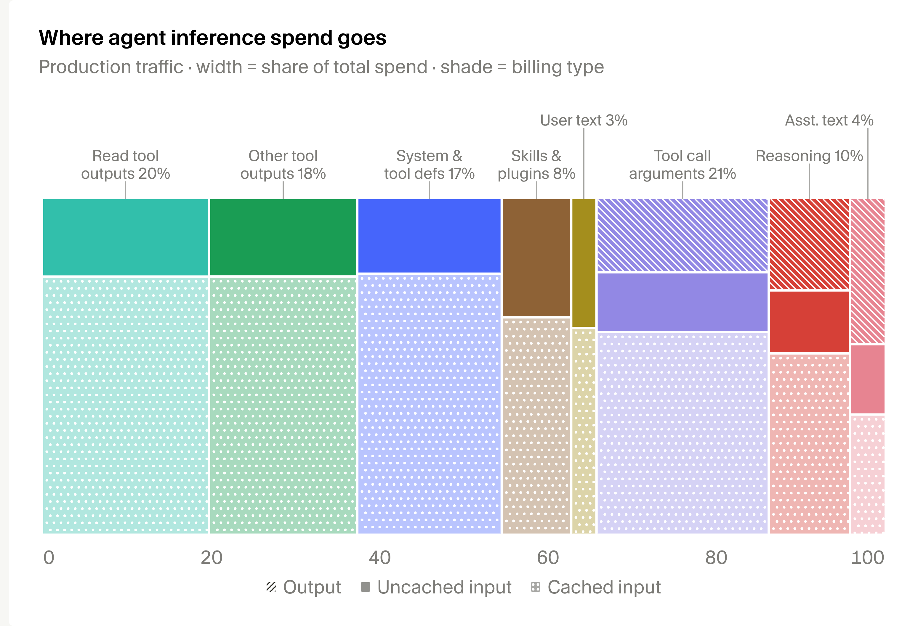
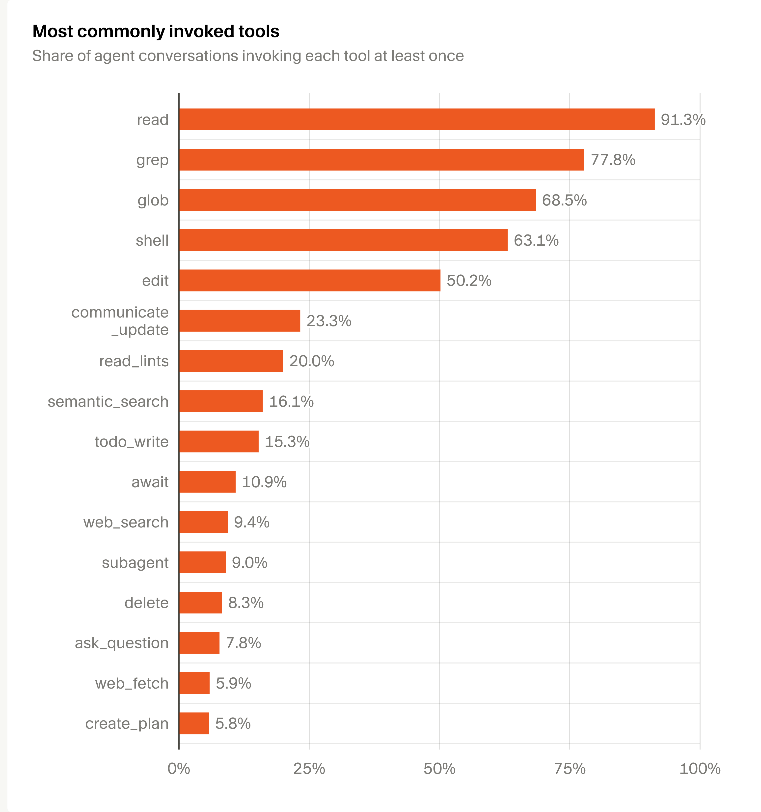
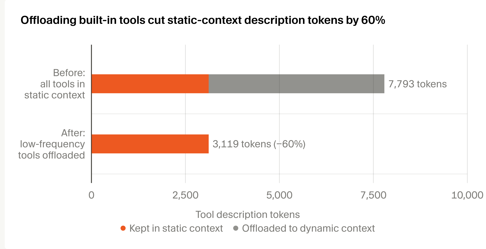
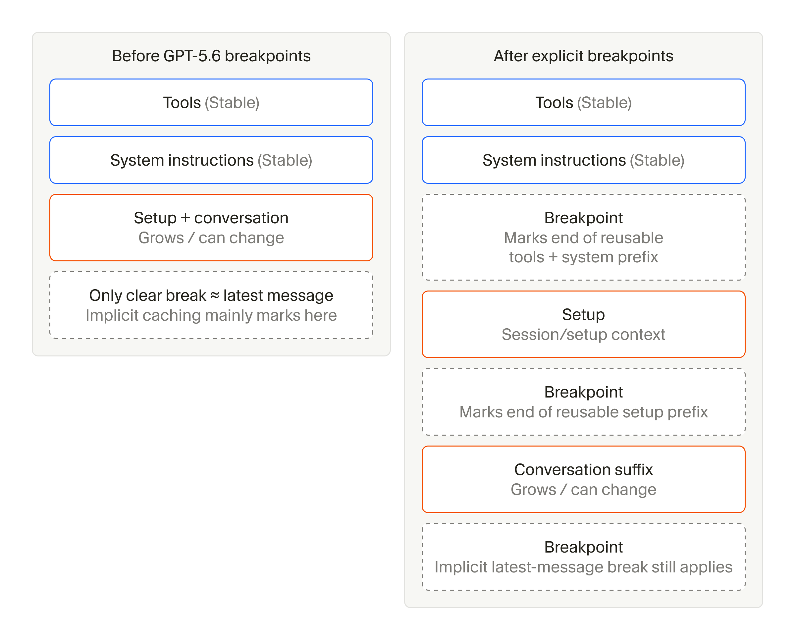

# 提升长时间运行 Agent 的 Token 效率（Improved token efficiency for longer agent runs）

> 原文：[Improved token efficiency for longer agent runs](https://cursor.com/blog/improved-token-efficiency) · Cursor · 2026-09-23
> 本文由 Kimi CLI 使用 Kimi K3-256k 全文翻译，并由 Agent 校对；已取得全文翻译和转载授权。

随着智能体日益成熟、能够处理更具雄心的任务,token 的消耗结构也发生了变化。如今智能体的工作时长更长,并在各个步骤之间携带更多上下文,这使得我们组装和管理上下文的方式变得越来越重要。

注:"系统与工具定义"包含压缩摘要。"用户文本"包含手动附加的技能。"技能与插件"包含技能描述、MCP 工具描述以及进入静态上下文的规则。

过去几个月,我们通过提升 Cursor 智能体框架(harness)的效率来应对这一转变。该框架让我们能够直接控制每个请求的组装方式、上下文的复用方式,以及工作何时在多个智能体之间分配。这些层面的改动在不降低智能体质量的前提下,为用户的 token 成本降低了 7%。

## [#](https://cursor.com/blog/improved-token-efficiency#trimming-the-system-prompt)精简系统提示词

每一轮智能体交互都包含 Cursor 在模型开始工作前提供的上下文,其中包括系统提示词和智能体可用工具的定义。由于这部分上下文贯穿整个对话,它已成为我们完全可控的最大开销来源之一。

当模型能力较弱时,我们不得不把工具使用、任务管理和代码变更工作流的指令一一写明。我们还需要防范一些奇怪行为,比如超长哈希值输出、二进制输出和表情符号。

随着模型不断进步,这些指引大多不再必要。我们只需定义工具的行为方式,模型通常就会遵守,而不再需要列出长长的"禁止做某事""你必须"或"重要"之类的指令。这一点在各模型家族中普遍成立,使我们得以将系统提示词精简约 66%。

随着时间推移,我们会继续根据新模型所需的新指引来增删指令,这些指引随后也会流入未来模型的训练。在庞大的用户群上进行 A/B 测试,对于针对真实流量有效优化框架至关重要。虽然评测(evals)是快速且有用的代理指标,但它们往往只代表"困难"问题,并不能恰当反映用户请求的真实分布。

## [#](https://cursor.com/blog/improved-token-efficiency#loading-tools-only-when-needed)仅在需要时加载工具

系统提示词只是 Cursor 在每轮交互中提供的上下文的一部分。另一部分是工具定义——随着这一年我们不断为 Cursor 智能体加入更强大的能力(包括后台 shell 监控、云端子智能体以及更可靠的网页内容访问),这部分定义已急剧膨胀。这些工具大多很重要,但每个工具在不足 20% 的对话中才会被用到。

这创造了一个提效机会:让工具保持可用,但不在每个请求中包含其完整定义。今年早些时候,我们在将 MCP 工具移入动态上下文时已经解决了类似问题——仅在需要时才加载它们。这使得调用过 MCP 工具的会话的 token 总量减少了 46.9%。

我们现在已将同样的技术应用到自己的内置工具上。

为了决定哪些工具保留在静态上下文中,我们根据每个工具的使用频率以及模型是否需要从一开始就见到它,对多种配置进行了 A/B 测试。我们跟踪了 token 用量、成本、延迟、工具调用错误和整体智能体使用情况,以确保节省不会损害质量。

最终,我们将用于读取、搜索、编辑和使用 shell 的高频工具保留在静态上下文中。我们还保留了 `ask_question`——某些模型倾向于幻觉出对它的调用——以及对特定产品流程至关重要的工具,例如计划模式(Plan Mode)中的 `create_plan`。其余工具现在在智能体需要时才加载。

## [#](https://cursor.com/blog/improved-token-efficiency#improving-cache-reuse)提升缓存复用

在减少每个请求中的静态上下文之后,我们改进了重复上下文跨轮次缓存的效率。

每一轮智能体交互都会重新发送一个很长的请求,其中包含工具、系统指令、初始配置以及到目前为止的对话。开头的大部分内容在各轮之间保持不变,而结尾的对话则持续增长。

提示词缓存(prompt caching)让模型提供方能够复用这段不变的前缀。不过,缓存的可配置性因提供方而异。在 GPT-5.6 之前,缓存边界是根据最新请求自动确定的。尽管工具和系统指令很少变化,它们本身并没有被干净地标记为可复用。

自 GPT-5.6 起,OpenAI API 允许客户端在默认的隐式缓存之外显式标记缓存断点。我们现在将断点放在请求的稳定层之后、不断增长的对话之前,使后续轮次能够复用更多不变的前缀。

断点只有在前缀本身保持稳定时才有效,因此我们也收紧了每个请求最前部的内容。具体做法是:将工具和系统指令专用于很少变化的内容,并将更易变的配置移到缓存边界之后的"幻影用户消息"(phantom user message)中。该消息承载用户和请求特有的上下文,如技能、子智能体和环境信息。

这些改动将冷缓存未命中率降低了 20%。

## [#](https://cursor.com/blog/improved-token-efficiency#compressing-file-reads)压缩文件读取

另一个 token 开销的大头是智能体在工作过程中加入的上下文,其中大部分来自文件读取。

Cursor 的智能体通过 `Read` 工具读取文件。传统上,该工具会为每一行编号,因为模型自己不擅长数行数,而且需要为用户引用具体的代码区段。

一个行号只占大约三到五个 token,但当智能体在一次会话中读取数万行时,为每行编号会累积出相当可观的上下文。

我们通过只在每第十行附带行号来降低这部分开销。这个频率仍足以让模型正确引用代码,而这项改动使缓存读取的 token 减少了 1.6%,且质量没有下降。

## [#](https://cursor.com/blog/improved-token-efficiency#using-subagents-strategically)策略性地使用子智能体

更长的智能体运行创造了更多将工作委派给子智能体的机会。这可以降低 token 消耗,因为每个子智能体通常从全新的上下文窗口开始,而不是携带父智能体的完整对话。子智能体汇报结果后,父智能体无需携带其完整工作上下文即可继续。

不过,智能体与子智能体之间的这种上下文隔离确实会带来协调成本,因为不共享上下文的智能体可能重复劳动,或继续执行已不再必要的任务。

我们做了两项改动,以在不增加不必要协调的前提下获得效率收益。首先,我们移除了强烈鼓励智能体在代码库探索中使用子智能体的指令。随着子智能体在训练数据中越来越常见,研究人员也将其纳入后训练,模型已能自然地学会这一模式。移除额外的提示后,子智能体的使用变得更加均衡。

我们还收紧了子智能体选择模型的方式。Cursor 可以使用任何可用模型来派生子智能体,这使得弥补不同模型之间的盲区、或将昂贵的规划模型与更便宜的执行模型配对成为可能。我们更新了工具参数,使智能体仅在用户或框架指示时才选择不同的模型。

## [#](https://cursor.com/blog/improved-token-efficiency#continuing-to-improve-harness-efficiency)持续提升框架效率

我们将继续衡量上下文在更长运行中的累积方式,并测试框架可以在哪些地方减少重复处理而不影响智能体质量。随着时间推移,我们预计这将使 token 用量的增长速度远低于智能体所能完成工作的增长速度。我们还把这些经验带到了 Grok Bot,正在优化其独特的框架,让用户能够以最低成本完成最多的工作。
