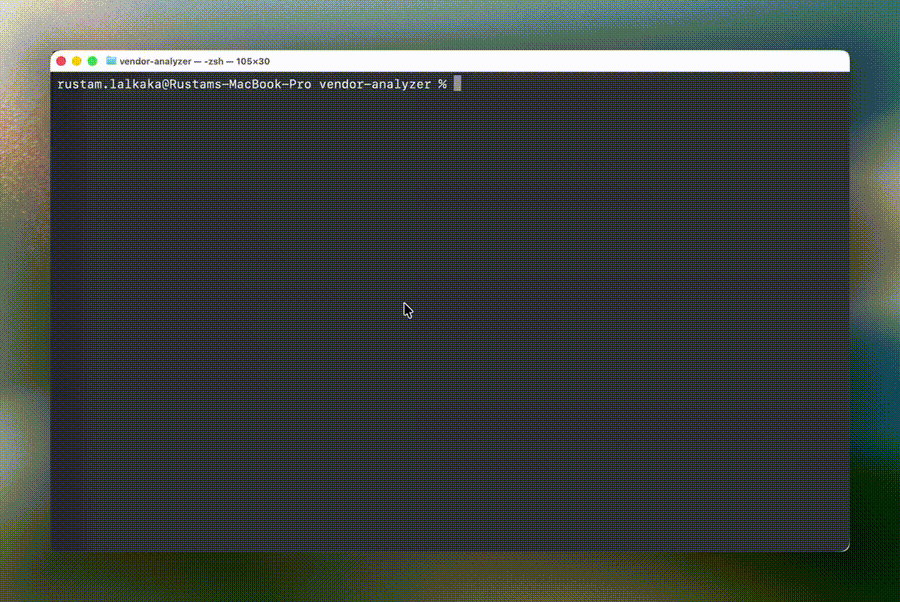

# Agent SDK 正式发布（Introducing the Agent SDK）

> 原文：[Introducing the Agent SDK](https://cursor.com/blog/agent-sdk) · Cursor · 2026-10-20
> 本文由 Kimi CLI 使用 Kimi K3-256k 全文翻译，并由 Agent 校对；已取得全文翻译和转载授权。

软件团队使用以代码定义的智能体来处理开发生命周期中的重复性工作。这些智能体连接到团队的工作场所，并在相关事件发生时采取行动——无论是审查一个拉取请求（pull request）、执行合规工作流，还是排查一次事故。

最有用的智能体是为特定团队的运作方式量身定制的。在此之前，构建这样的智能体通常意味着采用一个围绕他人工作流程设计的产品，或者从零开始自行开发。

今天，我们发布了 Agent SDK——这是我们用来构建自家托管智能体（如 Bugbot、Security Reviewer 和 Rollouts）的框架。Agent SDK 让你能够以代码定义智能体，并像管理其他软件项目一样管理它们。你可以从模板开始，或者让你的编码智能体查阅我们的文档。当智能体准备就绪时，只需一条命令 `agent-sdk deploy`，即可将其部署到 Cursor 基础设施上。

## [#](https://cursor.com/blog/agent-sdk#build-around-your-workflow)围绕你的工作流程构建

Agent SDK 让你能够快速构建和部署按照团队方式工作的智能体。它们响应你的团队已经在处理的事件，并遵循你的团队可以检查和修改的策略。

代码审查就是一个例子。每个团队对于什么需要关注、应该由谁审查都有自己的标准。借助 Agent SDK，你可以构建一个响应来自 GitHub、GitLab 或 Bitbucket 的拉取请求事件的智能体。该智能体可以评估变更的风险，将其路由到合适的团队，并批准符合你策略的变更。

举个例子，Cursor 内部的一个团队建立了一个庞大且快速增长的经验教训知识库，希望每一个拉取请求都能对照它进行检查。这样，即使代码库不断变化，团队过去的决策依然有效。借助 Agent SDK，他们用了大约一天时间就构建出了 kb-reviewer。现在它会在其主代码库的每一个 PR 上运行，标记与已记录经验相矛盾的变更，引用每项发现背后的记录，并鼓励工程师调和它所报告的出入。

对于更复杂的工作，智能体可以将任务交给另一个拥有自己工具和会话的专用智能体。它们还可以将一项工作分配给多个并行工作的子智能体。

Agent SDK 还开箱即用地支持评估（evals）和事件回放，从而实现快速开发，并确保关键工作流按你预期的方式执行。PGA Tour 使用 Agent SDK 来驱动他们的软件开发工厂。评估（evals）让他们保持快速前进。

> Agent SDK 使 PGA 能够在 Cursor 的基础设施上构建我们软件工厂的每一个组件。它提供了我们所需的灵活性，让我们能够构建驱动开发流程的智能体。而内置的评估（evals）支持使我们能够快速迭代新想法，并可靠地优化现有能力。

Michael Gyarmathy

首席工程师，PGA America

## [#](https://cursor.com/blog/agent-sdk#define-everything-in-code)以代码定义一切

一个 Agent SDK 智能体的组织方式就像一个小型软件项目。指导它的指令与其工具的代码、与外部服务的连接以及用于测试它的评估（evals）放在一起。

每个文件都代表智能体所知道或能做的某件事。提示词用 Markdown 编写，而工具则定义为 TypeScript 函数。因为一切都是代码，变更可以像你的其他软件一样，经过同样的版本控制和审查流程。

## [#](https://cursor.com/blog/agent-sdk#deploy-agents-wherever-you-need-them)将智能体部署到任何你需要的地方

当你准备让智能体投入使用时，可以在项目目录中运行 `agent-sdk deploy` 将其部署到 Cursor。该命令会构建智能体，为其分配一个 URL，并在我们的基础设施上启动它。你可以在仪表板中管理密钥和集成，同时继续使用与本地相同的日志、评估（evals）和演练场（playground）。



[观看官方完整视频](https://stream.mux.com/wSa1Fv1OwV2H8jzVwJYAb0202Op2tQXQPBn3Ew021zTWuk.m3u8)

你也可以在自己的基础设施上运行智能体。每个智能体都作为单个 Node 进程运行，可以打包到容器中。

## [#](https://cursor.com/blog/agent-sdk#get-started)开始使用

上手 Agent SDK 的过程与启动任何其他软件项目非常相似。创建一个项目目录，然后启动本地演练场（playground）：

```
import { homedir } from "node:os";
import { join } from "node:path";
import { defineAgent } from "@cursor/agent-sdk";

export default defineAgent({
  name: "Robo",
  model: {
    id: "composer-2.5",
    params: [
      { id: "effort", value: "high" },
      { id: "fast", value: "true" },
    ],
  },
  local: {
    cwd: join(homedir(), ".cache", "factory", "robo"),
  },
})
```

接下来，你可以先进行本地迭代并运行评估（evals），然后再通过 `agent-sdk deploy` 进行部署。

Agent SDK 还附带了一些技能（skills），用于引导编码智能体完成开发过程。你可以让智能体查阅文档，让它帮助你一起构建这个机器人。

Agent SDK 今日正式发布。阅读[文档](https://cursor.com/docs/agent-sdk)并开始使用。
