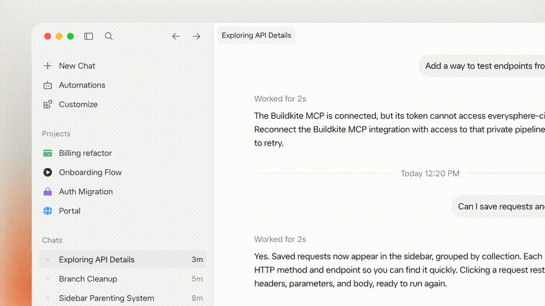
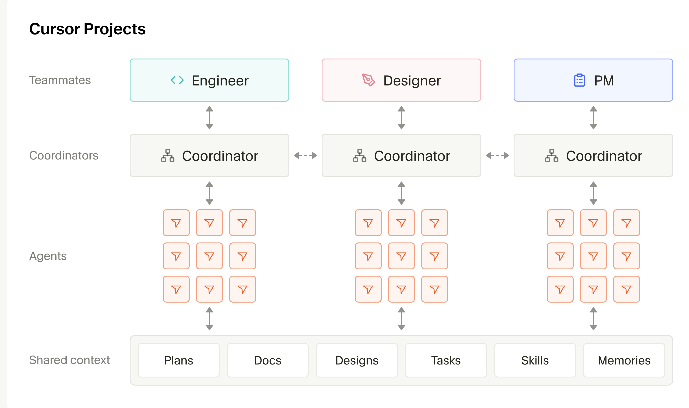

# Cursor Projects 支持多人协作（Cursor Projects is now multiplayer）

> 原文：[Cursor Projects is now multiplayer](https://cursor.com/blog/projects-multiplayer) · Cursor · 2026-11-10
> 本文由 Kimi CLI 使用 Kimi K3-256k 全文翻译，并由 Agent 校对；已取得全文翻译和转载授权。

今年 9 月，我们[推出了 Projects](https://cursor.com/blog/projects)，让工程师可以通过一个协调器（coordinator）指挥一支智能体（agent）舰队，从而承担大规模工作。今天，Projects 迎来重大升级：它现在支持多人协作了。邀请你的队友加入一个 Project，你们就可以与所有智能体一起规划、构建和交付。迄今为止，多智能体系统只为单个用户服务；而 Projects 是为整个团队打造的多智能体系统。

[观看官方完整视频](https://stream.mux.com/vV21zY7yo1viGho3YhIwEqyfkg601BlCJOxr0002KhzPnA.m3u8)

## [#](https://cursor.com/blog/projects-multiplayer#a-multiplayer-multi-agent-workspace)多人协作的多智能体工作空间

市面上不缺团队协作软件，但颇具讽刺意味的是，却没有一款是为编程智能体设计的。Projects 是首个让软件团队与其所有智能体并肩工作的工作空间，共享上下文、记忆和文档。共享任务看板展示每个人在做什么、每个人的智能体在处理什么，以及每个任务背后的 PR，让人类与智能体都获得统一且实时更新的视图。

## [#](https://cursor.com/blog/projects-multiplayer#a-unified-context-system-for-a-whole-team)面向整个团队的统一上下文系统

如今，智能体的上下文是按个人隔离的，新团队成员必须先构建并维护自己的上下文，才能让智能体开始工作。在一个 Project 中，每位队友仍然拥有自己与协调器和工作智能体的一对一对话，各自保有独立的本地上下文。在此之上，Projects 增加了一个共享上下文系统，用于存放需求文档、架构图、技术规格、设计稿等。共享层只需构建一次，并会随着团队的工作不断成长。在某一个对话中做出的决策，Project 中的每个智能体都能获取。当新队友受邀加入 Project 时，上下文已预先配置并保持最新，避免了重复搭建。

这一点在值班（on-call）场景中体现得最为明显。我们的几个团队现在都在共享的 Project 中运行值班轮换。最近，当我们的一位工程师从队友手中接过值班时，在先行确认情况后，他的协调器直接从当前进度接续了工作。它已经知道哪些工作正在进行、哪些问题尚未处理、哪些事故和笔记需要交接，以及需要关注哪些频道、Linear 看板和讨论串。进行中的工作甚至可以直接移交：新队友的智能体会直接接手。

## [#](https://cursor.com/blog/projects-multiplayer#agent-to-agent-communication-across-teammates)跨队友的智能体间通信

共享工作空间与共享上下文开启了队友之间的智能体间通信。这让队友们的智能体能够像人类一样，实时地围绕彼此的工作进行规划并互相解除阻塞。

举例来说，如果一位工程师正在为产品页面添加评论功能，而一位设计师正在重新设计该页面，他们的协调器会及早发现工作重叠并进行同步，从而让评论功能直接构建进新设计中，避免日后返工重构。又或者，当你的功能需要读取数据库，而你的队友正在修改数据库 schema 时，你们的智能体会提前就工作顺序达成一致，这样双方都不会在最后遇到合并冲突。

## [#](https://cursor.com/blog/projects-multiplayer#get-started)开始使用

Multiplayer Projects 首次将协作软件的精神带给了 AI 智能体，让人类团队与智能体舰队拥有一个共同工作的共享空间。它从今天开始以 beta 形式向所有 Cursor 用户推出。要开始使用，请从左侧导航栏创建一个 Project，然后邀请你的队友加入。
