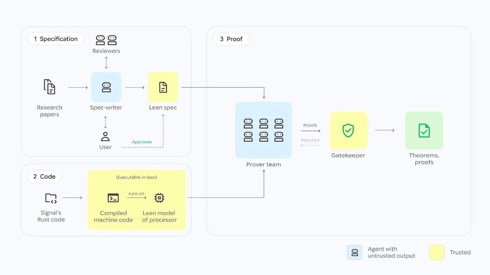

# AlphaProof Code：深入验证复杂软件的突破（Introducing AlphaProof Code: a breakthrough in verifying complex software at depth）

> 原文：[Introducing AlphaProof Code: a breakthrough in verifying complex software at depth](https://deepmind.google/blog/introducing-alphaproof-code/) · Google DeepMind · 2026-11-10
> 本文由 Kimi CLI 使用 Kimi K3-256k 全文翻译，并由 Agent 校对；已取得全文翻译和转载授权。
> 作者：Pushmeet Kohli、Swarat Chaudhuri

2026年11月10日 研究

Pushmeet Kohli 和 Swarat Chaudhuri

[阅读技术论文](https://deepmind.google/documents/36/Formal_Verification_of_Signal_4.pdf)

分享

Google DeepMind 研究人员如何构建一个新的智能体框架，对 Signal 加密协议的代码进行形式化验证——这一直被视为一项重大的安全挑战

今天，我们分享软件安全领域一个长期被视为重大挑战的里程碑：Google DeepMind 研究人员引导 AI 智能体，以数学方式证明了 Signal 协议底层实际代码的关键安全属性。Signal 协议是为 Signal 和 Google Messages 等应用中数十亿私密对话提供保护的技术。

这一突破性发现是通过 **AlphaProof Code** 实现的，**这是一个用于前所未有的深度形式化验证的新型智能体框架，它将人类专业知识与 AI 智能体相结合。** 形式化验证——以数学方式证明代码正确运行且无缺陷——是安全保障的最高标准；然而，它十分困难，且往往需要耗费大量人力。

我们的工作标志着 AI 首次被用于以这种深度对广泛部署的加密协议进行形式化验证。这也是任何方法——无论是否借助 AI——首次对这样一个广泛部署协议的实现进行形式化验证。

## 我们如何验证 Signal

AlphaProof Code 是一个多 LLM 智能体框架，它像研究团队一样拆分形式化验证的工作：人类专家与 AI 协作决定*要证明什么*，然后由一组 AI 智能体去完成证明。

首先，我们的研究人员与多个模型协作，将 Signal 的安全目标转化为形式化的数学规范，并由人类专家对每一项进行审查。随后，由 [Gemini Carbon](https://blog.google/innovation-and-ai/models-and-research/gemini-models/introducing-gemini-4-carbon/) 驱动的智能体完成了证明，生成了超过六百万行 Lean 代码——Lean 是一种用于以数学方式证明代码正确性的计算机语言。

接下来，智能体对证明进行了审计，并标出了需要人工复查的部分——仅占代码库的百分之一，节省了大量时间。由于 Lean 会自动检查其余部分，我们的专家可以将审查重点放在最需要人类判断力的地方。

加密协议支撑着几乎所有的数字通信，从网上银行到网页浏览，一个缺陷就可能同时波及数百万人。这就是为什么专家们数十年来一直在对它们进行形式化分析。

但大多数协议验证止步于设计层面。我们的智能体更进一步，证明编译后的代码满足关键安全属性——例如在设备暂时被入侵之前和之后保持消息受到保护——一直深入到设备上运行的确切代码。由于现实世界的漏洞往往隐藏在设计与实现之间的缝隙中，弥合这一缝隙使这些证明的复杂度大幅提升。

即使在这种复杂度下，我们的验证过程也仅用了四周——这项任务历史上需要专家团队花费数年时间——证明了 Signal 的核心加密代码实现了我们专家所指定的安全保护。

为了确认 AlphaProof Code 能够区分正确代码与有缺陷的代码，我们将两个真实存在、此前已被修复的漏洞重新引入 Signal 代码的隔离版本中。在这两种情况下，系统都生成了经机器检验的证明，证明存在漏洞的版本是不安全的。

*在 AlphaProof Code 中，AI 智能体帮助用户编写规范，然后自主证明实现满足该规范。每个证明都由 Lean 检查，以验证智能体的工作。*

> 以往的形式化验证主要集中在代码的较小部分，而 Google DeepMind 的方法实现了显著的扩展。利用 AI 智能体将实际运行的代码转化为有效的 Lean 定理是一项重大突破。随着 AI 驱动的安全威胁日益增长，严格验证 Signal 协议的实现让我们对代码的隐私保障更有信心。

Ehren Kret

Signal 首席技术官

尽管以往的形式化验证工作必然聚焦于较小的范围，但这一新方法实现了显著的扩展。传统上，验证生产代码是否严格符合其加密设计需要大量的人工工作，因此利用 AI 智能体自动将实际运行的代码转化为有效的 Lean 定理是一项伟大的突破。随着 AI 驱动的安全威胁日益增长，通过自动化定理证明对核心 Signal 协议进行严格验证，让我们更加确信我们的代码兑现了其隐私保障承诺。

## 安全的未来

攻克这一长期挑战展示了 AI 如何为企业、政府和关键基础设施带来精英级的安全保障，帮助抵御智能体驱动的网络威胁。

验证 Signal 的核心加密技术为保护其他重要系统奠定了基础，从医疗设备固件到电网软件。

推广这些技术需要持续的研究。与 [CodeMender](https://deepmind.google/blog/introducing-codemender-an-ai-agent-for-code-security/) 等自动化防御智能体相结合，形式化验证可以帮助应对现代网络威胁的速度和规模，从而创建出能够以数学方式证明其保护措施有效的软件。

我们正在开源我们的[形式化验证成果](https://google-deepmind.github.io/code-verification)，供社区使用。请阅读下方的技术论文。

[阅读技术论文](https://deepmind.google/documents/36/Formal_Verification_of_Signal_4.pdf)

## 致谢

本研究由 Swarat Chaudhuri、Andrew Ferraiuolo、Anton Kovsharov、Tej Chajed、Sam Schlesinger、Karn Seth、Jonathan Katz、Charles Sutton 和 Pushmeet Kohli 共同完成。

我们感谢 Eric Wieser 在代码开源方面提供的帮助，感谢 Owen Jones 的项目管理支持，感谢 Martín Abadi、Christopher Henson、Katerina Hristova、Henryk Michalewski、Jonathan Protzenko 和 George Tsoukalas 的有益讨论。我们感谢 Signal 的 Rolfe Schmidt、Michael Rosenberg 和 Ehren Kret 对我们方法论提出的反馈。我们还感谢 Tulsee Doshi、Four Flynn、Kate Olszewska、Alicia Huang、Andy Liu、Benoit Schillings、Raluca Ada Popa、Melvin Johnson、Koray Kavukcuoglu、Demis Hassabis 和 Sundar Pichai 对本项目的支持。
