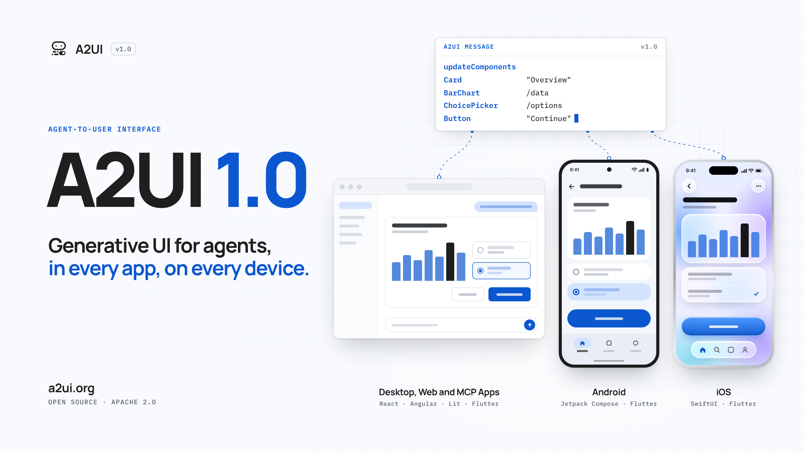
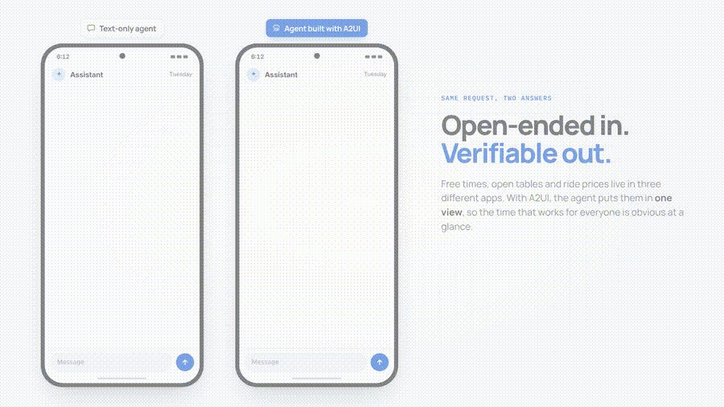
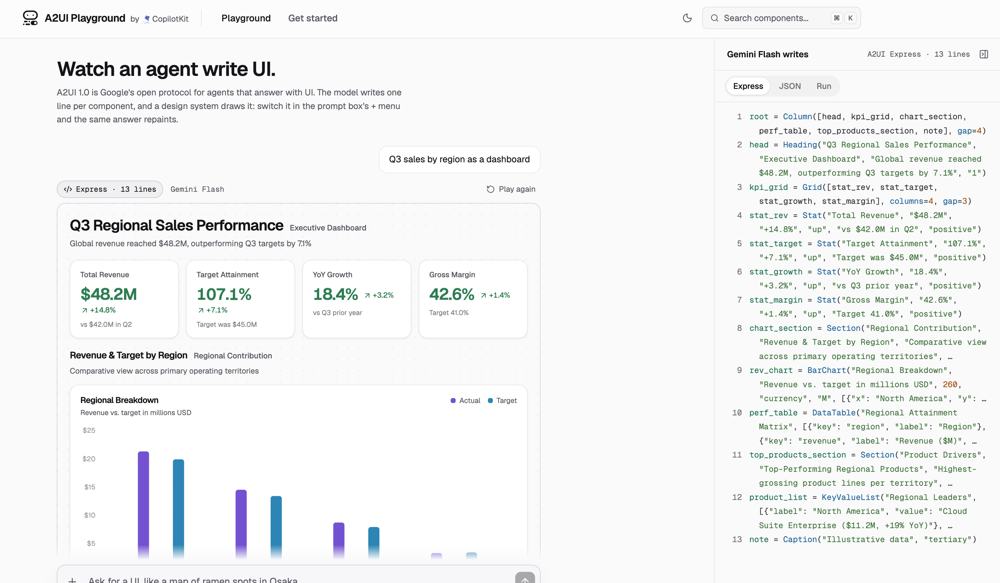
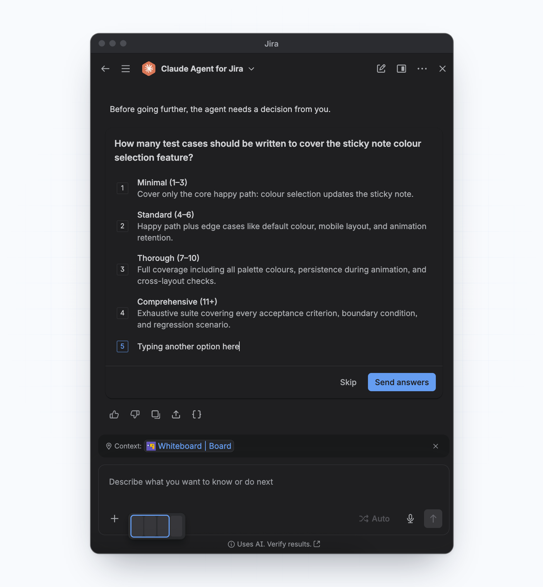
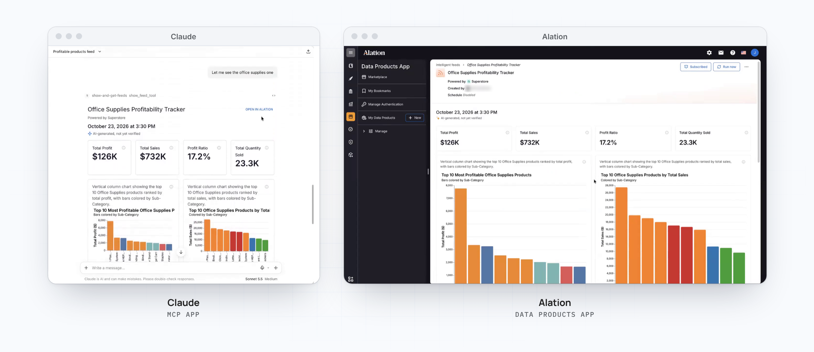
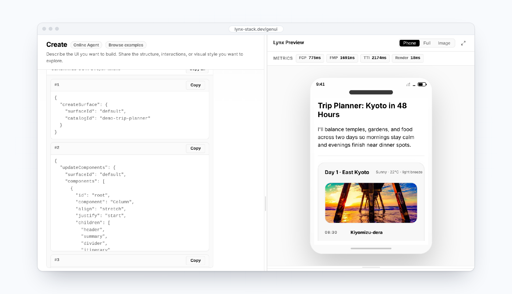
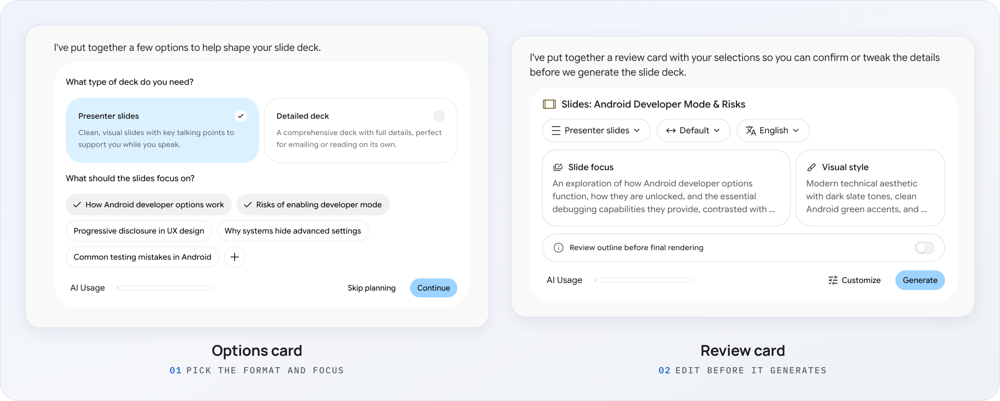

# A2UI 1.0：构建流畅可靠的 Agent 交互体验（A2UI 1.0: Build delightful, fast, reliable, agentic experiences）

> 原文：[A2UI 1.0: Build delightful, fast, reliable, agentic experiences](https://developers.googleblog.com/en/a2ui-10-build-delightful-fast-reliable-agentic-experiences/) · Google · 2026-11-11
> 本文由 Kimi CLI 使用 Kimi K3-256k 全文翻译，并由 Agent 校对；已取得全文翻译和转载授权。
> 作者：Vishal Motwani、Google A2UI Team

如今用户与智能体的交互，就像终端时代的计算机：能力强大，但几乎所有回答都是纯文本。用户可以通过打字或说话向智能体提出任何请求，而返回的通常是一大段文字——用它来比较三款产品，或者编辑并批准一份详细计划，都是很糟糕的方式。

今天**，**我们发布 A2UI 1.0，这是我们用于生成式 UI 的开放协议的首个稳定版本。它让 AI 智能体可以用交互式界面来回答，例如一个待确认的表单或一张图表。开发者现在就可以使用它，配套的工具有：面向 Web、Android 和 iOS 的开源渲染器 SDK，以及面向 Python、TypeScript 和 Dart 的智能体 SDK。[Atlassian](https://www.atlassian.com/)、[Alation](https://www.alation.com/)、[Bloomberg](http://techatbloomberg.com/) 和 [ByteDance](https://www.bytedance.com/) 等公司已经在用它进行构建。

借助 A2UI，智能体描述要展示什么，每个应用用自己的原生组件绘制 UI。应用接收 A2UI 消息，并以原生速度安全地渲染内容。无论用户是在企业自己的应用中访问其智能体，还是在托管 MCP 应用的第三方 AI 助手（如 Gemini 或 Claude）中访问，都能获得同样的低延迟、高可信度和完整的原生保真度。

## 为什么选择 A2UI

- **当下即个性化。** 你的智能体构建的 UI 会适应每位用户独特的需求和偏好。
- **贴合你的品牌。** 智能体只使用你的设计系统，别无其他。它们只放置和配置你注册的组件。
- **生产环境中快速、可靠且安全。** LLM 使用 [A2UI Express](https://a2ui.org/concepts/inference-formats/) 或使用「系统一」决策模型来组合 UI——挑选组件而不是撰写文本。A2UI 在服务器端可靠地绑定到你的数据和子组件，因此敏感值永远不会到达模型，并且应用在智能体工作时以流式方式呈现 UI。

## 开发者可以用 A2UI 构建什么

你一觉醒来病了。要撑过这个早晨需要六个应用：预约视频问诊、挪动会议、通知团队、开启外出自动回复、请伴侣去接孩子放学，再点一份汤。如果改问一个纯文本智能体，你会得到一面编号文字墙，然后是一轮又一轮的「选哪几个？」。A2UI 不会替你度过病假，但它为开发者提供了框架，去构建一个能做到这些的智能体。这个智能体可以用一个视图回答，把六个应用全部呈现出来。更改计划只需轻点几下，而不是再来一轮消息往来，而且在你确认之前不会发送任何内容。

[观看原始视频：官方视频 1](https://storage.googleapis.com/gweb-developer-goog-blog-assets/original_videos/A2UI_1.0_sick_day_three_ways_2.mp4)

同一个病假日的三种处理方式。第三个应用展示了开发者可以用 A2UI 构建的那类智能体界面（示意图）。

同一份智能体输出可以在任何屏幕上工作。让智能体「把和 Priya 的晚餐改到周五」，它可以用一个视图来回答：并排展示你的日历、餐厅预订应用里的空位以及网约车应用的价格，让适合所有人的时间一目了然。开发者用 A2UI 构建一次这个视图，它就能在你的手机和笔记本电脑上原生渲染。

[观看原始视频：官方视频 2](https://storage.googleapis.com/gweb-developer-goog-blog-assets/original_videos/A2UI_1.0_dinner_every_screen.mp4)

同一个请求分别以文本和 A2UI 回答，然后是笔记本上的同一视图（示意图）。

在这两个例子中，A2UI 是简化跨平台构建这些体验的框架。开发者构建智能体，并选择它要支持的平台。A2UI 为他们提供智能体用来描述每个视图的协议、在单个视图中组合来自不同应用的组件的方式，以及在 Web、Android 和 iOS 上原生绘制的渲染器。

刚接触 A2UI？从 [CopilotKit 的 A2UI Playground](https://go.copilotkit.ai/a2ui-playground) 开始，或者查看[行业示例](https://a2ui.org/get-help/)。

Copilotkit 的 A2UI Playground

## 1.0 的新变化

- **稳定的协议。** 1.0 版本增加了双向函数调用，因此航班或预订选择器可以当场查询可用性。协议还增加了对无障碍功能的支持，以及用于任何附加元数据的扩展。
- **面向主要平台的渲染器库。** 开源渲染器用以下技术绘制 A2UI 界面：Web 上的 [React](https://www.npmjs.com/package/@a2ui/react)、[Angular](https://www.npmjs.com/package/@a2ui/angular) 和 [Lit](https://www.npmjs.com/package/@a2ui/lit)；移动端、Web 和桌面端的 [Flutter](https://pub.dev/packages/a2ui_flutter)；iOS 上的 [SwiftUI](https://github.com/a2ui-project/a2ui/tree/main/swift/swiftui) 和 Android 上的 [Jetpack Compose](https://developer.android.com/jetpack/androidx/releases/a2ui-compose)（当前为 v0.9.1，v1.0 即将推出）。Web 和 Flutter 渲染器还可以在 [MCP Apps](https://modelcontextprotocol.io/extensions/apps/overview) 内部运行，因此 A2UI 界面可以出现在支持 MCP Apps 的 AI 助手中，例如 [Claude](https://claude.com/blog/interactive-tools-in-claude) 和 [Gemini](https://cloud.google.com/blog/topics/developers-practitioners/devs-guide-to-mcp-apps-in-gemini)。
- **通过面向智能体 SDK 的 A2UI 实现快速、可靠的 UI 生成。** 新的 [TypeScript](https://www.npmjs.com/package/@a2ui/agent) 和 [Dart](https://pypi.org/project/a2ui-agent-sdk/) SDK 与 [Python](https://pypi.org/project/a2ui-agent-sdk/) SDK 一起，通过生成技能、翻译消息和纠正错误，简化了与你的智能体框架或工具链的集成。可替换的推理格式可降低延迟，而在 Python 中，[A2UI Macros](https://a2ui.org/guides/macros/) 增加了可编程的组件展开和数据绑定。

## 今天就在用 A2UI 构建的团队

### **Atlassian**

Atlassian 正在把 A2UI 引入 Jira，团队可以在其中[将工作项分配给 AI 智能体](https://www.atlassian.com/software/jira/dev)。当智能体需要团队跟进才能完成某个工作项时——例如缺少细节或需要决策——它会在工作项中用一张交互式卡片提问，团队就在 Jira 中直接回答。

图 1. 智能体在 Jira 工作项内向团队请求跟进。

### **Alation**

Alation 智能操作系统（AIOS）使用 A2UI 构建其信息流：指标卡片、图表等。每张图表都可以显示其背后的 SQL 查询和数据。向 Claude 询问一份关于盈利产品的信息流，信息流就会在对话中渲染出来，由 A2UI 渲染指标卡片、图表和自定义组件。同样的信息流、同样的信息，可以直接在 Alation 中以几乎相同的布局查看。

> 「Alation 智能操作系统（AIOS）把包含数据、图表和洞察的成果直接带到团队工作的地方，并透明地展示每个数字的来源。A2UI 提供了交互式 UI 骨架，让这些成果无论是在 Alation 中使用，还是在我们客户已经在用的 AI 助手中使用，都感觉像是精心打造、量身定制的应用。」\
>
>  - ***GT Volpe，Alation 产品管理副总裁***

图 2. 同一份 Alation 信息流分别在 Claude（左）和 Alation 的 Data Products App（右）中渲染。

### **ByteDance（字节跳动）**

字节跳动于 2026 年 6 月[发布了适用于 Lynx 的 A2UI 渲染器](https://lynxjs.org/react/genui/a2ui.html)，Lynx 是其跨平台框架。Lynx 让流式界面保持流畅，并提供了一套基于其 `lynx-ui` 库构建的默认组件。在 [Lynx GenUI Playground](https://lynx-stack.dev/genui/#/a2ui) 中，你可以看到 A2UI 消息被原生渲染，例如渲染成一个京都两日游规划器。Lynx 目前支持 A2UI 0.9，并正在与 A2UI 团队一起适配 1.0。

> 「A2UI 正朝着正确的方向前进：它将模型生成界面的方式与应用渲染界面的方式分离开来。可替换的推理格式和宏让生成保持高效，甚至可以把 LLM 换成系统一（System 1）模型。在我们的 playground 中，像 Jev 这样的决策模型挑选组件和值，而不是撰写文本，然后由 SDK 构建出 Lynx 原生渲染的 A2UI 界面。」\
>
>  - **Shouqun Liu**，字节跳动 Lynx 工程负责人

图 3. 在 Lynx GenUI Playground 中，A2UI 消息（左）在 Lynx 中原生渲染为京都旅行规划器（右）。

## Google 内部

### **Gemini Notebook**

让 Gemini Notebook 做一套幻灯片，它会回复一张卡片，询问两件事：演讲者幻灯片还是详细演示文稿，以及要聚焦哪些主题。随后是一张审阅卡片，列出格式、重点和视觉风格，你可以在生成演示文稿之前进行编辑。同样的卡片也引导着 Web 端和移动端的视频概览（Video Overviews）功能。

图 4. Gemini Notebook 的选项卡片（左）和审阅卡片（右）。

## Gemini 内部

组织可以注册自己用 A2UI 进行响应的智能体。Gemini 使用其 A2UI 组件库中的组件渲染这些响应，目前支持 A2UI 0.9.1。Google Cloud 文档介绍了如何[注册智能体](https://docs.cloud.google.com/gemini/enterprise/docs/a2ui-agents/register-and-manage-an-a2ui-agent)，以及如何在 [Cloud Run](https://docs.cloud.google.com/gemini/enterprise/docs/a2ui-agents/tutorial-host-agent-cloud-run) 上托管智能体。

其他几个 Google 团队——包括一些来自我们最大产品背后的团队——正在用 A2UI 构建功能。

其他几个 Google 团队——包括一些来自我们最大产品背后的团队——正在用 A2UI 构建尚未发布的功能。随着这些功能上线，我们会分享更多信息。

## A2UI 与 MCP Apps

A2UI 与 MCP Apps 协同工作。Alation 已经同时使用二者，在 Claude 中展示其 A2UI 信息流。我们六月的文章 [A2UI + MCP Apps](https://developers.googleblog.com/a2ui-and-mcp-apps/) 介绍了三种结合方式，而 [A2UI in MCP Apps 指南](https://a2ui.org/guides/a2ui-in-mcp-apps/) 则演示了如何在 MCP App 内运行 A2UI 界面。

## 接下来

面向 1.0 的 Jetpack Compose 支持即将推出。[Gemini Enterprise](https://cloud.google.com/gemini-enterprise) 中的智能体已经可以使用 A2UI，我们正在将 Gemini Enterprise 升级到 A2UI 1.0。[A2UI 路线图](https://a2ui.org/roadmap/) 涵盖了其余内容——从能在每个平台上原生渲染的设计系统原语，到对 Jev 等决策模型的官方 SDK 支持。

## 开始使用

- 阅读文档，并在 [a2ui.org](https://a2ui.org/) 上试用[快速上手](https://a2ui.org/quickstart/)。
- 选择渲染器：Web 端有 [React](https://www.npmjs.com/package/@a2ui/react)、[Angular](https://www.npmjs.com/package/@a2ui/angular) 和 [Lit](https://www.npmjs.com/package/@a2ui/lit)；移动端、Web 端和桌面端有 [Flutter](https://pub.dev/packages/a2ui_flutter)；iOS 端有 [SwiftUI](https://github.com/a2ui-project/a2ui/tree/main/swift/swiftui)。[Jetpack Compose](https://developer.android.com/jetpack/androidx/releases/a2ui-compose) 渲染器目前支持 0.9.1，1.0 支持即将推出。
- 正在从 0.9 升级？[演进指南](https://github.com/a2ui-project/a2ui/blob/main/specification/v1_0/docs/evolution_guide.md)涵盖了每一项变更。
- 在 [github.com/a2ui-project/a2ui](https://github.com/a2ui-project/a2ui) 提交 issue 并讨论想法。

## 寻找灵感？

我们与合作伙伴协作，他们围绕不同行业构建了 A2UI 1.0 演示，为你如何将 A2UI 应用于自己的用例提供灵感。来看看他们的成果：

1. [Homeward](https://homeward-genui.web.app/)（房地产与搬家智能体），由 [Moonwise](https://moonwise.se/) 开发
2. [Investing companion](https://finance-a2ui-v1.web.app/)（金融与投资智能体），由 [Somnio Software](https://www.somniosoftware.com/) 开发
3. [Alder](https://aldera2ui.netlify.app/)（造型师智能体），由 [L+R](https://levinriegner.com/) 开发；
4. [GenUI Clinic](https://genui-clinic.solid.software/)（医疗记录智能体），由 [Solid Software](https://solid.software/) 开发
5. [Riviera Home](https://a2ui-vgv-smart-home.web.app/)（智能家居智能体），由 [Very Good Ventures](https://verygood.ventures/) 开发
6. [Vital Loop](https://vital-loop-555131973673.us-central1.run.app/)（生命体征追踪智能体），由 [Oak Tree Apps](https://vital-loop-555131973673.us-central1.run.app/) 开发
7. 想了解在本地或浏览器内模型上运行 A2UI Express 的一种方式，请参阅 [Soverius AI](https://soverius.ai/) 的[实操演示](https://youtu.be/kZ7fzADj1HM)和 [Gemma 4 微调文章](https://soverius.ai/blog/a2ui-10-express-delivery)。
8. 在 [Copilotkit](https://www.copilotkit.ai/) 提供的 [A2UI playground](https://go.copilotkit.ai/a2ui-playground) 中尝试你自己的想法
