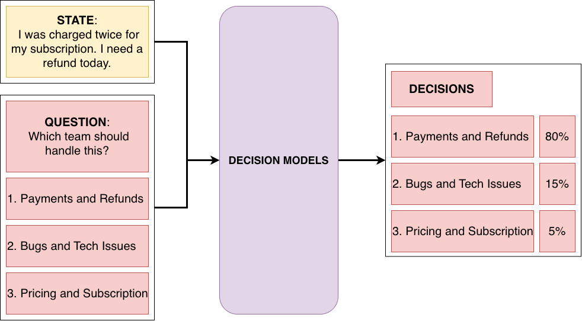

# Hugging Face 中的决策模型（Decision Models in Hugging Face）

> 原文：[Decision Models in Hugging Face](https://huggingface.co/blog/decision) · Hugging Face · 2026-11-10
> 本文由 Kimi CLI 使用 Kimi K3-256k 全文翻译，并由 Agent 校对；已取得全文翻译和转载授权。
> 作者：Aritra Roy Gosthipaty、Lysandre、Pedro Cuenca、Tom Aarsen

大语言模型（LLM）在生成文本方面表现得异常出色。我们用它们来回答问题、编写代码、推理问题，以及做更多的事情。*但并非每个问题都需要生成文本。*

假设一个客户支持系统收到以下消息：

"我的订阅被重复扣费了。我今天就需要退款。"

系统需要判断应由哪个团队处理该请求、请求的紧急程度，以及客户是否在请求退款。

我们可以让 LLM 返回一个包含这些答案的 JSON 对象。

````bash
llama cli -hf ggml-org/gemma-4-e4b-it-GGUF:Q4_0

> We have the following customer support ticket, "I was charged twice for my subscription. I need a refund today.", which team should handle the request, how urgent it is, and whether the customer is requesting a refund. Give the answers in JSON.

[Start thinking]
...
[end thinking]
```json
{
  "team_to_handle": "Billing",
  "urgency": "High",
  "request_refund": true
}
````

但如果模型能够直接评估可用选项，并返回这些选项上的概率分布，*而不生成任何文本*，那会怎样？

```python
from transformers import pipeline

decide = pipeline("decision", model="autotrust/GEV-26B-Decide")
decision = decide(
    {
        "state": "I was charged twice for my order and want a refund.",
        "questions": {
            "department": {
                "type": "choice",
                "instructions": "Which team should handle this?",
                "criteria": {
                    "billing": "Payments and refunds",
                    "technical": "Bugs and technical issues",
                    "sales": "Pricing and subscriptions"
                }
            },
        }
    }
)

# {
#   'department': {
#       'type': 'choice',
#       'choice': 'billing',
#       'confidence': 0.9974000453948975,
#       'probabilities': {
#         'billing': 0.9982666969299316,
#         'technical': 0.0010246571619063616,
#         'sales': 0.0007087149424478412
#       }
#     }
# }
```

这正是**决策模型（decision models）**背后的核心思想。

## 什么是决策模型？

决策模型接收某种输入上下文（状态，state），对一个带有一组预定义可能答案（原语，primitives）的问题进行评估，并返回一个带有概率的结构化决策。我们不再要求模型逐 token 地生成答案，而是要求它为我们的应用程序已经理解的那些答案分配概率。

[](../../../assets/articles/5f3963726dbe36e6/d37b008fec93d7a37595a955.png)

[TypeSafe AI 推出了 Jev](https://typesafe.ai/blog/introducing-system-one-models-and-jev)，将其描述为一种[*系统一模型（System One model）*](https://en.wikipedia.org/wiki/Thinking,_Fast_and_Slow)。这个名字的灵感来自快速直觉思维（系统 1）与较慢的审慎思维（系统 2）之间的区别。

> 社区已经逐渐统一到**决策模型（decision model）**这个术语上，因为它描述的是模型的计算角色，而不是援引某种特定的认知理论。在本文的其余部分，我们将把这些模型称为"决策模型"，而不是"系统一模型"。（[一个关于我们应如何称呼这类模型的 Twitter 投票](https://x.com/ariG23498/status/2113220513158009022)）

对于决策模型来说，其基本接口是：

```text
State + Questions + Allowed Answers → Decisions + Probabilities
```

## 为什么不把 LLM 用于一切？

我们可以直接提示 LLM 返回一个包含决策结果的 JSON 对象。事实上，许多应用程序已经以这种方式将语言模型用于分类、路由和其他结构化任务。

然而，这种方法存在一些问题。

- LLM 并不保证遵循所请求的 schema：即使有明确的指令，模型也可能生成无效的 JSON、引入意料之外的键，或返回允许选项之外的答案。
- 约束解码有所帮助，但并不能消除计算开销：诸如 [Outlines](https://github.com/dottxt-ai/outlines) 和 [XGrammar](https://github.com/mlc-ai/xgrammar) 之类的库，可以通过限制模型在每一步允许生成的 token 来强制执行语法或 JSON schema。这能确保输出符合所支持的结构约束，但会引入额外的工作。
- 为什么要生成一整个回复：LLM 是为开放式生成而设计的，但当我们的应用程序只需要在预定义答案之间做选择时，自回归解码可能是不必要的工作。

## 决策模型与分类模型有何不同？

在理解决策模型的接口之前，有必要回顾两种密切相关的方法，即传统分类和零样本分类。

### 传统分类

假设我们训练一个分类器，将客户支持请求路由到三个部门：

- 账单（Billing）
- 技术支持（Technical support）
- 销售（Sales）

传统的分类模型学习从输入到一组预定义标签的映射。在训练期间，模型学会从示例中预测这些标签。分类头通常为每个类别产生一个 logit，softmax 再将这些 logit 转换为概率分布。

这里的局限性在于，***输出类别被固化在模型的分类头中***。

如果我们引入第四个部门，例如法务（Legal），现有的分类器不会自动获得相应的输出类别。我们可能需要修改分类头、收集训练数据，并**重新训练**或适配模型。

### 零样本分类

[零样本分类](https://huggingface.co/tasks/zero-shot-classification)解决了这一局限中的一个重要部分。我们不再要求分类器必须在每个输出类别上专门训练，而是在推理时提供候选标签。

例如：

```python
from transformers import pipeline

classifier = pipeline(
    "zero-shot-classification",
    model="facebook/bart-large-mnli",
)

classifier(
    "My payment was deducted twice.",
    candidate_labels=["billing", "technical support", "sales"],
)

# {'sequence': 'My payment was deducted twice.',
#  'labels': ['billing', 'sales', 'technical support'],
#  'scores': [0.8466812372207642, 0.0962134450674057, 0.05710534751415253]}
```

与传统的固定标签分类器不同，类别可以随请求而变化。让我们再添加一个部门，例如"法务（Legal）"，看看模型的输出。

```python
from transformers import pipeline

classifier = pipeline(
    "zero-shot-classification",
    model="facebook/bart-large-mnli",
)

classifier(
    "My payment was deducted twice.",
    candidate_labels=["billing", "technical support", "sales", "legal"],
)

# {'sequence': 'My payment was deducted twice.',
#  'labels': ['billing', 'sales', 'technical support', 'legal'],
#  'scores': [0.8185835480690002, 0.09302053600549698, 0.05521026626229286, 0.03318570926785469]}
```

一种常见的实现方式是使用为自然语言推理（NLI）训练的模型。每个候选标签被转换为一个假设，模型衡量输入对该假设的蕴含程度。

这听起来已经与决策模型非常相似了。而且在许多方面，确实如此。

### 决策模型的不同之处

决策模型将这一思想扩展到不仅仅是把输入分配到某个类别。一个决策模型可以接收关于同一状态的多个命名问题，且答案类型各不相同。这些类型可以是在若干备选项中选择（choice）、对有序等级进行打分（score），或者估计一个命题为真的概率（noul）。

更重要的是，其接口是围绕**可能决策上的概率分布**来设计的。

请比较以下三种方法：

| 属性 | 分类 | 零样本分类 | 决策模型 |
| --- | --- | --- | --- |
| 选项上的概率 | 是 | 是 | 是 |
| 标签在推理时定义 | 否 | 是 | 是 |
| 多个带类型的问题 | 否 | 否 | 是 |
| 有序打分和是/否决策 | 特定于任务 | 经过适配后可行 | 原生原语 |

决策模型的优势并不在于它们发明了运行时定义的标签或概率分类，而在于它们将这些能力组织成一个一致的接口，并可能由专门为决策优化的架构和训练过程作为支撑。

## 决策模型接口

一个决策模型请求包含以下两个组成部分：

1. 状态（state）
2. 问题（questions）

### 状态

状态是模型应当评估的信息。它可以是一个字符串、一个结构化的 JSON 对象，或者对于受支持的全模态（omni-modal）模型而言的其他模态。

例如：

```json
{
  "customer_message": "I was charged twice. Please refund me today.",
  "subscription": "pro",
  "previous_tickets": 2
}
```

### 问题及其原语

问题描述了我们想了解关于状态的什么信息。在决策模型接口中，三种基本原语代表了不同形式的决策：

1. **Choice（选择）：** 从若干可能的答案中选择一个。
2. **Score（打分）：** 在一个有序等级上对某事物进行评估。
3. **Noul：** 以概率方式回答一个是/否问题。

让我们逐一介绍。

#### Choice：选项上的概率分布

Choice 是最直观的原语，也最接近传统分类。

假设我们问：

> 这个客户请求应该由哪个部门处理？

可用选项有账单（Billing）、技术支持（Technical support）和销售（Sales）。

```python
from transformers import pipeline

decide = pipeline("decision", model="autotrust/GEV-26B-Decide")
decision = decide(
    {
        "state": "I was charged twice for my order and want a refund.",
        "questions": {
            "department": {
                "type": "choice",
                "instructions": "Which team should handle this?",
                "criteria": {
                    "billing": "Payments and refunds",
                    "technical": "Bugs and technical issues",
                    "sales": "Pricing and subscriptions"
                }
            },
        }
    }
)

# {
#   'department': {
#     'type': 'choice',
#     'choice': 'billing',
#     'confidence': 0.9974000453948975,
#     'probabilities': {
#       'billing': 0.9982666969299316,
#       'technical': 0.0010246571619063616,
#       'sales': 0.0007087149424478412
#     }
#   }
# }
```

模型为每个选项分配一个 logit。对于 logit $z_1,\ldots,z_K$（共 $K$ 个类别），我们可以用 softmax 得到概率：

$$
p_i=\frac{\exp(z_i)}{\sum_{j=1}^{K}\exp(z_j)}
$$

这里，$K$ 是选项的数量。

来看这个示例性的分布：

| 选项 | 概率 |
| --- | --- |
| 账单（Billing） | 0.998 |
| 技术支持（Technical support） | 0.001 |
| 销售（Sales） | 0.001 |

概率之和为一：

$$
\sum_{i=1}^{K}p_i=1.
$$

模型选择概率最大的选项：

$$
\hat y=\arg\max_i p_i
$$

在本例中，选择是账单（Billing），概率为 0.998，但其余概率同样有用。它们告诉我们模型如何在各备选项之间分配其置信度。

#### Score：有序分布的期望

当存在若干不同的备选项时，Choice 行之有效。但如果我们想在一个有序等级上度量某事物呢？

考虑这个问题：

> 这个客户请求有多紧急？

我们定义三个等级：

- 0：低紧急度
- 1：中紧急度
- 2：高紧急度

```python
from transformers import pipeline

decide = pipeline("decision", model="autotrust/GEV-26B-Decide")
decision = decide(
    {
        "state": "I was charged twice for my order and want a refund.",
        "questions": {
            "urgency": {
                "type": "score",
                "instructions": "How urgent is the request?",
                "criteria": ["low", "medium", "high"]
            },
        }
    }
)

# {
#   'urgency': {
#     'type': 'score',
#     'score': 1.7053890228271484,
#     'legend': {
#       '0': 'low',
#       '1': 'medium',
#       '2': 'high'
#     },
#     'confidence': 0.5580834252759814,
#     'probabilities': {
#       '0': 0.014908230863511562,
#       '1': 0.26479458808898926,
#       '2': 0.7202972173690796
#     }
#   }
# }
```

模型同样产生一个概率分布：

| 等级 | 概率 |
| --- | --- |
| 0 — 低 | 0.01 |
| 1 — 中 | 0.26 |
| 2 — 高 | 0.72 |

Score 原语并非只返回最可能的等级，而是计算**等级索引的期望值**。

对于表示等级的随机变量 $X$，期望为：

$$
\mathbb{E}[X]=\sum_{i=0}^{K-1}ip_i
$$

对于我们的例子：

$$
\mathbb{E}[X] = 0(0.01)+1(0.26)+2(0.72)=1.7
$$

因此报告的分数是 `1.7`。

这并不意味着模型选择了一个介于中和高之间的虚构等级。它的意思是其概率分布的期望是 1.7。

#### Noul：伯努利决策

第三个原语是 Noul，它表示一个二元问题。

例如：

> 客户是否在请求退款？

```python
from transformers import pipeline

decide = pipeline("decision", model="autotrust/GEV-26B-Decide")
decision = decide(
    {
        "state": "I was charged twice for my order and want a refund.",
        "questions": {
            "refund": {
                "type": "noul",
                "instructions": "Is the customer requesting a refund?"
            }
        }
    }
)

# {
#   'refund': {
#     'type': 'noul',
#     'noul': 0.9947046637535095
#   }
# }
```

我们不再定义一个选项列表，而是要求模型返回答案为真的概率。我们可以借助伯努利分布来理解这一点（noul 一词即来自 Bernoulli）。

令 $Y$ 表示一个二元结果：

$$
Y\sim\operatorname{Bernoulli}(p)
$$

其中

$$
P(Y=1)=p,\qquad P(Y=0)=1-p.
$$

如果模型返回：

```json
{"type": "noul", "noul": 0.92}
```

那么它为"是"分配了 `0.92` 的概率，为"否"分配了 `0.08` 的概率。

这里的模型并不是在随机采样一个二元答案。它返回的是概率参数本身，由应用程序来决定如何据此采取行动。

#### 置信度（Confidence）：模型有多确定？

到目前为止，我们已经从模型获得了概率分布。但决策模型接口还会为 Choice 和 Score 返回一个名为 `confidence` 的字段。

完整的分布可能包含多个可能的答案，而概括模型的置信集中程度是很有用的。`confidence` 正是用来实现这一点的。

对于一个有 $K$ 个选项的 Choice，置信度为：

$$
\frac{p_{\max}-\frac{1}{K}}{1-\frac{1}{K}}
$$

其中 $p_{\max}$ 是预测的最大概率。

其直觉是：

- 均匀分布的置信度为 0。$p_{\max} = \frac{1}{K}$。这意味着模型估计所有选项的可能性相同。
- 完全集中在一个选项上的分布置信度为 1。$p_{\max} = 1$
- 获胜概率相对于均匀分布越大，置信度就越高。

在前面那个三选项的例子中，账单（Billing）的概率为 0.998：

$$
C=\frac{3(0.998)-1}{2}=0.997
$$

请注意，获胜概率为 0.998，但报告出的置信度是 0.997。置信度是相对于可用选项的数量对最大概率做归一化得到的。相比之下，前面有序 Score 示例的置信度仅为 0.558。

## Hugging Face 生态系统中的决策模型

决策模型是一个年轻且快速发展的领域。每个模型在底层的决策方式都不尽相同（对整个 schema 联合打分的头部、架在 LLM 骨干之上的独立读出层、面向边缘设备和多模态的变体，等等）。这种多样性是健康的，但它也有代价。如果每个模型都暴露自己的接口，那么围绕它的每个工具都需要做针对特定模型的适配。

Hugging Face 的目标是在不强制统一**实现**的前提下，就统一的**接口**达成共识。一个决策模型在内部想怎么工作都可以，只要它接受相同的状态和问题，并返回相同类型的决策即可。一旦这个契约存在，生态系统的其余部分就只需在此之上构建一次：

- 像 llama.cpp 这样的推理引擎可以通过相同的 API 服务任何决策模型
- Hub 可以一致地打包和展示它们
- 训练工具可以面向共享的原语，而不是针对个别架构

本节的其余部分将逐一介绍这些内容。

### 1. 使用 Transformers 提供服务

Transformers 现已支持 `DecisionPipeline`、`AutoModelForDecision` 和 `DecisionConfig` 类。它们遵循 `transformers` 中 pipeline 和模型类的相同整体结构，但专为决策模型量身定制。

```python
from transformers import pipeline

decide = pipeline("decision", model="autotrust/GEV-26B-Decide")
print(decide)

# DecisionPipeline: {'model': 'JevForDecision', 'dtype': 'bfloat16', 'device': 'cuda', 'input_modalities': 'text'}
```

还可以像这样检查配置和模型：

```python
from transformers import AutoModelForDecision, DecisionConfig

model_id = "autotrust/GEV-26B-Decide"
config = DecisionConfig.from_pretrained(model_id)
model = AutoModelForDecision.from_pretrained(model_id)
```

[Transformers 还支持 `/v1/systemone` 端点](https://huggingface.co/docs/transformers/main/en/serve-cli/serving#v1systemone)。

我们可以使用 serving 依赖项启动一个本地服务器：

```bash
pip install "transformers[serving]"
transformers serve
```

使用兼容版本的 Transformers，我们就可以发送一个决策请求：

```json
curl http://localhost:8000/v1/systemone \
  -H "Content-Type: application/json" \
  -d '{
    "model": "autotrust/GEV-26B-Decide",
    "state": "I was charged twice. Please refund me today.",
    "questions": {
      "department": {
        "type": "choice",
        "instructions": "Which team should handle this?",
        "criteria": {
          "billing": "Payments and refunds",
          "technical": "Bugs and technical issues",
          "sales": "Pricing and subscriptions"
        }
      },
      "urgency": {
        "type": "score",
        "instructions": "How urgent is the request?",
        "criteria": ["low", "medium", "high"]
      },
      "refund": {
        "type": "noul",
        "instructions": "Is the customer requesting a refund?"
      }
    }
  }'
```

响应包含三个命名答案及其对应的类型化结果和概率。

```bash
{
  "model":"autotrust/GEV-26B-Decide",
  "answers":{
    "department":{
      "type":"choice",
      "choice":"billing",
      "confidence":0.9974000453948975,
      "probabilities":{
        "billing":0.9982666969299316,
        "technical":0.0010246571619063616,
        "sales":0.0007087149424478412
        }
    },
    "urgency":{
      "type":"score",
      "score":1.7525686174631119,
      "legend":{"0":"low","1":"medium","2":"high"},
      "confidence":0.6288529792800546,
      "probabilities":{
        "0":0.014000383205711842,
        "1":0.2194305807352066,
        "2":0.7665690183639526
      }
    },
    "refund":{
      "type":"noul",
      "noul":0.9953224062919617
    }
  },
  "usage":{"input_tokens":148,"output_tokens":0}
}
```

> 一个有趣的细节是，上述 API 也适用于兼容的自回归语言模型。Transformers 会构造决策提示，在批量前向传播中评估答案标签的 logits，并应用 softmax，而不生成响应文本。这意味着我们**不**一定需要训练新模型，就可以试验这个决策接口。

### 2. 使用 llama.cpp 提供服务

[llama.cpp 同样支持决策模型](https://huggingface.co/blog/ggml-org/decision-models-in-llamacpp)，使用相同的 `/v1/systemone` API。

例如，我们可以从 Hub 启动一个 GGUF 决策模型：

```bash
llama serve -hf ggml-org/Kev-4B-GGUF
```

默认服务器运行在 9931 端口。

然后我们可以使用 `http://localhost:9931/v1/systemone` 发送包含相同状态和问题的请求。由于模型已由服务器选定，我们可以从请求中省略 `model` 字段。

这里真正有用的特性是接口兼容性。

```python
curl http://localhost:9931/v1/systemone \
  -H "Content-Type: application/json" \
  -d '{
    "model": "ggml-org/Kev-4B-GGUF",
    "state": "I was charged twice. Please refund me today.",
    "questions": {
      "department": {
        "type": "choice",
        "instructions": "Which team should handle this?",
        "criteria": {
          "billing": "Payments and refunds",
          "technical": "Bugs and technical issues",
          "sales": "Pricing and subscriptions"
        }
      },
      "urgency": {
        "type": "score",
        "instructions": "How urgent is the request?",
        "criteria": ["low", "medium", "high"]
      },
      "refund": {
        "type": "noul",
        "instructions": "Is the customer requesting a refund?"
      }
    }
  }'
```

### 3. 在 Hugging Face Hub 上发现模型

Hugging Face 引入了专门的 [`decision-model` 标签](https://huggingface.co/models?other=decision-model&sort=trending)用于发现兼容的模型。这很有用，因为决策模型不必共享单一的骨干或架构。

例如，生态系统中既包含基于 ModernBERT 等编码器架构的模型，也包含从更大的生成式语言模型骨干衍生而来的模型。

### 4. 使用 Hugging Face 工具链训练决策模型

理解了推理之后，下一个问题就是我们能否对决策模型进行适配。由于决策模型已集成进 transformers，我们可以用 `Trainer` API 对它们进行微调。

下面是一个玩具示例，它微调 `JEV-9B` 来路由支持工单请求。它刻意保持很小，但展示了关键的部分：

- 每个示例是一个决策请求（一个 `state` 加上 `questions`），与标准答案配对。
- `model.decision_config.prepare_inputs` 将请求转换为模型输入，方式与推理时完全相同。
- 模型为每个选项返回一个 logit，因此 `choice` 类型的问题用针对这些选项的普通交叉熵损失来训练。

```python
import os; os.environ["CUDA_VISIBLE_DEVICES"]="2"
import torch
import torch.nn.functional as F
from transformers import AutoTokenizer, AutoModelForDecision, Trainer, TrainingArguments

checkpoint = "autotrust/JEV-9B"
tokenizer = AutoTokenizer.from_pretrained(checkpoint)
model = AutoModelForDecision.from_pretrained(checkpoint)

examples = [
    ("I was charged twice. Please refund me.", "refund"),
    ("My package has not arrived.", "shipping"),
    ("The application crashes when I open it.", "technical"),
    ("I want my money back.", "refund"),
    ("Where is my delivery?", "shipping"),
    ("I cannot log into my account.", "technical"),
]

options = {
    "refund": "Billing issues and refunds",
    "shipping": "Orders and deliveries",
    "technical": "Software and account issues",
}

def preprocess(text, label):
    request = {
        "state": text,
        "questions": {
            "category": {
                "type": "choice",
                "instructions": "Classify the support request.",
                "criteria": options,
            }
        },
    }
    (inputs, questions), = model.decision_config.prepare_inputs(
        request, tokenizer
    )
    inputs["marks"] = inputs["marks"].unsqueeze(0)
    inputs["num_options"] = torch.tensor([[len(questions[0].options)]])
    inputs["question_type_ids"] = torch.tensor([[1]])  # choice
    inputs["labels"] = torch.tensor(
        [questions[0].options.index(label)]
    )
    return inputs

dataset = [preprocess(text, label) for text, label in examples]


class DecisionTrainer(Trainer):
    def compute_loss(self, model, inputs, return_outputs=False, **kwargs):
        inputs = inputs.copy()
        labels = inputs.pop("labels")
        logits = model(**inputs)

        logits = logits.unsqueeze(0)  # [3] -> [1, 3]
        loss = F.cross_entropy(logits.float(), labels)

        return (loss, logits) if return_outputs else loss


trainer = DecisionTrainer(
    model=model,
    args=TrainingArguments(
        output_dir="./decision-toy",
        max_steps=30,
        per_device_train_batch_size=1,
        learning_rate=1e-3,
        logging_steps=5,
        save_strategy="no",
        report_to="none",
        remove_unused_columns=False,
    ),
    train_dataset=dataset,
    data_collator=lambda batch: batch[0],
)

trainer.train()
```

对决策模型训练的一等支持也即将登陆 TRL（[huggingface/trl#8040](https://github.com/huggingface/trl/pull/8040)），届时我们就不必手写这些管道代码了。截至本文撰写时，该 PR 仍处于开放状态。

如果想更进一步，把一个生成式 LLM 变成决策模型，[Unsloth 提供了一份教程](https://unsloth.ai/docs/basics/train-your-own-decision-model-with-unsloth)，使用 LoRA 和一个决策打分头来微调 Qwen 等模型。

## 结语

决策模型之所以有趣，并不是因为分类是新事物，而是因为它们让**决策和概率成为软件的一等输出**。

传统分类器已经能产出概率，零样本分类器也早已允许在运行时定义类别。决策模型将这些想法带入了一个类型化的接口：支持多种问题原语、非生成式打分，并且有可能通过专门的训练来获得可靠、校准良好的决策。
