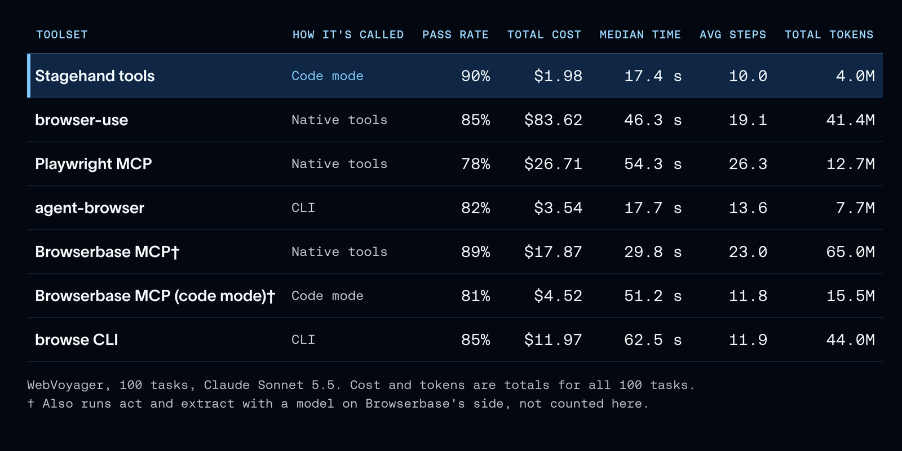
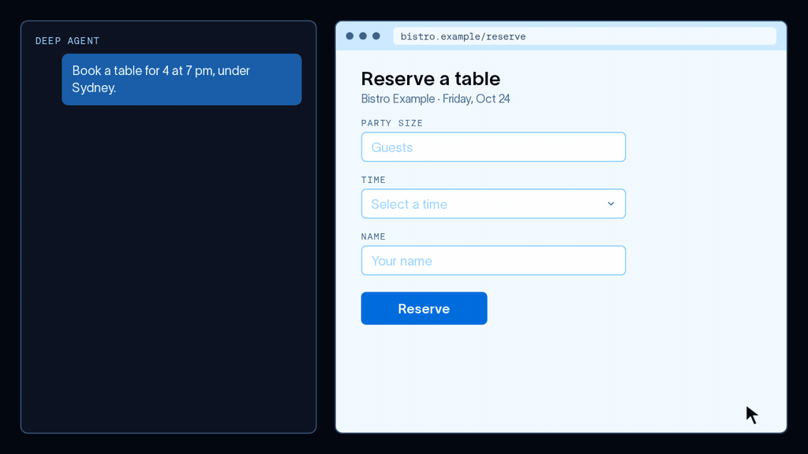
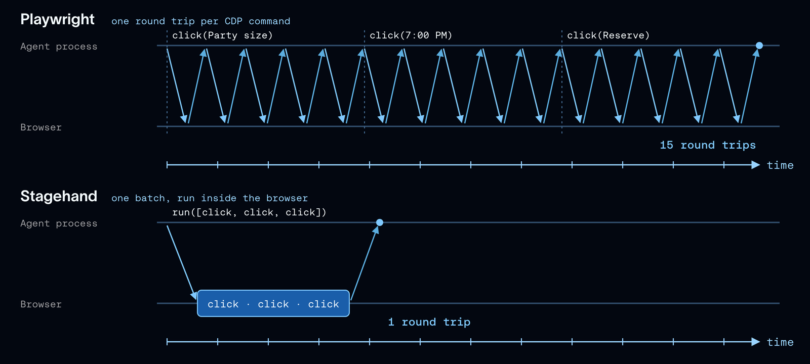
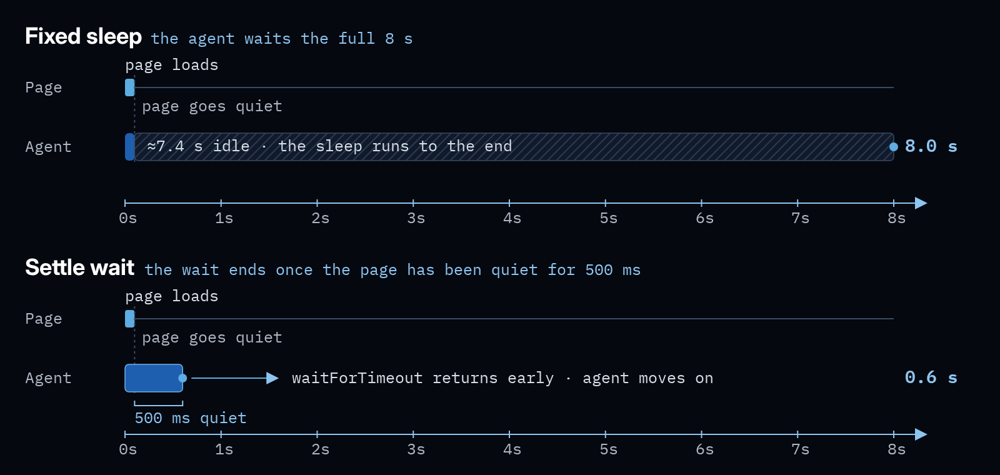

# 我们如何优化 Deep Agents 的浏览器使用（How We Optimized Browser Use for Deep Agents）

> 原文：[How We Optimized Browser Use for Deep Agents](https://www.langchain.com/blog/how-we-optimized-browser-use-for-deep-agents) · LangChain · 2026-11-03
> 本文由 Kimi CLI 使用 Kimi K3-256k 全文翻译，并由 Agent 校对；已取得全文翻译和转载授权。

## 关键要点

- 浏览器使用（Browser use）是智能体执行自主工作的一项重要能力，让它们能够在为人类构建的网站上进行操作。
- 智能体用来驱动浏览器的工具对其成本和执行轨迹有巨大影响，而 Stagehand 的工具正是为智能体打造的。
- 优化工具是一个迭代过程：追踪智能体的行为以找出低效之处，更新工具集（harness），并在保留每项改动之前用评测（evals）加以验证。

浏览器智能体现在可以承担对人类来说既痛苦又耗时的多步骤工作。像 [Instinct](https://instinct.com/) 和 Meta 的 [Muse](https://ai.meta.com/muse/) 这样的个人智能体可以规划横跨全国的公路旅行、取消未使用的订阅、发布车辆出售信息，而且全都是在没有公开 API 的网站上完成的。[DataDome](https://finance.yahoo.com/technology/ai/articles/datadome-report-agentic-browser-traffic-130000558.html) 发现，仅 9 月一个月，智能体浏览器请求量就增至原来的 4.7 倍。

浏览器使用在两个场景下发挥作用：一是 API 无法覆盖的操作，比如使用一个智能体事先没有配置过的网站；二是对编程智能体构建的 Web 应用进行端到端测试。无论哪种情况，智能体都需要两样东西：

1. 驱动浏览器的**工具**：打开页面、读取页面内容并在其上执行操作。大多数工具集通过 [Chrome DevTools 协议](https://chromedevtools.github.io/devtools-protocol/)（CDP）来控制浏览器，该协议让工具能够检查和控制 Chrome。
2. 一个可供驱动的**浏览器**，可以是本地的，也可以是托管的。[Managed Deep Agents](https://docs.langchain.com/langsmith/python/managed-deep-agents) 让你无需运行任何基础设施就能在 LangSmith 中构建和部署智能体，它还可以为你的智能体[运行浏览器](https://docs.langchain.com/langsmith/python/managed-deep-agents-browser-use)（详见我们的[发布博文](https://www.langchain.com/blog/browser-use-in-managed-deep-agents)和[视频演示](https://www.youtube.com/watch?v=r1iJzoxFBtg)）。像 [Browserbase](https://www.browserbase.com) 这样的托管浏览器提供商可以帮你处理开放网络中的难题，比如验证码（CAPTCHA）、机器人拦截，以及大规模运行多个浏览器。

本文聚焦于工具，以及如何让它们足够好，使智能体能够用好浏览器。

我们的目标是为 [Managed Deep Agents](https://docs.langchain.com/langsmith/python/managed-deep-agents) 中的智能体提供一个浏览器。我们比较了七种工具集，选出了最好的一个——来自 [Browserbase](https://www.browserbase.com) 的 [Stagehand](https://www.stagehand.dev/)（[GitHub](https://github.com/browserbase/stagehand)）。然后，我们根据智能体在 [LangSmith](https://docs.langchain.com/langsmith/observability) 追踪（traces）中的行为对它进行了改进，并用评测验证了每一项改动。最大的收获是：通过工具设计来改进智能体，空间远比想象中大。

## 浏览器使用带来的上下文管理挑战

浏览器使用工具集有几种形式：原生工具、[MCP 服务器](https://docs.langchain.com/oss/python/langchain/mcp)，或者智能体在 shell 中运行的 CLI。浏览器使用给这些工具带来了两个独特的挑战：

- **任务是长时间运行的**，包含大量顺序执行的工具调用。在 Playwright MCP 上，单个 WebVoyager 任务平均需要 26 个模型轮次。
- **网页携带大量内容**，而其中通常只有一小部分与任务相关。通过 Browserbase 的托管 MCP 服务器执行一次导航，返回内容的中位数约为 17,000 个字符。

这两点都意味着浏览器工具必须高效地管理上下文。

## 我们是如何测试这些工具的

我们按照[智能体开发生命周期](https://www.langchain.com/blog/the-agent-development-lifecycle)进行迭代：在基准测试上运行智能体，在 LangSmith 中阅读其追踪记录以找出浪费步骤或 token 的地方，修改工具，然后运行评测来检查改动是否有帮助。每次运行都是一个 [LangSmith 实验](https://docs.langchain.com/langsmith/evaluation)，这样我们可以并排比较各种配置，并从任何一个数字点击进入其背后的追踪记录。

我们使用了三个基于真实网站的任务基准测试：

- [**WebVoyager**](https://arxiv.org/abs/2401.13919)：在 Allrecipes、Amazon 和 Google Flights 等热门网站上执行 100 个日常任务，使用 Claude Sonnet 5.5 运行，并由一个 [Jev](https://www.langchain.com/blog/building-a-harness-with-jev) 评判器打分。该基准已经相当饱和，这使它成为比较上下文使用、成本和速度的干净方式。
- [**HardBench**](https://github.com/browserbase/stagehand/blob/main/packages/evals/datasets/hardbenchmark/README.md)：来自 Browserbase 的 102 个更难的任务，由其自带的验证器打分，主要使用 Claude Opus 5.5 运行。
- [**WebTailBench**](https://huggingface.co/datasets/microsoft/WebTailBench)：来自微软的真实世界“长尾”任务，每个任务都按一份简短的评分标准打分。我们通过 [Stagehand 评测](https://github.com/browserbase/stagehand/tree/main/packages/evals)运行了其中的 150 个任务。

我们让每个工具集都返回结构化输出（一个 JSON 答案）。这样一来，格式上的失误——比如对一个要求表格的任务只回复了一行文字——就不会被算到它的浏览能力头上。我们把这个选项[贡献回](https://github.com/browserbase/stagehand/pull/3219)了 Browserbase 的评测代码。

## 工具设计……实在太重要了

我们首先固定模型和任务，只改变工具集。这七种工具集在智能体的调用方式上各不相同：

- **原生工具：** 每个操作对应一个工具，比如 `click` 或 `navigate`，一次调用一个（[Playwright MCP](https://github.com/microsoft/playwright-mcp)、[browser-use](https://github.com/browser-use/browser-use) 和 [Browserbase MCP](https://github.com/browserbase/mcp-server-browserbase)）。
- **CLI：** 智能体在 shell 中运行浏览器命令（[agent-browser](https://github.com/vercel-labs/agent-browser) 和 Browserbase 的 `browse` CLI）。
- **代码模式（Code mode）：** 智能体编写调用浏览器的代码，这样一次调用就可以执行多个步骤（Stagehand 工具，以及从代码中调用的 Browserbase MCP）。



七种工具集在 100 个任务上使用 Claude Sonnet 5.5 的 WebVoyager 结果。

每种工具集的任务通过率都在 78% 到 90% 之间，但成本和速度差异很大。Stagehand 工具通过率最高（90%），总成本为 1.98 美元，每个任务的中位耗时为 17.4 秒。Playwright MCP 通过率为 78%，成本为 26.71 美元，约为其 13 倍，且每个任务的耗时是其三倍（[完整结果](https://github.com/langchain-ai/deepagents/pull/6868)）。

Stagehand 为智能体提供了[三个工具](https://docs.langchain.com/oss/python/integrations/tools/stagehand#tools)：

- `snapshot` 读取页面的[无障碍树（accessibility tree）](https://developer.mozilla.org/en-US/docs/Glossary/Accessibility_tree)，并为可交互元素标注 ID。
- `run` 在页面上执行操作，既可以是一批诸如 `click` 和 `fill` 的动作，也可以是使用 Playwright 风格 `page` 对象的 JavaScript 代码。
- `screenshot` 截取渲染后的页面。

在更难的任务上，差距依然存在。在 HardBench 的 38 个核心任务上，Deep Agents 使用 Stagehand 的代码编写型 `run` 工具通过了 30 个，而使用 Browserbase 的命令式 `browse` CLI 只通过了 21 个，且后者每个任务的成本是前者的三倍。

## Stagehand 是为智能体而生的

早期的浏览器工具复用了 [Playwright](https://playwright.dev) 这样的测试 SDK。用 Browserbase 的话说，[“Playwright 是为测试而构建的，而 Stagehand 是为你的智能体而构建的。”](https://www.browserbase.com/changelog/stagehand-v4) 在 Browserbase 的 [Stagehand v4 发布公告](https://www.browserbase.com/blog/stagehand-v4)中，有三个设计选择对我们影响最大：

- **代码模式**，让一次工具调用可以执行多个浏览器步骤
- **快照（Snapshots）**，一种紧凑的页面可交互元素文本视图
- **更少的往返次数**，通过在浏览器内部运行来实现

### 代码模式让上下文保持精简

在代码模式下，智能体编写调用工具的代码，而不是一次一个地调用工具（Browserbase 在 [Code mode is all you need](https://www.browserbase.com/blog/code-mode-is-all-you-need) 和 [Evolving computer use with code](https://www.browserbase.com/blog/evolving-computer-use-with-code) 中阐述了这一理念）。它同时解决了上述两个挑战：

- **调用之间无需等待模型。** 浏览器步骤是顺序执行的，因此有了 `run`，智能体可以把整个链条（打开页面、填写字段、点击、检查）写成一段代码，运行时无需在每一步之间再做一次模型决策。
- **中间上下文不进入上下文窗口。** 代码片段在执行过程中接触到的所有内容都留在它的变量里，只有智能体在浏览器交互之后返回的结果才会进入上下文。



在我们选定 Stagehand 之前就看到了这种效果。在[解释器（interpreter）](https://www.langchain.com/blog/give-your-agents-an-interpreter)中通过代码调用 Browserbase 的 MCP 工具，而不是一次一个地调用，成本降至原来的约四分之一（从 17.87 美元降至 4.52 美元）。

Stagehand 的 `run` 工具原生接受代码。它平均每个任务只需 10 个步骤，而 Playwright MCP 需要 26 个；一次导航返回内容的中位数为 117 个字符，而 Browserbase 托管的 `navigate` 工具约为 17,000 个字符。

`run` 也接受 Playwright 风格的代码。模型是在海量 Playwright 代码上训练出来的，所以那是它们写得最好的代码，而 Stagehand 的转译器会把它编译成 Stagehand 命令。当我们尝试让 `run` 改为接受 Stagehand 原生 API 时，即使工具描述写得准确，通过的任务数也少了 5.3 个百分点，且每个通过任务的成本高出 19%。

### 快照表示可交互元素

读取页面是浏览器智能体最昂贵的操作之一。`snapshot` 返回页面的无障碍树，裁剪到智能体所需的部分，并为每个可交互元素标注 ID。这让智能体获得一个可以直接理解和操作的页面视图，比如在 `run` 中使用 `{"op": "click", "id": "0-7"}`，这样它就永远不需要读取原始 HTML，也不需要为了点击一个按钮而编写选择器（selector）。Browserbase [报告](https://www.browserbase.com/changelog/stagehand-v4)称，v4 的 token 效率比 Playwright 高出约 80%。

主要通过 `snapshot` 而不是 `screenshot` 来读取页面，是[上下文工程](https://www.langchain.com/blog/context-engineering-for-agents)上的一大胜利。无障碍树是智能体可以直接操作的紧凑文本，而截图是一张需要模型去解读的图像——在我们的 WebTailBench 运行中，每次调用的截图中位大小为 89 KB。不过，裁剪必须在源头进行。当我们在事后把快照截断到 8,000 个字符时，智能体只会重新抓取页面，每个通过任务的成本持平不变。

![左侧是 Stagehand 对前面示例中预订表单的快照，右侧是同一页面的截图。Reserve 按钮在树中是 [0-7]，即智能体用来点击它的 ID。](../../../assets/articles/449a5ebbef16a4ba/6d3ec3215d72cecd8e15cdc2.png)

左侧是 Stagehand 对前面示例中预订表单的快照，右侧是同一页面的截图。Reserve 按钮在树中是 [0-7]，即智能体用来点击它的 ID。

### 浏览器往返次数被最小化

Playwright 的一次 `click` 实际上是五个 CDP 调用：将元素滚动到可视区域、读取其位置，然后依次是鼠标移动、按下和释放（[来源](https://github.com/microsoft/playwright/blob/main/packages/playwright-core/src/server/chromium/crInput.ts)）。Playwright 会等待每个调用的响应后才发送下一个，因此一次点击就要在智能体与浏览器之间往返五次。随着浏览器与智能体的距离变远——从笔记本到沙箱再到云端——这种开销会不断累积。

[Stagehand v4](https://www.browserbase.com/blog/stagehand-v4) 作为扩展运行在浏览器内部，所以这些底层调用发生在页面旁边，而 `run` 可以在一次往返中发送整批动作。Browserbase 报告称，在其基准测试中 v4 的运行速度是 Playwright 的 2 倍。



## 探索其他优化

选定 Stagehand 之后，我们继续调优 harness。最大的收益来自修复智能体等待页面加载的方式。

通过查看 LangSmith 中的 trace，我们发现智能体会写死固定的 sleep，比如 `page.waitForTimeout(8000)`，来等待页面加载。大多数页面在计时器耗尽之前早就准备好了，因此智能体在每次运行中有大量时间什么都没做。

于是我们修改了 `run`：一旦页面静默达到 500 ms 就结束每次 sleep，且绝不会晚于智能体请求的时间。在一次测量中，一个 8 秒的 sleep 在 0.6 秒就返回了。然后我们用 eval 验证了这一改动。在 HardBench 上，结合结构化答案和模型调用超时，它将智能体的中位耗时从 182 秒降至 124 秒，且准确率变化在噪声范围内。



Stagehand 此后已将这一修复[合并到上游](https://github.com/browserbase/stagehand/pull/3282)。

## 结论

与大多数工作相比，浏览器任务对智能体上下文的消耗更大。我们发现最大的收益来自工具，主要来自它们向模型返回多少内容，以及它们需要多少个回合。

你可以在任何智能体上使用同样的流程。先了解你的用例会产生多大的上下文，然后借助 trace 和 eval 进行迭代。trace 会显示智能体在哪里浪费步骤和 token，而 eval 会告诉你某项改动是否有效。

这些就是 Managed Deep Agents 中浏览器背后的工具。给你的智能体配上一个 [Managed Deep Agents 中的浏览器](https://docs.langchain.com/langsmith/python/managed-deep-agents-browser-use)——我们[上周刚发布](https://www.langchain.com/blog/browser-use-in-managed-deep-agents)。

要在开源的 [Deep Agents](https://docs.langchain.com/oss/python/deepagents/overview) 中使用同样的工具，请将来自 [langchain-stagehand](https://docs.langchain.com/oss/python/integrations/tools/stagehand) 的 `StagehandMiddleware` 添加到你的智能体：

```python
from deepagents import create_deep_agent
from langchain_stagehand import StagehandMiddleware
from stagehand import Stagehand, local_browser

browser = await local_browser.launch(headless=True)
stagehand = await Stagehand.create(browser=browser)

agent = create_deep_agent(
    model="openai:gpt-5.5",
    middleware=[StagehandMiddleware(stagehand=stagehand)],
)
```

对于需要大规模浏览开放网络的智能体，改为在 [Browserbase](https://docs.langchain.com/oss/python/integrations/providers/browserbase) 上用 `browserbase.launch()` 启动浏览器。[浏览器使用指南](https://docs.langchain.com/oss/python/deepagents/browser-use)涵盖了其余内容，包括浏览器作用域以及在沙箱中测试应用。试一试吧，告诉我们你构建了什么！

## 致谢

感谢 Baihao Wang 主导了支撑上游合并到 Stagehand 的各项优化的 HardBench 工作，也感谢来自 Browserbase 的 [Sean McGuire](https://www.linkedin.com/in/sean-p-mcguire/)、[Miguel Gonzalez](https://www.linkedin.com/in/miguelgfz) 和 [Kyle Jeong](https://www.linkedin.com/in/kyle-jeong) 在 Stagehand 方面提供的帮助。
