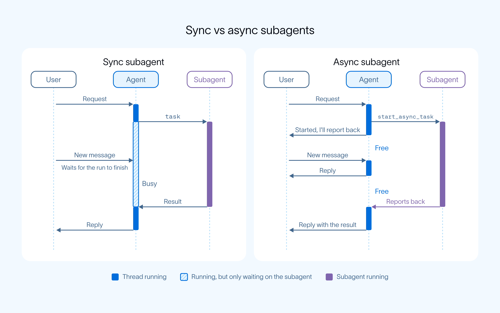
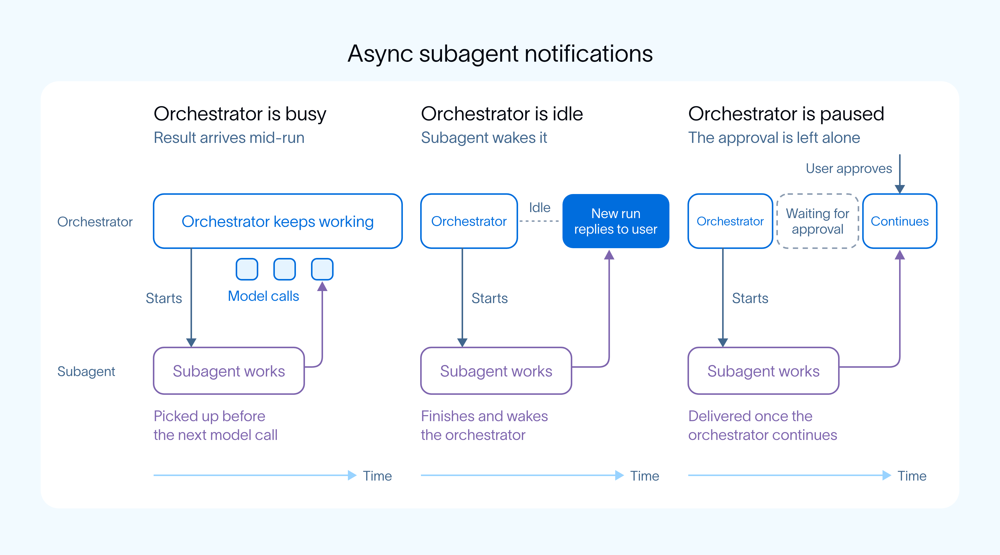

# Agent 正在走向异步（Agents Are Going Async）

> 原文：[Agents Are Going Async](https://www.langchain.com/blog/agents-are-going-async) · LangChain · 2026-11-05
> 本文由 Kimi CLI 使用 Kimi K3-256k 全文翻译，并由 Agent 校对；已取得全文翻译和转载授权。

## 要点速览

- 随着智能体（Agent）承担更大的目标，它们需要在同时推进许多长任务的同时，保持对用户的响应能力。
- 异步子智能体将智能体拆分为一个始终对用户可用的编排器（orchestrator），以及在后台运行任务并在完成后向编排器汇报的子智能体。
- 后台工作正成为智能体基础设施的常态，从 Claude Code 这样的编码智能体，到 OpenAI 的 dots 这样的个人智能体，都是如此。

想象一下，有一位办公室主任，每次你把一个大项目交给他，他就消失不见，直到项目做完才回来。你大概会立刻解雇他。一位优秀的办公室主任会在后台推进各个项目，同时保持可联系，并随时向你同步进展。当我们要求智能体朝着更大的目标努力时，它们也需要具备同样的两个特性。智能体必须具有**响应性**，能够结合此前所有上下文立即执行新指令；同时具有**生产力**，能够同时推进许多大型任务。

我们一直以来用于构建智能体的架构*无法*同时满足这两个要求。在标准的 ReAct 循环中，每一次耗时较长的工具调用都会阻塞循环，其他所有任务都得排在它后面。而现在，我们看到整个生态正在收敛到一种拆分模式：一个留在用户身边的智能体，加上负责执行长任务的后台工作者。[Claude Code](https://code.claude.com/docs/en/sub-agents) 默认在后台运行子智能体；OpenAI 的 [dots](https://learn.chatgpt.com/docs/dots) 把工作交给后台工作者，以便同时推进多项事务；[DeepSeek Harness](https://x.com/DeepSeekHarness/status/2116857257245987236) 则围绕一个与人对话的路由器和并行执行任务的后台工作者构建了其超级智能体。

我们正在通过[异步子智能体](https://docs.langchain.com/oss/python/deepagents/async-subagents)把这一模式带到 [Deep Agents](https://www.langchain.com/deep-agents) 中。编排器始终对用户可用，并保持对话上下文的有序组织；异步子智能体则作为后台工作者运行，完成后进行汇报。这样一来，智能体能够承担的工作量随后台工作者的数量增长，而不再受限于单个循环的长度。

## 异步子智能体的工作原理

智能体在一个循环中运行：模型调用一个工具，等待结果，然后决定下一步做什么。过去，工具和子智能体会一直阻塞这个循环，直到它们返回结果——就像代码逐个 await 每一次缓慢的调用。异步子智能体的工作方式类似于用 `asyncio.create_task` 启动的任务，或一个暂时不 await 的 `Promise`：调用立即返回，工作在后台独立运行，结果稍后再回来。



编排器把工作交给异步子智能体，自己则保持空闲与用户对话。

异步工作依赖于系统的两个特性：

- **用户可以联系到编排器。** 编排器是用户直接交互的智能体。子智能体不再占用它的循环，因此只要编排器自己的循环不忙，用户随时都能联系到它，而不必等待每个子智能体完成。
- **任务并行运行、互不阻塞。** 编排器在任务到来时就启动子智能体，而不是等待整批任务返回。

编排器通过五个工具管理异步子智能体：

- `start_async_task` 在独立线程上启动一个子智能体并立即返回。
- `check_async_task` 获取任务状态，并在任务完成后获取其结果。
- `update_async_task` 向正在运行的任务发送新指令。
- `cancel_async_task` 停止一个正在运行的任务。
- `list_async_tasks` 列出所有任务及其状态。

对正在运行的子智能体进行引导，与联系编排器是两回事。当编排器通过 `update_async_task` 发送后续指令时，该子智能体定义中的 `update_strategy` 字段决定接下来发生什么：

- `"interrupt"`（默认值）停止当前运行，并带着新指令重启子智能体。适用于纠正类指令，例如"改用 Postgres"。
- `"enqueue"` 将后续指令保留到当前运行结束。适用于追加类指令，例如"做完之后把测试跑一遍"。

## 通知机制的工作原理

每个未完成的任务都会列在编排器的系统提示词中，因此它始终知道有哪些任务正在进行中。它可以用 `check_async_task` 轮询，也可以让任务[自行汇报结果](https://docs.langchain.com/langsmith/python/managed-deep-agents-subagents#get-notified-when-a-subagent-finishes)：

- 如果编排器**正忙**，它会在每次模型调用前检查未完成的任务，并在运行中途获取结果。
- 如果编排器**空闲**，子智能体会以一次新的运行唤醒它。
- 如果编排器因等待审批而**暂停**，该审批不受影响，结果会在用户作答后送达。



无论编排器正忙、空闲还是因审批而暂停，异步子智能体都会汇报结果。

需要审批的子智能体会显示为 `waiting` 状态，用户在子智能体自己的线程上作答，不会打断编排器。在 Slack 上的 Managed Deep Agents 中，审批请求会[回帖到原始线程](https://docs.langchain.com/langsmith/python/managed-deep-agents-subagents#answer-approvals-in-channels)。

我们预计这一模式将从子智能体推广到所有工具。OpenAI 最近增加了对[异步工具调用](https://developers.openai.com/api/docs/guides/async-tool-calling)的支持：模型在调用工具后可以继续工作，而你的应用程序在之后的请求中再把结果发回。

## 使用异步子智能体

异步子智能体已在 Deep Agents 的 [Python](https://docs.langchain.com/oss/python/deepagents/async-subagents) 和 [JavaScript](https://docs.langchain.com/oss/javascript/deepagents/async-subagents) 版本，以及 [Managed Deep Agents](https://docs.langchain.com/langsmith/python/managed-deep-agents-subagents) 中提供。在后者中，让一个子智能体变为异步只需一个字段：

```python
from managed_deepagents import define_deep_agent

agent = define_deep_agent(
    name="research-assistant",
    model="openai:gpt-5.5",
    subagents=[
        {
            "name": "researcher",
            "description": "Researches a topic in the background.",
            "system_prompt": "Research the topic and report your findings.",
            "async": True,
        },
    ],
)
```

在 Managed Deep Agents 中，每个已部署的智能体还会获得 `general-purpose` 子智能体的一个异步副本，因此它可以在运行时决定把委派的工作放在前台还是后台运行。

任务通知功能目前处于 beta 阶段，API 仍可能发生变化。[async-deep-agents](https://github.com/langchain-ai/async-deep-agents) 仓库提供了一个可运行的监督者（supervisor）示例，包含用 Python 和 TypeScript 实现的研究员与程序员子智能体。

欢迎试用异步子智能体，并通过 [GitHub issues](https://github.com/langchain-ai/deepagents/issues) 或[论坛](https://forum.langchain.com/)告诉我们你的想法。
