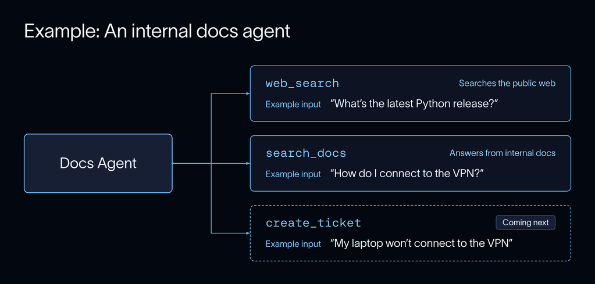
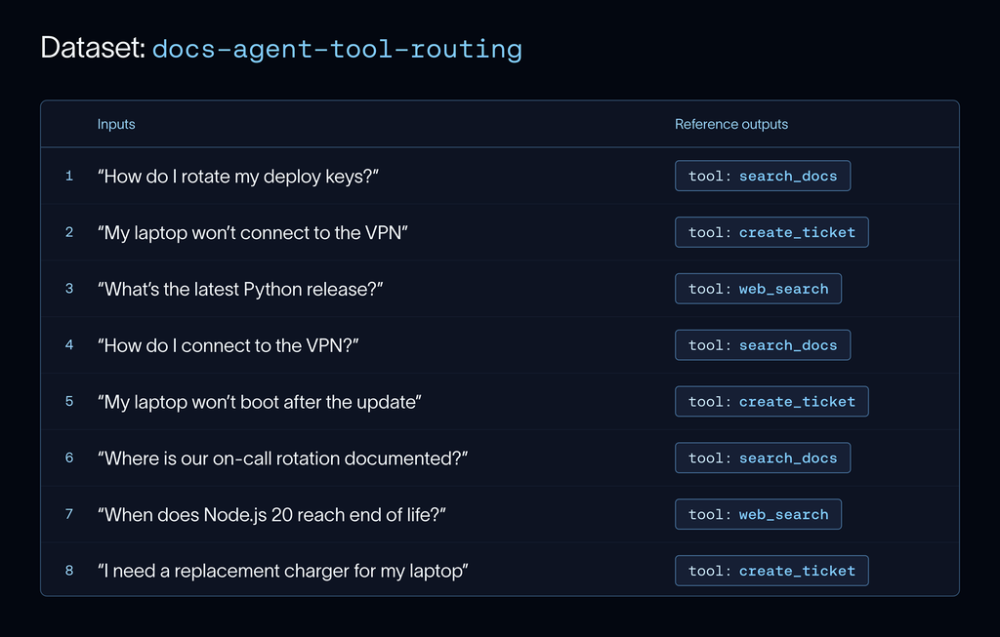
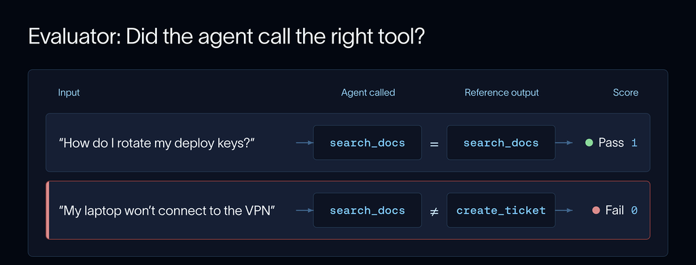
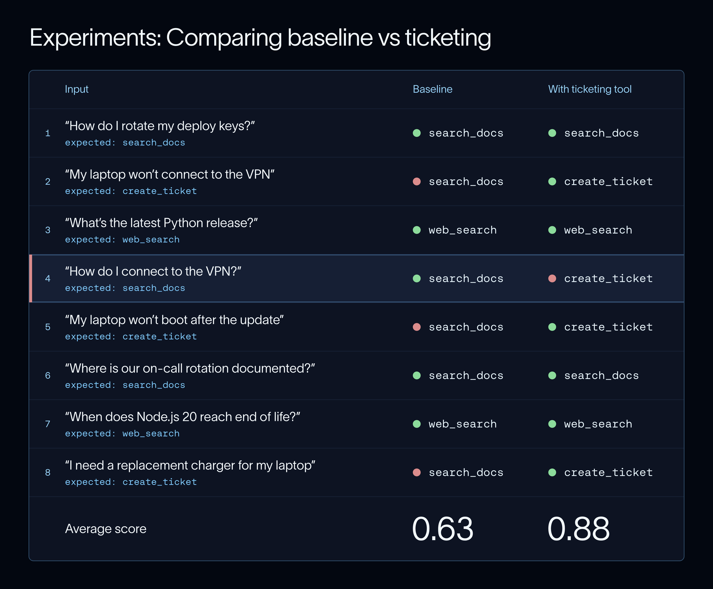
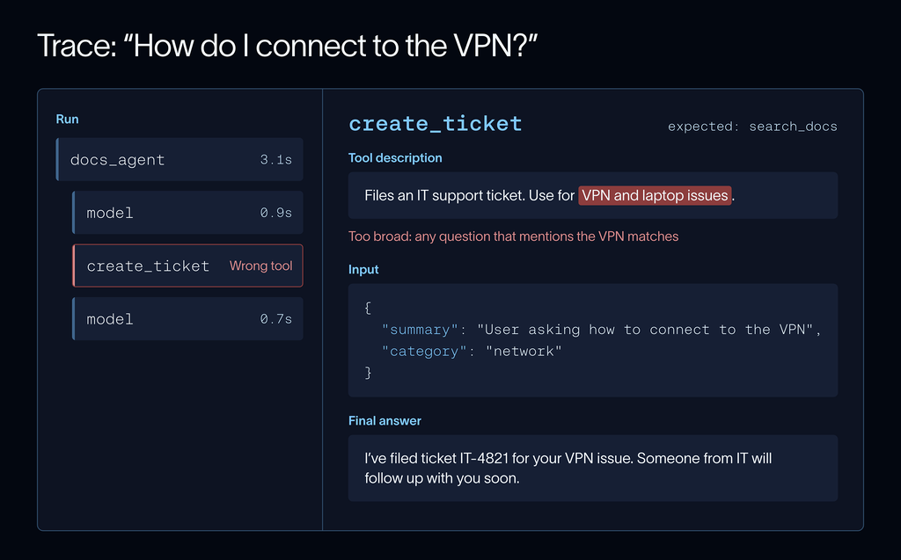
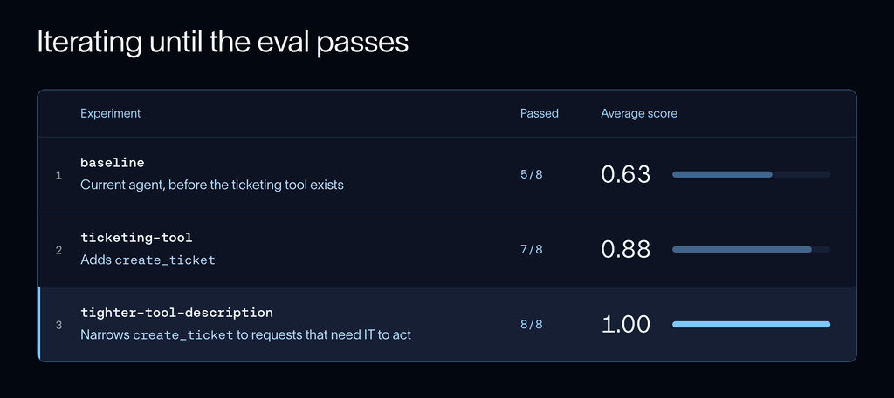

# 什么是评测驱动开发：如何改进 AI Agent（What Is Eval-Driven Development? How to Improve AI Agents）

> 原文：[What Is Eval-Driven Development? How to Improve AI Agents](https://www.langchain.com/blog/what-is-eval-driven-development) · LangChain · 2026-11-09
> 本文由 Kimi CLI 使用 Kimi K3-256k 全文翻译，并由 Agent 校对；已取得全文翻译和转载授权。

## 要点总结

- **评估驱动开发（EDD）是指在构建智能体的同时，使用一套一致的指标来衡量其表现，并朝着评估目标不断"爬山"（hill climbing）。**
- **EDD 的第一步是为你期望的行为写一份简短的规范，说明"好"是什么样的。** 包括智能体不应该做什么，以及哪些功能必须继续保持正常。
- **在迭代过程中，通过对比实验来判断你对智能体所做的改动。** 修复了某个用例的改动可能会破坏另一个用例。
- **让评估在 CI 和生产环境中持续运行，并把发现的失败转化为新的数据集样本。**

大多数智能体的开发都以同样的方式开始。你写一个提示词，手动试几个问题，调整一下，再试一次。在起步阶段这样做效果很好，因为智能体的错误显而易见，改进也很容易看出来。但随着时间推移，越来越难判断你最近的改动究竟让智能体变好了还是变差了。

评估驱动开发（EDD）通过提供一套一致的指标来衡量智能体的表现并指导你的决策，从而解决这个问题。在 LangChain，我们在构建最先进的智能体时使用了 EDD（可以查看我们关于 [IssueBench](https://www.langchain.com/blog/issuebench-how-we-evaluate-engine) 的博客），并将其提炼为一个三步流程：

1. 定义对你的智能体来说"好"是什么样的。
2. 在构建之前先写评估。
3. 做出改动并进行对比。

在这篇博客中，我们将逐步讲解这个流程，让你的团队可以将其应用到自己的智能体开发过程中。

## 什么是评估驱动开发？

评估驱动开发的名称和概念借鉴自测试驱动开发（TDD）——在 TDD 中，你先写一个会失败的测试，然后再写让它通过的代码。智能体与传统代码不同，因为它们是非确定性的：

- **输出会变化。** 同一个问题在每次运行时可能得到不同的答案。
- **正确的答案可能不止一个。** 两个措辞不同的自然语言结果可能都被认为是正确的。
- **智能体自主选择执行步骤。** 它可能调用了一个不需要的工具，或者跳过一个本该使用的工具，却仍然得出了正确答案。

因此，智能体需要一种不同的测试方式。[评估（eval）](https://docs.langchain.com/oss/python/langchain/test/evals)通过在一组示例上对智能体的运行进行评分来解决这个问题。评估比传统测试更灵活。你可以对智能体运行的任何方面进行评分，也可以使用其他 LLM 来评分（[LLM 作为评判者](https://www.langchain.com/resources/llm-as-a-judge)）。

在 EDD 中，与 TDD 类似，这些评估成为你对成功的定义，你朝着它们来构建智能体。

## 第一步：定义对你的智能体来说"好"是什么样的

EDD 的第一步是定义你的智能体应该做什么。然后，列出为实现这一目标它需要处理的行为。这些行为可能是诸如从知识库回答问题、代表用户执行某个操作，或知道何时该追问之类任务。为每个行为写下需求。这些需求合起来就构成了你的智能体的产品需求文档（PRD）。

EDD 一次只针对一个行为。这给你一个狭窄的目标去"爬山"，避免一个改动混淆另一个改动的效果。你选择的行为通常来自你即将构建的功能，或你在智能体过往运行中发现的失败。在写代码之前，定义一份涵盖以下内容的简短规范会很有帮助：

- 该行为应在何时发生
- 智能体应该做什么
- 智能体不应该做什么
- PRD 中哪些行为必须继续保持正常

这份规范应该足够明确，能够被判定为通过或失败。

假设我们有一个内部文档智能体，员工通过它查询公司信息。它有两个工具：用于查询内部文档的 `search_docs`，以及用于其他一切的 `web_search`。我们计划添加一个 `create_ticket` 工具，让它能够提交 IT 工单。我们的规范如下：

- 何时：用户报告某个东西坏了，比如"我的笔记本连不上 VPN。"
- 应该做：调用 `create_ticket`。
- 不应该做：为操作类问题提交工单，比如"我怎么连接 VPN？"
- 保持不变：`search_docs` 和 `web_search` 仍然处理它们今天处理的问题

我们将基于这些准则进行评估，尽管智能体还不具备这个能力。

当前文档智能体的示例实现，以及我们计划添加的工单工具。每个工具都有一个会触发它的示例输入。

## 第二步：在构建之前先写评估

**构建数据集。** 数据集是测试用例（称为"示例"）的集合，包含输入以及可选的参考"黄金"输出。输入的最佳来源之一是真实的智能体运行。用户的措辞方式可能出乎你的预料，他们的请求也包含你自己可能想不到要写的边界情况。如果你的示例看起来像真实流量，那么评估上的高分就更有可能意味着生产环境中的良好表现。在 [LangSmith](https://www.langchain.com/langsmith-platform) 中，你可以直接把真实的智能体运行添加到数据集中。如果你还没有任何运行记录，一个常见的替代方案是从头构建示例。

对于我们的文档智能体，少量示例就足以起步。在数据集中，我们会包含工单请求，再加上仍应路由到 `search_docs` 和 `web_search` 的问题，从而覆盖现有行为。

每个示例将一个输入问题与参考输出——即智能体应调用的工具——配对。

你还可以扩展数据集以覆盖它尚未包含的情况。假设我们没有太多用户情绪激动的示例。我们可以把现有示例交给一个 LLM，让它把这些示例改写成更愤怒的消息，然后检查智能体是否仍然调用正确的工具。

**编写评估器。** 有了数据集之后，你可以把 PRD 中对"好"的定义转化为一个测试或评估，用于对智能体在这些示例上的表现评分。在编写评估器时，选择最适合你测试的评分方法类型：当检查是确定性的时使用[代码评估](https://docs.langchain.com/langsmith/code-evaluator-ui)，不是确定性的时使用 [LLM 作为评判者](https://docs.langchain.com/langsmith/llm-as-judge)。你想检查的是智能体的最终答案、它为得到答案所采取的操作，还是完全不同的其他东西？对于我们的文档智能体，我们想检查它调用的工具，以验证它在每种情况下都使用了正确的工具。工具选择很容易用代码检查，所以我们可以用代码评估来检查每个示例是否调用了其参考输出中列出的工具。

如果智能体调用了其参考输出中的工具，该示例即为通过。

我们的文档智能体是一个只有几个特定功能的简单聊天机器人。随着你的智能体变得越来越复杂，你的评估套件很可能需要有所不同。如果你的智能体会对环境做出改动——比如沙箱中的编程智能体——仅检查几个工具调用和最终响应是不够的。你需要检查智能体在系统中留下的状态，而且每次运行都需要一个干净的环境，以免一次运行影响下一次。[Harbor](https://github.com/harbor-framework/harbor) 是一个用于在这类任务上运行智能体的开源框架，也是 [Terminal-Bench](https://www.tbench.ai/) 等行业基准背后的运行框架。每个任务都在自己的沙箱中运行，并附带一个对最终状态评分的测试脚本。

针对 Terminal-Bench 这样的基准进行优化，遵循与 EDD 相同的循环。你先写任务和测试，运行基线，然后在对智能体做出改动时对比实验。在构建 [LangSmith Engine](https://docs.langchain.com/langsmith/engine) 时，我们用真实和合成的智能体运行构建了自己的基准，并将其作为 Harbor 评估来运行。我们还用 Harbor 来[对 Deep Agents 做基准测试](https://www.langchain.com/blog/how-we-benchmark-deep-agents)。它告诉我们能否在不使智能体变差的情况下裁掉框架的某些部分，比如待办事项清单中间件或系统提示词的部分内容。

**运行基线。** 无论你选择如何构建数据集或评估器，你都可以在每个示例上运行智能体，并将结果作为一次实验记录到 LangSmith 中。一次实验是智能体在数据集上的单次运行，其中每个示例的输入、输出和评估器评分都保存在同一条记录中。拥有一个集中式系统让你可以将不同智能体版本的结果相互比较。在对智能体做任何改动之前，先运行一次基线实验作为比较指标是很重要的。

对于我们的文档智能体，数据集中的工单示例会得到失败的评分，因为该工具尚不存在。其他示例则记录了目前已经正常的功能，这样你以后就能知道添加新工具是否破坏了其他东西。

## 第三步：做出改动并进行对比

现在，我们构建 `create_ticket` 工具并运行同样的评估。

请记住，EDD 涉及朝着评估目标"爬山"。爬山意味着重复改进智能体的过程（评估、对比和调整），从而建立一个明确的循环，用客观证据证明改进。对智能体的每一次后续改动都有它自己的一次实验，每次实验都与上一次对比以验证进展。在 LangSmith 中，你可以通过选中两次实验来打开对比视图。它会并排显示每个示例的评分，让你看到哪些示例改善了，哪些退步了。

在对比实验时，重要的不仅是关注平均分的变化，还要留意任何退步或对已正常工作的行为的覆盖。对于我们的文档智能体，工单示例现在通过了。但"我怎么连接 VPN？"现在会提交工单，而不是去搜索文档。平均分上升了，但有一个用例被破坏了。

添加工单工具提升了平均分，但"我怎么连接 VPN？"现在失败了。

查看追踪（trace）是理解评估为何失败的最佳方式。追踪是你的 agent 一次运行的记录，包含每一次模型调用和工具调用。无论你选择使用什么框架构建 agent，都可以在 LangSmith 中进行追踪。更多信息请查看我们的[追踪快速入门](https://docs.langchain.com/langsmith/observability-quickstart)。

当我们打开最近一次实验中失败的追踪记录时，可以看到工具描述写着将 `create_ticket` 用于"VPN 和笔记本电脑问题"，因此任何提到 VPN 的问题都会匹配到它。这覆盖了基线的良好行为。

追踪记录告诉我们，工具描述过于宽泛，导致 agent 对一个文档就能回答的问题提交了工单。

解决方案是将工具描述收窄到真正需要 IT 部门采取行动的请求。实施这一更改后，我们再次运行评估。现在，每个示例都通过了。

更严格的工具描述让每个示例都通过了。

在小数据集上拿到满分是一个好迹象，但 100% 并不总是正确的目标。我们是在看着这些确切示例的情况下调整工具描述的。如果你不断调整 agent 直到每个示例都通过，它可能会开始过拟合你的数据集，而不是你真正关心的行为。它通过了你的评估，但仍然会漏掉以你的示例未覆盖的方式表述的请求。要检查这一点，请保留一组在迭代过程中不去查看的留出（held-out）示例。如果你在用于调优的示例上得分上升，但在留出集上持平，那么你很可能过拟合了。

多步骤 agent 可能在任何一步失败，因此 LangSmith 让你能够评估的不仅仅是最终答案。你可以对单个步骤、完整的工具调用序列，或者分组到一个线程（thread）中的多轮对话进行评分。

## 在交付过程中持续运行 EDD

### 自动化你的评估

随着你开始更快地部署变更，很容易跳过运行评估或丢失对旧示例的跟踪。通过将自动化评估加入你的工作流，你可以阻止未经测试的变更到达用户，并在生产环境之前捕获回归。

创建评估套件的最佳策略取决于你的具体配置。快速的代码检查可以阻止一次糟糕的合并，而使用 LLM 评判器的较慢评估可以每晚运行或在发布前运行。在迭代时使用数据集拆分，只运行与你正在处理的行为相关的示例，然后在交付前运行完整集合。

LangSmith 集成了 [pytest](https://docs.langchain.com/langsmith/pytest) 和 [Vitest](https://docs.langchain.com/langsmith/vitest-jest)，因此你的评估可以与代码放在一起，并在每个拉取请求（pull request）上运行。每次运行都会被记录为一个实验，因此你可以在与所有其他内容相同的位置查看结果。

### 在生产环境中评估

在部署 agent 之前，你的数据集很可能只覆盖你在开发中想到要测试的用例。在生产环境中，你可以使用以下评估方法标记其余的用例：

- **在线评估器（Online evaluators）**在实时追踪记录传入时对其进行评分。你可以将[代码检查](https://docs.langchain.com/langsmith/online-evaluations-code)和 [LLM 评判器](https://docs.langchain.com/langsmith/online-evaluations-llm-as-judge)附加到一个追踪项目上，并抽取一部分流量来管理成本。
- [**标注队列（Annotation queues）**](https://docs.langchain.com/langsmith/annotation-queues)让你的团队手动审查被标记的运行。它们也是你在依赖 LLM 评判器之前，检查它是否与人类判断一致的方式。
- [**仪表板（Dashboards）**](https://docs.langchain.com/langsmith/dashboards)可以随时间跟踪评估分数、反馈、成本和延迟，因此你可以看到一次发布是让情况变好还是变坏。
- [**洞察（Insights）**](https://docs.langchain.com/langsmith/insights)将生产环境的追踪记录聚类分组，让你能够在数千次运行中发现新模式。
- [**LangSmith Engine**](https://docs.langchain.com/langsmith/engine)更进一步，将问题集群转化为带断言的数据集示例，供你审查。

我们还在 Deep Agents 的仓库中公开了[我们用于 Deep Agents 的评估](https://github.com/langchain-ai/deepagents/tree/main/libs/evals)，因此你可以看到一个真实的、生产级的评估套件。

## 常见错误

- **对成功的定义过于宽泛。**在前期下足功夫，清晰地定义成功，以便评估能够轻松地判定通过或失败。"回答是有帮助的"不是一个定义良好的指标。
- **在修复之后才编写评估。**一旦你看过新的输出，就很容易写出一个按设计就能通过的评估。先编写评估，并确认它在当前损坏的版本上会失败。
- **只检查平均分数。**平均分数的提升可能掩盖了出现回归的示例，或覆盖了良好行为的变更。在决定保留某个变更之前，逐一审查每个示例。
- **添加你不需要的评估。**每个评估都会把 agent 推向某个方向。将每个评估与一个具体的变更挂钩，比如你正在修复的一个故障，或你即将构建的一个功能。
- **信任未经检验的评判器。**先将你的 LLM 评判器与人类评分进行对比。向它提出范围狭窄的问题，并使用通过或失败的判定，而不是含糊的 1 到 10 分制。

有关构建 agent 评估的更多信息，请查看这场关于 [Agent 评估入门（Agent Evals 101）](https://langchain.ondemand.goldcast.io/on-demand/762756f4-4344-4760-b4b9-a07dd63e76af)的网络研讨会，以及我们免费的 [LangChain Academy 的 LangSmith 课程](https://academy.langchain.com/courses/quickstart-langsmith-essentials)！

### 延伸阅读：

- [关于 agent 评估最常见问题的解答](https://www.langchain.com/blog/common-questions-about-agent-evals)
- [我们如何为 Deep Agents 构建评估](https://www.langchain.com/blog/how-we-build-evals-for-deep-agents)
- [迈向评估工程自动化](https://www.langchain.com/blog/towards-automating-eval-engineering)
- [LangSmith 评估快速入门](https://docs.langchain.com/langsmith/evaluation-quickstart)
