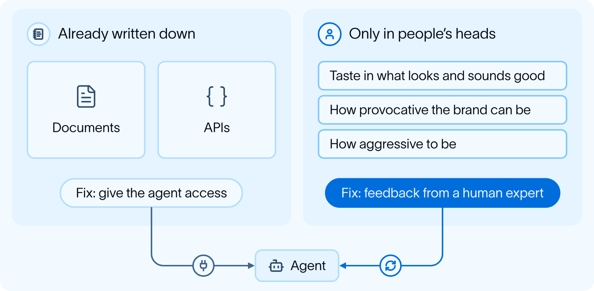
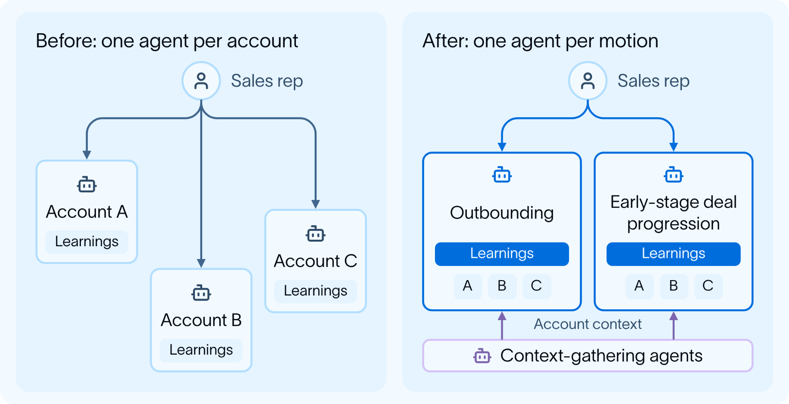

# 目标工程：如何设计 Agent 的目标（Goal Engineering: How to Design Goals）

> 原文：[Goal Engineering: How to Design Goals](https://www.langchain.com/blog/goal-engineering) · LangChain · 2026-11-14
> 本文由 Kimi CLI 使用 Kimi K3-256k 全文翻译，并由 Agent 校对；已取得全文翻译和转载授权。

智能体可以承担的任务范围在过去几年中急剧扩大。它们从简单的文本生成，发展到工具调用和决策制定，再到执行完整任务。智能体的未来在于它们能够承担开放式目标，并朝着这些目标的完成不断前进。像 [Hone](https://x.com/hone/status/2108218574926176490?s=20) 这样的发布让我们得以一窥那个未来。

在这样的世界中，设计智能体的任务范围至关重要。给它们指错方向，你会浪费大量 token。Hone 智能体设置中的一个关键部分就是定义供它们优化的指标。

## **如何设计目标**

在我们开发类似风格的智能体的过程中，我们意识到一件关于为智能体设计任务范围的事情：你希望设计智能体的范围时，要让它在运行过程中尽可能容易获得反馈。

这是为什么呢？

当智能体出错时，一个重要原因是缺乏正确的上下文。为了解决这个问题，你需要给智能体正确的上下文。上下文有不同类型。有些类型的上下文是诸如访问正确的文档或 API 之类的东西——这相对容易修复。最难提供给智能体的上下文是尚未被记录在任何地方的上下文。这种上下文需要由人类专家以反馈的形式提供给智能体。

随着智能体从完成可验证的任务扩展到与人类一起在组织内承担主观性工作，这一点尤为重要。例如，如果你希望智能体帮助优化某个业务指标（比如改进你的广告以优化营销效果），除了事实性上下文之外，还有太多细微差别是你希望用来约束智能体行为的。你可能对什么听起来和看起来好有特定的品味。你对品牌可以多大程度上大胆或前卫有自己的看法。一个无法有效获得反馈来学习这些东西的智能体很快就会变得毫无用处。

如果你的智能体的任务范围使得人们能够非常容易地对其工作提供大量高质量反馈，这将极大地帮助你构建一个能够可靠地追求长期目标的智能体。

一个相关的经验是，你应该大量投入于打造一个直观且令人愉悦的、用于*审阅*智能体工作的 UX。智能体表现的瓶颈往往在于它们能否从反馈中学习。因此，你应该努力优化收集反馈的便利性和质量！为此投入一个清晰的 UX 是值得的投资。

## **案例研究：Actively AI**

让我们来看一个来自 [Actively AI](https://www.actively.ai/) 的例子，该公司为销售团队构建智能体。

Actively 的第一个面向目标的智能体体验是这样设计的：他们为每个账户（销售团队想要销售的潜在客户）设置一个智能体。该智能体的任务是推动该账户向前发展，并产出供销售代表批准的行动。直觉上，这是合理的——这是一个相对受限且明确的目标，有扎实的结果。天真地来看，关于账户的上下文似乎是智能体需要拥有的最重要的上下文，所以你应该围绕它来组织智能体。

随着智能体的运行，他们发现还有另一个智能体需要的重要上下文来源：如何高效地完成工作。具体来说，如何进行外呼拓展、如何回复、如何就交易制定策略、应该多激进、如何在大型组织中周旋等等。这种类型的上下文分散在多个智能体之中——如果你在一个账户中学到了关于外呼拓展的东西，你往往非常希望把那个学习成果转移到其他账户上。

Actively 发现，当智能体负责单个账户时，销售人员很难高效地使用智能体并向其提供反馈。智能体在推进单个账户时要做许多不同的工作，而这些工作往往在时间上分散开来。他们发现：（a）在智能体之间进行大量的上下文切换（因为在任何时间点，单个智能体只有几件事情需要审阅），以及（b）在智能体之间共享学习成果的 UX 很别扭（而这又是必需的，因为它们在学习同样的东西）。

Actively 智能体体验的第二个版本解决了这个问题。他们新的面向目标的智能体（构建于 [Deep Agents](https://github.com/langchain-ai/deepagents) 之上！）被称为"motions"（动作）。一个 motion 是要完成的某项特定工作——比如外呼拓展或早期阶段交易推进。如何完成这项工作并没有明确定义，其中很大一部分甚至与个别销售代表的偏好有关。大量知识存在于销售人员的头脑中，需要以反馈的形式提供给负责该 motion 的智能体，以便它学习。由于一个 motion 是一堆相似的任务，销售人员可以很容易地将它们放在一起审阅。从 motion 中一个任务学到的任何反馈都可以直观地迁移到该 motion 中的其他任务。

这使得反馈（包括反馈的范围以及提供反馈的便利性）与智能体本身对齐，从而让创建强大的智能体变得容易得多。

这并不是说账户上下文不重要——它显然很重要！但账户上下文往往已经被记录下来，而且更加客观。所以 Actively 有在后台运行、为每个账户汇总上下文的上下文收集智能体，但实际推动账户沿着漏斗前进的工作现在由跨多个账户工作的 motions 来处理。它们负责销售动作中的一个切片，从反馈中学习的速度快得多，并在需要时引入每个账户的上下文。

## **未来展望**

未来，智能体将发展到这样一个程度：你只需给它们一个目标，它们就会着手努力去优化那个目标。

人工审阅这些智能体所做的工作需要大量时间——但它非常有价值。这是你教这些智能体该做什么、并让它们适应你的领域的方式。只存在于人们头脑中的知识非常重要，需要以一种易于传递给智能体的形式将其萃取出来。

为了最好地做到这一点，你需要将智能体的目标与人类最容易审阅的内容对齐。这让你能够打造令人愉悦的审阅 UX，提取尽可能多的信息，并使你的智能体能够持续学习，从而随着时间的推移变得越来越有用、越来越自主。

提示工程（prompt engineering）和上下文工程（context engineering）会消失，但目标工程（goal engineering）将长存。

‍
