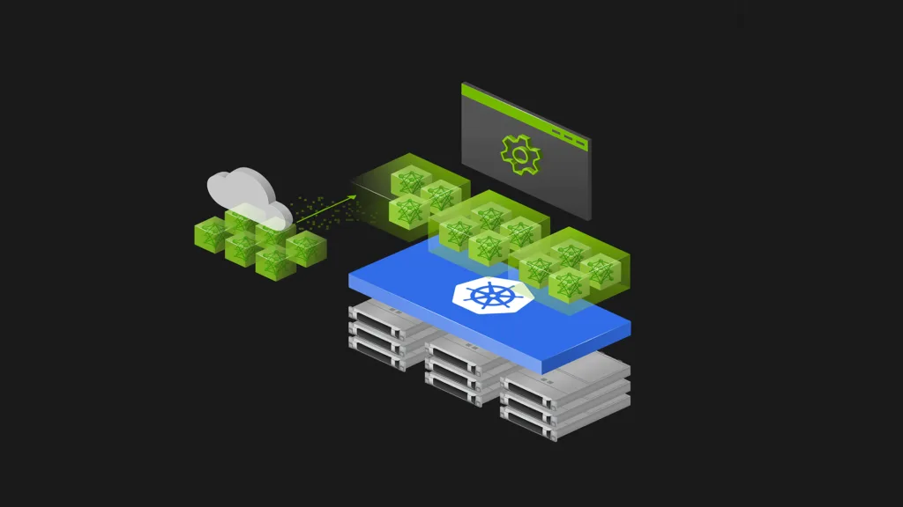

# Agent Substrate：推进 Kubernetes 上的大规模 Agent 运行（Agent Substrate: Advancing Kubernetes for Agents at Scale）

> 原文：[Agent Substrate: Advancing Kubernetes for Agents at Scale](https://developer.nvidia.com/blog/agent-substrate-advancing-kubernetes-for-agents-at-scale/) · NVIDIA · 2026-11-10
> 本文由 Kimi CLI 使用 Kimi K3-256k 全文翻译，并由 Agent 校对；已取得全文翻译和转载授权。
> 作者：Ekin Karabulut、Omer Yahud

AI 智能体的大部分时间都处于空闲状态，等待人类提示、工具结果或模型响应。Kubernetes 并非为此而生。每个会话运行一个 Pod，会为那些毫无作为的会话占用内存；而在每个回合之间删除 Pod，则每次都要付出数秒的冷启动代价，并且会丢失智能体的状态。RL 后训练也会撞上同样的墙。

Agent Substrate 现已捐赠给云原生计算基金会（CNCF）沙箱项目，它是一个开源的、经过安全加固的零信任沙箱化智能体运行时，专为以比标准容器高 10 倍的密度安全运行数百万个智能体和工具而设计。它将大量会话复用到一小池工作 Pod 上。空闲会话会被检查点化（包括内存和文件系统），并在下一个请求到来时恢复到任何一个空闲的工作 Pod 上。随着智能体基础设施碎片化为一堆绕过 Kubernetes 的专有运行时，NVIDIA 正在向上游贡献，以保持这项工作的开放性。

本文将介绍哪些工作负载适合 Agent Substrate、上游正在构建什么，以及该项目如何与 [DSX AI Factory Platform](https://docs.nvidia.com/dsx) 中的 KAI Scheduler 和 NVIDIA Dynamo 组件协同工作。

## 智能体工作负载的形态

传统 Web 服务以相对少量、长生命周期的实例运行。[智能体](https://www.nvidia.com/en-us/glossary/ai-agents/)则遵循另一种模式：它们醒来执行一步操作——运行一条 shell 命令、编辑一个文件、调用一套测试套件或调用一个 LLM，然后等待，有时几毫秒，有时几分钟，再进行下一步。智能体的状态（其文件系统、进程、工作目录）必须在各步骤之间持续存在。

Kubernetes 在这里举步维艰，因为为智能体启动一个计算 Pod 意味着要经历 API 服务器、准入控制、etcd、调度器、kubelet、镜像拉取和网络配置的完整流程。这需要数秒钟，对于运行数周的服务来说没问题，但对于一个必须瞬间出现、执行一条 10 毫秒的 bash 命令然后立刻让位、每秒数百次的沙箱来说，实在太慢了。

这让平台团队面临两个都不理想的选择：要么为每个智能体保持一个温热的 Pod，为几乎全部时间都在空闲的计算资源付费；要么按需创建 Pod，在每一步都付出冷启动的代价。

## Agent Substrate 的工作原理

Agent Substrate 使用 Kubernetes 运行一池就绪的 Pod。它创建一个独立的控制平面，将大量执行体（智能体及其环境）映射到那池较小的工作 Pod 上。当一个执行体进入空闲状态时，它会被从其沙箱（gVisor 或 microVM）中快照出来，其工作 Pod 的执行容量随即被释放出来。当该执行体再次被调用时，它会被恢复到任何一个空闲的工作 Pod 上，其内存和文件系统状态保持完整。

唤醒一个执行体不需要重新走一遍 API 服务器、调度器或 kubelet 的流程。Agent Substrate 会将执行体恢复到一个已有的工作 Pod 上。这些工作 Pod 仍然是普通的 Kubernetes Pod，因此集群调度、配额和放置策略依然适用，我们将在后文详述。

## 驱动需求的用例

我们看到三类工作负载在驱动对 Agent Substrate 的需求：

- **编程助手与智能体服务：** 编程智能体在 LLM 调用和自有环境中的工作之间交替进行：克隆代码仓库、编辑文件、运行构建和测试。用户期望环境在各回合之间持续存在并能立即响应。一个服务数千个此类会话的平台，不可能为每个会话都负担一个专属的温热沙箱。
- **使用智能体环境进行强化学习（RL）后训练：** 采用可验证奖励的 RL 会同时运行 GPU 训练器、生成服务器以及一队 CPU 密集型环境（代码沙箱、编译器、浏览器、模拟器），这些环境负责执行动作并检查结果。随着 rollout 批次派发动作，沙箱需求会突发式到来。一个训练任务可以从早期实验中的几百个沙箱增长到生产环境中的数十万个。最慢的环境决定了训练器何时拿到下一批数据，因此这条路径上的冷启动会让 GPU 空转。
- **面向研究的 GPU 沙箱：** 研究人员的编程智能体需要 GPU，但不是为了部署模型，而是为了编译 CUDA 代码、对内核做基准测试或运行数值计算。它在一个共享集群上启动一个 GPU 沙箱，运行任务，然后删除沙箱。要在整个组织内支持这一点，需要大量生命周期短暂、相互隔离的 GPU 沙箱，它们能快速启动，并公平地共享有限的 GPU 资源池。

## 上游工作：已落地的与接下来的

下面每一项贡献都始于上述用例之一。所有这些工作都公开在 [Agent Substrate 代码仓库](https://github.com/agent-substrate/substrate)中：

- **当所有工作 Pod 都繁忙时，下一个请求排队等待而不是失败：** 在一个超订的系统中，例如高峰期的编程助手平台或 RL rollout 突发期间，用户的下一个回合可能在所有工作 Pod 都繁忙时到来。Agent Substrate 过去会立即返回错误，尽管通常稍后片刻就会有另一个执行体腾出一个工作 Pod。

Agent Substrate 路由器中的请求停靠（request parking）功能（[#221](https://github.com/agent-substrate/substrate/pull/221)）会挂起该请求并重试恢复，直到有工作 Pod 空闲，等待时间有上限，同时排队等待的请求数量也有上限。后续改进（[#1229](https://github.com/agent-substrate/substrate/pull/1229)）确保发往已在运行的执行体的请求永远不会卡在那个队列里。

- **让智能体在其沙箱内使用 GPU：** 即上文所述的研究用 GPU 沙箱，以及模拟器等由 GPU 支持的 RL 环境。

我们正在开发设备可插拔能力，在 Kubernetes [动态资源分配](https://kubernetes.io/docs/concepts/resource-management/dynamic-resource-allocation/)（DRA）之上添加设备支持。设备厂商通过配置文件接入其设备，沙箱中的每个容器只请求它所需的设备（[#752](https://github.com/agent-substrate/substrate/issues/752)），同一套模型对 gVisor 和 microVM 沙箱都适用。NVIDIA GPU 将是首个受支持的设备。

- **一个容器不能拖垮或杀死它的邻居：** 智能体沙箱通常会让智能体的工作负载与日志、代理或指标等辅助容器并排运行。其中一些可能是不可信的。一个失控的容器不应耗尽整个沙箱的内存并拖垮智能体。

针对 microVM 沙箱的按容器 CPU 和内存限制（[#859](https://github.com/agent-substrate/substrate/pull/859)）解决了这个问题。超出内存限制的容器会被单独停止，沙箱的其余部分继续运行。

### 在挂起与恢复之间保留 GPU 沙箱

当智能体暂停以等待人工审查时，其沙箱应当释放 GPU，并在稍后恢复时，其编译产物和已加载数据仍原封不动。支持这一点需要同时保存和恢复智能体状态与 GPU 状态。

恢复 GPU 状态会带来硬件兼容性约束。GPU 检查点通常只能恢复到相同型号的 GPU 上，有时甚至要求相同的驱动版本。Agent Substrate 提出了一种设计来解决这个问题。

设备厂商描述如何安全地暂停其设备，以及快照依赖哪些设备属性。Agent Substrate 将这些属性随每个快照记录下来，并将沙箱恢复到匹配的设备上；如果没有可用设备，则回退到干净的冷启动。该设计是厂商中立的，构建于 DRA 之上。NVIDIA GPU 是首个目标；该设计可扩展到其他硬件类型。

## NVIDIA Dynamo：将智能体循环与推理循环连接起来

Agent Substrate 管理智能体在哪里行动；推理运行时管理智能体在哪里思考。两者面临相似的效率挑战：让空闲沙箱保持温热会浪费 CPU 和内存，而在重复的模型调用上重建模型上下文会浪费 GPU 周期。独立扩展每一层可以提高利用率。将它们协调起来还可以降低延迟，并在智能体在工具执行与模型调用之间切换时保留可复用的上下文。

[NVIDIA Dynamo](https://github.com/ai-dynamo/dynamo) 这个开源分布式推理框架提供了这种协调。Agent Substrate 在一池温热的沙箱工作 Pod 上激活、挂起和恢复有状态的智能体环境。Dynamo 则在 GPU 工作节点之间编排推理。Dynamo 路由器位于两者之间，将智能体正在做的事情与 GPU 上正在发生的事情连接起来。

### 让推理感知智能体

传统的推理路由把每个模型调用视为独立请求。而在智能体中，每个请求都是更长循环中的一步，连续的请求往往复用相同的系统提示、工具定义、对话历史和先前的观察结果。

Dynamo 的路由器能看到可复用的键值（KV）缓存位于何处、哪些工作节点正忙于预填充（prefill）或解码（decode），以及负载在整个 GPU 集群中如何分布。Agent Substrate 和智能体框架则补充了会话身份、请求优先级、预期输出长度、工具调用边界和生命周期事件等信号。

结合两者，Dynamo 可以：

- 将相关的模型调用保留在已持有可复用 KV 缓存的工作节点上，同时避免造成 GPU 过载热点
- 在推理池承压时，优先处理交互式回合而非后台智能体工作
- 在工具调用的间隙中保持系统提示、工具定义和对话历史可用
- 优先丢弃来自已终止子智能体、已关闭推理分支或已压缩上下文的缓存状态
- 在工具调用接近完成时，预先准备可能用到的上下文

### 将 GPU 智能反馈给 Agent Substrate

集成中最重要的部分，是 Dynamo 向 Agent Substrate 暴露推理信号，帮助它决定何时让智能体保持运行、挂起或恢复。

Dynamo 比智能体运行时更贴近 GPU 执行。它能看到缓存就绪情况、队列压力、活跃的预填充与解码工作，以及一个 LLM 请求大概需要多长时间。这些信息既可以指导推理路由，也可以指导 Agent Substrate 如何调度智能体沙箱。

Dynamo 可以返回诸如预计首 token 时间、预计完成时间、请求进度、缓存就绪情况和 GPU 池饱和度等信号。Agent Substrate 可以利用这些反馈来决定是让执行体保持驻留、在较长的推理等待期间将其挂起，还是在模型响应接近完成时将其恢复。

在集群规模下，同样的反馈还能帮助调整温热工作节点的容量、调节智能体和子智能体的扇出，并避免激活那些原本会在饱和的 GPU 队列后面空等的 CPU 沙箱。

这种集成确立了一种简单的职责划分。Agent Substrate 管理智能体环境的高频生命周期，Dynamo 管理推理的高性能生命周期。Dynamo 将两者围绕定义智能体式计算的循环连接起来：模型调用、工具调用、观察，然后再次模型调用。

## 快速上手：使用 Dynamo 和 Agent Substrate 构建编码助手

这份[指南](https://docs.nvidia.com/dynamo/dev/agents/sandboxed-coding-agents)提供了在 Dynamo 和 Agent Substrate 上部署编码助手的分步说明。

你将学习如何：

**指南链接占位符——待补充后添加**

- 将 Pi 编码智能体作为 Substrate Actor 运行：为每个智能体提供隔离的、有状态的环境，用于检查代码仓库、编辑代码和运行测试。
- 将智能体连接到通过 NVIDIA Dynamo 提供服务的 GLM-5.3-Flash：在 Substrate 管理的沙箱中完成模型推理与工具执行之间的循环。
- 使用 Harbor 在 SWE-bench Verified 上编排评估：让智能体处理软件问题并收集结果，以评估它们的更改是否解决了这些任务。

Agent Substrate 仍在不断发展。它的 API 仍在变化，GPU 支持正在新的 DRA 基础上重建，Dynamo 智能体集成的部分功能仍处于实验阶段。现在正是参与贡献、帮助塑造核心设计的好时机。

## 将 Agent Substrate 与 KAI Scheduler 和 Dynamo 一起运行

Agent Substrate 运行在 Kubernetes 之上，与提供模型服务和调度工作负载的 NVIDIA 软件协同工作。Substrate 管理有状态的智能体环境，[KAI Scheduler](https://github.com/kai-scheduler/KAI-scheduler) 负责放置 Kubernetes 工作负载，Dynamo 提供模型服务并与智能体运行时交换推理状态信号。

它们共同协调 CPU 侧的工具执行与 GPU 侧的推理，从而更充分地利用共享集群容量。

下面的表 1 展示了各个组件所处的位置。Dynamo、KAI Scheduler 和 Kubernetes 基础组件都是 NVIDIA DSX OS 的组成部分。

Agent Substrate 是一个独立的开源 CNCF Sandbox 项目，并非 DSX OS 的命名组件，不过 NVIDIA 正在向上游贡献代码，并与 DSX OS 组件开发互操作性。

| 架构层 | 技术 | 角色 | 与 DSX 的关系 |
| --- | --- | --- | --- |
| 智能体与 RL 框架 | NeMo RL、NeMo Gym、你的智能体工具框架 | 智能体循环、rollout 编排和环境请求 | DSX OS 之上的应用层 |
| 智能体执行 | Agent Substrate | 在热备 worker 之间复用的有状态隔离沙箱 | 与 DSX OS 组件集成的外部开源运行时 |
| 模型服务 | NVIDIA Dynamo（ThunderAgent、Grove、ModelExpress） | KV 感知、智能体感知的路由；prefill/decode 协调；推理 Pod 的拓扑感知放置 | DSX OS 模型服务 |
| 工作负载编排 | KAI Scheduler | 放置、队列、成组调度（gang scheduling）、拓扑感知和公平共享 | DSX OS 工作负载与 GPU 编排 |
| Kubernetes 基础 | AI Cluster Runtime、GPU Operator、Network Operator、Topograph | 经过验证的运行时以及 GPU、网络和拓扑管理 | DSX OS 加速的 Kubernetes 基础 |

*表 1. Agent Substrate 在 Kubernetes 上运行 AI 智能体和 RL 环境的技术栈中的位置：每层的技术、角色以及与 NVIDIA DSX OS 的关系。*

**KAI Scheduler 与 Agent Substrate 运行在不同的调度层级：** Substrate 的 worker Pod 就是普通的 Kubernetes Pod。KAI Scheduler 现在就可以将它们与其所支持的 GPU 训练任务和推理服务器一起放置。将 worker 池的自动扩缩与 KAI 的队列及公平共享策略相协调，可以把跨租户的资源共享扩展到环境层。

## 与我们在 KubeCon 一起构建智能体基础设施

- [Agent Substrate 社区聚会](https://luma.com/re1kzz80)**——11 月 10 日（周二），盐湖城。** 面向维护者、贡献者以及生态系统中所有人的非正式晚间聚会。欢迎来与我们探讨本博客中提到的所有贡献，并结识正在 Kubernetes 上构建智能体基础设施未来的人们。
- **闪电演讲——11 月 11 日（周三）下午 1:00–1:15，Google Cloud 展位 #122："**From Pods to Actors：面向智能体工作负载的 GPU 感知基础设施"
- [NVIDIA 展位 #170](https://www.nvidia.com/en-us/events/kubecon-and-cloudnative-con-north-america/)，**KubeCon + CloudNativeCon 北美大会——11 月 10–12 日。** 来与我们的专家交流智能体平台、Kubernetes 上的 RL 后训练、Substrate、Dynamo 和 KAI Scheduler。
- **在 NVIDIA 展位 #170 与专家会面——**11 月 11 日（周三）下午 3:15–3:35（山地时间），探讨 Agent Substrate 以及在 Kubernetes 上运行智能体工作负载。
- 查看完整的 Meet the Experts 阵容**——**[NVIDIA 亮相 KubeCon + CloudNativeCon 北美大会 2026](https://www.nvidia.com/en-us/events/kubecon-and-cloudnative-con-north-america/)

## 更进一步

如果你正在 Kubernetes 上构建智能体平台、编码助手或 RL 环境，我们希望了解你的工作负载。欢迎来活动现场找我们，查看 Dynamo 指南，或在 [agent-substrate/substrate](https://github.com/agent-substrate/substrate) 和 [ai-dynamo/dynamo](https://github.com/ai-dynamo/dynamo) 上提交 issue。加入[社区会议](https://docs.nvidia.com/dynamo/community)，参与接下来的发展。
