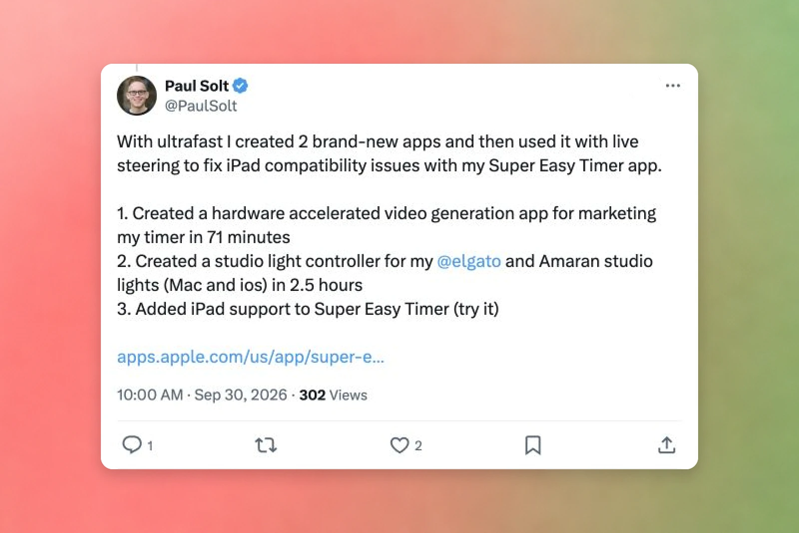
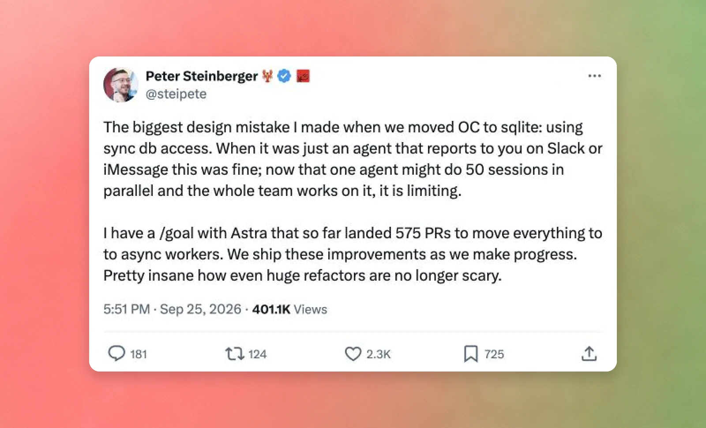

# GPT-6 系列模型实践指南（A model guide for the GPT-6 family）

> 原文：[A model guide for the GPT-6 family](https://openai.com/index/practical-guide-building-gpt-6/) · OpenAI · 2026-10-02
> 本文由 Kimi CLI 使用 Kimi K3-256k 全文翻译，并由 Agent 校对；已取得全文翻译和转载授权。
> 作者：OpenAI

2026 年 10 月 2 日

[产品](https://openai.com/news/product-releases/)指南

帮助您在管理时间和成本的同时，从 GPT‑6 模型中获得最佳效果的实用技巧

GPT‑6 是[我们迄今最先进的模型套件⁠](https://openai.com/index/introducing-gpt-6-1-sol/)，为不同类型的工作提供了多种模型选择。

无论您是要将想法转化为可用的原型、构建和测试某个功能，还是要跨代码仓库、数据库和外部 API 编排多步骤工作流，本指南都会讲解如何选择 GPT‑6 模型、如何给出有效的指令、如何管理长时间运行的工作，以及如何为生产环境做好准备。

- ### GPT-6Astra

  我们最智能的模型，用于获得
  最佳结果。

  输入
  :   $10.00

  输出
  :   $50.00

  缓存输入
  :   $1.00
- ### GPT-6.1Sol

  以五分之一的价格获得接近 Astra 的智能。

  输入
  :   $2.00

  输出
  :   $10.00

  缓存输入
  :   $0.10
- ### GPT-6Luna

  快速高效，适合规模化处理
  日常工作。

  输入
  :   $0.10

  输出
  :   $0.50

  缓存输入
  :   $0.01

## 摘要

- **在生产环境中高效运行。** 使用[缓存⁠](https://developers.openai.com/api/docs/guides/prompt-caching)和[压缩⁠](https://developers.openai.com/api/docs/guides/compaction)来管理上下文和成本。衡量任务成功率和延迟，并规划监控和数据控制。
- **让模型匹配您的工作负载。** 通过选择适合任务的模型、[推理强度⁠](https://developers.openai.com/api/docs/guides/reasoning)和速度，在能力、成本和延迟之间取得平衡。
- **调整您的提示词和技能。** 让提示词、技能和仓库指令在以下方面保持一致：模型应交付什么、可以独立完成什么，以及怎样才算完成。
- **让长时间运行的工作保持正轨。** 使用[引导（steering）⁠](https://developers.openai.com/api/docs/guides/steering)、[异步工具⁠](https://developers.openai.com/api/docs/guides/async-tool-calling)和[委派⁠](https://developers.openai.com/api/docs/guides/responses-multi-agent#overview)来处理更新和独立工作。为模型应在何时请求输入设定清晰的边界。

## 1. 在生产环境中高效运行

### 为您的工作流做好生产准备

在部署之前，您需要落实若干检查和最佳实践。

- 牢记效率。[削减任务不需要的上下文⁠](https://developers.openai.com/api/docs/guides/cost-optimization#cost-and-latency)，同时保留它所需要的证据。在您的应用支持的情况下，[并行运行相互独立的任务⁠](https://developers.openai.com/api/docs/guides/latency-optimization#parallelize)，避免某个缓慢的步骤拖住不相关的工作。
- 通过[提示词缓存⁠](https://developers.openai.com/api/docs/guides/prompt-caching)为重复性工作复用共享上下文。缓存的输入 token 比未缓存的输入 token 最高可便宜 [95%⁠](https://developers.openai.com/api/docs/guides/prompt-caching#why-prompt-caching-matters)，具体取决于模型。把稳定的指令和参考资料放在变化的任务细节之前，并保持工具定义一致。[缓存仪表板⁠](https://platform.openai.com/usage?usage_section=prompt-caching)和[诊断指南⁠](https://developers.openai.com/api/docs/guides/prompt-caching/diagnostics)可以帮助您发现复用在何处失效。在估算完整工作流的成本时，请把缓存写入费用和任何长上下文的计费标准都计算在内。
- 对于较长的对话，[压缩⁠](https://developers.openai.com/api/docs/guides/compaction)可以在保留继续工作所需状态的同时缩减上下文大小。
- 决定您将如何[监控行为⁠](https://developers.openai.com/api/docs/guides/safety-checks/misalignment-monitoring)，并审查适用于您应用的[数据控制⁠](https://developers.openai.com/api/docs/guides/your-data)。
- 部署前先测试：运行具有代表性的任务，衡量任务成功率、延迟以及每个成功任务的成本。请查阅我们的 [API 部署检查清单⁠](https://developers.openai.com/api/docs/guides/deployment-checklist#choose-a-model-for-the-workload)。

### 让模型匹配工作负载

可以把模型选择和推理级别看作智能与价格之间的权衡。

- **模型：**

  - [GPT‑6 Astra⁠](https://developers.openai.com/api/docs/models/gpt-6-astra)：用于最困难的推理工作，即需要最强智能的场景。
  - [GPT‑6.1 Sol⁠](https://developers.openai.com/api/docs/models/gpt-6.1-sol)：用于复杂编码、研究和计算机操作。
  - [GPT‑6 Luna⁠](https://developers.openai.com/api/docs/models/gpt-6-luna)：用于规模化的聚焦型任务，以及目标明确的日常重复性工作，例如提取发票字段、对请求进行分类，或生成结构化摘要。

在评估最适合任务的模型时，请[比较各模型的定价⁠](https://developers.openai.com/api/docs/models/compare)。

- **推理级别：** 在 API 中，选择模型在任务上投入多少推理强度。

  - 低：常规任务，例如提取事实或进行小修改。
  - 中：需要判断力的工作，例如规划某个功能或比较多个方案。
  - 高：困难的调试、更深入的分析或细致的审查。
  - 超高 / 最大：在支持的模型上，当“高”不足以满足需求时进行测试，只有当改进足以证明额外时间和成本是值得的时候才保留它。

在 API 中，您可以[在对话中途更改推理强度⁠](https://developers.openai.com/api/docs/guides/reasoning#change-reasoning-mid-conversation)，而不会破坏缓存。

在 Codex 中，从该模型的默认推理级别开始，然后针对较简单的任务将其调低，或针对更深入的分析将其调高。

- **速度：**

  - 在 API 中，当响应速度很重要时（例如在聊天应用或编码工具中），使用[快速模式⁠](https://developers.openai.com/api/docs/guides/fast-mode)。与标准处理相比，它以更高的单 token 成本提供更快、更稳定的响应时间。
  - 在 Codex 和 API 中，当更快的响应值得支付溢价时（例如快速的编码迭代），使用[极速模式⁠](https://developers.openai.com/api/docs/guides/ultrafast-mode)。它在不依赖推理强度的情况下加快 token 生成速度。[已支持 GPT‑6 Astra⁠](https://x.com/OpenAIDevs/status/2104996045482778973)。

## 2. 调整您的提示词和技能

### 给模型一个明确的任务

[*“模型在理解细微差别和歧义方面已经进步很多，因此过去有所帮助的过于具体的指示，如今反而可能妨碍结果。”*⁠](https://x.com/pvncher/status/2095991462416490862)

——Eric Provencher，OpenAI 开发者体验团队

从一个明确的任务开始：您想要的结果、目标受众、相关的上下文和约束，以及怎样才算完成。然后回顾以下四个方面（总结自 [*《为 GPT‑6 Astra 重新思考技能与提示词》*⁠](https://developers.openai.com/blog/rethinking-skills-and-prompts-for-gpt-6-astra#better-skills)），以更深入地更新您的指令：

- **创建更好的技能：** 让描述保持简短，并明确说明每个技能应在何时运行；仅在需要时加载支持性细节；用适合您团队所用模型的指导来取代僵化的固定流程。
- **更新您的 AGENTS.md：** 说明特定文档和测试在何时相关，并明确授权安全的常规工作流，例如使用一次性数据、不访问生产环境地在本地运行测试。
- **设定决策边界：** 说明哪些操作可以独立进行、哪些需要批准，用清晰的边界取代“一律询问”式的笼统规则。
- **对坚持完成给出明确规定：** 定义“完成”所包含的内容——实现变更、运行它、检查结果以及修复失败——并指出任何需要您审查的决策。

如需更多指导，请参阅[推理最佳实践⁠](https://developers.openai.com/api/docs/guides/reasoning-best-practices#how-to-prompt-reasoning-models-effectively)。

### 定义您需要的输出

无论您是在 Codex 中工作，还是使用 API 进行构建，都要指明模型可以做哪些决定、应在何时请求输入，以及有用的回复应该是什么样子。

给模型足够的方向感，让它能在不猜测关键决策的情况下持续推进工作。[告诉它哪些选择可以自行决定、何时应征求您的意见⁠](https://developers.openai.com/api/docs/guides/latest-model#initiative-and-follow-through)，例如，它可以自行决定如何组织一份摘要，但在更改项目范围之前应先与您确认。[描述有用的回复应该是什么样子⁠](https://developers.openai.com/api/docs/guides/latest-model#personality-and-writing-style)，例如平实的语言、适合您受众的技术深度，以及简短的交接说明，涵盖发生了什么变化、检查了什么、还有什么需要关注。

## 3. 优化长时间运行的任务

### 让复杂工作持续推进

借助 GPT‑6 模型家族，您现在可以处理跨度为数小时甚至数天的任务。使用以下功能来更好地管理执行长时间运行任务的智能体。

#### API

在 API 中，使用引导（steering）、异步工具和并行工作来让长时间运行的任务持续推进。

- **在运行期间更新指令：** [中途引导⁠](https://developers.openai.com/api/docs/guides/steering#send-a-steering-message)让您能够在模型工作的同时，通过 [Responses WebSocket API⁠](https://developers.openai.com/api/docs/guides/websocket-mode) 发送更正。更新会进入队列；它们不会取消正在运行的工具，也不会撤销已完成的操作。
- **在工具运行时继续工作：** [异步工具调用⁠](https://developers.openai.com/api/docs/guides/async-tool-calling#how-async-tools-work)让模型能够在您的应用运行较慢任务（例如测试）的同时继续独立工作。您的应用在结果就绪时将其返回。在开始依赖该结果的工作之前，请先等待该结果。
- **委派独立的子任务：** GPT‑6.1 Sol 支持 [Responses API 中的多智能体工作流⁠](https://developers.openai.com/api/docs/guides/responses-multi-agent#overview)。它可以把独立的工作分配给子智能体（例如调查代码库的不同部分），并把它们的发现整合成最终回复。多智能体功能目前处于测试版。

#### Codex

长时间运行的任务可能会暴露出一些您未必能在初始提示词中预料到的决策。使用澄清和引导来让工作保持在正轨上。

- **在工作推进过程中回答问题：** 借助 GPT‑6 Astra，Codex 可以[在工作过程中请求澄清⁠](https://developers.openai.com/api/docs/guides/latest-model#initiative-and-follow-through)。请解答那些会影响下一步的问题，并指明在你做决定期间哪些独立工作可以继续进行。如果你将离开一段时间，请告诉 Codex 哪些任务可以继续，以及它应在何时暂停以等待你的答复。
- **在需求变化时调整工作方向：** 用新信息[引导正在进行的任务⁠](https://developers.openai.com/blog/mastering-codex-remote-for-engineering#2-learn-the-difference-between-queue-and-steer)，说明哪些内容应改变、哪些应保持不变。这有助于避免在已不再满足你需求的方案上继续花费时间。

### 利用计算机使用能力完成更多工作

[**计算机使用**⁠](https://developers.openai.com/api/docs/guides/tools-computer-use)让 GPT‑6 Astra、GPT‑6.1 Sol 和 GPT‑6 Luna 能够直接与网站和桌面应用交互，甚至包括那些没有 API 的应用。例如，你可以让模型排查一个 bug、修复代码，并在浏览器中打开你的产品以验证修复是否生效。

为每一步选择最简单可靠的方式：

- 当 API 或已连接的工具能直接完成工作时，就使用它们。
- 当模型需要读取屏幕、点击按钮或替你填写表单时，就使用计算机使用能力。

如果你要在自己的应用中内置计算机使用能力，请为模型提供一个可以运行代码来控制浏览器或桌面的工具。[Playwright 适用于浏览器⁠](https://developers.openai.com/api/docs/guides/tools-computer-use#code-execution-harness-examples)；PyAutoGUI 适用于桌面应用。

### 从测试到生产：各团队如何使用 GPT‑6 Astra 进行构建

1 / 4

> [**Harvey：更多上下文，更有用的草稿。**⁠](https://openai.com/index/harvey-from-context-to-confidence-with-astra/) Harvey 结合法院信息、判例法、律所文件以及律师的个人偏好来定制其草稿。“我们可以为模型提供更多上下文，并产出质量越来越好、结构越来越完善的输出，”联合创始人 Gabe Pereyra 表示。

> [**Cognition：工程师可以审阅的测试结果。**⁠](https://openai.com/index/cognition-devin-testing-with-astra/) Cognition 在 Devin 内部使用 GPT‑6 Astra 来测试软件并返回证据。在一个 iPhone 游戏的示例中，Devin 产出了模拟器录屏和一份报告，将通过的检查项与尚未测试的区域区分开来，使剩余工作更易于看清。

> [**Hex：从一个业务问题到一个交互式仪表板。**⁠](https://openai.com/index/hex-gpt-6-astra/) Hex 使用 GPT‑6 Astra 将有关销售渠道表现的问题转化为书面结论和交互式仪表板，包括按地域的细分。它还会让模型检查数字是否合理，以及分析是否回答了该业务问题。

> [**Invideo：对最终剪辑的更强掌控。**⁠](https://openai.com/index/invideo-builds-with-gpt-6-astra/) Invideo 使用 GPT‑6 Astra 来规划时间线编辑，并创建剪辑师可以进一步打磨的自定义特效。该公司报告称，在调色和色彩校正任务上的成功率约为原来的三倍。还有几位剪辑师在一天内创建了约 50 个特效。

- [ChatGPT](https://openai.com/news/?tags=chatgpt)
- [2026](https://openai.com/news/?tags=2026)
- [API 平台](https://openai.com/news/?tags=api-platform)

## 作者

OpenAI
