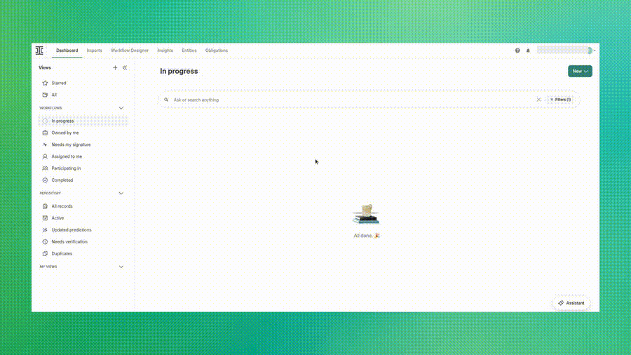

# 与 Ironclad 一起推进计算机使用能力（Advancing computer use with Ironclad）

> 原文：[Advancing computer use with Ironclad](https://openai.com/index/advancing-computer-use-with-ironclad/) · OpenAI · 2026-10-06
> 本文由 Kimi CLI 使用 Kimi K3-256k 全文翻译，并由 Agent 校对；已取得全文翻译和转载授权。
> 作者：OpenAI

2026年10月6日

[出版](https://openai.com/research/index/publication/)

一项合同领域的研究合作如何帮助我们在复杂的专业工作中训练和评估 AI 智能体。

当我们推出 [GPT‑6 Astra](https://openai.com/index/gpt-6-astra/) 时，我们展示了我们的模型在使用计算机完成专业工作方面取得的进展，从准备文档到测试网站。我们的下一个目标是让智能体在使用专业软件解决复杂业务问题时更加强大和高效。我们正在探索如何训练模型理解公司的业务规则、执行多步骤工作流程，并验证其工作是否符合原始要求。

为了加速这项研究，我们正与少数最了解这些工作流程的软件公司直接合作。我们共同识别具有挑战性的高价值任务，并将其转化为用于训练和评估模型的研究问题，最终使我们的模型在现实世界的商业应用中更加强大和实用。

我们的第一个合作伙伴是 Ironclad，AI 合同领域的领导者。通过与 Ironclad 团队的紧密合作，我们开发了要求智能体配置协议、审批和可复用法律条款的任务，并在这些复杂工作流程上展示了进展。Ironclad 的专业知识在定义成功的标准以及将真实客户需求直接引入前沿模型开发方面发挥了重要作用。我们感谢他们的合作，并很高兴分享我们共同取得的成果。

GPT‑6 Astra 是我们第一个在 Ironclad 任务上训练的前沿模型。在我们的研究评估中，它的平均得分比 GPT‑5.6 Sol 高 32%，而每次尝试的估计耗时降低了 48%。[1](https://openai.com/index/advancing-computer-use-with-ironclad/#citation-bottom-1)

## 将合同工作流程转化为训练任务

设想一个法务运营团队正在搭建一个软件采购流程。财务部门可能需要审批超过一定金额的采购，安全团队可能需要审查某些请求，法务部门可能需要审查非标准条款。搭建该流程的人必须把这份简短的清单转化为一个信息收集表单、文档模板、审批规则以及最终协议的记录。

一个执行同样工作的 AI 智能体必须在软件中操作时始终关注这些要求。例如，它必须配置超过支出阈值时的财务审批，并检查高于和低于该阈值的请求是否都遵循了正确的路径。仅仅把单个步骤做对是不够的：完成的流程必须在其设计要处理的所有情况下都能正常工作。

Ironclad 的员工以及在 OpenAI 使用 Ironclad 的人员帮助我们的研究人员在法律、商业和采购工作中识别了 11 项任务。这些任务包括搭建保密协议、创建采购审批流程，以及更新一条可复用的法律条款以反映请求者所选择的司法管辖区。我们估计，这项工作平均而言需要一名有经验的用户每项任务花费约 30 到 40 分钟。

我们根据每项任务的复杂程度，用 8 到 50 条标准对其进行评估。这使我们能够看到模型做对了哪些部分，以及在哪些方面存在不足。Ironclad 还提供了其产品的托管软件环境，供模型练习这些任务。我们的研究人员围绕具有代表性的工作流程开发了合成训练任务[2](https://openai.com/index/advancing-computer-use-with-ironclad/#citation-bottom-2)，并使用强化学习帮助模型通过练习和反馈不断改进。这种组合——由深谙业务的人员参与挑选的任务、详细的评估标准，以及供模型练习的环境——确保我们在对客户最重要的真实世界任务上不断进步。

## Astra 的表现

我们比较了 Astra 和 GPT‑5.6 Sol，其中 Astra 使用 Max 推理档位，Sol 使用 High 推理档位，即各自得分最高的设置。在 11 项研究任务中，Astra 的平均得分为 55.0%，而 GPT‑5.6 Sol 为 41.6%；同时，每次尝试的估计平均耗时从 Sol 的 37.0 分钟降至 Astra 的 19.2 分钟。[3](https://openai.com/index/advancing-computer-use-with-ironclad/#citation-bottom-3) 一个在 Astra 开发过程中使用的内部模型在这些任务上取得了更强的 63.7% 的成绩，我们的目标是将这些进一步的提升带到未来的模型中。

|  |  |  |
| --- | --- | --- |
| **指标** | **GPT‑5.6 Sol** High 推理 | **GPT‑6 Astra** Max 推理 |
| 平均评分标准得分 | 41.6% | 55.0% |
| 每次尝试的估计平均耗时 | 37.0 分钟 | 19.2 分钟 |

Astra 以更少的每次尝试模拟耗时满足了更多任务要求。下面两段视频展示了两个模型如何处理同一项研究任务。Astra（第一段）在估计 20 分钟内满足了约 94% 的任务标准；GPT‑5.6 Sol（第二段）在估计 32 分钟内满足了约 85%。

[观看原始视频：ironclad-astra](https://player.vimeo.com/video/1231839120?h=31fd7f85fb&amp;badge=0&amp;autopause=0&amp;player_id=0&amp;app_id=58479)

**GPT‑6 Astra** 在估计 20 分钟内满足了约 94% 的任务标准。

[观看原始视频：ironclad-sol](https://player.vimeo.com/video/1231839180?h=53f2234f22&amp;badge=0&amp;autopause=0&amp;player_id=0&amp;app_id=58479)

**GPT‑5.6 Sol** 在估计 32 分钟内满足了约 85% 的任务标准。

## 这次合作对 Ironclad 意味着什么

Ironclad 在这项工作中扮演的角色反映了其客户熟知的一个挑战：合同流程必须在保留企业所依赖规则的同时处理各种例外情况。如果一个智能体在任务进行到一半时丢失了其中某条规则，那就限制了软件公司可以放心交给它完成的工作。这凸显了为什么随着智能体在复杂合同任务上不断进步，人工监督仍然重要，以及为什么一个完整的合同平台依然不可或缺。与我们的研究人员合作，让 Ironclad 能够将这些问题带入底层模型的开发过程，使我们能够共同研究它们。

随着模型能力不断增强，Ironclad 有机会将它们应用到更多自家产品中。对法务和业务团队而言，这可能意味着 AI 将承担复杂合同工作中的更多环节，同时保留这些团队所依赖的控制机制。

> “要让 AI 在合同的复杂领域中真正发挥作用，它必须做得比完成单个操作更多。智能体需要理解完整的合同生命周期，包括各业务工作流程如何相互衔接，同时保留团队所依赖的控制机制。我们与 OpenAI 的合作将这些真实世界的挑战带入了研究过程，并有助于推动技术向前发展。”

——Sunita Verma，Ironclad 首席技术官

## 与我们合作，推进面向复杂专业工作的 AI

我们正在邀请少数软件公司与我们的研究和工程团队直接合作，攻关当今智能体仍无法可靠完成的重要专业任务。如果您的团队有这样的任务，我们希望看到一个具体的例子：您要求智能体做什么、它在哪些方面失败的证据，以及您将如何评判一个成功的结果。合作伙伴还应能够带来深谙该业务的人员、一个安全的测试环境，以及可以安全用于研究的数据。这为我们调查失败原因并衡量模型是否改进提供了起点。

如果这描述的正是您的团队，[**申请探索研究合作**](https://openai.com/form/computer-use-research-collaboration/)。

- [2026](https://openai.com/research/index/?tags=2026)

## 作者

OpenAI

## 脚注

1. 1

   这些结果涵盖 11 项研究任务，并非全部 Ironclad 工作流程。所列时间为基于假设的模型处理和生成速度得出的模拟估计值，并非实测的客户时间节省。
2. 2

   我们在应用了旨在去除个人信息的筛选条件后，利用美国证券交易委员会（SEC）EDGAR 数据库中公开可得的合同创建了模拟任务。我们没有将 OpenAI 客户数据、OpenAI 的内部合同，或非公开的 Ironclad 客户数据或合同用于训练或评估。
3. 3

   参见上文的研究评估脚注。
