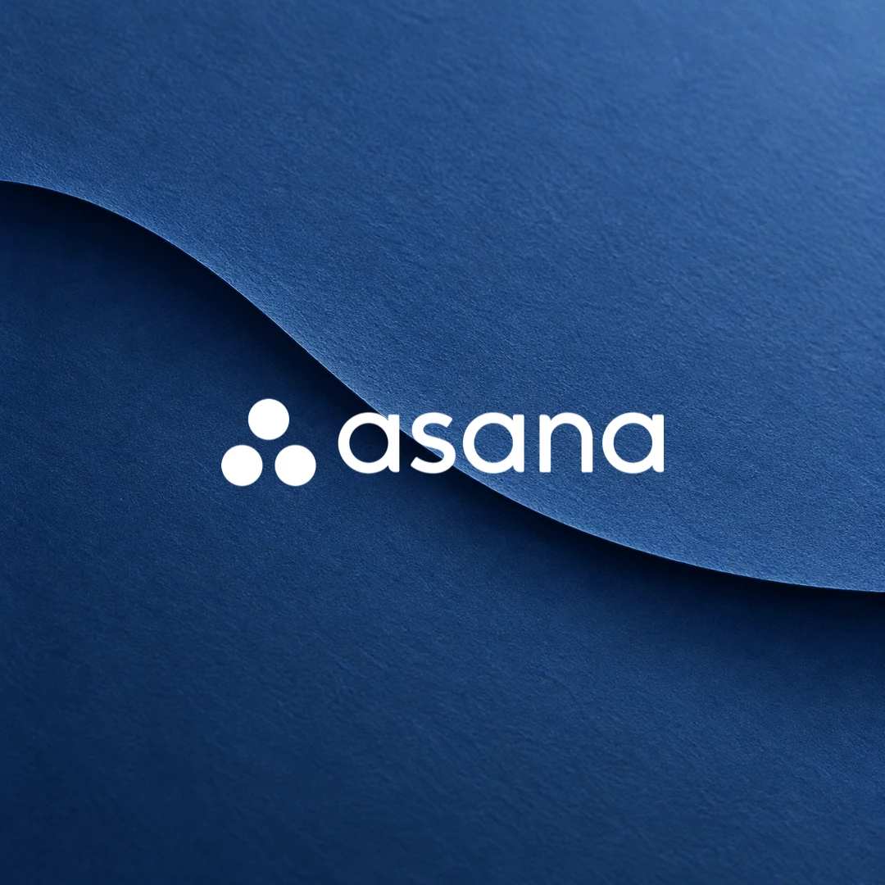
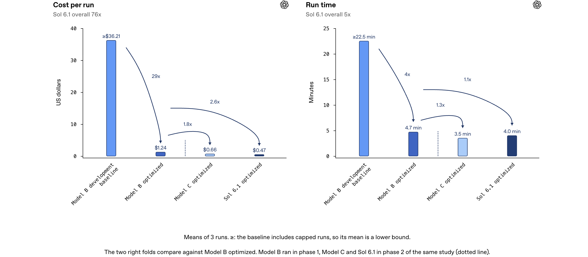
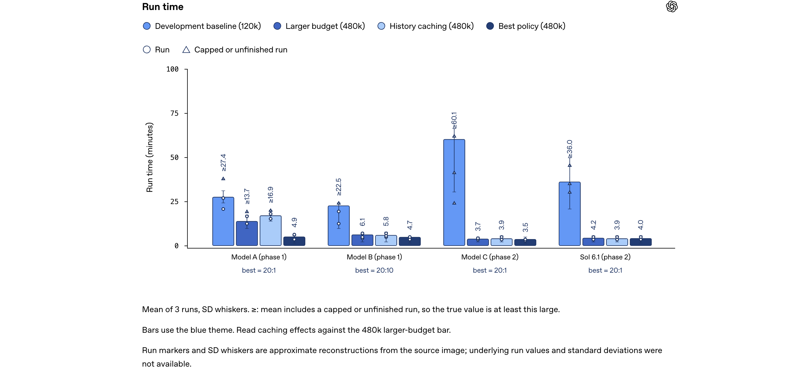
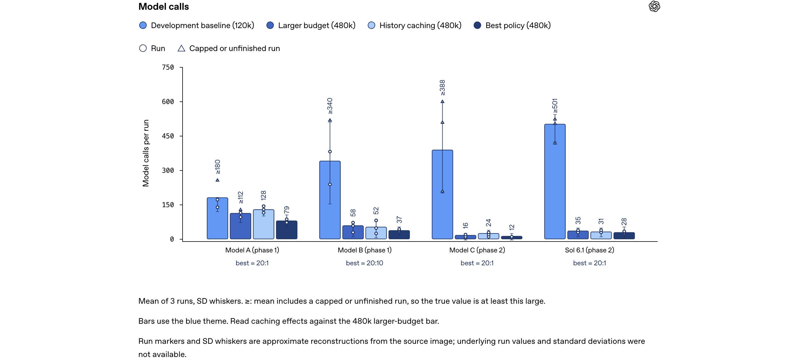

# Asana 如何在浏览器测试中将模型成本降至原来的七十六分之一（Asana cuts model costs 76x in browser tests with GPT-6.1 Sol）

> 原文：[Asana cuts model costs 76x in browser tests with GPT-6.1 Sol](https://openai.com/index/asana-browser-agent/) · OpenAI · 2026-10-09
> 本文由 Kimi CLI 使用 Kimi K3-256k 全文翻译，并由 Agent 校对；已取得全文翻译和转载授权。
> 作者：OpenAI

2026年10月9日

通过在 Codex 中使用 GPT‑6 Astra，Asana 让其浏览器智能体在测试中的成本降至原来的约1/76、运行速度约为原来的5倍，从而能够为客户提供更强大的模型。

[联系销售](https://openai.com/contact-sales/)

公司规模：企业级

地区：北美

行业：科技

产品：Codex

76倍

优化后的 GPT-6.1 Sol 工作流带来的更低预估模型成本

5倍

优化后的 GPT-6.1 Sol 工作流带来的更快浏览器运行速度

0.47美元

优化后的 GPT-6.1 Sol 工作流的平均预估模型成本

借助在 Codex 中运行实验的 GPT‑6 Astra，Asana 优化了其浏览器智能体在 GPT‑6.1 Sol 上的工作流，使其成本降至原来的约1/76、运行速度约为原来的5倍。

Asana 通过其 [收购⁠](https://asana.com/press/releases/pr/asana-acquires-stackai-adding-cross-system-execution-for-human-agent-teams/e7c73b97-ae8c-4e51-b927-189ccb184146) 的平台 [StackAI⁠](https://www.stackai.com/)，帮助客户跨业务应用实现工作自动化。借助 StackAI，客户无需编写代码即可构建能够浏览网站、填写表单和收集信息的工作流。在 Asana 的规模下，这些工作流中的微小低效也会积少成多。

Asana 旗下 StackAI 的首席技术官 Frank Hidalgo 博士着手让浏览器智能体运行得更快、更便宜。他指挥 Codex 中的 GPT‑6 Astra 调查该智能体、测试改进方案并比较结果。他估计，这项手工完成需要一到两个月的工作，只用了大约一周时间。

[Asana 的144次运行研究⁠](https://asana.com/inside-asana/cut-browsers-agent-cost) 测试了 GPT‑6.1 Sol 和其他三个前沿模型（在此称为模型A、B和C）。最终在 GPT‑6.1 Sol 上形成的优化工作流，平均预估模型成本为0.47美元，每次运行约四分钟，相比在模型B上的原始生产设置，成本降至原来的约1/76、运行速度约为原来的5倍。

> “这就是人类与智能体团队在实践中的样子。一名工程师设定方向，GPT-6 Astra 运行实验，结果经由 Command 进入生产环境。这展示了 Asana 如何将人类与智能体团队变为现实。”

——Arnab Bose，Asana 首席产品官

## 用 GPT‑6 Astra 识别浏览器智能体的低效之处

为了快速推进，Hidalgo 首先使用 Codex 中的 GPT‑6 Astra 梳理代码库，并解释智能体是如何构建每个模型请求的。GPT‑6 Astra 发现，该智能体缓存了固定的指令和工具定义，却没有缓存不断增长的页面文本和截图历史，因此每个请求都会以全价重新发送这段历史。

该智能体还会在几乎每一步丢弃较早的截图并裁剪文本。每次编辑都会改变历史记录，所以仅缓存历史本身也无济于事，而丢失这些信息可能导致智能体重新访问它已经读过的页面。

## 从预计两个月的研究到用 GPT‑6 Astra 一周完成

Hidalgo 审阅了 GPT‑6 Astra 提出的修复方案，并选出三个进行测试：

- 将缓存扩展到智能体的浏览历史
- 增加其可保留的文本量
- 分批移除截图，而不是每一步都移除

GPT‑6 Astra 先通过快速测试确定哪些变量起作用。由于代码并非为受控实验设计，它随后重构了代码，使一个前端和后端能够并行支持多个工作流，每个工作流都有自己的设置。

Astra 开展了完整研究：120,000和480,000字符的历史预算，以及六种缓存与截图策略，每种策略在四个模型上各测试三次（见下表）。表现最佳的策略允许截图累积到20张后再削减到最新的一张。这使得较早的历史在两次移除之间能保持更长时间不变。结合更大的历史预算，它成为了优化后的工作流。每种配置执行相同的任务：从一个公开的演示目录中为32本书各收集六个字段，这与一些 Asana 客户在 StackAI 中运行的任务类似。

| **模型** | **描述** | **价格** |
| --- | --- | --- |
| **模型A** | 来自另一家前沿实验室的更小、更便宜的模型，2025年秋季发布 | GPT‑6.1 Sol 价格的一半 |
| **模型B** | 最初在生产中使用的模型，与模型A来自同一实验室，2026年夏季发布 | 与 GPT‑6.1 Sol 价格相同 |
| **模型C** | 模型B的更新版本，2026年秋季发布 | 与 GPT‑6.1 Sol 价格相同 |
| **GPT‑6.1 Sol** | OpenAI 的模型 |  |

GPT‑6 Astra 运行了这些工作流，并检查了请求、用量记录和输出，另有独立的模型会话审阅了这项工作。每个会话的请求、数据轨迹和结果都记录在 Asana 的软件交付平台 [Command⁠](https://asana.com/product/command) 中，以便团队事后审阅完整研究。研究结果从 Command 转化为工单，再转化为拉取请求，变更随后进入生产环境。

> “这项工作手工做需要一到两个月。借助 Codex 中的 GPT-6 Astra，只用了大约一周：我会在睡前设置一个 /goal，早上审阅结果。”

——Frank Hidalgo 博士，Asana 旗下 StackAI 首席技术官

## 将每次运行的模型成本降至0.50美元以下

对于模型B，优化将预估模型成本从至少36.21美元（部分原始运行在完成前就达到了步数上限）降至每次运行1.24美元，即降至原来的约1/29。在 GPT‑6.1 Sol 上的优化工作流还要再便宜，成本约为其1/2.6，即0.47美元。优化工作流中的每次运行都完成了任务并返回了正确答案。

3次运行的平均值。≥：基线包含被截断的运行，因此其平均值是下限。

右侧两个对比项以优化后的模型B为参照。模型B在第一阶段运行，模型C和 Sol 6.1 在同一研究的第二阶段运行（虚线）。

仅就 GPT‑6.1 Sol 而言，在更大的历史预算下，新的缓存与截图策略将成本降至原来的约1/4，从每次运行1.97美元降至0.47美元。每次调用的成本降至原来的约1/3，因为89%的输入来自缓存，价格仅为未缓存价格的5%。运行速度也更快了：模型B上的原始设置至少需要22.5分钟，而 GPT‑6.1 Sol 上的优化工作流约为四分钟。

3次运行的平均值，误差线为标准差。≥：平均值包含被截断或未完成的运行，因此真实值至少为此数值。

柱状图采用蓝色主题。缓存效果请对照480k更大预算的柱形阅读。

运行标记和标准差误差线是根据源图像近似重建的；底层运行数值和标准差不可得。

3次运行的平均值，误差线为标准差。≥：平均值包含被截断或未完成的运行，因此真实值至少为此数值。

柱状图采用蓝色主题。缓存效果请对照480k更大预算的柱形阅读。

运行标记和标准差误差线是根据源图像近似重建的；底层运行数值和标准差不可得。

这项调查还展示了历史管理如何影响智能体能否产出答案。让 GPT‑6.1 Sol 有更大空间保留浏览历史后，产出答案的运行次数从较小历史预算下18次中的3次，增加到较大预算下全部18次，且每次答案都正确。对 Hidalgo 来说，商业价值在于让客户能够使用更快、更强大的模型，同时保持运营成本可持续。

> “过去，成本限制了我们能为这些工作负载向客户提供哪些模型。通过让智能体更高效，我们可以为客户提供更好、更快的模型，同时降低我们的运营成本。”

——Frank Hidalgo 博士，Asana 旗下 StackAI 首席技术官

## 扩大实验和产品测试的规模

Asana 已将浏览器导航方面的变更发布到 StackAI，并正在开发工具，让类似实验更容易重复。随着时间推移，团队计划将此类测试纳入平台的评估体系，使客户和内部团队在配置智能体时能够比较成本、运行时间和答案质量。

> “交付速度不再是瓶颈；人类注意力才是。我们正接近这样一个世界：每位工程师都是领导一支智能体舰队的项目经理。”

——Frank Hidalgo 博士，Asana 旗下 StackAI 首席技术官

Asana 现在还在使用 Codex 中的 GPT‑6 Astra 在产品功能发布前进行测试：Astra 在平台中导航、尝试不同输入并向人类 QA 审阅人员报告缺陷。Hidalgo 将其视为一种新软件开发生命周期的基础——由众多云端智能体会话并行测试各项功能。

*完整研究可在* [*Asana*⁠](https://asana.com/inside-asana/cut-browsers-agent-cost) *和* [*StackAI*⁠](https://www.stackai.com/blog/how-stackai-by-asana-used-astra-codex-and-command-to-reduce-browser-agent-costs) *博客上查阅。*

## 加入工作的新时代

全球超过100万家企业正在借助 OpenAI 取得有意义的成果。

[联系销售](https://openai.com/contact-sales/)
