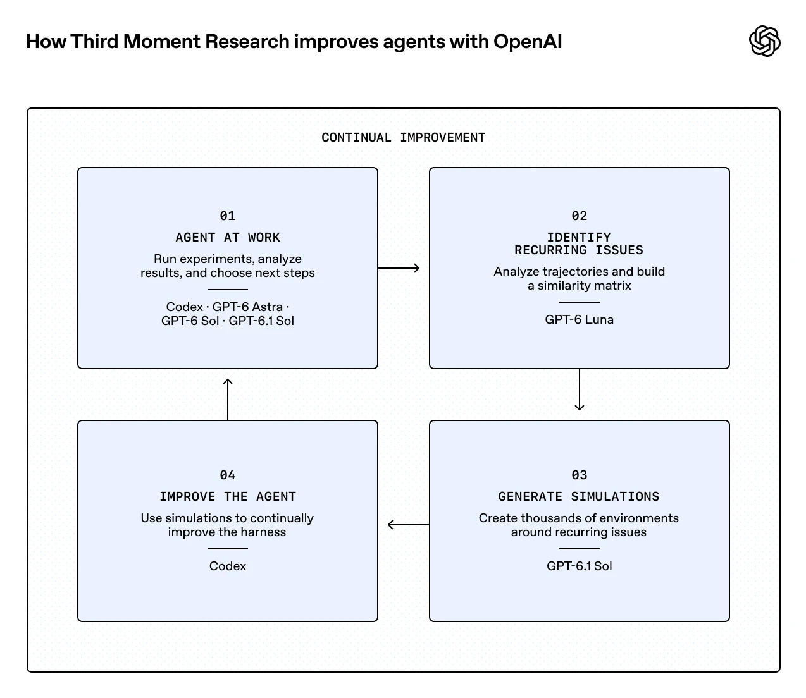

# Third Moment Research 如何让一万个 Agent 连续运行超过 36 小时（How Third Moment Research runs 10,000 agents for 36+ hours）

> 原文：[How Third Moment Research runs 10,000 agents for 36+ hours](https://openai.com/index/third-moment-research/) · OpenAI · 2026-10-14
> 本文由 Kimi CLI 使用 Kimi K3-256k 全文翻译，并由 Agent 校对；已取得全文翻译和转载授权。
> 作者：OpenAI

2026年10月14日

初创公司

凭借 GPT‑6 Astra、GPT‑6.1 Sol、Codex 以及用于网络安全的 Daybreak，这家 AI 实验室打造的智能体能够专注工作数天，并在使用中不断改进。

公司规模：初创公司

地区：北美

行业：科技

产品：API、Codex

10,000

同时运行的智能体数量

36–48

每次自主研究会话的小时数

97%

借助 Codex 实现的回测时间缩减

1

单日消耗的万亿级 OpenAI token

每家公司都有自己的工作流程、工具、边缘情况和成功标准。[⁠](https://thirdmomentresearch.com/)[Third Moment Research⁠](https://thirdmomentresearch.com/) 认为，最优秀的智能体应该非常擅长这些特定工作，并且应该随着使用次数的增加而不断提升自身能力。

该公司正围绕这一理念构建一个自我改进的 AI 系统，利用 OpenAI 的最新模型来理解智能体行为、识别反复出现的弱点，并围绕这些问题自动创建数千个合成场景。团队利用这些场景来改进智能体，并随着新问题的出现不断重复这一过程。

Codex、GPT‑6 Astra、GPT‑6 Sol 和 GPT‑6.1 Sol 支撑着该系统的研究与计算工作，使 Third Moment 能够同时运行 10,000 个智能体，开展持续 36-48 小时的调查研究。该公司还使用 Daybreak 来测试智能体工作环境的安全性。

> “在一次会话中，GPT-6.1 Sol 能够在数天的计算过程中保持一条连贯的计算研究主线，而不会偏离主题。”

——Adam Khakhar，Third Moment Research 联合创始人

## 借助 Codex 减少运行时间和 token 浪费

Third Moment 的早期应用之一是量化金融领域，因为该领域有明确的成功衡量标准。这个领域为研究智能体的工作方式及其困难所在提供了具体的场景。团队使用 Codex 来发现并解决研究环境中的问题。

在一个实例中，团队使用 Codex 搭配当时最新的 GPT 模型 GPT‑5.6，分析了数千条记录的模拟轨迹（智能体的操作和环境的响应），以及时间戳和代码库。

Codex 发现了一个瓶颈：在一年期的美国股票订单级数据上回测一个交易策略需要数小时。在等待期间，智能体会反复轮询任务是否完成，浪费 token 并用状态检查填满上下文。

在对回测进行性能分析并分析其输入和使用情况后，Codex 找出了一个缓存优化方案和一种内存紧凑打包技术。它试验了各种解决方案，并将修复部署到生产环境，把回测时间从约 3 小时缩短到约 3 至 5 分钟。这减少了 token 消耗和上下文污染，从而为后续实验释放出更多的智能体 token 预算。

## 借助 Codex 和 GPT‑6 让智能体专注于任务

Third Moment 为每个智能体提供完成特定工作所需的工具、信息和环境。在量化研究中，团队在 Docker 化的环境中运行默认的 Codex 框架。智能体会获得一太字节的数据、文档，以及一个包含特征工程、GPU 支持的模型训练、交易策略和模拟等模块的研究代码库。

GPT‑6 Astra、GPT‑6 Sol 和 GPT‑6.1 Sol 提供推理能力，而 Codex 框架则为智能体提供行动、制定计划、设定目标、派生子智能体以及在工作推进过程中压缩上下文的工具。

为了解决智能体在完成任务之前就停下来的问题，Third Moment 将 Codex 视为一个子智能体，置于由 GPT‑6 Sol 或 GPT‑6.1 Sol 驱动的外层框架之内。当任务未完成时，外层框架会检查运行轨迹，并决定是重试、终止任务，还是升级交由人工审查。

> “Codex 框架的通用性极强，能够在许多不同的领域中使用。”

——Adam Khakhar，Third Moment Research 联合创始人

在该研究环境中，智能体的任务是改进由 Third Moment 工程师构建的基准交易系统。它们在历史数据上测试交易策略，评估某项改进是有意义的还是噪声，并利用每个结果来选择下一个实验。据 Adam 介绍，它们的工作已经改进了这个基准交易系统。

## 以更高的 token 效率支撑更长时间的研究

Adam 表示，在 GPT‑5.5 之前，模型只能执行用户指定的实验。有了 GPT‑5.5 和 GPT‑5.6，与 Codex 框架配合工作的模型就可以利用实验结果来设计后续实验。如今有了 GPT‑6 Astra、GPT‑6 Sol 和 GPT‑6.1 Sol，智能体可以通过数百个与子智能体并行运行的实验来调查根本原因。

这一进步帮助智能体探索了团队此前未曾预料到的研究方向。在一次会话中，GPT‑6.1 Sol 发现了非显示交易对某家交易所的影响——在该交易所，这类交易在成交量中占据了出人意料的巨大份额。“这是一个不显而易见的结果，我们的研究团队最初并没有考虑到，”Adam 说。

Third Moment 在优化、机器学习系统和量化研究等方面对模型进行评估。它以最高推理设置测试前沿发布的模型，评估它们浏览代码库、编写高效代码以及持续推进一项调查的能力。目前的测试还包括 GPT‑6 Luna。

> “鉴于其 token 效率，GPT-6.1 Sol 目前是我们使用最多的模型。它用最少的 token 完成任务，同时提供与 GPT-6 Astra 相近的性能。”

——Jeffrey Yan，Third Moment Research 联合创始人

有一项基准测试要求智能体在保持输出不变的前提下，降低一个实时记分牌服务的更新延迟。团队通过将专家精心编写的解决方案的平均运行时间除以模型解决方案在相同硬件上的平均运行时间来衡量加速比，前提是通过正确性验证。据 Adam 介绍，GPT‑6 Astra 实现了最大的加速比。

对于有针对性的工作——包括检查模拟系统中特定的安全弱点——团队会使用 GPT‑5.6 Terra 等更高效的模型。而对于深度研究，Adam 认为更强的推理能力可以证明更高的成本是值得的：“在量化金融领域，发现某个有趣信号的价值是极其高的。”

## 使用 Daybreak 自动化安全测试

在有 10,000 个智能体自主运行的情况下，Third Moment 需要一种能够大规模测试其研究环境安全性的方法。团队在模拟启动之前使用 Daybreak 网络安全平台来自动化这些测试。

这些测试检查智能体是否可能突破其研究环境并访问更广泛的网络。“通过使用 Daybreak，我们能够让智能体自己对模拟环境进行渗透测试，检验其基础设施和安全性，”Adam 说。

> “没有 Daybreak，我们将无法大规模地自主进行这种测试。”

——Adam Khakhar，Third Moment Research 联合创始人

## 迈向数十万个协作智能体

Third Moment 的雄心延伸到了公司日常开展的专业化工作。对于零售商来说，这可能意味着在库存短缺或供应商延迟时做出更好的供应链决策。对于工程团队来说，这可能意味着在大型代码库中找到性能瓶颈。对于文档密集型业务来说，这可能意味着找出一份文档中的承诺与另一份文档中记录的结果不一致的地方。

在 GPT‑6 Astra、GPT‑6 Sol 和 GPT‑6.1 Sol 推理能力的基础上，Third Moment 计划从单个调查扩展到数十万个协作子智能体。其路线图计划用数万亿 token 支撑由数十个相互依赖的实验组成的链条，目标是利用这些研究在新挑战出现时自主改进智能体。

对 Adam 来说，这将让人们有更大的能力去塑造智能体的学习和工作方式：“人类可以处于一个杠杆效应大得多的位置，他们可以思考如何开展研究并优化研究本身，而不是亲自动手做研究。”
