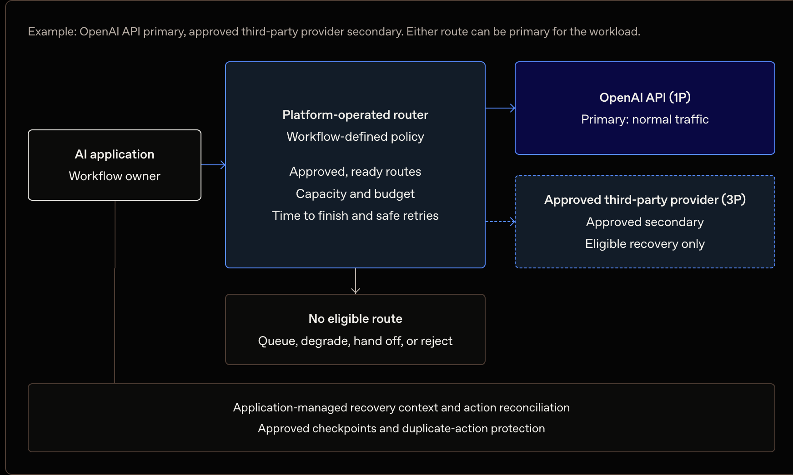
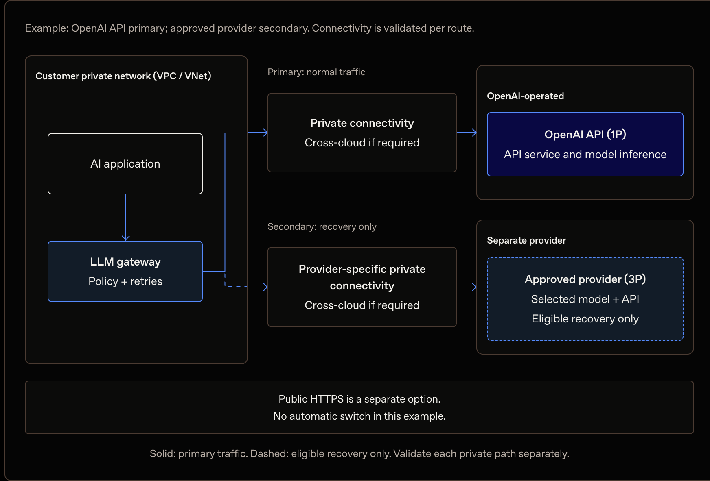

# 设计 OpenAI 模型提供商之间的故障切换（Designing failover across OpenAI model providers）

> 原文：[Designing failover across OpenAI model providers](https://developers.openai.com/blog/designing-failover-across-openai-model-providers) · OpenAI · 2026-10-14
> 本文由 Kimi CLI 使用 Kimi K3-256k 全文翻译，并由 Agent 校对；已取得全文翻译和转载授权。
> 作者：Oliver Steffmann, Vik Bomma

当业务依赖 AI 工作流时，即使是短暂的服务商中断，也可能延误决策或中断服务。我们一直在与金融服务客户合作，使用 OpenAI 模型构建智能体应用和网络安全工作流。本文以支付工作流中的只读欺诈评估作为贯穿示例，说明我们如何为关键工作负载设计生产路由与恢复方案。

在本文中，第一方 **(1P)** 指直接调用 OpenAI API；第三方 **(3P)** 指通过云服务商访问 OpenAI 模型，无论应用程序运行在何处。我们将介绍直接访问在预览模型和功能方面的价值、工作负载需求与私有连接如何影响路由选择，以及哪些操作可以安全地进行故障转移。随后，我们会提供一个用于在现有网关中实现该策略的 Codex 提示词，并说明在启用故障转移之前需要验证的内容。

## 为什么同时使用两条路由？

即使生产环境通过云服务商运行，直接访问 OpenAI 仍然很有价值。一个核心原因是可以访问预览模型和功能：当这些能力通过直接 API 提供时，符合条件的团队可以在其选择的云服务商支持之前，针对自己的工作流先行评估。

工作流运行的位置往往决定了生产路由。第三方云服务可能更契合应用现有的基础设施和运维控制，而直接访问 OpenAI 可能更符合另一个工作流的需求。请在你选择的路由上验证所需的模型、功能和行为，并使用直接 OpenAI 访问进行持续的实验。具体可用的内容取决于服务商、端点、区域以及你的账户。

对于关键工作负载，我们还会考虑在 1P 和 3P 之间经过验证的故障转移。服务商故障转移是指当主服务商无法处理请求时，通过另一个已批准的服务商重试该请求。只有当请求可以安全地重复执行，且备选路由满足工作流的要求时，故障转移才有帮助。

例如，一家全球性支付服务商可能使用 [Responses API](https://developers.openai.com/api/docs/guides/migrate-to-responses) 进行自包含的只读欺诈评估。如果调用在结果被使用之前超时，应用程序可以在交易截止时间之前，通过经过验证的备用路由重试。

而一个进行中的 [Agents API](https://developers.openai.com/api/docs/guides/agents-api/overview) 会话则需要不同的恢复方式。切换服务商本身并不能恢复其对话和已保存的工作，也无法调和先前的操作。这类恢复要困难得多，不在本文的讨论范围内。

正是这一区别，使我们将多服务商支持视为平台能力，而将故障转移视为工作流层面的决策。

## 计划路由与故障转移

选择生产路由和批准故障转移是两个独立的决策。计划路由可能包括在多个服务商之间拆分流量，或将超出容量的需求导向另一条路由。这些模式各自需要进行容量、成本、质量和恢复方面的测试。

我们看到一些客户将 [Decisions API](https://developers.openai.com/api/docs/guides/decisions) 用作路由的可选输入。为了保持工作流的韧性，需要定义当该服务不可用时路由应如何表现。

下图中以 1P 为主路由、以已批准的 3P 路由为备用路由。具体哪条路由作为主路由，取决于工作负载。

## 路由器的位置



_图 1：OpenAI API 为主路由；已批准的第三方服务商为备用路由。路由器由平台运营；策略由应用程序定义。模型、功能、容量、控制措施和可用性可能有所不同。_

> 图示：AI 应用程序将请求发送到由工作流定义的策略所管理的、由平台运营的路由器。实线箭头承载发往 OpenAI API 的主流量；虚线箭头承载发往已批准的第三方服务商的符合条件的恢复流量。如果没有符合条件的路由，则将请求排队、降级、移交或拒绝。应用程序负责管理恢复上下文、操作调和、检查点以及防重复操作保护。

示例：OpenAI API 为主路由，已批准的第三方服务商为备用路由。对于该工作负载，任一路由都可以作为主路由。

**AI 应用程序** 工作流所有者

**平台运营的路由器** 工作流定义的策略

已批准的、就绪的路由容量与预算完成时间与安全重试

**OpenAI API (1P)** 主路由：正常流量

**已批准的第三方服务商 (3P)** 已批准的备用路由 仅限符合条件的恢复流量

**无符合条件的路由** 排队、降级、移交或拒绝

由应用程序管理的恢复上下文与操作调和 已批准的检查点与防重复操作保护

> 插图说明：AI 应用程序在工作流定义的策略下，将请求发送到平台运营的路由器。正常流量发往主用的 OpenAI API，只有符合条件的恢复流量才发往已批准的第三方服务商。当没有符合条件的路由时，工作流将请求排队、降级、移交或拒绝。恢复上下文、操作调和、检查点以及防重复操作保护由应用程序负责。


如果你现有的模型路由器或 LLM 网关能够针对每条路由执行独立的规则，就可以直接使用它。将正常流量发送到主路由。只有在满足故障转移条件时，才使用经过测试的备用路由。

定义谁可以使用每条路由、在哪些区域使用、以及使用哪些模型和 API。记录已批准的法人实体、团队、服务商账户或项目，以及数据处理规则。批准仅适用于约定的工作负载和区域。

## 私有连接与路由选择

受监管行业的许多客户将私有连接作为其安全控制的一部分。对于这些客户来说，选择路由还意味着要检查其应用所在的云如何以私有方式连接到每个服务商。下图展示了一个位于客户私有网络中的应用程序和网关，分别通过独立的私有路径连接到各个服务商。



_图 2：OpenAI API (1P) 为主路由；已批准的服务商 (3P) 为备用路由，例如 Amazon Bedrock 或 Azure OpenAI。只有符合条件的恢复流量才使用备用路由。_

> 图示：AI 应用程序和 LLM 网关位于客户私有网络内。网关通过私有连接将正常流量发送到 OpenAI 运营的 API，并通过经过单独验证的、特定于服务商的私有连接，将符合条件的恢复流量发送到另一个已批准的服务商。任一私有路径都可能需要跨云连接。在本示例中，公共 HTTPS 是一个独立的选项，不会自动切换。

示例：OpenAI API 为主路由；已批准的服务商为备用路由。每条路由的连接都经过单独验证。

**客户私有网络（VPC / VNet）**

AI 应用程序

**LLM 网关** 策略 + 重试

主路由：正常流量

**私有连接** 如有需要则跨云连接

**OpenAI 运营**

**OpenAI API (1P)** API 服务与模型推理

备用路由：仅用于恢复

**特定于服务商的私有连接** 如有需要则跨云连接

**独立服务商**

**已批准的服务商 (3P)** 选定的模型 + API 仅限符合条件的恢复流量

公共 HTTPS 是一个独立的选项。在本示例中不会自动切换。

实线：主流量。虚线：仅限符合条件的恢复流量。分别验证每条私有路径。

> 插图说明：AI 应用程序和 LLM 网关运行在客户私有网络内。主路由使用独立的私有连接访问 OpenAI API，如有需要可采用跨云连接。符合条件的恢复流量使用特定于服务商的私有连接访问已批准的第三方服务商。OpenAI 与备用服务商各自运营独立的服务。公共 HTTPS 是一个独立的选项，不会自动激活。


在本文发布时，1P 和 3P 的私有连接选项有所不同。对于直接访问 OpenAI（1P），[OpenAI Private Link](https://developers.openai.com/api/docs/guides/private-link) 使用 Azure Private Endpoint。运行在 AWS 和 Google Cloud 上的工作负载需要由客户自行管理到 Azure 的连接，才能通过这条私有路径访问直接 OpenAI API。

对于第三方访问（3P），[Amazon Bedrock](https://docs.aws.amazon.com/bedrock/latest/userguide/vpc-interface-endpoints.html) 通过 AWS PrivateLink 使用特定于 API 的接口型 VPC 端点，而 [Azure OpenAI](https://learn.microsoft.com/en-us/azure/ai-services/cognitive-services-virtual-networks#use-private-endpoints) 使用 Azure 私有端点。在启用故障转移之前，请在两条路由上验证 DNS、访问权限以及区域性的模型和 API 支持。[OpenAI Private Link](https://developers.openai.com/api/docs/guides/private-link#does-private-link-fail-over-between-regions-automatically) 不会在区域端点之间自动切换，因此区域性恢复需要单独的配置和测试。任何到公共 HTTPS 的恢复也需要获得明确批准。

服务商的支持情况可能发生变化。在选择或启用路由之前，请查阅官方文档。

## 哪些操作可以进行故障转移？

并非每个操作都有合适的备用路由。例如：

- **缺失的能力：** 某个工作流可能通过直接 OpenAI API 使用网络搜索来核查最新信息。如果备用路由不支持该能力，不要静默地跳过搜索。应验证替代实现方案，或者对该操作保持故障转移禁用。
- **未经验证的行为：** 模型名称匹配或 API 兼容并不够。在启用备用路由之前，先针对它运行工作流现有的测试工具和评估。
- **数据驻留或状态约束：** 不要切换到违反已批准的数据位置要求、或无法访问安全完成该操作所需状态的目标路由。

当没有符合要求的备用路由时，可以在约定的时限内将工作排队、使用已批准的降级功能路径或人工路径，或者安全地停止。即使整个工作流不符合条件，其中某个可重试的推理步骤仍可能符合条件。

一个超时的只读欺诈评估，如果其结果尚未被使用且仍有足够的时间，则可能符合再次尝试的条件。一旦输出已进入其他系统，恢复就需要一条经过测试的重启路径。如果某个操作可能已经执行完成，在重启之前必须确认其结果并防止重复操作。

## 何时以及如何进行故障转移

在支付示例中，繁忙或不可用的模型可以替换为另一个已批准的模型：这是模型回退（model fallback）。通过另一个服务商重试评估则是服务商故障转移（provider failover）。有时两者会同时发生变化。

我们首先要问的是：切换服务商是否有帮助。共享的网关、检索服务或身份系统可能同时影响两条路由。测试备用路由的连接、访问权限和容量，并检查针对你的模型、托管工具和数据位置要求的区域性恢复支持。

如果故障或响应缓慢持续存在，熔断器可以暂停发往受影响路由的新请求。按服务商、模型、区域和工作流分别设置错误率和响应时间阈值。每个请求仍需满足故障转移的条件。

在重试请求之前，请确认该请求可以安全地重复执行，并且能够在工作流的截止期限内完成。备用路由必须经过批准、处于启用状态、健康运行，并针对额外负载进行了测试，且仍有剩余预算。请查阅 OpenAI 的[错误代码](https://developers.openai.com/api/docs/guides/error-codes)和[速率限制文档](https://developers.openai.com/api/docs/guides/rate-limits)；同时也要查看其他提供商的错误、重试、配额和计费规则。

下表给出了自动故障转移的一个保守起点。请依据各提供商的错误详情来判断，而不仅仅是 HTTP 状态码。

| 条件                                                             | 路由决策                                                                                                                                                                                                                   |
| ---------------------------------------------------------------- | -------------------------------------------------------------------------------------------------------------------------------------------------------------------------------------------------------------------------- |
| 临时性的服务或连接故障                                           | **考虑故障转移**：针对可重试的提供商错误、连接重置或超时。                                                                                                                                                                 |
| 持续的限流或响应缓慢                                             | **考虑故障转移**：如果继续等待会突破请求或工作流的截止期限。注意区分临时限流与需要整改的配额或计费问题。                                                                                                                   |
| 无效请求、访问失败、拒绝或配额耗尽                               | **不要自动切换路由**：针对格式错误的请求、401/403 错误、安全拒绝、配额耗尽、额度或支出上限用尽等情况。应纠正或上报问题根源。未分类的错误不应触发故障转移。                                                                 |
| 输出不完整或工具操作结果不确定                                   | **不要盲目重放**，也不要假设部分响应可以在另一条路由上继续。在重新开始之前，先核对操作结果并防止重复写入。                                                                                                                 |
| 特定模型不可用或容量受限                                         | **尝试另一个经过批准的模型**，该模型需满足质量、功能和延迟要求。如果提供商的共享服务路径受到影响，则在满足上述前提条件的情况下**考虑提供商级故障转移**。                                                                     |

应由一个统一的层级来控制应用程序、SDK 和网关之间的重试，以避免重试次数相互叠加放大。使用共享的重试预算，并遵循有效的 [Retry-After 指引](https://developers.openai.com/api/docs/guides/rate-limits)。否则，请使用[有界指数退避加抖动](https://developers.openai.com/api/docs/guides/rate-limits#retrying-with-exponential-backoff)：逐次拉长重试间隔、加入随机性，并限制尝试次数。只对安全的推理调用进行重试，并同时受请求截止期限和工作流截止期限约束。

限制故障转移流量，以免备用路由不堪重负。当具有代表性的请求在规定的一段时间内持续满足错误率和响应时间限制后，再逐步恢复主路由。一旦这些限制被突破，就暂停流量增加。如果两条路由都受限，则按照工作流事先约定的恢复策略执行。

## 使用 Codex 实施故障转移策略

现在我们可以使用 Codex 将这些恢复规则转化为对现有 LLM 网关的具体改动。以支付场景为例，我们把工作范围限定在自包含的只读欺诈评估步骤。主路由保持不变，并且在备用路由获得批准并通过验证之前，故障转移保持禁用状态。

在 Codex 中打开负责网关配置或应用路由的代码仓库，然后根据你的工作流和目标路由调整下面的提示词。

```text
Add disabled-by-default provider failover for [workflow’s self-contained, read-only inference step] in [repository/gateway]. Preserve the primary route and reuse the existing gateway, approved platform routes, and workflow policy.

Inspect gateway, SDK, and adapter versions, deployment configuration, APIs, and current official documentation. Separate app and gateway changes by owner and required review. Provide configuration and integration tests for dependencies owned elsewhere. Flag unsupported controls. Do not guess approvals or limits; keep dependent failover paths disabled until verified.

Use tested provider-specific error mappings. Allow transient service/network failures and confirmed temporary throttling only when replay is safe and the approved, enabled, healthy secondary has required features, data controls, tested capacity, remaining budget, and time to finish. Block invalid requests, access failures, refusals, exhausted quota/credits/budget, unknown errors, and ambiguous 429s.

Use one retry controller across client, gateway, and SDK. Disable conflicting retry/failover chains; enforce one total attempt limit and both request and workflow deadlines. Use configured per-attempt timeouts within the overall deadline. Accept only one result per logical request and ignore late responses from earlier attempts. Respect valid Retry-After; otherwise use bounded exponential backoff with jitter. Never blindly replay partial output or uncertain actions, or assume provider state transfers. Apply the approved queue, reduced-result, or stop policy. Include manual disable, circuit breaking, and gradual failback.

Test the actual request path with local HTTP stubs and external networking blocked. Assert route order, call counts, and elapsed time for success, eligible failures, each blocked error class, failed eligibility, partial output, uncertain actions, exhausted budgets, both routes failing, and recovery controls. Blocked cases must make no secondary call. Keep synthetic limits in test fixtures and protect secrets. Make no live calls or deployments without authorization.

Return minimal patches, tests mapped to requirements, results, rollback instructions, and outstanding live checks. Leave all unverified failover paths disabled.
```

该提示词要求 Codex 完成一项聚焦的网关改动、编写说明何时应当以及何时不应当调用备用路由的测试，并列出在真实路由上仍需完成的检查清单。请先审查补丁和本地测试结果，然后在启用故障转移之前，验证模型行为、数据管控、容量以及负载下的恢复能力。

## 验证路由与恢复

支付示例所展示的检查同样适用于其他关键工作负载。针对工作流在质量、安全、输出格式、工具使用和上下文限制方面的[验收标准](https://developers.openai.com/api/docs/guides/evaluation-best-practices#design-your-eval-process)，对两条路由都进行测试。记录所测试的配置、可用性和访问要求——包括处理层级和托管功能——并明确何时需要重新测试。

评估步骤的数据限制（包括提示词和输出日志记录的限制）在正常运行和恢复期间同样适用。在启用任一路由之前，与法务、隐私、安全和数据治理负责人一起审查凭据、网络路径、检索、工具、存储状态和日志。

这项审查需要服务文档和合同，以确认数据在何处处理和存储、保留多长时间、如何加密，以及谁控制密钥和访问权限。仅凭端点的位置或私有连接是不够的。不同端点的管控措施、适用资格和责任划分各不相同——请参阅 [OpenAI 的数据管控](https://developers.openai.com/api/docs/guides/your-data)。

一条合适的路由还需要为恢复流量预留余量。提供商级别的整体仪表盘可能会掩盖欺诈评估模型上的限流，因此要按每条路由的模型、账户或项目以及区域，分别跟踪请求速率和 token 速率、并发请求数、限流情况、响应时间以及剩余的已批准预算。

要了解备用路由能否承受压力，请将其现有负载与预期的欺诈评估流量及重试加在一起进行负载测试。利用这些结果来设定故障转移流量上限，并决定哪些请求可以等待、哪些可以使用降级功能、哪些应当停止。仅有配额并不能保证在截止期限前完成。

迁移评估步骤还可能改变其成本和响应时间。比较每次成功评估的成本，包括缓存未命中、数据传输费用和连接成本。同时也要测量因缓存未命中或请求跨云传输而增加的延迟。

最后，在负载下测试表中的各类故障场景，以及功能缺失和备用路由繁忙或不可用的情况。检查恢复策略是否按预期工作，包括流量限制、手动停止以及向主路由的渐进回切。

从以下方面评估恢复效果：服务恢复的速度、在截止期限前完成的评估数量、结果质量、成本以及重复操作。定期开展演练可以让这些检查保持时效，以应对凭据过期、配置变更或容量变化。

## 谁负责恢复

一种实用的做法是将路由服务的所有权与应用程序的所有权分开。平台团队可以负责运行提供商集成、路由器、监控和审计日志。它拥有路由服务的生产就绪性，并强制执行目的地、身份、数据、流量和支出方面的管控，同时指定值班负责人，负责禁用路由以及管理向主路由的回切。

在这种模式下，应用程序负责人定义哪些操作可以故障转移、服务和质量目标，以及可接受的降级功能。他们还负责业务结果、保存的恢复上下文、工具权限、响应检查，以及防止重复操作——包括在状态或工具被共享的情况下。

你的团队可以合并这些角色，也可以采用不同的分工方式。在启用故障转移之前，请先明确由谁批准管控措施、谁负责路由测试和运行手册，以及谁在事故期间有权采取行动。

## 结论

即使生产环境经由云提供商运行，也应把直接访问 OpenAI 视为工具箱中的一项选择。它为符合条件的团队提供了一条评估预览模型和功能的途径，也是关键工作负载的一条潜在恢复路由。生产环境选择 1P 还是 3P，应基于工作流的能力、托管环境和管控要求来决定——包括在需要时提供私有连接。

对于关键工作负载，从一个自包含的只读推理步骤开始。Codex 可以帮助实现该步骤的网关策略和本地测试，而在实际路由上的验证则确定备用路由是否满足工作流的要求。这样，团队就拥有了一份具体的恢复计划：何时切换、何时停止，以及由谁来做决定。
