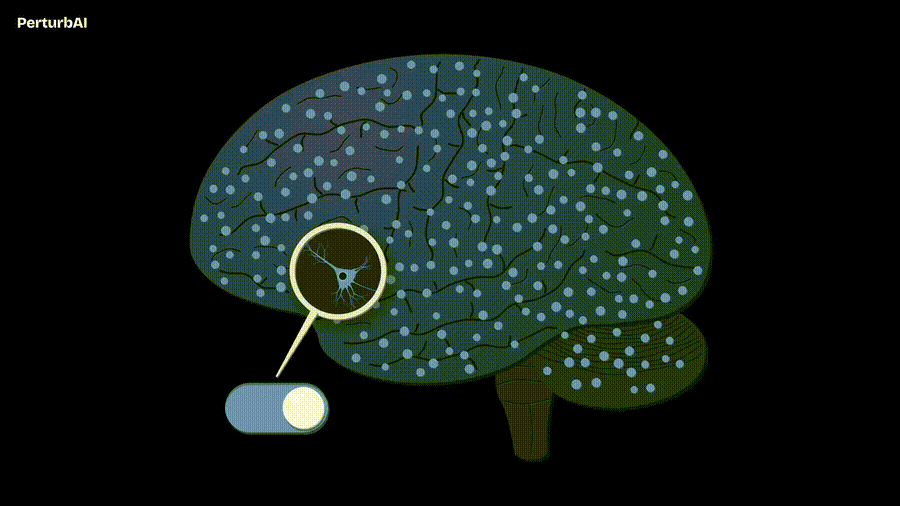
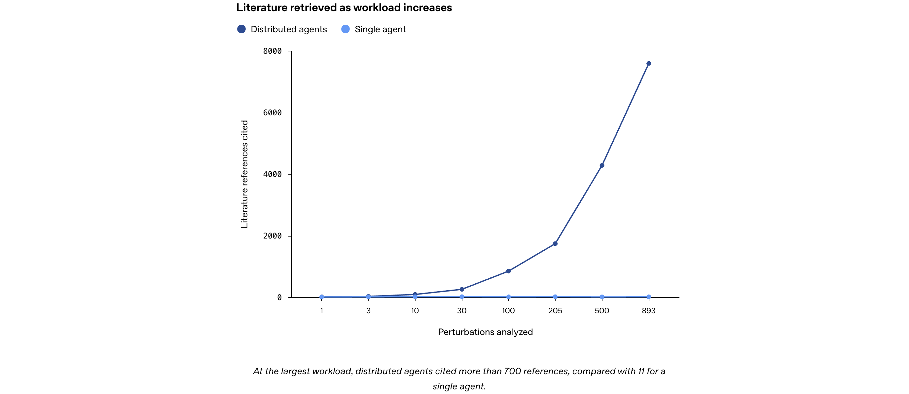
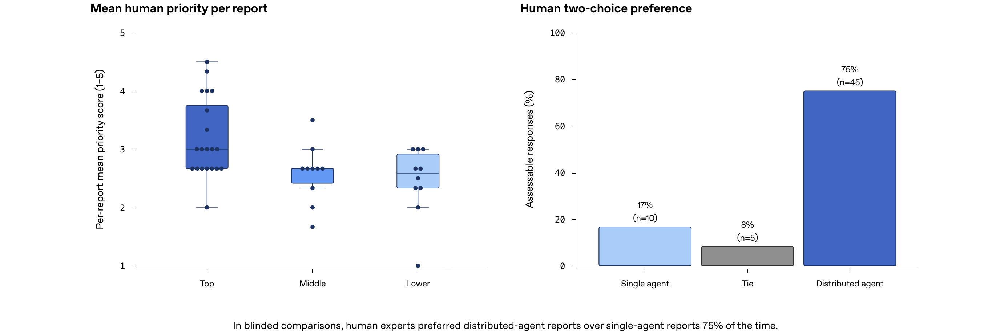

# 利用数千个 AI Agent 在生物数据中发现新线索（Using thousands of AI agents to uncover new leads in biological data）

> 原文：[Using thousands of AI agents to uncover new leads in biological data](https://openai.com/index/scaling-ai-research-for-complex-biological-data/) · OpenAI · 2026-10-21
> 本文由 Kimi CLI 使用 Kimi K3-256k 全文翻译，并由 Agent 校对；已取得全文翻译和转载授权。
> 作者：OpenAI

2026年10月21日

[出版物](https://openai.com/research/index/publication/)[研究](https://openai.com/news/research/)

OpenAI、PerturbAI 和 Scripps Research 如何利用分布式 AI 智能体，帮助科学家从数百万个脑细胞的数据中识别有前景的研究线索

[阅读论文](https://www.biorxiv.org/content/10.64898/2026.10.15.759436v1)

[观看原始视频：evidence-graph-pitch-16x9-r17-A-warm](https://player.vimeo.com/video/1237313920?h=0c81b1925b&badge=0&autopause=0&player_id=0&app_id=58479&texttrack=en-x-autogen&cc=1)

*看看 OpenAI、PerturbAI 和 Scripps Research 如何并行部署数千个 AI 智能体，从数百万个脑细胞的复杂数据中识别出有前景的生物学关联。*

*⁠*

*视频制作：PerturbAI。*

如果科学家能够在几分钟内而不是几个月内发现关于阿尔茨海默病和帕金森病的新线索，那会怎样？OpenAI、[PerturbAI⁠](http://perturb.ai) 与 [Scripps Research⁠](http://scripps.edu) 携手合作，使用[由 GPT‑Rosalind 驱动的数千个 AI 智能体⁠](https://www.biorxiv.org/content/10.64898/2026.10.15.759436v1)，仅用 32 分钟就分析和解读了来自[数百万个小鼠脑细胞⁠](https://huggingface.co/datasets/perturbai/wholebrain_crispr_atlas)的现有实验数据。这些智能体将基因扰动的影响与科学文献中的发现联系起来，揭示了意想不到的生物学关联，这些关联可以帮助科学家理解疾病，并为新疗法确定研究方向。这项工作展示了 AI 如何帮助研究人员探索大型生物学实验所揭示的更多内容。

现代实验产生的数据远远超出科学家能够彻底研究的范围。研究人员现在可以改变数千个基因，并测量它们在数百万个细胞中产生的效应。但要理解这些结果对人类疾病意味着什么，就需要将复杂的实验发现与数十年来分散的科学知识联系起来。这正是 AI 可以帮助科学家发现那些可能被遗漏的有前景线索的地方。

> “我们构建细胞图谱，是为了让其他科学家能够做出我们尚未想象到的发现。AI 可以帮助更多研究人员探索这些资源，并将意想不到的观察转化为可供检验的新问题。”

——Sarah Teichmann 博士，剑桥大学干细胞医学讲席教授，人类细胞图谱（Human Cell Atlas）创始联合主席

该团队将分析工作分配给数千个由 GPT‑Rosalind 驱动的 AI 智能体，我们将这种方法称为分布式生物学推理（distributed biological reasoning）。这些智能体研究了一份[全脑 CRISPR 图谱⁠](https://www.biorxiv.org/content/10.64898/2026.03.16.711480v1)——这是一份展示基因扰动如何影响小鼠大脑中不同类型细胞的数据集。每个智能体负责研究一个基因扰动，分析细胞反应，检索科学文献，并为结果提出解释。它们的报告被整合成一份推理图谱，将基因、细胞效应、相关文献和可能的生物学机制联系起来。

研究团队估计，如果由人类一次只分析一个扰动，进行可比拟的分析和文献综述将需要数月至一年的时间。这些智能体在复现人类分析结果的同时，还发现了额外的线索。它们对新颖性和科学价值的评估也与盲评人类专家的判断相一致。这些发现有助于确定后续实验的优先次序，以检验所提出的生物学机制。

其中一些洞见为理解脑部疾病指明了新的线索。这些智能体发现了两个与疾病相关的基因以不同方式影响脑细胞的意外差异，以及胆固醇调节与神经退行性病变之间的潜在联系。这些发现可以帮助科学家研究疾病如何发展，以及未来的疗法可能在何处进行干预。

> “有时线索已经存在，只是分散在不同的领域——我们还没有把它们联系起来。神经元功能与胆固醇代谢之间可能存在的联系表明，这些碎片一旦拼合起来，就能为我们提供一种思考疾病生物学的新方式。”

——Tomasz Nowakowski 博士，加州大学旧金山分校（UCSF）神经外科副教授

研究人员今天就可以开始探索这些发现。该推理图谱[现已开放⁠](https://github.com/jinlabneurogenomics/distributed_agent)，科学家可以借此比较相关基因、研究意想不到的反应，并识别值得深入探究的有前景线索。当来自不同领域的研究人员汇聚各自的专业知识，以意想不到的方式将熟悉的想法联系起来时，新的发现往往由此产生。AI 可以通过将新数据与散布于各学科的知识相连接，显著扩大这类关联的规模。这一机遇不仅仅在于更快地分析数据。通过将 AI 与实验生物学、人类专业知识和科学文献相结合，我们可以帮助科学家将更多数据转化为可检验的想法。

## 大型实验，意外线索

实验中最有趣的一些线索，往往藏在科学家最初打算探究的故事之外。在一个包含数千次扰动的数据集中，这些线索很容易被遗漏。

这些智能体发现了 Tsc1 和 Tsc2 之间一个意想不到的差异。这两个基因协同工作，共同控制 mTOR——细胞生长、代谢和衰老的主要调节因子。扰动其中任何一个基因，在几组神经元中都会产生相似的影响。但在帮助协调运动的小脑中，Tsc2 扰动改变了数十个参与神经元通讯的基因的活性，而 Tsc1 扰动则几乎没有引起变化。

这一差异可能与人类疾病相关。在结节性硬化症患者中，小脑异常与 TSC2 突变密切相关。虽然降低 mTOR 活性的药物可以治疗某些脑肿瘤和癫痫发作，但与该疾病相关的学习和行为障碍仍然难以解决。这些智能体精确定位了一组值得研究的特定神经元和细胞变化：现有药物可能纠正哪些变化，哪些变化可能指向新的治疗方法？这为研究人员提供了一组更具体、可在实验室中检验的问题。

## 分工协作，深化推理

如果把整个数据集交给单个智能体，它的表现能和数千个并行工作的智能体一样好吗？我们在保持模型和资源不变的情况下测试了这一点。随着工作量的增加，单个智能体检索的文献越来越少，在最大工作量下仅引用了 11 篇参考文献，而分布式智能体引用了 700 多篇参考文献。人类专家也更偏好分布式智能体的解读。

科学家的时间有限，往往专注于数据中最强的信号。分布式智能体可以帮助考察更广泛的反应，包括细微或意想不到的反应，并将它们与相关科学文献联系起来。并行运行这些智能体可以同时研究多个扰动。这有助于科学家探索实验中蕴含的更多内容，并识别那些可能被遗漏的有前景线索。

*在最大工作量下，分布式智能体引用了 700 多篇参考文献，而单个智能体仅引用了 11 篇。*

## 寻找下一个值得做的实验

当一项发现能指明一个值得做的实验时，它的价值会更大。这些智能体在 *DCTN1* 基因中找到了这样一条线索——该基因的突变会导致佩里综合征（Perry syndrome），这是一种具有帕金森样症状的神经退行性疾病。

DCTN1 参与神经元内胞内货物（cargo）的运输。在全脑 CRISPR 图谱中，扰动 Dctn1 会提高参与胆固醇合成的基因的表达。这些智能体将这一观察与相关研究联系起来，后者表明胆固醇运输出现问题可能会导致细胞合成更多胆固醇。这为后续实验提出了一个问题：DCTN1 扰动是否会改变胆固醇在神经元内的分布，而这些变化是否会导致神经退行性病变？如果是这样，恢复正常的胆固醇分布是否有助于保护神经元？

人类专家也认为这一假说具有新颖性、意义重大且值得跟进。这个例子展示了如何把一个意想不到的结果与已有知识联系起来，从而将一条线索转化为可检验的想法，并可能成为治疗疾病的新方向。

在盲评比较中，人类专家在 75% 的情况下更偏好分布式智能体的报告，而非单个智能体的报告。

科学家仍然是发现的核心。通过发掘更多有前景的线索，AI 可以帮助研究人员决定追寻哪些想法、设计实验并解读结果。我们的目标是将生物学实验中的更多信息转化为知识，随着时间的推移，这些知识可以帮助指导更好药物的开发。

- [2026](https://openai.com/research/index/?tags=2026)
- [科学](https://openai.com/research/index/?tags=science)

## 作者

OpenAI
