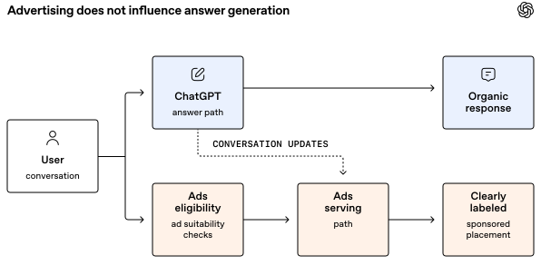
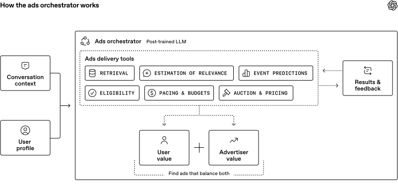
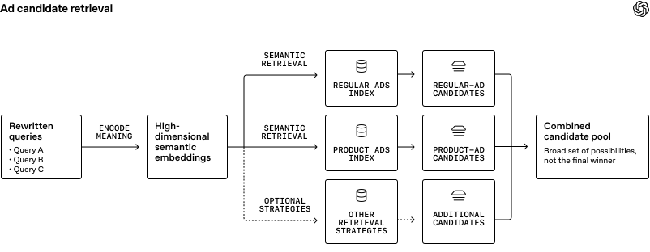
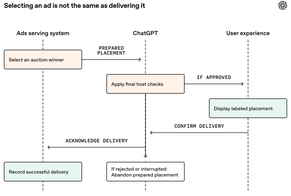
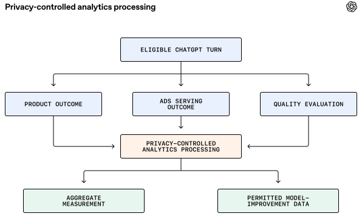

# 我们如何构建兼顾用户信任与相关性的 ChatGPT 广告系统（How we built ChatGPT’s novel ad stack for user trust and relevance）

> 原文：[How we built ChatGPT’s novel ad stack for user trust and relevance](https://openai.com/index/building-chatgpt-ad-stack/) · OpenAI · 2026-10-21
> 本文由 Kimi CLI 使用 Kimi K3-256k 全文翻译，并由 Agent 校对；已取得全文翻译和转载授权。
> 作者：Ritendra Datta, Karthik Gopalratnam

2026年10月21日

[工程](https://openai.com/news/engineering/)

作者：Ritendra Datta 和 Karthik Gopalratnam，技术团队成员

传统广告系统的构建目标是响应离散的、一个个单元的用户意图。用户在网上搜索或浏览某些内容，广告系统将这些查询和页面浏览作为事件接收，然后系统根据这些事件寻找匹配的广告。而为 ChatGPT 构建广告技术栈则有所不同：用户意图是在对话中逐渐形成的，会在对话的多轮交互中发生变化，有时并不存在一个合适的广告时机。为了支持这一新范式，我们构建了一套定制化的广告投放系统。这种新型广告技术栈基于一个定制的、经过后训练的前沿大语言模型（LLM），它通过工具调用来完成检索（识别排名靠前的候选项）、排序（预测用户参与度）、相关性评估（评估广告的实用性），以及运行拍卖以完成最终的广告选择和定价。

我们的广告系统通过三项关键设计决策来支持用户目标不断演变的细微之处：1）实现有状态的广告会话，即信息可以在一次对话的多轮交互之间以及多次对话之间被记住；2）依赖一个定制的、经过后训练的 LLM，它采用工具调用架构来解读对话的上下文及其底层意图，然后有效地选择、排序和投放广告；3）将广告选择流程与 ChatGPT 的回答生成分开，在独立的服务中运行，以防止广告影响回答，并保持 ChatGPT 中立的语调。我们使用这个经过后训练的 LLM 来编排整个广告流程，根据用户当前的一轮对话和对话历史，确定在恰当的时间展示恰当的广告。过去，引导这样一个自我改进的广告系统需要数年时间，而 ChatGPT Ads 在[上线后不到 200 天](https://openai.com/index/expanding-access-to-ai-with-chatgpt-ads/)就达到了 10 亿美元的年化收入运行率；自上线以来，已有超过 10 万家广告主在 ChatGPT 上投放了广告。

## 广告在智能体聊天中应该如何运作？

传统的广告请求通常始于一个定义明确的事件。用户提交一条搜索查询或打开一个网页，广告系统便收到一个请求。这类系统相当简单：它检索潜在的广告候选项，对其进行排序，运行拍卖为该机会合理定价，然后将最终选出的广告展示给用户。而 ChatGPT 并不会自然地产出这样一个具体的时刻。

在 ChatGPT 的对话中，人们带着目标而来，而非一条只有一个答案的搜索查询。他们可能正在规划一次旅行、为自己的企业选择软件、布置家居，或者学习一项新爱好。这一切并不会在对话的一轮中全部发生。ChatGPT 常常会在这个过程中帮助用户澄清什么才是重要的。

举例来说，我们的工程团队询问 ChatGPT 如何为一场比赛进行训练：对话从一个关于跑步的一般性问题开始。几轮之后，他们问起有助于训练的鞋子。随着每一个新约束条件的出现，对话的商业含义都在变化——而这种个性化的上下文会跨越多次会话持续演化。一个只根据第一条消息采取行动的系统可能会完全误判意图，从而可能降低用户体验并妨碍用户。

构建我们的广告系统要求我们超越传统的“请求-响应”广告架构，从零开始构建一套广告技术栈，在优先保障用户信任和价值的同时，发掘潜在的商业机会。

## 拥有对话记忆，但不影响 ChatGPT 的回答

像传统广告系统那样把每条消息都变成一个独立的请求，在我们的聊天场景中会带有若干风险：1）因过度简化而误读用户目标；2）过早启动广告流程，此时用户的真实需求尚不明确；3）展示的广告妨碍而非支持用户的任务进程；4）每当请求变化就低效地重新运行整个广告流程，制造噪音并浪费成本。我们的广告系统（由检索、排序和投放组成）并不围绕单个事件构建，而是维护一个有状态的会话，也就是说，广告会话在一个符合条件的对话轮次期间持续运行，随着对话的演进不断记住并更新信息。ChatGPT 将初始请求上下文发送给广告服务器。广告系统会跟随并适应不断发展的对话，而不是依赖于单一的、被压平的查询。

广告选择流程与 ChatGPT 正常的回答生成并行运行，以确保广告流程不会影响 ChatGPT 的回答。广告通过一个独立的系统进行过滤和选择，该系统在该系统自身的资格、质量和投放约束下消费对话内容。这一重要的架构边界——使用独立模型和独立代码的不同服务——让 ChatGPT 核心服务器专注于生成自然（非广告）回答；与此同时，广告系统独立评估是否存在合适的广告机会，如果有，则通过独立的投放流程准备一条赞助内容。

*广告与 ChatGPT 的回答路径并行运行。*

除了保护用户体验之外，这种分离还带来了一些实际效果。ChatGPT 对广告系统没有任何依赖——这些服务之间毫不纠缠，也不共享内容生成模型。因此，即使广告投放系统不可用或响应缓慢，ChatGPT 的自然回答也会照常继续，不受影响。这意味着广告系统不可能使 ChatGPT 产品宕机或变慢。这种分离的另一个好处是，它为“有价值的广告”设定了非常高的门槛。不返回任何广告是一个正常的、成功的结果。只有当广告对用户和广告主都明显有益时，系统才会投放广告。

## 一个解读对话并调用工具的 LLM

我们广告技术栈中的另一个关键架构组件，是那个解读对话并在智能体循环中运行整个广告流程的后训练 LLM——它向广告系统的核心功能发起工具调用，从检索阶段到排序，再到拍卖，最终完成投放。我们把这个 LLM 称为*编排器（orchestrator）*。

广告流程的第一部分是理解用户意图，以启动检索过程，即快速且有意宽泛地搜集潜在广告，供后续过滤。以增量方式接收对话会产生一个信息更丰富但也更模糊的检索问题，因为广告系统需要区分当前意图和过时的上下文。编排器必须解读对先前消息的引用，识别用户何时在做假设性的谈论，并避免把每一次提及某个产品或服务都当作购买请求。

广告编排器利用可用的对话和用户上下文，通过迭代来寻找优质广告，并反复选择何时调用哪个工具，其底层目标是为该对话及其上下文找到最合适的广告（即在用户价值和广告主价值之间取得平衡的广告）。如果用户选择启用个性化广告，编排器还会考虑关于用户过往对话的可用非敏感信息，以找到最佳的广告匹配。

广告编排器通过迭代调用广告投放工具来寻找有价值的广告。

随着对话推进、广告编排器获得更多更新信息，编排器可以使用更新后的上下文运行一组新的工具调用，以找到更好的广告并将其返回给客户端，客户端随后可以在这些新广告及时到达时使用它们。

用户价值

广告主价值

印花抱枕

不符合资格的候选项

*编排器的设计目标是平衡用户价值和广告主价值，并始终将用户放在首位。*

## 编排器如何在智能体循环中调用广告工具

广告系统由多个独立的工具组成，编排器通过迭代调用它们来为对话找到最佳广告。从高层来看，编排器将对话转化为简短的文本摘要，再将摘要转化为语义嵌入（即存储下来的、便于广告系统筛选的含义表示），利用这些语义嵌入检索广告候选项，根据预算、用户设置和其他初步检查对候选项进行资格过滤，评估其质量和相关性，最后进行最终排序，以识别出适合在聊天回答末尾展示的高价值机会。因此，每个广告都必须在资格和相关性上达到很高的标准，才有资格被展示。

### 准备捕捉意图的检索查询

编排器 LLM 首先会准备一条或多条代表相关商业意图的查询。这可以包括改写对话上下文，把商业可能性扩展到超出 1:1 搜索查询的范围，然后创建语义表示——编排器将一段多轮对话提炼为供检索系统使用的摘要版本，从而以聚焦的方式从我们的数据库中检索广告。

只有当对用户的意图有深入理解时，广告展示对用户和广告主双方才都会更好。多条查询可以保留意图的不同方面。例如，一段关于规划旅行的对话，可能包含与交通、住宿或活动相关的不同需求。检索系统可以保留这些区分，而不是把整段对话压缩成一个字面字符串。

举个例子，让我们看一段关于登山鞋的潜在对话序列：

1. 优胜美地两日游应该安排哪些内容？
2. 下周会冷吗？
3. [某品牌]的新产品线？

尽管用户并没有把鞋品牌的问题与优胜美地之行联系起来，但这段对话在我们的广告系统中可能被表示为两条查询，例如 `[适合徒步旅行的鞋]` 和 `[适合旅行的[品牌]新产品线]`。这可能只是第一次尝试；编排器被设计为会对这些表示进行迭代，直到在我们的广告库存中找到对用户极具价值的广告为止。

### 检索可能的广告

检索（Retrieval）是创建一个刻意放宽范围的广告候选池的过程。候选广告可能来自不同的检索策略，之后可以在相同的投放约束下相互竞争。我们构建了多个索引，分别针对不同的系统和产品约束进行优化（例如，商品信息流广告的索引在抓取最佳广告时会感知商品的正面或负面评价，而对于那些可能没有相关评价的其他广告而言，这一点并不适用）。每个索引都针对某种近似最近邻（ANN）搜索进行了优化，使用表示用户意图的嵌入向量。这种 ANN 搜索是一种面向大型语义索引的检索近似算法，意味着广告会被非常快速地抓取——它追求接近一个不错的解，而不是寻找"唯一正确"的解，同时保留绝大多数相关候选。

广告系统在广告检索过程中使用改写后的查询来创建语义嵌入向量，并生成一个宽泛的广告候选池。

### 过滤不合格候选

过滤的目标是剔除所有在相关性、出价和预算方面达不到投放标准的广告候选。根据候选和配置的不同，过滤检查可以包括：素材和广告系列的可用性（广告系列或广告素材是否处于启用状态）、广告系列的定向设置（例如广告系列被允许在哪些地区投放）、政策限制（关于可投放广告内容的合规要求）、预算可用性（广告系列是否仍有可用预算可供消耗）、投放节奏（广告系列应当现在消耗预算，还是在一天中的其他时间消耗）、展示位置兼容性（该广告适合出现在哪些类型的对话中），以及广告主和广告系列级别的去重（为每个广告主选择适当数量的广告，以确保各商家之间的公平参与）。

### 评估相关性与质量

通过资格检查的候选广告会进入评分阶段，在此阶段，编排器会向各种评分系统发起工具调用——这些评分服务于以下考量：语义相关性（广告是否与用户的目标相关？）、预测互动率（广告是否有可能被浏览、点击，并转化为广告主期望的结果？）、历史表现（该广告此前向用户展示时表现如何？）。编排器还会在竞价之前过滤广告，以确保相关性和安全性。这些系统将候选范围缩小为一个更小的、为竞价做好准备的候选池，但它们仍然不决定最终投放哪条广告。

### 运行广告竞价

编排器在对话上下文中评估准备好的候选广告，并选择哪些广告候选足够合适、可以进入最终竞价。编排器并不直接决定投放哪条广告，也不设定价格。它只是为竞价工具提名上下文合适的候选广告，供其评估。

竞价会应用最终的投放机制，包括竞价准入（通过相关性和价值的最低门槛）、投放节奏（更均匀地消耗广告预算）、出价和竞价特征计算、质量调整后的排序、定价，以及最终选择。

### 最终资格检查

竞价之后，广告可能以两种方式投放失败，这两种方式都是 ChatGPT 对话媒介所特有的。

1. **广告在聊天中可能显得不合时宜**：尽管对话本身已被完整性模型（即决定何时适合投放广告的模型）判定为适合投放广告，且广告本身也被判定为符合政策，但有时广告在某些对话的上下文中仍可能显得不合时宜。编排器会阻止这些广告被展示。
2. **广告请求可能未能及时到达**：如果 ChatGPT 模型已经准备好回复，但广告尚未准备好投放，广告请求就会超时，广告也就不会被投放。因此，广告系统的目标之一就是尽可能快地运行。ChatGPT 模型的响应时间是动态的，我们不会为了等待广告加载而延迟聊天回复。

如果上述所有检查均通过，我们会将广告发送到前端进行渲染。我们将此视为一次服务器端广告*投放*，但我们仍可能不会向用户展示该广告——这是有意为之的设计。

## 最后一步：向用户展示广告

在 ChatGPT 这样的对话式产品中，广告素材的服务器端投放并不保证广告会被展示；广告还必须及时到达，才能被纳入当前这一轮对话。广告素材包括标题、描述、目标链接以及任何行动号召（call to action）。此外，广告系统还会返回一段由模型生成的引导语（preamble），即一段简短、中立的介绍，说明该广告与对话的关联。将引导语与素材分开，既保留了广告主的原始信息，又保持了 ChatGPT 的中立语气。

ChatGPT 前端将引导语和广告素材作为一个整体接收。如果它在 ChatGPT 的回复完全生成之前到达，前端就会在 ChatGPT 回复下方展示该广告，并明确标注为"赞助内容"。如果到达得太晚，该轮对话就不会展示这条广告。这就是服务器端广告投放与面向用户的广告展示之间的区别。

*胜出选择与投放是两个独立的事件。只有在 ChatGPT 批准并展示该广告位、且投放得到确认回执之后，一条被选中的广告才成为一次投放。*

## 广告展示之后会发生什么

我们的广告技术栈使用传统的日志和数据管道，这带来三大好处：广告主可以更轻松地将其现有系统与我们的技术栈集成；广告主可以利用报告数据改进其策略；我们的团队也能发现系统中可以改进的环节。除了这些报告和优化工具之外，我们还部署了一个高质量模型来评估我们的投放效果，并训练其他广告模型，从而形成一个强大的自我改进闭环。

对事件细节的详细拆解，帮助我们独立地理解和改进广告系统的每一个环节。日志处理系统还会记录细粒度的结果，例如：

- 该轮对话不符合广告投放条件。
- 广告会话已启动，但未发起检索请求。
- 检索未返回任何候选。
- 检索到了候选，但未通过数据补全（hydration）或资格检查。
- 广告已投放，并在之后收到了一次互动。

这些详细的拆解帮助我们独立地改进广告投放系统的每个环节。改进机会识别所需的证据，不同于改进检索、候选质量、竞价参与度或投放可靠性所需的证据。

*投放、服务和质量系统各自观测生命周期的不同部分。隐私受控的处理流程决定了哪些数据可用于度量和模型改进。*

### 高能力模型评估并改进整个技术栈

基于模型的评估背后的理念是：让我们最强大、推理能力最强的模型观察并评判系统的结果，然后通过训练来改进经过后训练的 LLM，使其表现得更好。例如，如果我们最强大的模型能够收集反馈并训练这些小型工作模型做到尽可能出色，我们就可以将更小、更高效的模型或推理能力较低的模型用于编排或检索。

### 人类反馈引导品味方向

我们收集并响应人类反馈（用户的点击和隐藏行为），以及通过我们的广告管理器（Ads Manager）进行的用户调查和广告主的直接反馈。在构建过程中，我们还让团队成员随时提供反馈，并直接倾听 ChatGPT 用户和广告主双方的需求。这一反馈来源对我们方向的指引甚至超过了模型的观察性反馈，也是让我们能够快速迭代、做出正确产品决策的原因之一。模型或许能够理解用户意图、进行批判性思考并交付有价值的东西，但品味是由人塑造的。

## 下一步

一年前，我们还没有广告系统，只有少数几个人在思考这个问题领域。如今，我们拥有了一个稳健的广告系统，支撑着超过 10 亿美元的年化收入运行率，并由一个基于 LLM 的编排器驱动整个广告流程。Codex 是一个根本性的力量倍增器，让我们能够以无与伦比的速度从零起步搭建系统，达成这一重要的使用里程碑。从一开始，我们就围绕使用 Codex 来搭建团队和开发工作流，以快速构建和扩展系统。我们为 Codex 构建了护栏，使其能够可靠、安全地交付代码。与此同时，我们还为 Codex 搭建了数据基础设施插件，大幅收紧了洞察收集与系统改进落地的闭环，包括新产品功能、质量改进和更优的系统性能。

我们系统的边界（植根于我们的[广告原则⁠](https://openai.com/index/our-approach-to-advertising-and-expanding-access/)）与基于 LLM 的编排器相结合，让我们能够在不把每一轮对话都当作广告请求的情况下，让广告变得有用。展望未来，我们将继续试验更具动态性的广告形式，以提升用户价值（例如，让用户能够通过广告直接与商家对话）和广告主价值。这个建立在 OpenAI 模型之上、带有持续反馈闭环的自我改进架构，将加速我们随时间不断提升相关性和个性化的能力。

- [ChatGPT](https://openai.com/news/?tags=chatgpt)
- [2026](https://openai.com/news/?tags=2026)

## 作者

Ritendra Datta、Karthik Gopalratnam
