# LifeVal：评测个人 Agent 完成日常事务的能力（LifeVal）

> 原文：[LifeVal](https://openai.com/index/lifeval/) · OpenAI · 2026-11-02
> 本文由 Kimi CLI 使用 Kimi K3-256k 全文翻译，并由 Agent 校对；已取得全文翻译和转载授权。
> 作者：OpenAI

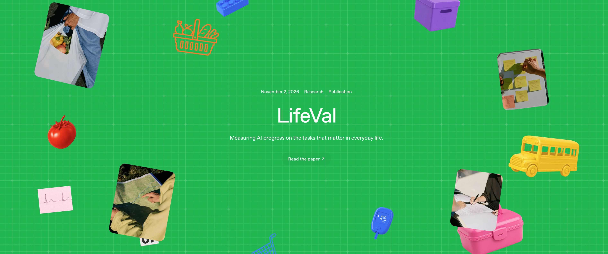

2026年11月2日

[研究](https://openai.com/news/research/)[出版物](https://openai.com/research/index/publication/)

衡量人工智能在日常生活中真正重要任务上的进展。

[阅读论文](https://arxiv.org/abs/2611.06687)

OpenAI 的使命是确保通用人工智能造福全人类。对于目前每周使用 ChatGPT 的超过十亿用户，我们希望构建能够帮助应对日常生活实际挑战的人工智能，比如寻找托儿服务、获取政府服务、制定预算、为入学做准备、修改食谱、订购日用品、设计锻炼计划等等。

当有人寻求帮助以让生活更轻松时，他们需要的不只是建议或聊天回复。要成为真正有用的个人助手，ChatGPT 应该能够采取实际行动，真正把事情办成。

[观看原始视频：LifeVal 主视觉](https://player.vimeo.com/video/1240955743?h=dd9318da21&badge=0&autopause=0&player_id=0&app_id=58479)

为了衡量模型在日常任务上随时间的表现，我们构建了一套评估体系，涵盖用户最希望从 AI 和个人智能体获得帮助的领域。过去一年中，我们使用这套评估来跟踪并推动模型在日常任务上的性能改进。

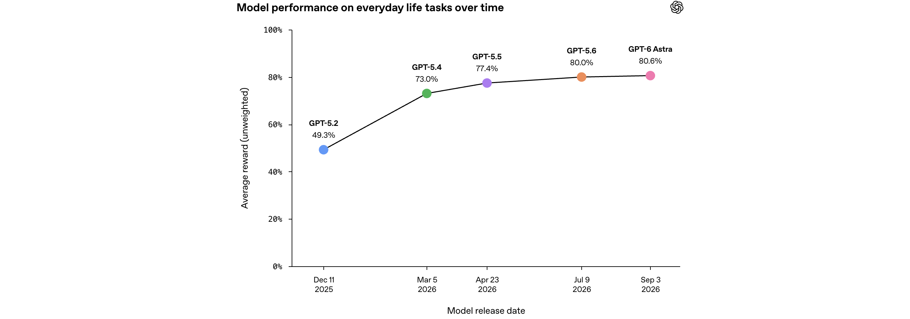

## 背景

为了确定人们最看重的任务，我们首先参考了两项追踪人们在美国及国际上如何支配时间的大型研究：[美国时间使用调查⁠](https://www.bls.gov/tus/)和[跨国时间使用研究⁠](https://www.timeuse.org/mtus)。这些数据集共同提供了一份详尽的日常生活任务目录，涵盖不同人口统计特征、一天中不同时段以及不同季节人们所做的事情。为了了解人们最希望在哪些方面获得 AI 帮助，我们在这些现有调查的基础上扩展了一项新的调查，覆盖了 3,995 名具有人口统计代表性的受访者。针对每项任务，我们提出了各种问题，以确定普通人最希望从个人助手那里获得帮助的领域。由此得出的任务涵盖了人们最希望获得帮助的最重要领域，包括照护、健康、教育、家庭事务管理、个人财务、购物以及获取政府服务。

## 单项任务示例

以下是一些示例，展示我们当前的模型在日常生活实际工作流上的表现。

### 搬家后报名合适的幼儿园

93.1%

比较我们新家附近的幼儿园，并筛选出最合适的候选名单。

我已将范围缩小到三所幼儿园，并整理好了报名详情。还有两个偏好需要您来决定。要不要查看一下候选名单？

### 在洪水来临前管理志愿者

98.0%

帮我组织社区的防洪志愿者队伍，为四位需要防洪援助的邻居提供帮助。

我准备了一份简单的行动计划，帮助志愿者评估提到的地点，并帮助他们为即将到来的恶劣天气做好准备。

### 为我的家人寻找新家

100%

在卢泽恩县找一套符合我预算、带有独立居住单元的房子，并且送完孩子上学后通勤时间要短。把房产契约加入我的购物车，以便我查看。

我找到了一套符合您要求的房子。我已计算好转让税，并将契约加入了您的县级记录购物车供您查看。

### 与远方的奶奶一起观看比赛

96.3%

为我和奶奶设置一种简便的方式，让我们可以远程一起观看比赛。

最简便的观看方案已经准备好了，如果直播中断还有备用方案。需要我带您和奶奶一步步操作吗？

### 为刚确诊糖尿病的父母准备膳食

90.4%

帮助我的父母适应新确诊的糖尿病，制定一份实用的护理和膳食计划。

第一周的计划已经准备好了，包括餐食、提醒事项以及要问护理团队的问题。在您分享给父母之前，要不要一起检查一下？

我们最新的模型在许多 LifeVal 任务上得分非常高。

## 任务结果

| 任务 | GPT‑6 Astra 最佳记录得分 |
| --- | --- |
| 寻找并**预约一门**符合我幼儿需求和我们家庭日程安排的**感官课程** | 100% |
| 查看我的车何时需要保养，并在公路旅行之前**预约一次车检** | 100% |
| 为我最喜欢的三道菜**订购清真食品杂货**，控制在预算之内，并在电子表格中逐项列出订单明细 | 100% |
| 利用照片和钻石鉴定报告，为妻子寻找她**丢失的订婚戒指**的替代品 | 100% |
| 找到并订购**一款**可以替代我的手机、电子阅读器和掌上游戏机的**口袋大小的设备** | 100% |
| **退订**电子邮件列表 | 100% |
| 为妈妈挑选并**购买一台相机** | 100% |
| 找一个我的孩子能方便到达的**戏剧工作坊**，并把课程加入我们的日历 | 100% |
| 在安娜堡找一场四月的**钢琴音乐会**，如果符合我的预算就预订两个相邻座位 | 100% |
| 为我的家庭寻找一处**新家**：符合预算、带独立居住单元，且通勤路程短 | 100% |
| 填写我的**得克萨斯州 SNAP 申请表**，并附上支持文件以便我审核 | 98.7% |
| 使用信用卡积分**预订前往日内瓦的旅行** | 96.7% |
| 与远在他处的奶奶一起**观看比赛** | 96.3% |
| 搬家后找到**合适的幼儿园** | 93.1% |
| 帮助一位家长适应**糖尿病确诊** | 90.4% |
| 检查我的 **LSAT 逻辑推理**答案 | 88.7% |

过去一年中，我们训练模型在浏览器使用、计算机使用和连接器任务上变得更快、更强大、更对齐。在 ChatGPT 中启用这些能力也扩展了模型可以帮助完成的任务类型，推动 ChatGPT 超越聊天工具，迈向真正的智能体个人助手。

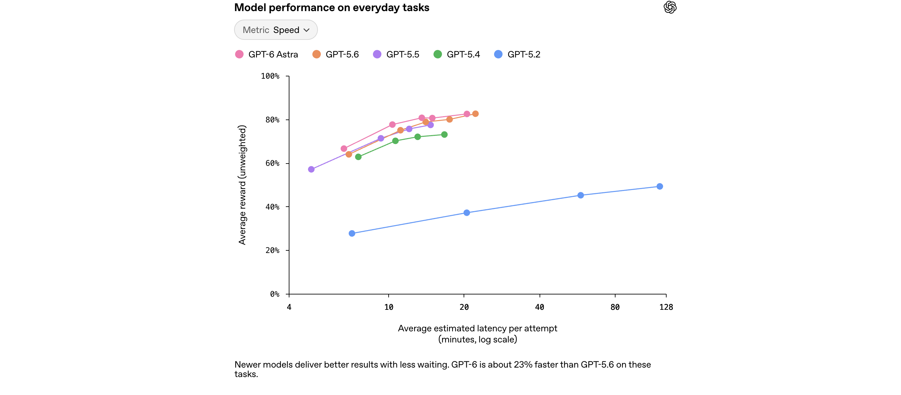

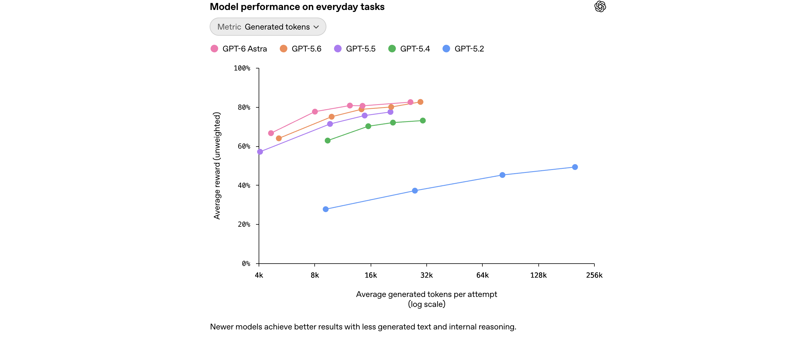

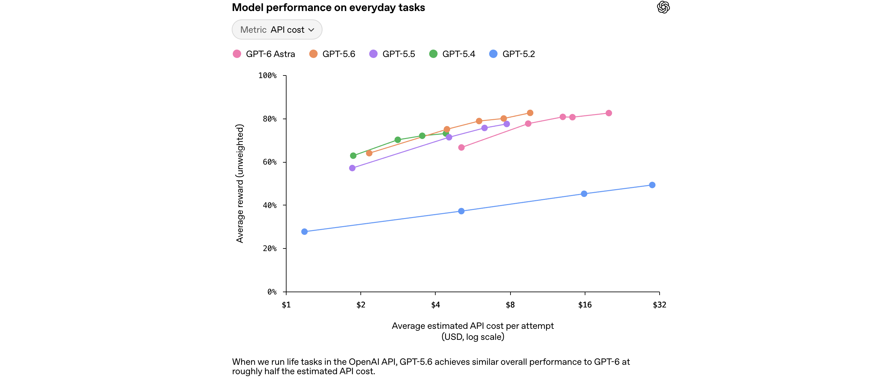

## 这为何重要

为了确保 AGI 造福全人类，我们需要衡量并改进模型在普通人生活中真正重要事项上的进展。这意味着要超越对模型知识的学术评估，真正衡量 AI 模型在帮助人们应对决策、管理日常事务、完成有意义的事情方面做得有多好。我们希望 LifeVal 能代表朝着这一目标迈出的一步。

- 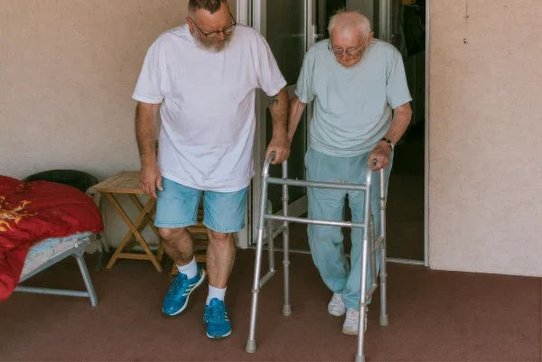
- 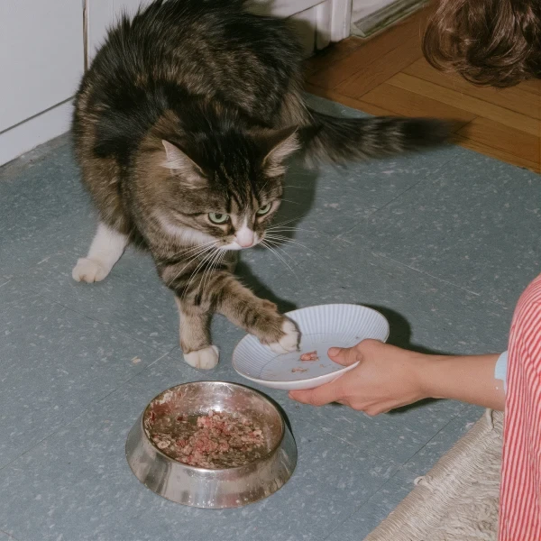
- 
- 
- 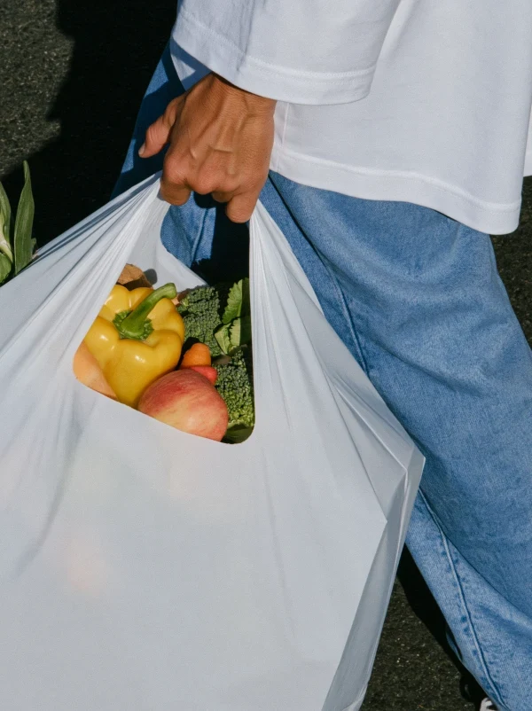
- 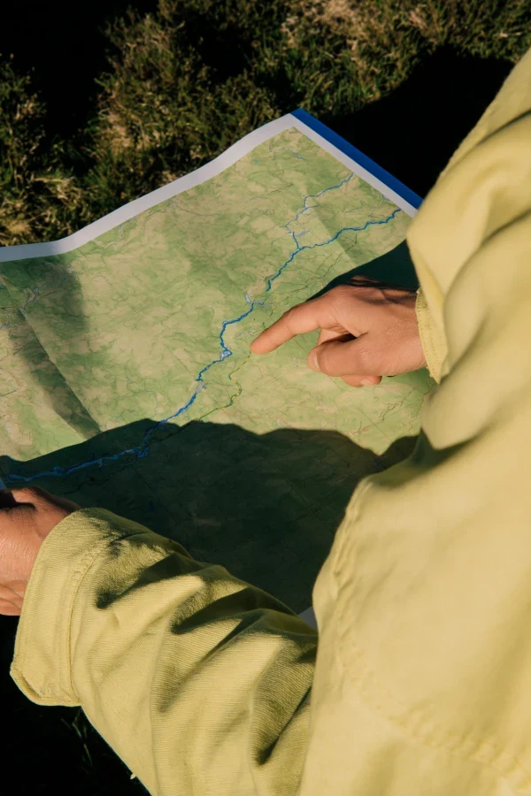
- 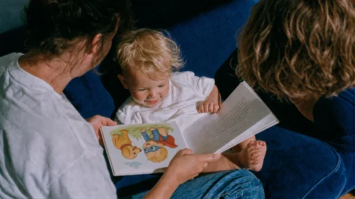
- 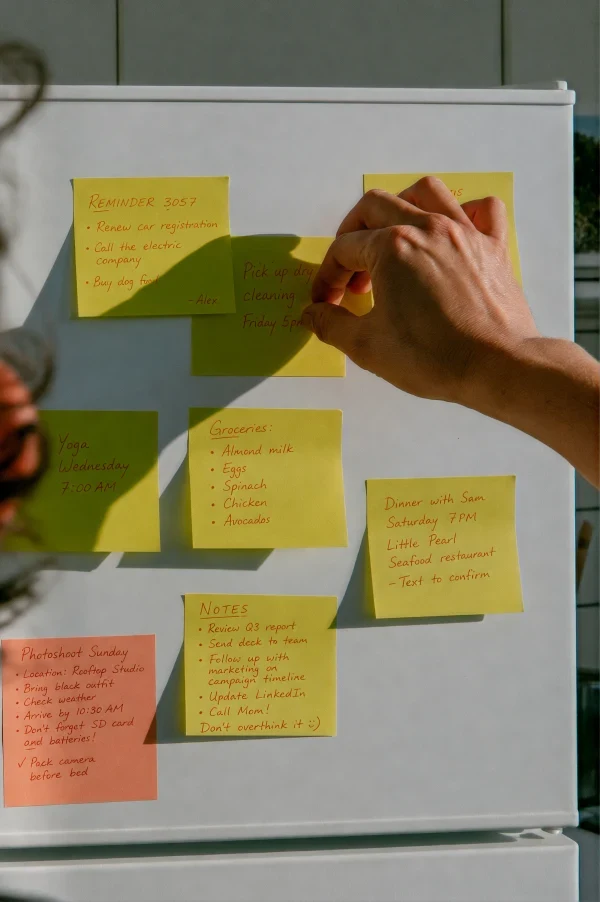
- 
- 

- [2026](https://openai.com/news/?tags=2026)

## 作者

OpenAI
