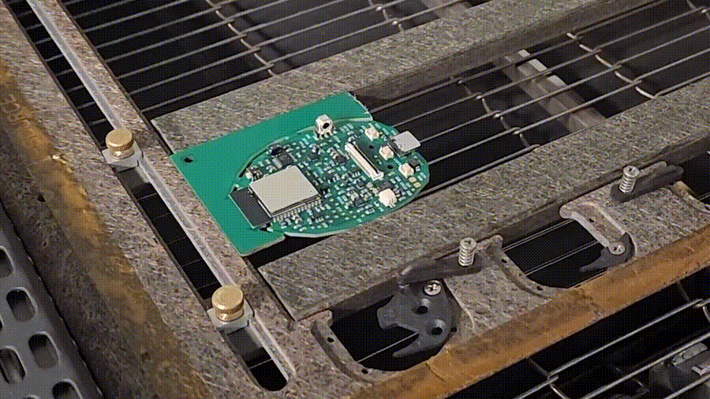
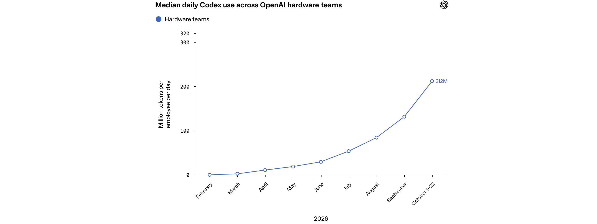
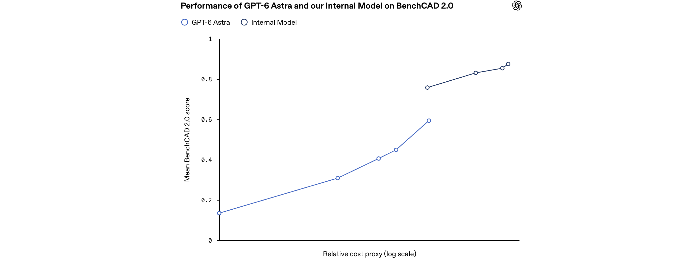
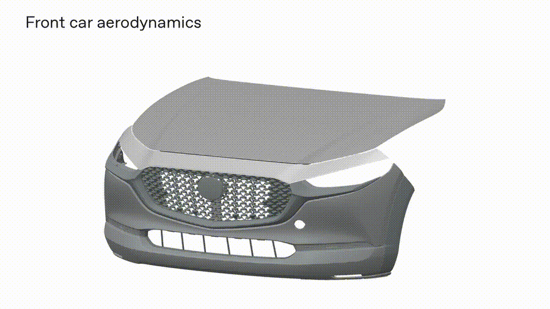

# 加速物理世界的工程设计（Accelerating engineering for the physical world）

> 原文：[Accelerating engineering for the physical world](https://openai.com/index/accelerating-engineering-for-the-physical-world/) · OpenAI · 2026-11-03
> 本文由 Kimi CLI 使用 Kimi K3-256k 全文翻译，并由 Agent 校对；已取得全文翻译和转载授权。
> 作者：OpenAI

2026年11月3日

[研究](https://openai.com/news/research/)[出版物](https://openai.com/research/index/publication/)

[观看原始视频：20261019_TamaGPT_LA_v11_Experiments_EndCard](https://player.vimeo.com/video/1239926138?h=d672ede7a8&badge=0&autopause=0&player_id=0&app_id=58479&title=0&byline=0&portrait=0&play_button_position=center)

今天，我们分享 OpenAI 模型如何帮助工程师设计、仿真和构建实体产品的最新进展。这些能力涵盖机械工程、电气工程以及端到端系统设计，并且已经在帮助我们的内部团队验证想法、加快迭代速度。

在这些项目中，工程师需要借助专业工具，将机械设计、电子器件、软件和制造要求整合在一起。我们正在训练模型来支持这类工作，从准备图纸、搭建仿真，到跨学科协调变更。我们的目标是让工程师有更多时间去探索想法、改进设计。

过去一年，前沿模型能力的提升帮助我们的内部团队更快地验证新想法、加快迭代，我们也看到了这些能力正在改善工业界专业工作流程的早期迹象。我们正在与合作伙伴共同探索这些能力在哪些方面能发挥最大作用，以及还有哪些地方需要改进。如果您是参与复杂实体产品设计、仿真、制造或生产的工程师、工程公司或软件供应商，我们非常希望与您[合作](https://openai.com/form/computer-use-research-collaboration/)，围绕您使用的工具和需要解决的问题来推进这项工作。

## 用 Astra 设计一台设备

我们通过一项测试检验了 [Astra 的最先进性能⁠](https://openai.com/index/gpt-6-astra/)在多模态和计算机使用工作流中的表现：看看能否在没有任何直接人工编辑的情况下打造一台设备。为此，我们使用 GPT‑6 来定义功能需求，并设计外壳、印刷电路板（PCB）和软件集成，最终做出一台用户可以用它与 Codex 对话的设备。

- **美学与设计：** Astra 借鉴了我们最近的 [Work Louder⁠](https://worklouder.cc/codex-micro) 合作项目以及来自游戏和玩具的参考，确定了设备的外观。
- **机械设计：** Astra 设计了[外壳⁠](https://images.ctfassets.net/kftzwdyauwt9/5aP4AhwHhDUmDxisSLcb2X/12114476f73d643b73dffe90b819cc0c/prototype-device-enclosure-diagram.png)以及用于固定各组件的内部结构。
- **电气设计：** Astra 选型了电子元器件并设计了印刷电路板（PCB），包括元器件布局和连接，以适配外壳空间。
- **UI/UX 与软件：** Astra 设计了用户界面，并生成了将设备连接到 Codex 所需的固件和软件集成。

两名团队成员在不到一周的时间里，将这台测试设备作为业余项目与 Astra 共同完成了设计。一家合约制造商在不到一个月的时间内制造了一小批原型机。

要让设备达到可投产的状态，仍然需要多轮评审与迭代。Astra 并未能始终考虑到制造商的生产限制、公差或装配所需的细节。这些差距正帮助我们明确未来模型需要在哪些方面做得更好。

## 加速 OpenAI 硬件团队

OpenAI 的硬件与基础设施团队使用 Codex 和 ChatGPT 来创建和修改计算机辅助设计（CAD）模型、准备制造图纸、搭建仿真并评审设计。这项工作横跨机器人与计算基础设施领域。自 2 月以来，以 token 计量，我们硬件团队的模型使用量已增至原来的 23 倍。

1/3

> *“Codex 极大地加速了我们从想法到工程化零件的过程。我们在 CAD 中迭代得更快，把 3D 设计转换为可用于生产的 2D 图纸，并且以少得多的手工工作完成仿真和 FEA 的搭建。”*

—— Grace Lam，OpenAI 前置部署工程师（Forward Deployed Engineer）

> *“作为系统硬件设计师，我们使用 Codex 和 ChatGPT 来组织跨职能的设计约束、探索系统架构、在各类 ECAD 环境中执行任务，并开展深入的设计评审。如今，Codex 和 ChatGPT 是工程与项目管理中值得信赖、全天候在线的伙伴，并有潜力成长为一支硬件专家团队，把一块电路板从概念一路推进到 Gerber 文件输出。”*

—— Qiong Wang，OpenAI 技术团队成员（Member of Technical Staff）

> *“在 AEC 和 BIM 领域，大量时间花在重复性建模、核对图纸与规范之间的信息，以及跨专业协调变更上。我们开始使用 Codex 来自动化日常任务、标记不一致之处，并把协调发现转化为清晰、可执行的问题项。这让团队有时间去评估设计方案和可施工性，由建筑师、工程师和 BIM 专业人员对结果进行审查与验证。”*

—— Jackie Lee，OpenAI 基础设施团队成员（Member of Infrastructure Staff）

- —— Grace Lam，OpenAI 前置部署工程师（Forward Deployed Engineer）
- —— Qiong Wang，OpenAI 技术团队成员（Member of Technical Staff）
- —— Jackie Lee，OpenAI 基础设施团队成员（Member of Infrastructure Staff）

## 衡量工程任务上的进展

我们也在衡量更新模型在结合编程与工程知识的任务上的进展。BenchCAD 2.0 测试模型能否重建 3D 零件和装配体，并识别电路板中的连接关系。一个较新的内部模型取得了 0.875 的平均分，而 GPT‑6 Astra 在其最高推理设置下为 0.594。尽管工程生命周期还包含设计之外的许多其他环节，我们仍将这些能力上的进步视为 AI 模型能够对专业工作流程的迭代速度产生积极影响的早期证据。

## 与行业伙伴安全部署

我们正在与一小批行业合作伙伴共同在真实工程问题上测试这些能力。他们的工程师会审查模型输出的准确性和实用性，帮助我们了解模型今天可以支持哪些任务，以及要实现安全、可靠的使用还需要在哪些方面改进。

我们正在扩大与 [Chip Ganassi Racing](https://openai.com/index/chip-ganassi-racing/)（CGR）的合作，探索 OpenAI 模型如何加速工程开发与原型制作。我们正在与其研发团队一起测试将现有零件的 3D 扫描转化为可编辑 CAD 模型和 2D 制造图纸的工作流。当原始设计文件不可用时，这一点尤其有用。

CGR 的工程师会审查模型和图纸的准确性与可制造性。他们的反馈帮助我们识别模型在哪些环节可以减少人工工作，以及哪些方面还需要进一步改进。

> “*这个模型在从原始扫描数据生成实体模型方面很有用。我一直在 CAD 中直接使用 Codex。我给模型的反馈会被直接应用，手动微调也可以直接完成，对我来说，这个过程变得更快、更省心了**。*”

—— Matthew Ortman，Chip Ganassi Racing 研发工程师

我们还宣布与马自达（Mazda）建立新的研究合作。我们的研究团队和前置部署工程团队正在与马自达的空气动力学与碰撞安全工程师合作，探索 OpenAI 模型如何帮助开发和评估新的车辆设计。

这项工作利用气流和结构行为的仿真，在兼顾造型与成本的前提下探索性能改进。我们将在未来几个月分享更多进展与成果。

[观看原始视频：front_car_aerodynamics_v7_alt](https://player.vimeo.com/video/1241345329?h=c8d21ac775&badge=0&autopause=0&player_id=0&app_id=58479&autoplay=1&muted=1)

GPT‑6 Astra 通过建模新的车头造型、模拟气流并优化最有潜力的设计，帮助马自达的空气动力学工程师探索降低车辆风阻的方法。使用许可已获得马自达汽车株式会社（Mazda Motor Corporation）同意。严禁在任何其他地方转载或重复使用。

> *“**它非得长成那样吗？”当我们找到一个能改善气流的形状时，设计师经常这样问我们。通过探索和模拟几十种变体，Codex 中的 Astra 帮助我们理解哪些特征对空气动力学至关重要，以及设计师在哪些地方还有发挥空间。这正是 Astra 以及与 OpenAI 合作的价值超越任务自动化和缩短开发周期的原因：它帮助我们把马自达独特的设计与空气动力学性能结合起来，而不必让任何一方成为妥协。”*

—— Akihiro Nakata，马自达首席工程师（Principal Engineer）

## 共同塑造面向工程与制造的 AI

我们一直与行业伙伴和早期采用者密切合作，拓展 AI 智能体在硬件与制造领域的能力边界。这些早期成果展现出令人兴奋的前景，我们现在正在寻找合作伙伴，以加速这些能力的提升，并确保它们被安全地部署到行业中。

如果您有兴趣与我们合作，通过识别机械工程、电气工程、机电设计、机电一体化或相关领域中的高价值用例、软件工具或未来机会，来塑造我们前沿模型的训练与开发，请填写[此表单](https://openai.com/form/computer-use-research-collaboration/)，我们将与您联系。

## 作者

OpenAI
