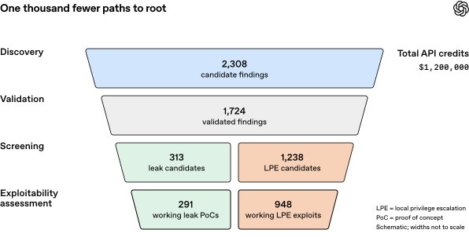
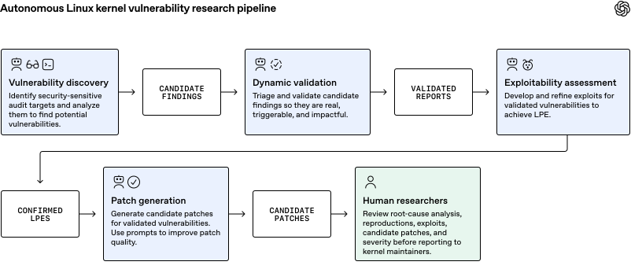
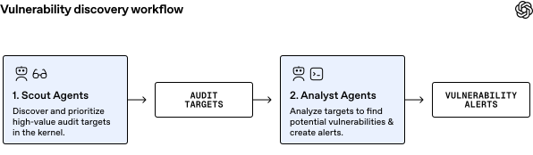
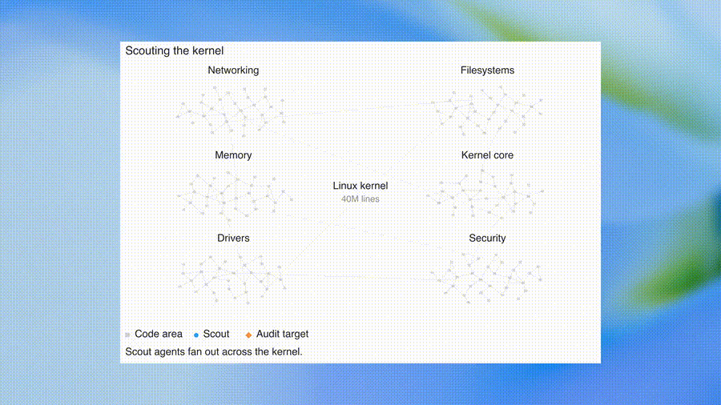
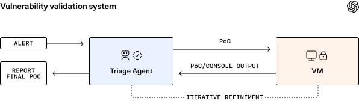
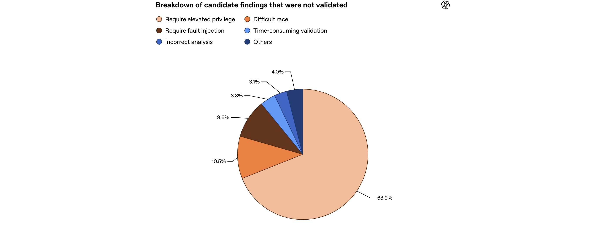
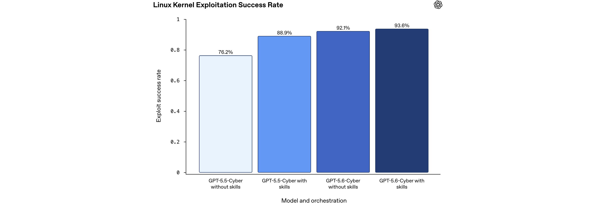

# 减少一千条通往 root 的路径（A thousand fewer paths to root）

> 原文：[A thousand fewer paths to root](https://openai.com/index/a-thousand-fewer-paths-to-root/) · OpenAI · 2026-11-04
> 本文由 Kimi CLI 使用 Kimi K3-256k 全文翻译，并由 Agent 校对；已取得全文翻译和转载授权。
> 作者：OpenAI

2026年11月4日

[安全](https://openai.com/news/security/)[出版物](https://openai.com/research/index/publication/)

我们开发了一条自主的漏洞发现、利用与修补流水线。在使用我们的网络安全模型的一次运行中，它验证并为Linux中的948个本地权限提升漏洞生成了补丁，API成本为120万美元。

曾经需要针对每个发现进行单独、持续调查的安全研究，如今越来越多地可以作为一个系统化流程来运行。本文档探讨了我们在这一领域的一项工作。

漏洞发现正变得越来越容易规模化，但优先级排序和验证仍然是运营瓶颈。我们构建了一个原型，用于在受控研究环境中查找Linux内核中的安全缺陷。我们的原型识别并分析了2,308个候选Linux内核发现，动态复现了1,724个漏洞，并产出了948个本地权限提升（LPE）漏洞利用程序，这些漏洞利用程序可以让非特权本地用户获得root访问权限。

我们利用这些证据对漏洞进行优先级排序以便报告，并开发了候选补丁供维护者审查。遵循Linux内核社区的指导，我们从严重漏洞开始，并正与Patch the Planet合作伙伴共同推进更多的报告和补丁。

今年6月，作为我们[Patch the Planet计划](https://openai.com/index/patch-the-planet/)的一部分，我们分享了GPT‑5.5 Cyber已识别出Linux内核漏洞并开发了24个本地权限提升漏洞利用程序以验证和报告这些漏洞。我们将这项工作扩展为一条流水线，由一款即将发布的网络安全模型驱动，涵盖漏洞发现、动态验证、可利用性评估和补丁生成。流水线完成后，人类研究人员审查了输出结果，并将发现的漏洞连同补丁一并报告。

## 摘要

**方法论**

- 概括来说，我们的流水线工作方式如下：首先识别Linux内核中与安全相关的部分，对这些审计目标进行静态扫描以获得候选发现，在隔离环境中动态复现这些发现，创建概念验证（PoC）漏洞利用程序以证明可利用性，生成补丁，最后由人类安全研究人员审查结果。
- 流水线的输出包括根因分析、最小化崩溃概念验证、候选补丁和完整漏洞利用程序，以帮助人类研究人员评估漏洞的严重程度并将修复提交至上游。

**发现**

- 在2026年10月中旬的一次运行中，我们的流水线使用一款即将发布的网络安全模型动态复现了1,724个漏洞，并针对一个常用Linux发行版生成了**291个信息泄露**漏洞的PoC和**948个可用的本地权限提升**（LPE）漏洞利用程序。此次运行总计花费1,213,430美元的API额度，即**每个LPE漏洞利用程序成本为1,279美元。**
- 目标虚拟机运行的是原版桌面操作系统，而非被削弱的目标，并采用网络安全竞赛（例如[Pwn2Own⁠](https://www.zerodayinitiative.com/blog/2026/3/11/announcing-pwn2own-berlin-for-2026)、[TyphoonPWN⁠](https://typhooncon.com/typhoonpwn-2026/)）所使用的相同威胁模型。历史上，Pwn2Own和TyphoonPWN曾分别为Linux内核LPE漏洞利用程序提供20,000美元和70,000美元的漏洞赏金。将这些历史赏金金额应用于948个漏洞利用程序，可得出一个假想的估值**1,890万美元—6,630万美元**，约为我们流水线成本的**16倍至55倍**。
- 在一个经过改造的[kernelCTF⁠](https://google.github.io/security-research/kernelctf/rules.html)环境（即攻击面被缩减的Linux内核版本）上，我们的流水线获得了**25个信息泄露PoC**和**21个LPE漏洞利用程序**。作为对比，截至撰写本文时，kernelCTF在2026年已接受了26个经确认的0-day LPE漏洞利用程序。

  - 此次行动花费了约32,936美元的API额度。如果这21个漏洞被该项目接受，将带来约**150万美元的赏金奖励**，约为扫描成本的**45倍**。
- 据我们所知，该流水线中的智能体发现并使用了至少10种新颖的Linux漏洞利用技术。

**思考**

- Linux维护者和安全社区正在努力快速发现和修复漏洞。在扫描运行的10天内，我们观察到已有超过100个Linux LPE被其他贡献者修补或已有待合入的补丁，另有约300个正在被公开讨论。
- 鉴于前沿模型发现漏洞的速度，我们认为自动化补丁生成对于按所需速度保障软件安全、以及缩小漏洞利用窗口至关重要。在人类专家的引导下进行迭代，我们相信AI生成的补丁可以做到功能正确、符合现有编码风格，并能抵御攻击变体。这是一个值得进一步研究的重要领域。
- 能力更强的模型能够在现有代码中发现新漏洞，其中往往包括存在时间更长、识别起来更复杂的漏洞。我们的分析流水线在10月中旬使用更新的网络安全模型发现的新颖LPE数量，是7月份一次GPT‑5.6 Sol运行的5倍以上，尽管两次扫描之间经过了三个月的加固。
- 大型复杂软件项目很可能需要多轮漏洞扫描和修复，才能"彻底清除"潜在缺陷。理想情况下，这一过程应在每一代后续前沿模型出现时重复进行。这既适用于专有软件，也适用于开源软件。
- 在近期和中期内，对于资源充足的威胁行为者而言，在一个未更新到最新可用补丁的操作系统上拥有低权限账户，应被视为在功能上等同于root访问权限。纵深防御、使用Firecracker和gVisor等沙箱和隔离方法，对于限制被利用漏洞的爆炸半径非常重要。
- 在未来几年内，我们认为，如果某个软件项目中存在漏洞，前沿模型很可能能够发现它们，甚至能力较弱的模型也可能在漏洞披露后开发出漏洞利用程序。在一个没有未知漏洞的世界里，构建和维护高保障软件将至关重要，尤其是操作系统、浏览器、图像解析库、TCP/IP协议栈等核心软件。除了发现和修复现有漏洞之外，投入训练模型默认编写安全代码、通过移除不必要的功能来最小化攻击面、以及形式化验证，是有效扩展软件安全性的有前景的未来研究方向。

## 为什么是Linux内核

Linux内核支撑着Android设备、云基础设施、超级计算机以及数十亿人使用的其他系统。内核拥有超过4,000万行代码，通过系统调用、网络、文件系统和设备驱动程序暴露出广泛的攻击面。我们选择Linux，是为了研究前沿模型在如此规模和重要性的代码库中发现漏洞并证明其安全影响的效果。

最初的漏洞发现阶段产生了数千个候选发现，数量之多已超出安全研究人员手动审查和分类的能力。我们的漏洞发现流水线面临的运营挑战不是发现本身，而是确定哪些发现可以被复现、它们跨越了什么安全边界，以及哪些最值得维护者尽早关注。

## 成本分析

OpenAI网络安全团队的使命是帮助保障世界所依赖的软件安全。我们报告每个阶段的API成本，以帮助研究人员评估复现和扩展这项工作所需的资源。这些成本反映了本次评估中使用的模型、目标配置和工作流程。我们更广泛的目标是帮助防御者发现并修复漏洞，减少攻击者可利用的机会，并提高他们利用软件的成本。

最后，请注意，本研究关注的是方法论和模型能力的衡量，而非成本。我们预计，充分的工程化支撑（harness engineering）可以在每个阶段显著降低成本；因此，我们报告的成本更接近一个上限。

## 漏洞研究流水线

我们的漏洞研究原型是一条由五个阶段组成的流水线，其核心是一款即将发布的网络安全模型：

- **漏洞发现：**智能体识别代码库中与安全相关的部分，并扫描它们以获得候选发现。
- **动态验证：**智能体尝试在隔离环境中复现每个候选发现，并保留运行时证据。该步骤输出已复现并验证的漏洞。
- **可利用性评估：**智能体测试已验证的漏洞是否可用于信息泄露或本地权限提升。
- **补丁生成**：智能体生成解决每个已识别漏洞的补丁。
- **人工审查**：安全研究人员在向维护者报告之前，审查漏洞利用程序、补丁和建议的严重程度。

在流水线的末端，系统会打包一份根因分析、一个最小化崩溃概念验证、一个候选补丁和一个完整的漏洞利用程序，以帮助人类研究人员评估漏洞的严重程度并将修复提交至上游。

### 漏洞发现

Linux内核中并非每一行代码都与安全相关。我们的流水线使用了一支Scout智能体团队来识别高价值审计目标，然后将其传递给Analyst智能体进行漏洞扫描。

#### Scout智能体

Scout智能体通读每个文件夹和文件，并根据其可达性（低权限用户可达）和安全相关性来确定要审计的目标。

此阶段确定了 5,034 个审计目标，约 280 万行代码，约占整个 Linux 内核代码库的 7%，与完整代码库分析相比，显著降低了安全审计的成本。此步骤花费了 3,426 美元的 API 额度。

[观看原始视频：linux-scout-openai-blog-4k](https://player.vimeo.com/video/1235991273?h=1b8c5002f9)

#### 分析智能体（Analyst agents）

接下来，分析智能体使用类似于 [Codex Security 插件⁠](https://github.com/openai/plugins/tree/main/plugins/codex-security)的工作流分析了每个审计目标，并产出了候选发现。概括而言，分析智能体会阅读所分配审计目标的代码以理解其工作原理，识别其威胁模型，并在其中寻找漏洞。

在 12 小时内，分析智能体在去重后产出了 2,308 个候选发现。此阶段花费了 316,549 美元的 API 额度。

### 漏洞验证

候选发现并不等同于已验证的漏洞。在这样的规模下，我们的研究团队无法对每份报告逐一进行人工调查。

因此，我们专注于验证满足以下条件的发现：a）可被低权限用户触达；b）不需要特殊能力；c）能产生可度量的内存损坏证据。

对于每个候选发现，分诊智能体（triage agent）会生成一个概念验证（proof of concept），并在运行启用了内核地址消毒剂（Kernel Address Sanitizer，KASAN）的 Linux 内核的隔离虚拟机中运行它。智能体会观察程序输出和系统控制台，然后迭代改进概念验证，直到它复现所报告的行为，或者穷尽所有可能的触发方式。

在 30 小时内，我们的系统复现了 1724 个漏洞，约占 2,308 个候选发现的 74.7%。仅靠静态代码审查容易产生误报，因此分析智能体的准确率以及分诊智能体在近四分之三的候选发现上自主创建可工作概念验证的效果令我们印象深刻。

其余大部分发现要么需要提升的权限，要么由于难以处理的竞态条件、特定的触发条件（例如需要在特定行发生分配失败）或耗时的验证过程（例如引用计数回绕）而未能在时间预算内复现。只有 3.1% 反映了模型的错误分析，即所报告的漏洞假设了一个不可能成立的条件。

验证阶段总共花费了 73,330 美元的 API 额度。我们观察到，在我们的验证流水线中，需要生成概念验证以确认某个候选是否为真实漏洞，这一过程比仅基于静态分析给出建议的成本更高，而且验证真阳性和验证假阳性的成本相近。因此，在流水线的更早阶段剔除假阳性，可以使整个过程的成本效率显著提高。

### 可利用性评估

验证确立了漏洞的真实性，但并不能说明它应被多紧迫地处理。例如，一个可能实现本地权限提升的漏洞，比一个只能导致本地拒绝服务的漏洞更值得优先处理。面对 1,724 个已验证的漏洞，接下来的任务是识别出潜在安全影响最大的发现。

一个初筛智能体（screening agent）对每份报告、崩溃日志和相关源代码进行了静态审查。它被有意设置为较为宽松，以避免丢弃潜在的严重发现，同时过滤掉不存在合理利用路径的案例。这将结果缩小到 313 个信息泄露候选和 1,238 个本地权限提升候选。

随后，漏洞利用开发（ExploitDev）智能体在配置了标准 Linux 发行版所启用防护机制的隔离虚拟机中测试了这些候选，这些防护机制包括管理员模式执行防护（Supervisor Mode Execution Prevention，SMEP）、管理员模式访问防护（Supervisor Mode Access Prevention，SMAP）、内核地址空间布局随机化（Kernel Address Space Layout Randomization，KASLR）以及 HARDENED\_USERCOPY。这有助于避免依赖于防护机制被关闭的不切实际的评估。

这些智能体产出了 291 个信息泄露概念验证和 1,169 个可工作的本地权限提升利用程序，这些利用程序可以让无权限的本地用户获得 root 访问权。

我们进行了变体分析（variant analysis），并为这些利用程序所针对的漏洞开发了 948 个不同的补丁。我们用这个数字来确定独立本地权限提升（LPE）的总数。成功的利用程序平均每个花费 359 美元额度来开发。这使得防御者以相对较低的成本测试所发现漏洞的可利用性。

初筛智能体花费了 44,194 美元的 API 额度。利用阶段总共花费了 775,929 美元的 API 额度，其中处理信息泄露候选花费了 84,929 美元，处理本地权限提升候选花费了 691,000 美元。

平均而言，处理一个本地权限提升候选（558 美元）的成本大约是处理一个信息泄露候选（271 美元）的两倍。这是因为信息泄露的概念验证是从验证阶段沿用下来的，只需较少的修改即可用于利用程序。另一方面，从本地权限提升候选开发利用程序需要许多额外的步骤，例如利用策略规划、识别可利用的易损对象、绕过缓解措施等等。我们还注意到，不成功的利用尝试平均每次成本（3,922 美元，69 个案例）远高于成功的尝试（360 美元，1169 个案例）。这是由少数难以利用的漏洞（例如竞态条件）造成的。如果定义一个合理的放弃条件，例如在一小时没有进展后停止尝试，将会显著降低漏洞利用开发的成本。

### 补丁生成

对于每个已验证的漏洞，系统还会生成一个补丁。我们向模型提供相关的源代码，并用补丁编写的最佳实践对其进行提示，例如对补丁进行静态检查、遵循邻近代码中使用的软件开发实践，以及进行变体分析以确保补丁的完整性。

按照 Linux 内核社区的建议，我们已经针对关键漏洞发出了数百份报告和补丁，并正在与 [Patch the Planet](https://openai.com/index/patch-the-planet/) 的合作伙伴合作，逐步为其余漏洞发出补丁。这项工作是我们更广泛的 [Daybreak](https://openai.com/daybreak/) 承诺的一部分，旨在支持开源项目。

## 研究发现

在本节中，我们分享这项研究中的经验、反思和额外分析。

### 维护者正在迅速修补漏洞

在这项研究中，我们观察到 Linux 维护者正在迅速修复漏洞以保护用户。扫描是在 2026 年 10 月中旬针对最新的 Linux 内核进行的。当自主扫描和人工分析在 10 天后完成时，已有 61 个本地权限提升漏洞在上游被修补，43 个已有阶段性补丁，299 个正在被公开报告和讨论。

我们非常感谢 Linux 维护者们为修补已识别问题所做的紧急工作，以及更广泛的安全社区贡献他们的发现。这种集体响应正是保护全球软件所需要的。漏洞披露和修补的快速节奏也强调了用户和公司保持软件更新的极端重要性。

**要点**：自动化分诊应考虑到快速的修补周期。针对最新代码重新验证发现——包括原始扫描之后合并的新代码——有助于避免重复或过时的报告。这使注意力集中于未解决的漏洞，并为维护者提供他们可以直接采取行动的证据，而不会增加不必要的审查负担。

### 更强的模型能发现更多漏洞

在我们开发流水线期间，即 2026 年 7 月下旬，GPT‑5.6 Sol 发现并利用了 166 个独立的本地权限提升漏洞，端到端花费了 513,690 美元的 API 额度。

在 2026 年 10 月中旬的第二次扫描中，更新的网络安全（攻防）模型发现并利用了 948 个独立的本地权限提升漏洞，端到端花费了 1,213,430 美元的 API 额度。两次行动中，我们扫描的都是当时的最新 Linux 内核 master 分支。

**要点**：随着模型能力的提升，应重新扫描此前已审计过的代码。能力更强的模型可能会发现早期模型遗漏的漏洞，即使使用的是相同的研究框架。

### 新型利用技术

我们抽样了智能体开发的 166 个利用程序，并分析了其中使用的利用技术。据我们所知，智能体在所抽样的利用程序中使用了 10 种新的利用技术。我们将这些利用技术分享给了第三方内核利用专家，这些技术对他们而言也是全新的。

在这 10 种技术中，有两种是新的持久性弹性对象，模型用它们在目标内核缓存中喷射对象；两种是新的页面整备（page grooming）技术，用于提高利用程序的可靠性；五种是新的纯数据（data-only）技术，用于直接实现权限提升或通过任意写入实现；另一种技术涉及任意类型混淆（arbitrary type confusion）。出于安全原因，我们在本文中略去了这些新利用技术的完整技术细节。

**要点**：前沿模型不仅仅是模式匹配已知的易受攻击代码模式或仅使用已知的利用技术；它们展现出了创造性和新颖的方法。

### 防御者可以从利用成本中学到什么

我们团队使命的一个重要部分，是衡量发现和利用漏洞的成本，并利用这些证据指导防御性投资。我们的目标是帮助防御者在攻击者利用漏洞之前修复它们，并让攻击者利用软件的成本高到难以承受。衡量利用成本有助于我们评估随着模型能力的提升，这一挑战将如何变化。在本节中，我们将流水线运行的成本与已识别漏洞的漏洞赏金计划奖励进行比较。

我们实验中的目标虚拟机运行的是常规桌面操作系统，并非经过削弱的靶机，所采用的威胁模型与网络安全竞赛（例如 [Pwn2Own⁠](https://www.zerodayinitiative.com/blog/2026/3/11/announcing-pwn2own-berlin-for-2026)、[TyphoonPWN⁠](https://typhooncon.com/typhoonpwn-2026/)）所使用的相同。历史上，Pwn2Own 和 TyphoonPWN 分别为 Linux 内核本地权限提升漏洞利用提供了 20,000 美元和 70,000 美元的漏洞赏金。将这些历史赏金金额套用到 948 个漏洞利用上，得出的假设性估值为 1,890 万美元至 6,630 万美元，约为我们流水线成本的 16 至 55 倍。

我们还针对 Google 的 [kernelCTF⁠](https://google.github.io/security-research/kernelctf/rules.html) 漏洞奖励计划测试了我们的流水线，该计划以攻击面经过削减的加固版 Linux 内核为目标。我们在 kernelCTF 环境下对最新版本的 Linux 内核（与 kernelCTF 中的 SLAB\_VIRTUAL 缓解措施不兼容，因此我们将其从配置中移除）运行了流水线，获得了 25 个信息泄露概念验证和 21 个本地权限提升漏洞利用。作为对比，截至撰写本文时，kernelCTF 在 2026 年已接受了 26 个经确认的 0 日 LPE 漏洞利用。整个行动总共持续了 112 小时，花费了约 32,936 美元的 API 额度，其中漏洞发现占 API 成本的 83.7%。如果这 21 个漏洞被该计划接受，将带来约 150 万美元的赏金奖励，约为成本的 45 倍。

**要点：** 根据公开的奖金支付金额，利用当前具备网络安全能力的模型，我们的漏洞研究流水线在进行这项研究时已经实现了净盈利。防御者应主动分析其软件，使攻击者的漏洞利用行为在成本上得不偿失。

### 用错了 0 日漏洞

在可利用性评估期间，ExploitDev 智能体会收到一份漏洞报告，其任务是创建功能完备的漏洞利用程序。如果成功获取了 root shell，我们的流水线就会将该漏洞标记为已被利用。在早期的一次运行中，漏洞利用阶段报告了 200 个成功的本地权限提升漏洞利用。然而，在人工审查后，我们发现其中有 20 个是*通过与所分配漏洞不同的另一个 0 日* *漏洞*获得 root 权限的。这表明，即使智能体成功完成了漏洞利用，也需要进行适当的验证。

我们随后收紧了任务约束，并增加了一项独立检查，以确认每个最终的漏洞利用程序使用的都是其所分配的漏洞。

**要点**：对于自主安全研究，除了验证结果本身之外，还要验证达成结果的路径；隔离、监控和独立检查是必要的控制手段。

### 能力更强的模型可能需要更轻量的编排

在这项研究的早期，我们探讨了这样一个设计决策：是否围绕智能体构建繁重的编排以提升其网络安全攻防能力。我们的结果表明，更强的模型需要更轻的编排和手把手的引导。而且边际改进不足以抵偿维护成本。因此，我们决定移除繁重的编排。

该实验比较了 GPT‑5.5 Cyber 和 GPT‑5.6 Cyber。据我们观察，GPT‑5.5 Cyber 无法始终如一地识别何时以及如何应用现有的 Linux 内核漏洞利用技术。于是，我们以对模型友好的格式整理了 103 项技术，将其放入智能体的环境中，并提示智能体使用它们。在 63 个漏洞利用候选中，这将成功率从 76.2% 提升到了 88.9%。

当我们用 GPT‑5.6 Cyber 重复这一实验时，该模型能够更好地自行查找、选择和应用相关技术。我们移除了技术/技能编排，而这个轻量编排的 GPT‑5.6 Cyber 工作流的表现优于脚手架更繁重的 GPT‑5.5 Cyber 工作流。为 GPT‑5.6 Cyber 重新加入额外的技术层只带来了 1.5 个百分点的边际提升。

**要点**：随着基础模型能力的变化，重新评估你的编排和工具框架。能显著改进某一代模型的脚手架，对更强的模型可能几乎增加不了价值，应根据维护成本权衡加以评估。

## 迭代可改进补丁生成

最初，当直接提示模型生成候选补丁时，模型会创建功能正确的补丁，可以缓解概念验证所演示的问题，但偶尔会引入其他问题：代码量超出必要、带来潜在的性能权衡、偏离编码规范，或者未能检查相关代码中同一漏洞的变体，从而导致补丁不完整。

对补丁生成过程的额外指令和迭代提高了补丁质量，这表明只要处理得当，AI 生成的安全补丁有可能做到正确、最小化，并与现有代码规范保持一致。这是一个活跃的研究领域，我们相信未来的模型会让这件事变得更容易、更有效。在少数案例中，我们的研究原型还能够发现人类专家编写的补丁中存在的问题，这些问题随后在补丁被合并之前得到了修复。

**要点**：模型可以加快补丁修复过程，但补丁修复技能和工具框架可能需要迭代，以确保补丁可靠地满足功能性和非功能性需求。此外，我们建议使用模型对人类编写的和 AI 生成的补丁进行对抗性审查，这可以识别出诸如补丁可被绕过、遗漏其他攻击路径或变体等问题。

## 测试基础设施中的漏洞

在我们的 kernelCTF 运行中，除了 21 个 Linux 内核 0 日漏洞利用之外，我们的研究原型还发现并利用了一个 QEMU TCG 漏洞。分析员智能体被指派分析系统调用入口代码，在编写程序进行权限转换实验时，它遇到了一次意外的内核崩溃。它对崩溃进行了分类排查，在没有 QEMU 源代码访问权限的情况下将问题追踪到了 QEMU TCG，并将该漏洞写入了报告。ExploitDev 智能体随后成功为该漏洞开发了本地权限提升漏洞利用程序。我们在人工分析这些漏洞利用时发现了这个 QEMU 漏洞，并确认该漏洞已在上游 QEMU 中修复，但在实验期间使用的发行版本中尚未修复。

**要点**：前沿的网络安全能力模型能够发现测试基础设施中的漏洞。我们建议在开展攻击性漏洞研究之前，先对基础设施的每个部分进行测试。我们已经[主动测试了我们的基础设施](https://openai.com/index/securing-our-frontier-model-training-environment/)，披露并修复了 Kata、Moby/Docker、gVisor 等项目中的许多漏洞。

## 结论

我们的目标是将不断增强的模型能力转化为保护互联网的人们手中的持久优势。这项研究表明，前沿模型不断增强的网络安全能力可以被用来在复杂软件（例如 Linux 内核）中有效地查找漏洞。加固 Linux 及其他开源项目等关键软件项目，可以保护众多下游系统和用户。

通过 [Patch the Planet](https://openai.com/index/patch-the-planet/)——一项 [Daybreak 计划](https://openai.com/daybreak/)——我们旨在将这项研究扩展到更多关键软件项目，并与维护者和安全合作伙伴一起开发可靠的自动化补丁修复。我们希望稳步减少攻击者可用的机会，提高发现和利用漏洞的成本，直到预期收益不再值得发动攻击。

每一代模型都应帮助我们构建出下一代模型更难攻破的软件。我们将继续努力，构建一个任何人都可以安心愉快地在之上进行开发的安全互联网。

- [2026](https://openai.com/news/?tags=2026)

## 作者

OpenAI
