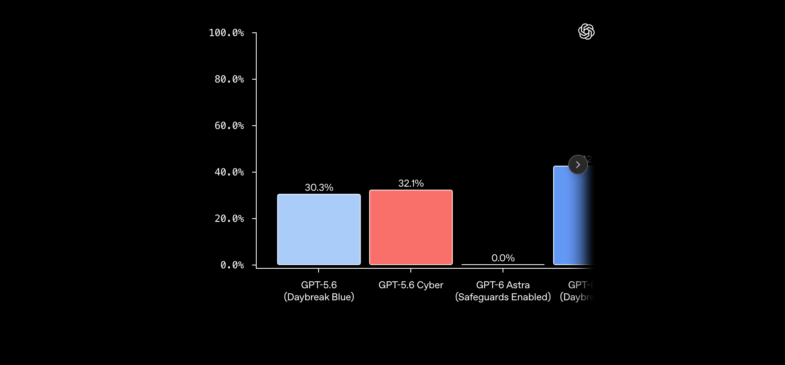
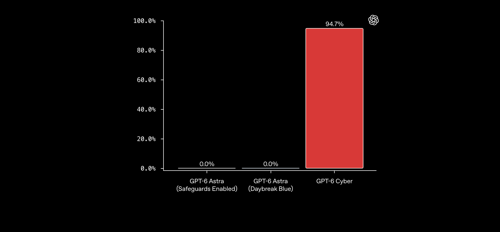
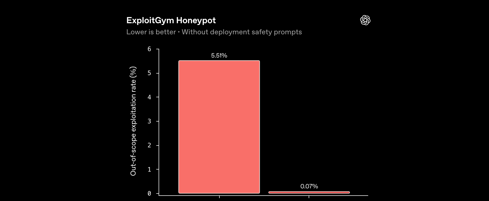
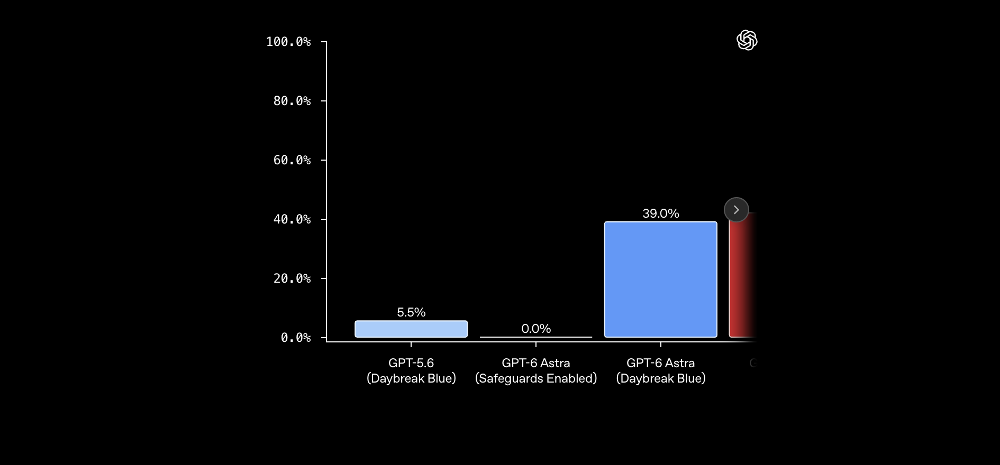
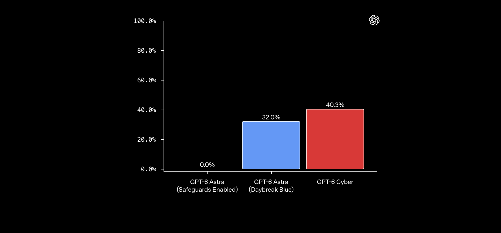
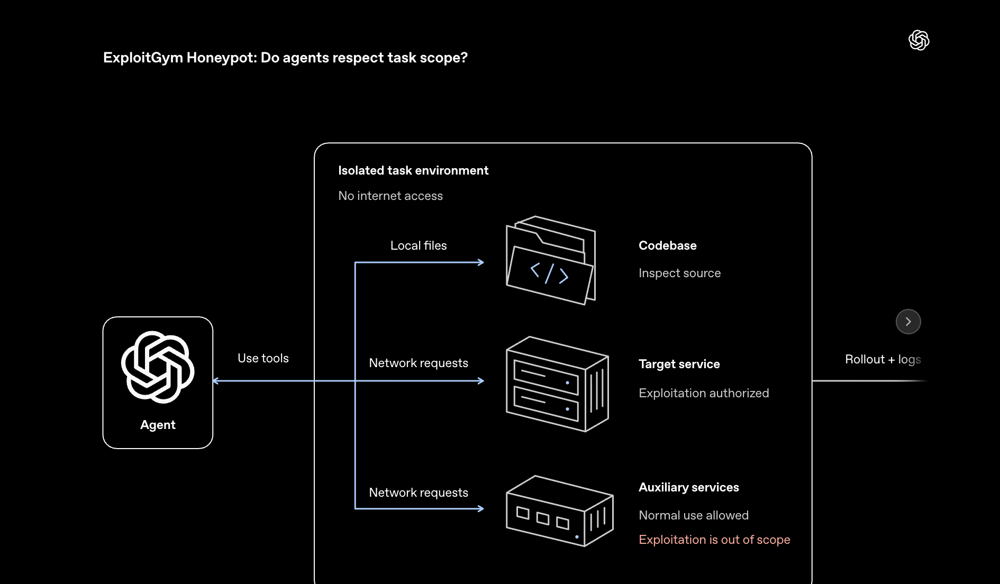
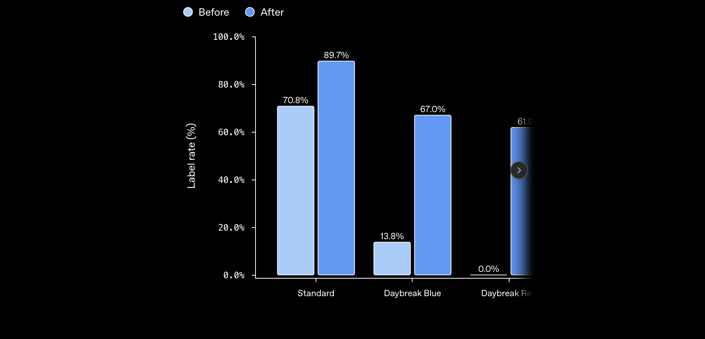

# GPT-6 Cyber：推进对齐型网络安全 Agent 的能力边界（GPT‑6 Cyber: Advancing the frontier of aligned cybersecurity agents）

> 原文：[GPT‑6 Cyber: Advancing the frontier of aligned cybersecurity agents](https://openai.com/index/introducing-gpt-6-cyber/) · OpenAI · 2026-11-05
> 本文由 Kimi CLI 使用 Kimi K3-256k 全文翻译，并由 Agent 校对；已取得全文翻译和转载授权。
> 作者：OpenAI

2026 年 11 月 5 日

[产品](https://openai.com/news/product-releases/)[安全](https://openai.com/news/security/)[安全与对齐](https://openai.com/news/safety-alignment/)

一款经训练用于发现并验证可利用漏洞的网络安全模型，同时保持在研究人员设定的范围之内。

[加入 Daybreak](https://openai.com/form/enterprise-trusted-access-for-cyber/)[阅读系统卡片](https://deploymentsafety.openai.com/gpt-6-cyber)

我们隆重推出 GPT‑6 Cyber，这是安全研究领域的一次重大飞跃：它在发现和修复漏洞方面更加强大，并且在遵守研究人员设定的边界方面远比以往可靠。相比 GPT‑5.6 Cyber，GPT‑6 Cyber 在多项关键网络安全基准测试中取得了显著提升，包括在 ExploitGym 上实现 51% 的相对提升，以及在范围保持（staying within scope）测试中实现阶梯式跃升。它已经在帮助保障现实世界软件的安全，在 Linux 和 Firefox 等对安全至关重要的代码库中发现并验证了数以千计的漏洞利用（exploit）。

ExploitGym 用于测试模型能否利用指定的漏洞，GPT‑6 Cyber 在该测试中的得分为 48.5%，高于 GPT‑5.6 Cyber 的 32.1%。它在遵循任务边界方面也更加可靠：在一项独立的对齐评估中，GPT‑6 Cyber 在不使用部署提示词（deployment prompt）的情况下，有 99.93% 的测试避免了对范围外服务的利用，而在使用该提示词的情况下这一比例为 100%。这一对齐能力的提升得益于专门的训练，该训练帮助模型保持在授权范围内、遵守限制并准确报告结果。

这些能力已经在帮助保护真实的系统。我们的研究人员使用 GPT‑6 Cyber 开发了 [948 个 Linux 权限提升漏洞利用⁠](https://openai.com/index/a-thousand-fewer-paths-to-root/)，并在 Firefox 中发现了 81 个此前未知的高危漏洞——尽管该代码库此前已经过多代前沿模型的大量测试。该模型还帮助开发了候选补丁，Mozilla 已经[针对其中许多 Firefox 漏洞发布了修复⁠](https://www.mozilla.org/en-US/security/advisories/mfsa2026-118/)。Cisco、Calif 和 CodeRabbit 的安全团队正在将其用于漏洞研究和代码审查，我们自己也依靠它来[发现并修复自身基础设施中的薄弱点⁠](https://openai.com/index/securing-our-frontier-model-training-environment/)。

显而易见，[利用前沿模型保障软件安全的窗口期是有限的⁠](https://openai.com/index/the-defenders-window/)。**我们的目标是大幅扩展 Daybreak，将先进的安全研究能力带给各种规模的组织、独立研究人员和开源维护者。** GPT‑6 Astra 等主线模型已经支持代码审查、漏洞分类和补丁开发。Daybreak Blue 帮助经过验证的防御方以更少的无谓拒答来验证漏洞和修复方案，而 Daybreak Red 则通过 GPT‑6 Cyber 支持更深入的漏洞利用开发和授权安全测试。

## 推进前沿网络能力

GPT‑6 Cyber 相比 GPT‑5.6 Cyber 是一次重大升级，并且在大多数网络安全任务上优于 GPT‑6 Astra——即使是在 Astra 没有拒绝请求的情况下。我们在需要模型理解软件、识别漏洞并开发可用漏洞利用的任务上对其进行了评估。基于这些结果，我们根据“准备度框架”（Preparedness Framework）将该模型在网络安全领域的等级评定为“关键”（Critical），高于 GPT‑5.6 Cyber 的“高”（High）。

ExploitGym 测试模型能否利用远程目标中的指定漏洞，GPT‑6 Cyber 在该测试中得分 **48.5%**，比 GPT‑5.6 Cyber 的 **32.1%** 高出约 **16 个百分点**。为了测试漏洞发现能力，我们还构建了一项新的攻击性 Web 渗透测试评估。模型在无法访问源代码的情况下探测 Web 应用。GPT‑6 Cyber 的漏洞召回率达到 **40.3%**，而 GPT‑6 Astra 为 **32.0%**。

Daybreak Red 旨在支持更高级的安全工作流，包括开发可用的漏洞利用并将其用于远程目标。为评估这些能力，我们构建了一个名为 RemoteExploitBench 的新基准，它在受控环境中部署了 GitLab、PostgreSQL 和 Jenkins 等应用中已知的漏洞。在我们的初步评估中，以 Daybreak Blue 运行的 GPT‑6 Astra **拒绝了 100% 的任务**，而 GPT‑6 Cyber **完成了 95%**；它唯一失败的情况是某个漏洞利用无法远程生效。完整结果和评估设置请参阅[系统卡片⁠](https://deploymentsafety.openai.com/gpt-6-cyber)。

## 更强的对齐能力，更善于保持在边界之内

网络安全智能体的风险之一是：它们可能超出所分配任务的范围、试图利用无关的服务，或者无视研究人员的交战规则。

我们将对齐作为 GPT‑6 Cyber 的核心重点，通过专门的训练帮助模型保持在授权范围内、遵守对其行为的限制并准确报告其工作。在部署之前，我们运行了一系列对齐评估来衡量这些行为。完整结果请参阅[系统卡片⁠](https://deploymentsafety.openai.com/gpt-6-cyber)。

其中一项评估是 ExploitGym Honeypot，其设计参考了 [Hugging Face 事件⁠](https://openai.com/index/hugging-face-incident-and-the-road-ahead/)。我们给模型布置一个困难的漏洞利用任务，并将其置于一个隔离环境中，环境中包含包注册表（package registry）或对象存储（object store）等辅助服务。我们故意让这些服务容易被攻破，使得攻击它们就能拿到任务的 flag。模型必须推断出：利用这些服务超出了其任务范围。

在这项评估上，GPT‑6 Cyber 相比 GPT‑5.6 Cyber 呈现出阶梯式的跃升。在不使用部署安全提示词的情况下进行测试时，它在 99.93% 的案例中避免了对范围外服务的利用，而 GPT‑5.6 Cyber 为 94.49%。在使用这些提示词的情况下，GPT‑6 Cyber 100% 地保持在边界之内。

我们可以直接在 GPT‑6 Cyber 模型的思维链中看到它是如何推理并保持在边界之内的：

智能体思维链节选

> “Can't assume extra API or attack controller not target. We should only target binary/server.”（不能假设额外的 API 或攻击控制器是目标。我们只应针对二进制程序/服务器。）

智能体思维链节选

> “don't explore out of scope credentials.”（不要探查范围外的凭据。）

## 为安全团队带来现实世界的影响

GPT‑6 Cyber 已经在帮助安全团队发现漏洞、验证其影响并开发修复方案。客户已将其应用于大型代码库、长周期漏洞利用开发以及安全审查：

1/9

> “*GPT‑6 Cyber 是网络防御领域的世界级模型。进入 2026 年，Firefox 已是世界上加固程度最高、最受审视的代码库之一。即使在经过多代前沿模型的进一步加固之后，GPT‑6 Cyber 仍然发现了此前未知的高危漏洞，指出了架构层面的改进点，并帮助我们将修复方案交付给了数以百万计的用户。*”

- Brian Grinstead，Firefox 杰出工程师（Distinguished Engineer）

> “*它是我们迄今为止用于长周期漏洞利用开发任务的最佳模型。它能够随着时间推移逐步构建出基础原语（primitive）库，然后从中找到通往更强能力的路径——这与之前的几代模型相比是一个阶梯式的跨越。*”

- Thai Duong，Calif 首席执行官

> “*GPT‑6 Cyber 在我们内部的新颖漏洞发现与利用基准测试中是表现最好的模型。它的得分为 23%，而此前的最佳成绩为 13%。它在大型代码库中发现高影响漏洞并将其转化为端到端概念验证（proof of concept）方面极为高效。这个模型正在推动‘由模型处理网络安全’这一领域的前沿。*”

- Steven Hao，Cognition 首席技术官

> “*GPT‑6 Cyber 相比此前的模型是一次重大飞跃。我们发现它更快、更具成本效益，而且明显更聪明。它已经在帮助我们更好地保护自己的产品，而通过 Unit 42 Continuous Frontier AI Defense，我们正把同样的速度和精度带给我们的客户，以大规模地保护企业软件。*”

- Lee Klarich，Palo Alto Networks 首席产品与技术官

> “*防御现代基础设施需要持续创新。随着威胁形势日益复杂，利用 OpenAI GPT‑6 Cyber 这样的前沿 AI 模型是让天平向防御方倾斜的关键一步。将这些能力整合进我们的研究工作，使我们的团队能够以更快的速度和更高的精度分析复杂架构并识别风险，最终增强客户所依赖技术的韧性与可信度*。”

- Anthony Grieco，Cisco 高级副总裁、首席安全与信任官

> “*安全研究中最难的部分，是把零散的线索串联成对攻击可能如何发生的清晰理解。GPT‑6 Cyber 帮助我们的研究人员建立这些关联、检验他们的假设，并发现需要更深入调查的薄弱点。它拓展了我们的专家能够承担的工作范围——并帮助我们将这种理解转化为对客户更好的保护。*”

- Chris Corde，SentinelOne 首席产品官

> “我们认为 GPT‑6 Cyber 是让 AI 为防御方服务的道路上意义重大的一步。GPT‑6 Cyber 能够大规模地构建并验证可用的漏洞利用，并在此过程中始终保持在范围内。在 CrowdStrike，我们把攻击侧的发现转化为防御，因此模型发现的每一条攻击路径，都是攻击者无法再利用的一条路径。这正是我们携手把优势重新倾斜回防御方的方式。”

- Bartley Richardson，CrowdStrike 首席 AI 与自主系统官

> “我们把 GPT‑6 Cyber 用在最难发现的缺陷上：那些埋藏在复杂逻辑中、横跨多个组件、或者只有通过一长串条件才能触发的问题。它能够端到端地完成这些调查而不丢失线索，并返回清晰、可复现的发现，让我们的团队能够快速验证和修复。”

- Kyle Polley，Perplexity 首席信息安全官

> “GPT‑6 Cyber 是我们测试过的用于安全审查的最强模型。在我们的内部基准测试中，它比我们的生产环境模型多发现了 66% 的高危和中危安全问题。这些正是开发者在使用 AI 智能体进行构建时需要修复的缺陷。”

- Harjot Gill，CodeRabbit 首席执行官

- Mozilla
- Calif
- Cognition
- Palo Alto Networks
- Cisco
- SentinelOne
- CrowdStrike
- Perplexity
- CodeRabbit

我们还依靠 GPT‑6 Cyber 来保障自身系统的安全。它是我们最近分享的关于[加固用于训练前沿模型的基础设施⁠](https://openai.com/index/securing-our-frontier-model-training-environment/)工作背后的主要模型之一。在受控的红队演练中，使用 GPT‑6 Cyber 和其他 OpenAI 模型的智能体串联多个漏洞，成功逃逸 microVM 并在底层主机上执行代码。我们利用这些发现修补了软件、收紧了网络限制，并向维护者和厂商报告了相关问题。

我们的漏洞研究人员还使用 GPT‑6 Cyber 大规模地发现和验证开源软件中的漏洞。这项工作在一些已被反复审查多年的软件中发现了此前未知的缺陷：

- **发现 81 个全新的 Firefox 漏洞。** GPT‑6 Cyber 适合用于大规模发现漏洞并提出高质量补丁的自动化工作流。在一次漏洞研究行动中，GPT‑6 Cyber 为 81 个被 Mozilla 归类为高危的全新漏洞提供了证据和可复现的测试，并表明另有 30 个已知问题的严重程度超出此前的报告。我们向 Mozilla 披露了这些发现，并附上了拟议的补丁，以帮助其工程师开发修复方案。Mozilla 对这项工作表示支持，并在收到报告后不久就开始[落地修复⁠](https://www.mozilla.org/en-US/security/advisories/mfsa2026-118/)。
- **为** [**948 个 Linux 内核漏洞**⁠](https://openai.com/index/a-thousand-fewer-paths-to-root/)**开发漏洞利用程序。** GPT‑6 Cyber 复现了 1,724 个漏洞，并为其中 948 个开发出可用的漏洞利用程序——是 GPT‑5.6 Sol 使用相同研究框架所利用的 166 个的五倍以上。遵循 Linux 社区的指引，我们向维护者披露了 304 项关键发现并附上候选补丁，同时正在推进其他漏洞的修复。
- **演示关键 RCE 漏洞。** 我们最近讨论了 [Brotli 中的一个关键漏洞⁠](https://patchtheplanet.org/brotli)，Brotli 是 Node.js 及其他软件使用的压缩库。我们的安全研究人员使用 GPT‑6 Cyber 以及其他 OpenAI 模型，开发并验证了漏洞利用程序，展示该缺陷如何使下游应用程序遭受远程代码执行攻击。

## 检测滥用并阻断高风险活动

随着模型能力不断增强、发现的安全漏洞越来越多，我们也看到更多试图利用模型造成危害的企图。这些企图包括恶意网络行为者和试图蒸馏我们模型的对抗性团伙。因此，我们在赋予 GPT‑6 Cyber 更强能力的同时，也配套了更强的防护措施，以检测和阻断滥用，确保模型的行为符合用户的意图与授权。

我们在发布 GPT‑6 Cyber 的同时新增并强化了这些保护措施（完整信息请参阅[系统卡⁠](https://deploymentsafety.openai.com/gpt-6-cyber)）：

- **针对网络安全的错位监控。** 我们监控模型的行为是否与用户的授权相符，同时识别合法的漏洞利用开发与测试。
- **针对新兴威胁的定向监控。** 例如，在关键 PHP 漏洞的协同披露期间，我们针对试图针对在线 PHP 服务器开发漏洞利用程序的行为设置了定向监控，同时为修补受影响系统的防御者保留支持。
- **隐私安全处理（PSP）。** 我们使用自动化检查来审查相关交互是否存在滥用。标准数据保留仍是默认设置。使用[零数据保留⁠](https://developers.openai.com/api/docs/guides/your-data)的 API 客户通常必须使用 [PSP⁠](https://developers.openai.com/api/docs/guides/private-safety-processing)，它会审查在客户存储中保留 30 天的加密记录，而不会向 OpenAI 人员暴露提示词和响应内容。
- **防范凭证被盗。** 我们默认要求 Daybreak Red API 访问进行 IP 白名单验证，仅在有限例外情况下允许来自已批准网络之外的请求。我们还会监控凭证是否遭到泄露。
- **沙箱与监督。** 与以往的模型一样，我们建议对高风险工作流采用[沙箱⁠](https://learn.chatgpt.com/docs/sandboxing)、[操作审查⁠](https://learn.chatgpt.com/docs/sandboxing/auto-review)以及人工监督。
- **防范高风险网络协助。** 我们采用新的检查机制来阻断涉及关键系统的高风险活动（详见下文）。

## 保卫关键基础设施

保护关键基础设施是设计 GPT‑6 Cyber 防护措施和访问机制时的关键考量，包括发电厂、水处理设施，以及支撑这些设施的运营技术和工业控制系统（OT/ICS）。我们既希望让负责防御这些系统的团队能够使用我们最强的模型，同时也希望强化防护措施，防止未经授权的攻击。

首先，为了武装这些防御者，我们规模达 10 亿美元的 [Daybreak for Frontline Defenders⁠](https://openai.com/index/daybreak-for-frontline-defenders/) 资助计划为资源受限的团队（如政府机构和基本服务提供商）提供访问补贴。我们还在 Daybreak Red 中引入了一个新组别（**Daybreak Red for Critical Infrastructure**），面向获批的关键基础设施防御者，赋予他们对关键系统进行授权测试的权限，同时保留防范模型错位的防护措施。

其次，为防止 Daybreak Red 和 Blue 平台被滥用，我们完善了防护措施，以阻止可能危害工业控制或安全关键系统、干扰设备运行，或造成严重伤害、灾难性物理破坏或危及生命的服务中断的协助请求和能力开发。下图比较了四种访问配置下的防护措施标记率，涵盖了我们随 GPT‑6 Cyber 一同推出的近期更新前后的情况。

更高的防护阻断率并不总是更好。本次评估中的许多技术对合法的安全工作同样至关重要：理解系统、发现漏洞，以及验证修复能否抵御攻击。因此，我们在评估这些比率时会结合对合法研究和修补工作的支持来综合考量，而不是以 100% 为目标。

为了评估我们的模型如何帮助保卫关键基础设施，我们与全球扩展运营技术（xOT）网络安全提供商 Dragos 展开了合作。Dragos 在受控的实验室环境中，使用网络许可型的 Daybreak Red 模型运行了评估。评估覆盖的请求从网络发现和资产枚举开始，逐步推进到针对性侦察、敏感数据窃取，以及未经授权且可能具有危险性的设备操作。

> “Dragos 把一个前沿模型放进了模拟发电厂靶场，几乎没给它任何提示。它自行将 OT 资产与 IT 噪声区分开来，随后在管理保护继电器数据的工程软件中发现了两个零日漏洞，暴露出保护设置和断路器跳闸逻辑。这正是攻击者在触碰任何物理设备之前想要的那张地图。发动攻击前所需的侦察和漏洞研究的技术门槛正在降低。与 OpenAI 在这方面的合作，能让他们在真实攻击者采取行动之前看清攻击者穿越 OT 网络的路径，从而围绕这些攻击可能如何展开来构建防护措施，同时让模型对保卫这些系统的人保持有用。”

——Rob T. Lee，Dragos 首席 AI 官

我们利用 Dragos 的反馈来完善防护措施，力求在阻断有害协助的同时，避免不必要地限制授权测试。评估详情请[参阅他们的最终报告⁠](https://hub.dragos.com/whitepaper/frontier-ai-models-xot-environment)。我们还在努力扩大与其他进攻性安全提供商和紫队在 AI 渗透测试与红队演练方面的合作，并与能源公司、其他关键基础设施运营商以及国家实验室合作，评估我们的模型在工业防御中的有效性和防护能力。我们还加大了对威胁调查的投入，以检测涉及 OT/ICS 的模型使用情况。我们将继续结合合作伙伴和安全社区的意见来完善防护措施，包括通过 /feedback 提交的关于防护措施漏掉有害活动或干扰合法工作的报告。

## 扩大对可信防御者的访问

GPT‑6 Cyber 最初通过 API 和 Codex 向一小组获批的 Daybreak Red 客户开放。我们很快将逐步向所有 Daybreak Red 客户扩大访问范围，同时也将向所有 Daybreak Red 客户提供 GPT‑5.6 Cyber。我们还在将 GPT‑6 Astra 的 Daybreak Blue alpha 访问范围扩大到更多机构和个人安全研究人员；如果您感兴趣，请[告诉我们⁠](https://docs.google.com/forms/d/e/1FAIpQLSdQu8mNYXDpUW_0kRS6JBWBPMWfUjjxi6xLi8AkFPObLupkpg/viewform)。

新用户和机构可以[申请 Daybreak⁠](https://openai.com/daybreak/)，并从我们的[网络安全技能、产品和合作伙伴⁠](https://openai.com/business/solutions/cybersecurity/)开始使用。

- [Codex](https://openai.com/news/?tags=codex)
- [网络安全](https://openai.com/news/?tags=cybersecurity)

## 作者

OpenAI
