# 衡量 AI Agent 处理日常湿实验室科学任务的能力（Measuring how AI agents handle everyday wet-lab science）

> 原文：[Measuring how AI agents handle everyday wet-lab science](https://openai.com/index/measuring-how-ai-agents-handle-wet-lab-science/) · OpenAI · 2026-11-06
> 本文由 Kimi CLI 使用 Kimi K3-256k 全文翻译，并由 Agent 校对；已取得全文翻译和转载授权。
> 作者：OpenAI

2026年11月6日

[发表](https://openai.com/research/index/publication/)

隆重推出 BioBasicsBench——一项用于衡量 AI 智能体在 100 项常规湿实验任务中解读原始实验数据能力的基准测试。

我们的使命是确保通用人工智能造福全人类。作为这一使命的一部分，我们希望帮助科学家加速生物学研究——从理解疾病到开发新的治疗方法。要让 AI 智能体做出贡献，它们需要可靠地解读科学家每天在湿实验室中接触的实验证据，即使用生物样本进行实验的工作。日常湿实验工作涉及失败的实验、模棱两可的图像以及相互矛盾的观察结果。现有基准围绕为科学论文挑选的图表和图像构建，可能无法涵盖这种模糊性及其所需的故障排查。正因如此，我们与专注于酶设计的生物技术公司 Ligo 合作开发了新的基准 BioBasicsBench，用于衡量智能体处理常规湿实验分析的能力。

该基准的 100 项任务测试智能体能否解读原始实验数据、识别错误，并判断证据何时无法支撑结论。正确完成这些任务之所以重要，是因为误读一张图像，或忽视用于核验实验结果的对照中存在的问题，可能导致科学家得出错误结论，把时间花在无法回答其研究问题的实验上。

在允许每个任务进行更多推理的“xhigh”设置下，GPT‑6 Astra 平均获得可用分数的 66.7%，而 GPT‑5.6 Sol 为 43.8%。结果表明常规实验分析方面取得了进展，但在图像解读、对照检查和实验背景运用方面仍有进一步改进的空间。

## BioBasicsBench 内部解析

BioBasicsBench 使用原始实验证据，从凝胶图像、菌落平板到显微成像和仪器读数。

BioBasicsBench 包含 100 项任务，覆盖常规湿实验工作的五个领域：蛋白质方法、成像与细胞计数、定量与测定、核酸方法以及分子克隆。任务从简单要求（例如读取凝胶中 DNA 样本的分子量）到详细的测定分析不等，但全部涉及湿实验科学家应能可靠完成的常规工作。

科学家们使用自己实验的数据编写任务，并为每个问题配上专家撰写的评分标准。每项任务都经过三轮评审：由未撰写该任务的 Ligo 科学家进行内部评审，由在湿实验室工作的博士级科学家进行外部评审，最后再经一轮内部评审。

智能体返回结构化答案，其中包含所要求的结论、测量结果或建议，并在需要时附上支撑性推理。答案按各项评分细则单独给分，使基准能够区分正确的结论与部分正确的分析。大多数任务同时测试多项技能，包括生物学知识、图像及其他数据的解读、错误检测和实验方案理解。

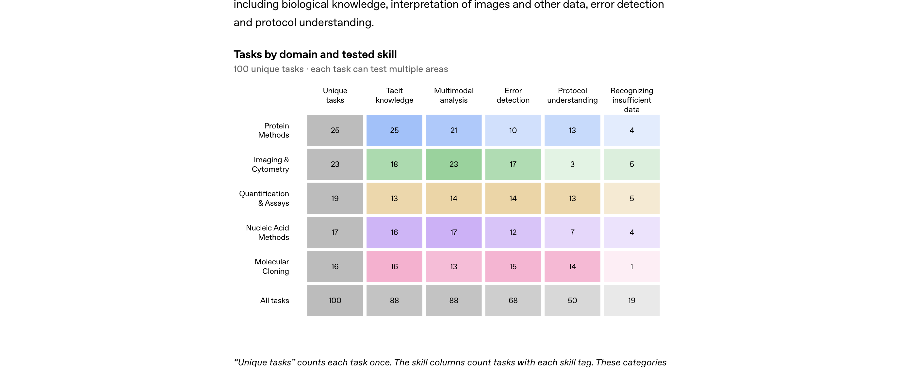

*“独特任务数”对每个任务只计一次。技能列统计带有各技能标签的任务数。这些类别相互重叠：一个任务可能出现在多列中，因此各技能计数不应相加以得出任务总数。颜色标识所属领域；着色越深，表示该领域中测试该技能的任务占比越大。*

输入保留了科学家实际接触的各类证据形式：凝胶和印迹图像、平板照片、显微成像序列、测序读段、酶标仪导出文件以及实验台操作视频。一项任务可以包含多种数据。梯带图、质粒图谱等参考表用于辅助解读实验证据。

### 提供给智能体的内容

| **数据类型** | **任务数** | **包含内容** |
| --- | --- | --- |
| 凝胶与印迹 | 31 | 琼脂糖 DNA 凝胶、SDS-PAGE 凝胶、Western 印迹 |
| 方案、笔记与规格 | 27 | 实验方案与 SOP、实验记录本与运行记录、手写笔记照片、产品目录、仪器规格、已发表方法 |
| 表格与仪器导出文件 | 20 | CSV 和 Excel 导出文件、泳道布局与清单、原始流式细胞术（FCS）文件 |
| 实验台、装置与试剂照片 | 18 | 实验台、凝胶电泳装置、试剂与培养管、一块 PCR 板、试管架、pH 试纸、一台浓缩仪、一台冰箱、一台液体处理工作站台面 |
| 显微成像 | 14 | 原始明场与荧光图像、多通道图像集、z 轴堆栈、延时影片 |
| 仪器屏幕与图表 | 13 | 流式细胞仪、显微镜、NanoDrop、酶标仪和天平屏幕的照片；导出的标准曲线、色谱图和图表 |
| 测序文件 | 12 | 原始长读长 FASTQ、FASTA 序列、GenBank 图谱 |
| 操作视频 | 7 | 划线接种、接种、梯度稀释、SDS-PAGE 电泳槽与培养箱设置、天平称量 |
| 琼脂平板与菌落 | 7 | 转化平板、蓝白斑筛选平板、抗生素药敏纸片平板 |
| 参考表 | 21 | 梯带图、质粒图谱、pH 图表（辅助材料） |

*包含各类数据的任务数量。类别相互重叠；参考表为辅助材料。*

科学家们使用自己实验的数据编写任务，将实验证据与问题和专家撰写的评分细则相配对。每项任务都经过三轮评审：由未撰写该任务的 Ligo 科学家进行内部评审，由在湿实验室工作的博士级科学家进行外部评审，最后再经一轮内部评审。评审人员核查了提示词、实验证据、评分细则、作者备注以及一份已评分的模型作答。

答案按照任务的评分细则打分，细则将分数分配给各单项标准。视任务而定，这些标准评估结论、数值结果、支撑性推理，或对证据不足的识别。

## 结果

我们在 BioBasicsBench 上评估了七个模型：GPT‑5.2、GPT‑5.4、GPT‑5.5、GPT‑5.6 Sol、GPT‑6.1 Sol、GPT‑6 Luna 和 GPT‑6 Astra。评估覆盖 37 种模型与推理强度设置，每种设置下对 100 项任务各进行五次尝试，共计 18,500 个结果。

我们报告**平均奖励**：即平均任务得分，以可用分数的百分比表示。误差线显示通过对完整任务重采样（将每项任务的五次尝试保持在一起）计算得出的 95% 置信区间。

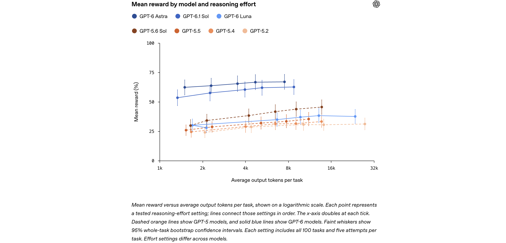

*平均奖励与每项任务平均输出 token 数的关系，以对数坐标显示。每个点代表一种测试的推理强度设置；连线按顺序连接各设置。x 轴每一刻度翻倍。橙色虚线表示 GPT‑5 模型，蓝色实线表示 GPT‑6 模型。浅色须线显示 95% 完整任务自助法（bootstrap）置信区间。每种设置包含全部 100 项任务，每项任务五次尝试。各模型的强度设置不尽相同。*

即使在低推理强度下，GPT‑6 Astra 相比 GPT‑5.6 Sol 也有显著提升。这些提升表明，**更强的原生多模态能力可能是提升日常湿实验**分析表现的关键。

### xhigh 推理强度下的表现

| **模型** | **平均奖励** | **95% 置信区间** | **输出 token 数 / 任务** |
| --- | --- | --- | --- |
| **GPT‑6 Astra** | 66.7% | 60.3–73.1% | 4,704 |
| **GPT‑6.1 Sol** | 62.0% | 55.6–68.4% | 5,238 |
| **GPT‑5.6 Sol** | 43.8% | 37.6–50.0% | 9,099 |
| **GPT‑6 Luna** | 38.3% | 32.3–44.5% | 13,120 |
| **GPT‑5.5** | 35.4% | 29.7–41.0% | 11,135 |
| **GPT‑5.4** | 33.2% | 28.3–38.4% | 13,717 |
| **GPT‑5.2** | 31.2% | 26.2–36.3% | 27,620 |

*xhigh 是全部七个模型均有报告的最高推理强度设置。每行包含全部 100 项任务，每项任务五次尝试。可用的最高强度（max-effort）结果已收录于上图中。*

## GPT‑6 Astra 相比 GPT‑5.6 Sol 的改进

### 识别数据能说明什么、不能说明什么

科学中一个常见的陷阱是过度解读数据，尤其是在检验假设时难免出现偏差的背景下。Astra 展现出更强的能力，能够辨别数据所示的边界，不得出无根据的结论。

在这个例子中，GPT‑5.6 Sol 根据一种用于检测死细胞的染料所产生的信号将细胞判定为死细胞。但该检测器也可能接收到第二种染料发出的光，因此仅凭亮度无法支持该结论。Astra 识别出了这种模糊性，并要求用更好的对照来分离两种信号。

#### 同一批细胞，三个检测通道

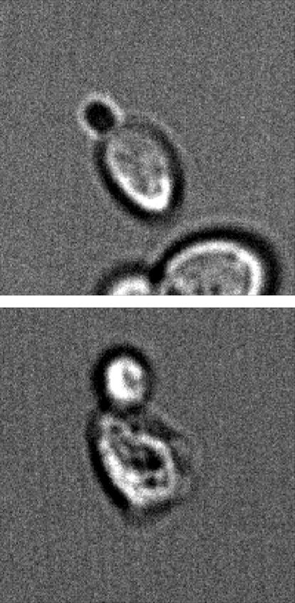

*明场 · 透射光*

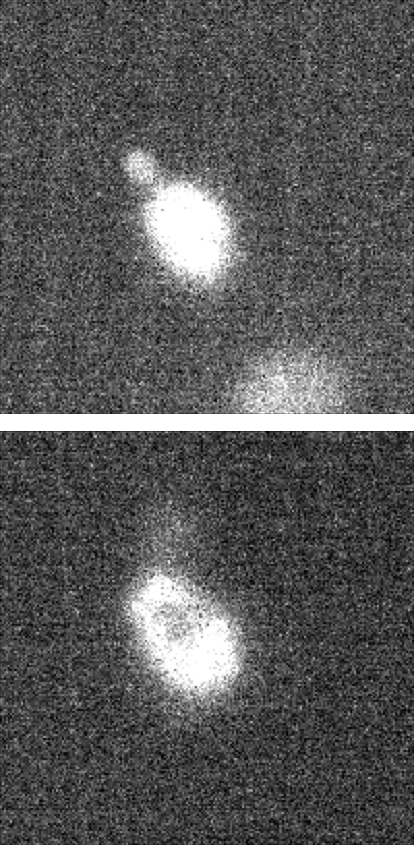

*通道 2 · SYTOX 标记 · 470–540 nm*

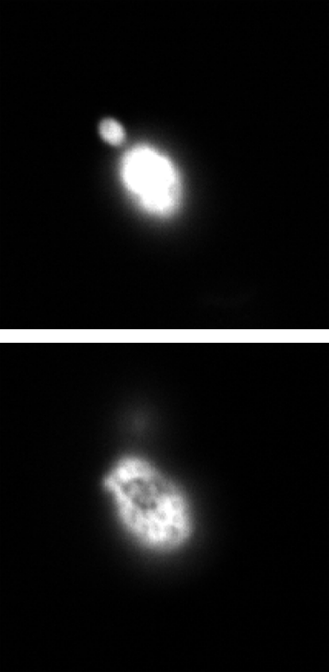

*通道 3 · FUN-1 绿色 · 525–580 nm*

*三个通道中的同一批细胞区域；检测窗口在 525–540 nm 处重叠。该重叠窗口允许干扰存在；其干扰量尚未测量。每个通道使用独立的线性强度标度显示，且在两个区域间固定；亮度无法在通道之间进行定量比较。*

### 更强的多模态处理能力

科学研究高度多模态，需要持续的视觉解读与决策。Astra 在处理多模态数据方面表现出显著改进，这些数据以照片和视频，以及测序、酶标仪测定、显微成像和流式细胞术的原始输出等形式提供。

在最基础的层面上，这一改进体现在 GPT‑6 Astra 能够从实验过程中拍摄的图像中捕捉更细微的细节，从而得出更准确的结论，如下例所示。该任务要求智能体从一项 DNA 克隆实验中得出结论，其中对照至关重要。GPT‑5.6 Sol 在阴性对照平板上没有看到菌落，并基于该观察得出结论。GPT‑6 Astra 注意到平板上标注了错误的抗生素，因而正确地否定了它作为可靠对照的有效性。

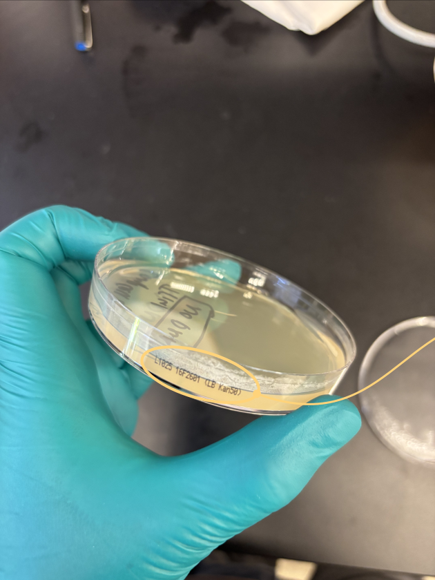

*原始照片*

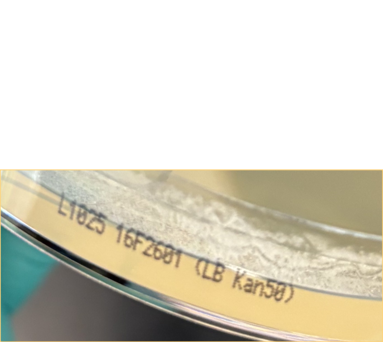

*平板边缘的标签*

*原始基准照片，平板边缘标签被圈出并放大。“LB Kan50”指卡那霉素，与实验中使用的氨苄青霉素是两种不同的抗生素。*

### 牢记实验背景

科学家在分析数据时必须将默会的生物学知识和实验背景铭记于心，才能正确解读数据所呈现的内容。Astra 展现出更强的能力来保持这一背景，并将其贯穿于整个分析过程。

其中一项任务展示了一系列显微镜图像中细胞从聚焦到失焦的变化。GPT‑5.6 Sol 试图为细胞的“消失”寻找生物学解释，而 GPT‑6 Astra 则正确识别出这是一个 z-stack：即在不同深度拍摄的一系列图像。

#### 深度扫描过程中的可见度变化

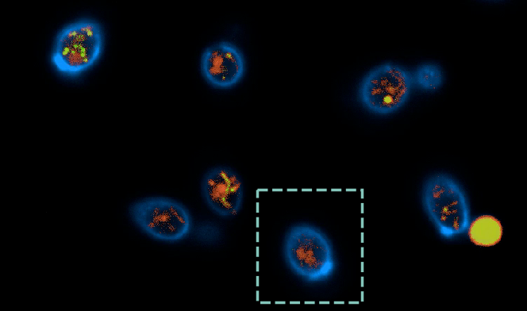

*0 秒*

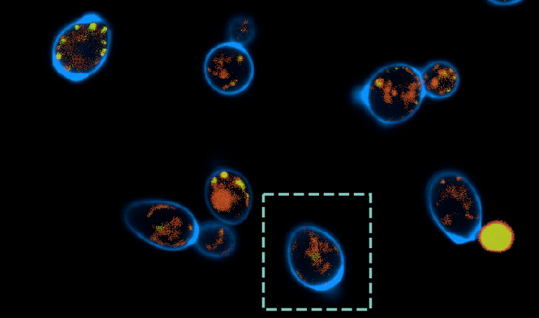

*3 秒*

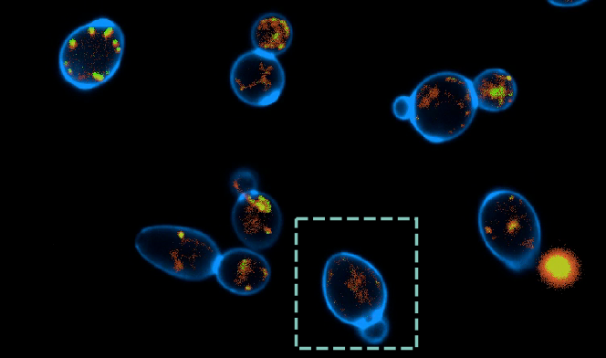

*6 秒*

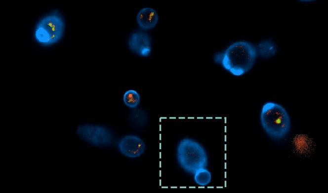

*9 秒*

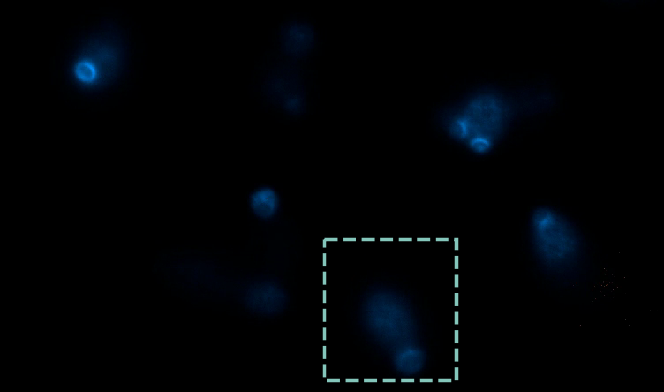

*12 秒*

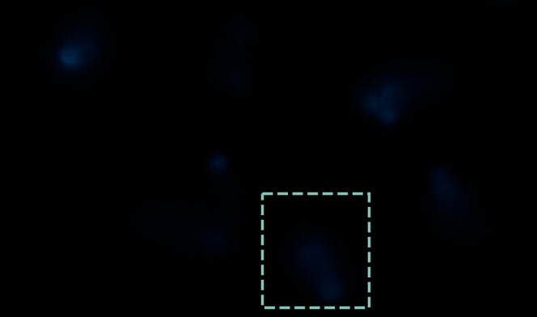

*15 秒*

*原始录像中的六帧画面。虚线框标出的是显微镜扫描不同深度时的同一位置。时间指所提供视频中的播放位置。*

## 模型仍然存在不足的地方

更高的基准测试分数并不意味着模型能够在实验室中做出可靠的判断。以下这些 Astra 的示例表明，假设、预期答案和给定的标签如何会凌驾于证据之上，以及一个正确的中间观察结果如何可能无法引导出最终的正确决策。

### 让假设凌驾于对照之上

**Astra 让一个熟悉的假设凌驾于实验对照所支持的解读之上。** 它能够区分两组菌落条带，但它假定更大的 PCR 产物代表克隆成功。在这一前提下，它选出了泳道 **4、6、7 和 8**；而参考答案的对照比较选出的是泳道 **5、9 和 10**。

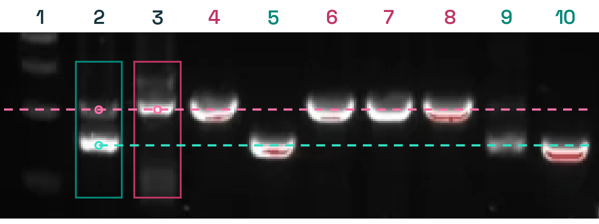

*参考答案选择的菌落是* ***5、9 和 10****；Astra 提出的是* ***4、6、7 和 8****。*

*1：marker（分子量标准）· 2：克隆混合物 · 3：原始质粒 · 4–10：菌落样品*

##### **解读对照**

1. 泳道 3 仅含原始质粒的 PCR 产物。其条带提供了旧质粒的参考位置。
2. 在参考答案的解读中，泳道 2 同时包含两种模式：不完全的组装使旧模板/骨架与新产物并存。
3. 由此产生的菌落可能携带旧质粒或新质粒。将它们的条带与这些参考模式进行比较。

**参考答案的选择：** 5、9 和 10

**Astra 的选择：** 4、6、7 和 8。Astra 提名这一组，理由是更大的 PCR 产物代表预期的构建体。

视觉分组是正确的，但附着于这些分组的实验身份相对于参考答案是颠倒的。因此，Astra 从菌落 PCR 结果中选错了菌落，这将导致下游纯化出错误的质粒。

### 忽视与其偏好解读相矛盾的数据

**Astra 忽视了与其偏好解读相矛盾的观察结果。** 它得出结论称，液泡（细胞内的区室）通常比周围的细胞区域更暗，尽管在同一图像中有些液泡显得更亮。两种表观都很重要：改变显微镜的焦点会使对比度反转，因此较暗的例子并不能确立一条普遍规律。

*较暗表观*

*较亮表观*

*Astra 关于液泡较暗的概括遗漏了同一视野中可见的较亮液泡。*

##### 这一答案遗漏了什么

有些细胞呈现出相反的对比度。两种表观都会出现，因为不同的焦深会使对比度反转。

Astra 检查了多个区域，甚至评论说对比度会随焦点变化。但随后它更重视它认为聚焦更好的细胞，并在最终答案中只保留了这些细胞的“液泡较暗”描述。那些相矛盾的较亮区域虽然已被检查过，却未被纳入结论考量。

### 在常规实验室测量中菌落计数出错

**Astra 的计数标记并不能可靠地对应单个菌落：它无法分辨相邻过近的菌落，遗漏了可见的菌落，还标记了空白琼脂。** 在这个平板上的最终结果比基准参考答案多计了约 12%。

#### A. 间距很近的菌落

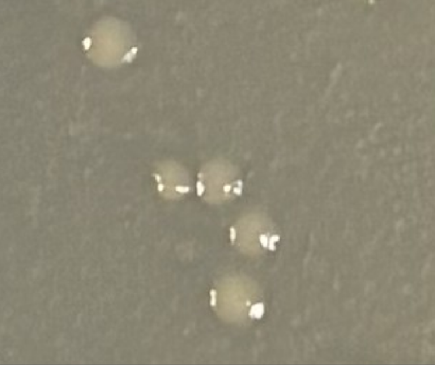

*原始图像*

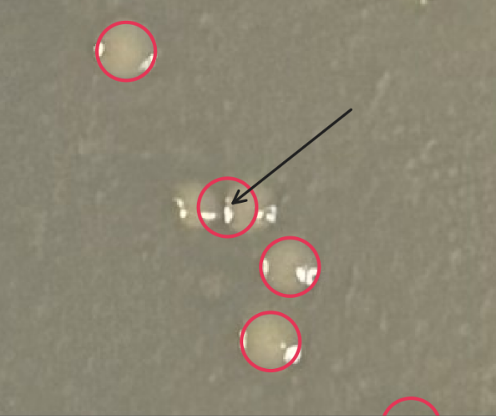

*Astra 的计数标记*

#### B. 可见菌落未被标记

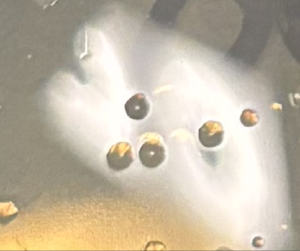

*原始图像*

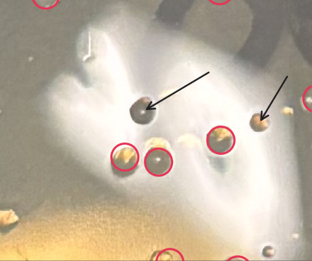

*Astra 的计数标记*

#### C. 空白琼脂被计为菌落

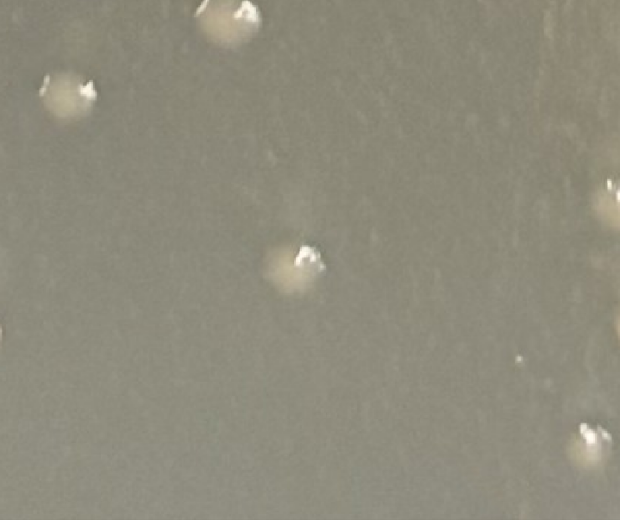

*原始图像*

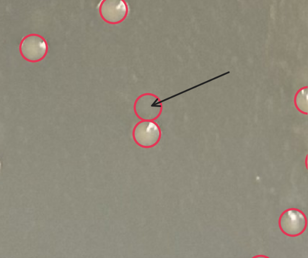

*Astra 的计数标记*

*A：相邻菌落之间只有一个计数标记。B：两个可见菌落未被标记。C：空白琼脂被计为菌落。红圈表示 Astra 的计数位置。黑色箭头为编辑性指引。*

不准确的菌落计数会直接影响对 DNA 导入细胞效率的估计。在铺板体积和稀释倍数固定的情况下，多计会使该估计值按相同比例被高估。

## 迈向可靠的实验室助手

加速生物学研究要求把日常工作做对。BioBasicsBench 将这些工作确立为改进目标：解读原始实验数据、检查对照，以及识别结论何时得不到支持。在这些任务上取得进展，可以帮助科学家减少排查问题的时间，把更多时间用于决定下一步开展哪些实验。跟踪这些能力也将帮助我们理解其对生物安全和生物安保的影响。

- [2026](https://openai.com/research/index/?tags=2026)
- [生命科学](https://openai.com/research/index/?tags=industry-life-sciences)

## 作者

OpenAI
