# Control Room 控制室（Control Room）

> 原文：[Control Room](https://openai.com/index/control-room/) · OpenAI · 2026-11-09
> 本文由 Kimi CLI 使用 Kimi K3-256k 全文翻译，并由 Agent 校对；已取得全文翻译和转载授权。
> 作者：OpenAI

随着我们的模型变得越来越强大，与之相关的安全和安保风险也越来越大，能够发现潜在问题并在需要时迅速阻止模型继续运行，变得愈发关键。为了解决这个问题，我们构建了 Control Room（控制室）。

Control Room 是一个中央系统，用于追踪我们研究基础设施中的模型工作负载，并在出现安全或安保隐患时迅速将其停止。它连接了每一个研究推理工作负载，包括用于模型训练和评估的智能体采样（agentic sampling）、数据处理等等。它与我们的[错位监控系统](https://openai.com/index/how-we-detect-frontier-model-misalignment/)协同工作，并在作出干预决定后的 35 秒内停止或暂停作业，从而中止模型输出。它的设计确保即使其他系统发生故障也能继续工作，并且如果 Control Room 本身宕机，也会停止模型输出。

Control Room 已经部署在我们的研究基础设施中，那里是最需要它的地方。我们的外部模型服务堆栈本身已经高度集中化，具备完善的运维能力，可以在需要时迅速下线模型部署。

## 工作原理

Control Room 通过集成几个系统来工作：*工作负载*、*推理引擎*和集中式的 *Control Room 服务*。

- *工作负载*是正在运行的作业，例如强化学习实验、评估、大规模采样或数据处理作业。我们要求每一个执行智能体推理的研究工作负载都必须与一个获批的[安全案例](https://openai.com/index/towards-safety-cases-for-frontier-ai-training/)相关联。
- *推理引擎*，或简称*引擎*，就是模型本身。你可以把引擎看作模型的大脑，直接运行在 GPU 上。一个工作负载通常会使用一个或多个模型，这些模型可能运行在一个或多个不同的推理引擎上。同一个推理引擎也可能被多个不同的工作负载使用。
- *Control Room 服务*负责追踪作业，并控制它们是否被允许继续生成模型输出。引擎在处理请求之前会先向 Control Room 服务查询。如果某个作业已被停止，该服务会拒绝请求，从而阻止进一步的输出。

Control Room 的集成方式如下：

- 启动新作业时，工作负载代码会向 Control Room 请求一个新的 job\_id。
- 每当工作负载需要从模型采样 token 时，它会向运行该模型的推理引擎发出请求，并传递 job\_id。引擎会向 Control Room 请求许可来完成该请求，并将 job\_id 一并传递给 Control Room。
- Control Room 检查该作业是否已被终止，如果是，则拒绝该推理请求。引擎会以拒绝响应工作负载的推理请求，从而停止为该作业生成进一步的模型输出。

[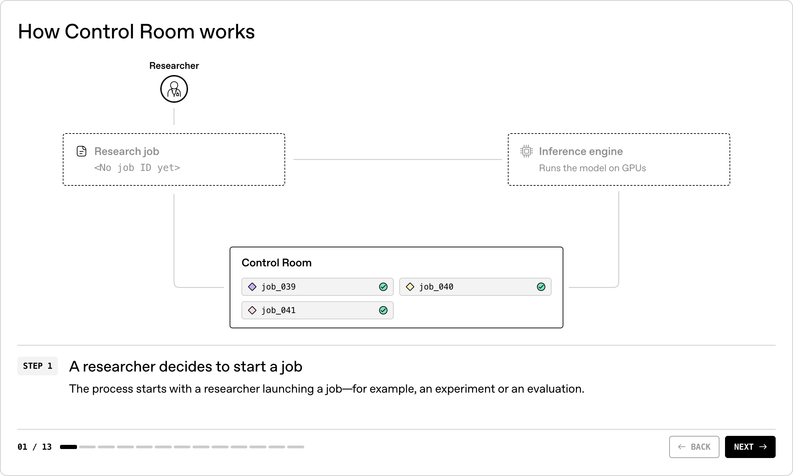](https://openai.com/index/control-room/)

*研究人员决定启动一个作业*

[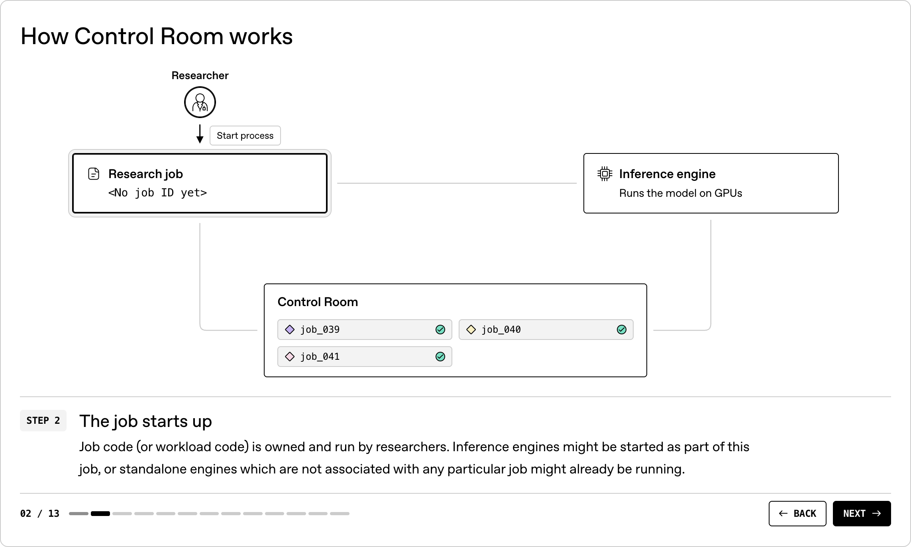](https://openai.com/index/control-room/)

*作业开始启动*

[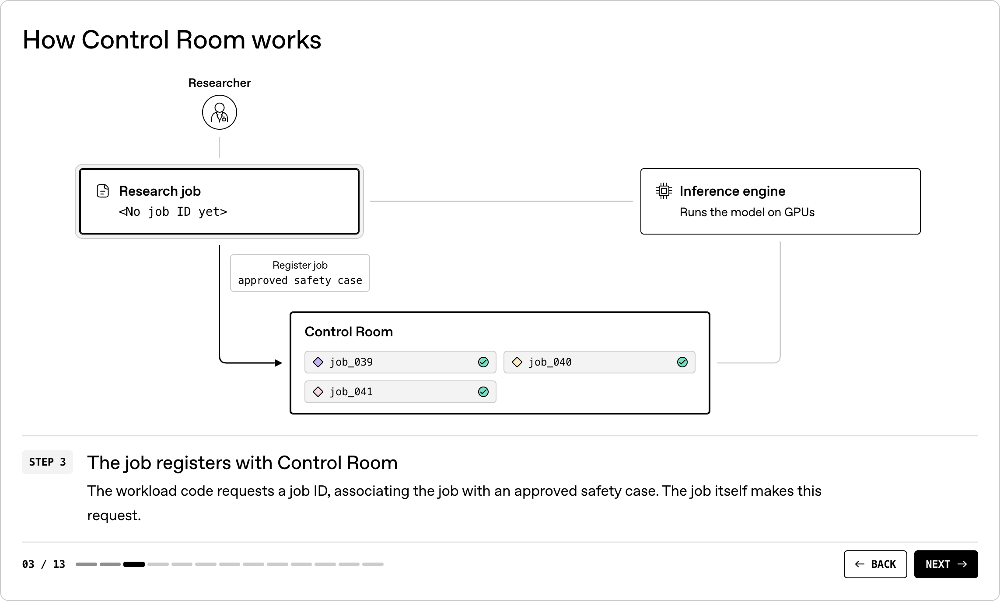](https://openai.com/index/control-room/)

*作业向 Control Room 注册*

[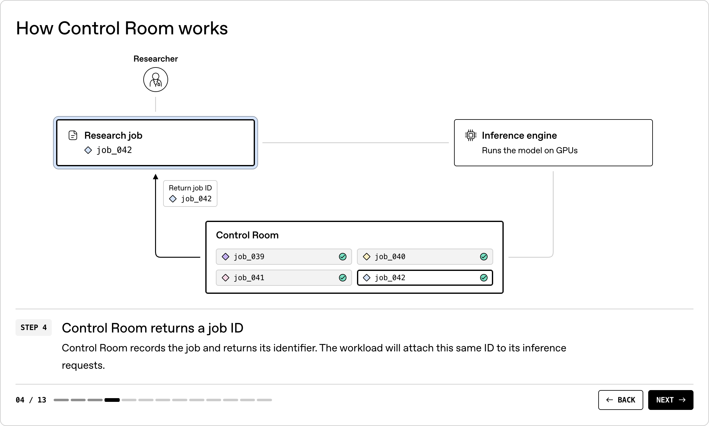](https://openai.com/index/control-room/)

*Control Room 返回一个作业 ID*

[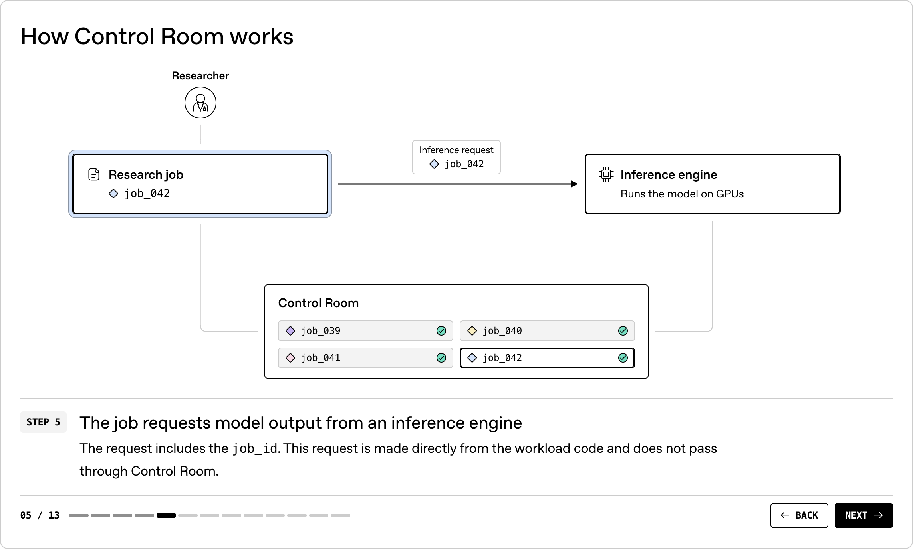](https://openai.com/index/control-room/)

*作业向推理引擎请求模型输出*

[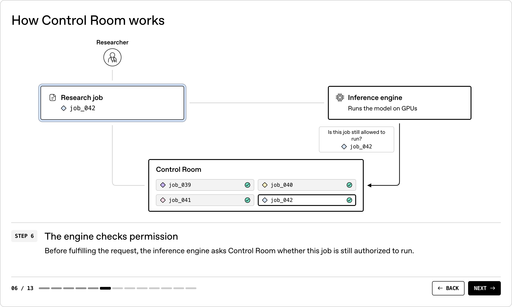](https://openai.com/index/control-room/)

*引擎检查权限*

[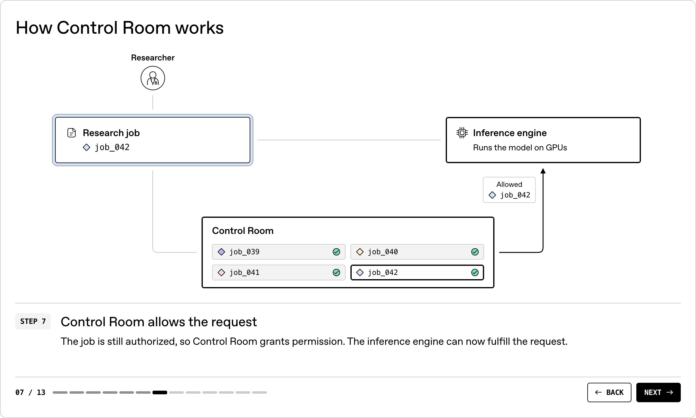](https://openai.com/index/control-room/)

*Control Room 允许该请求*

[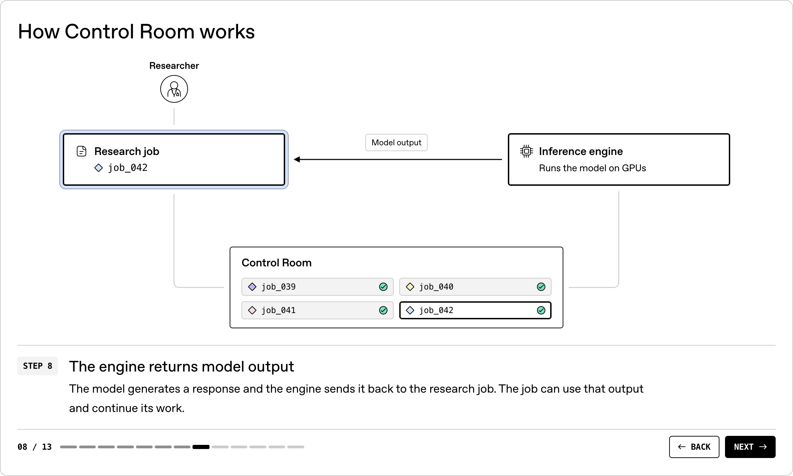](https://openai.com/index/control-room/)

*引擎返回模型输出*

[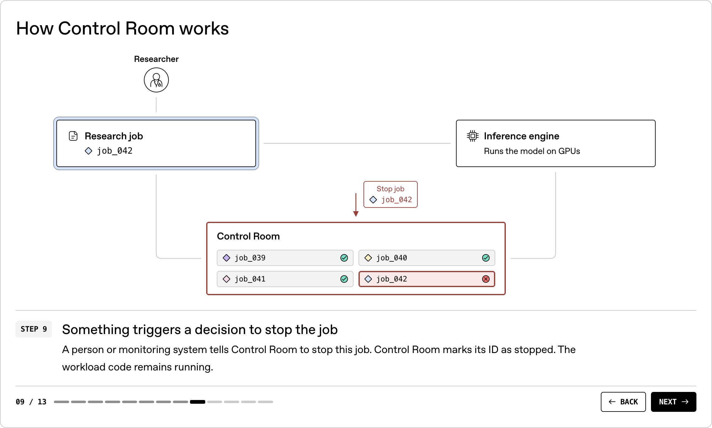](https://openai.com/index/control-room/)

*某个事件触发了停止该作业的决定*

[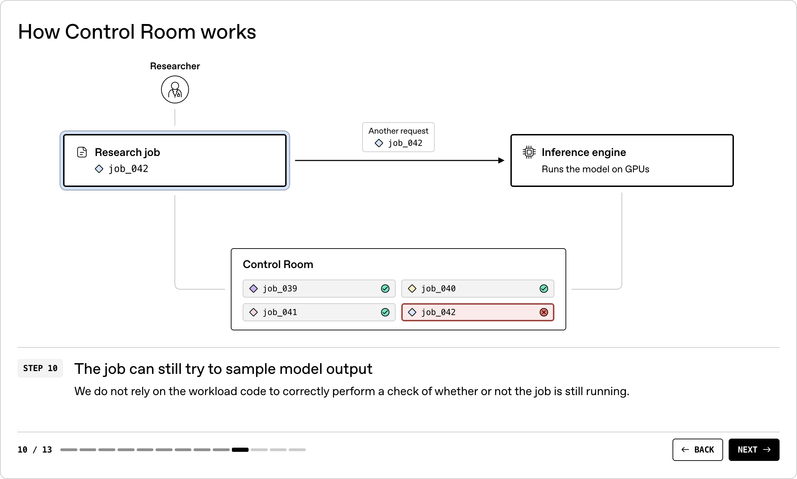](https://openai.com/index/control-room/)

*作业仍可尝试采样模型输出*

[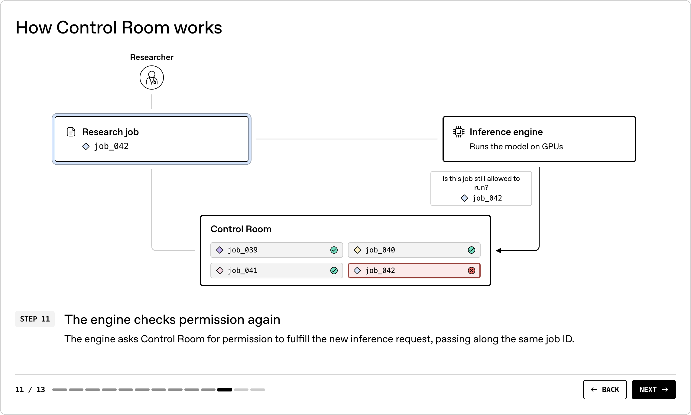](https://openai.com/index/control-room/)

*引擎再次检查权限*

[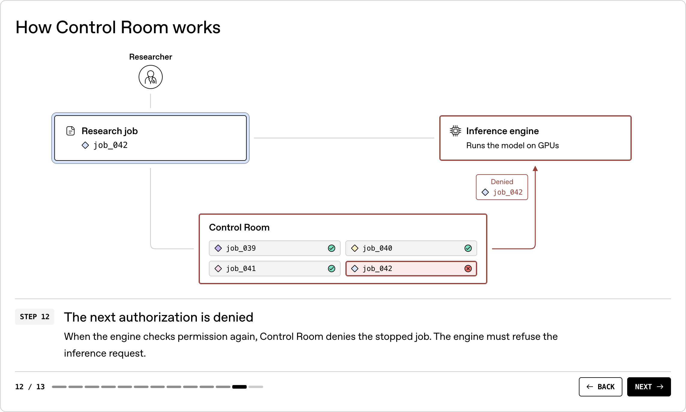](https://openai.com/index/control-room/)

*下一次授权被拒绝*

[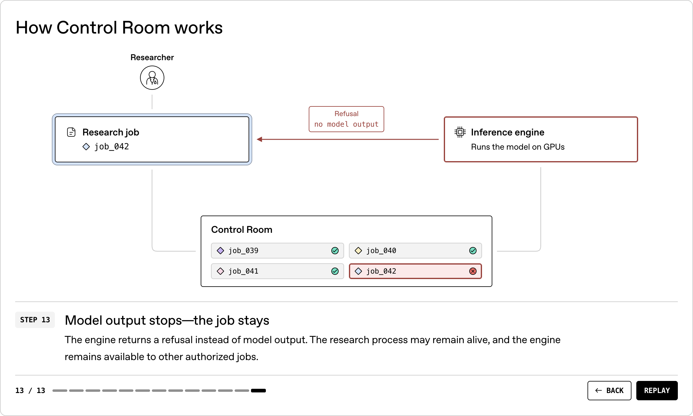](https://openai.com/index/control-room/)

*模型输出停止——作业仍保留*

## Control Room 的工作方式

研究人员

某个因素触发了停止该作业的决定

### 研究作业

`<No job ID yet>job_042`

### 推理引擎

在 GPU 上运行模型

### Control Room

- `job_039`
- `job_040`
- `job_041`
- `job_042`

第 1 步

### 研究人员决定启动一个作业

整个过程始于一名研究人员启动一个作业——例如一个实验或一次评估。

### 作业启动

作业代码（或称工作负载代码）由研究人员拥有并运行。推理引擎可能作为该作业的一部分启动，也可能是已经在运行的、不与任何特定作业关联的独立引擎。

### 作业向 Control Room 注册

工作负载代码请求一个作业 ID，将该作业与一个获批的安全案例相关联。该请求由作业本身发出。

### Control Room 返回一个作业 ID

Control Room 记录该作业并返回其标识符。工作负载会在其推理请求中附上这个相同的 ID。

### 作业向推理引擎请求模型输出

该请求包含 `job_id`。此请求由工作负载代码直接发出，不经过 Control Room。

### 引擎检查权限

在处理请求之前，推理引擎会询问 Control Room 该作业是否仍被授权运行。

### Control Room 批准该请求

该作业仍获得授权，因此 Control Room 授予许可。推理引擎现在可以处理该请求。

### 引擎返回模型输出

模型生成响应，引擎将其发送回研究作业。作业可以使用该输出并继续其工作。

### 某个因素触发了停止该作业的决定

某个人员或监控系统告知 Control Room 停止该作业。Control Room 将其 ID 标记为已停止。工作负载代码仍在运行。

### 作业仍然可以尝试采样模型输出

我们不依赖工作负载代码来正确检查作业是否仍在运行。

### 引擎再次检查权限

引擎向 Control Room 请求许可以处理新的推理请求，并传递相同的作业 ID。

### 下一次授权被拒绝

当引擎再次检查权限时，Control Room 拒绝了已停止的作业。引擎必须拒绝该推理请求。

### 模型输出停止——作业保留

引擎返回拒绝而非模型输出。研究进程可能仍然存活，引擎也仍可为其他已授权的作业提供服务。

## 示例：响应监控告警

我们所有的前沿强化学习作业都在监控器的配合下运行。*监控器*是另一个模型，它会检查被训练模型正在做的一切，并在发现问题时发出告警。例如，我们最近的 [DNS 相关事件](https://alignment.openai.com/misalignment-reports/an-agent-used-dns-to-reach-an-external-chatbot/)就是被监控器发现的。

Control Room 与我们的监控系统按以下方式集成：

- 如果监控系统检测到潜在问题，根据具体情况和严重程度，监控系统可能会决定停止该作业。
- 在这种情况下，监控系统会向 Control Room 发送停止该作业的消息，并传递 job\_id。Control Room 记录该作业已被终止。
- 下次持有该 job\_id 的作业向运行在*任何*引擎上的*任何*模型发出推理请求以采样更多 token 时，该请求将被拒绝，从而停止进一步的模型输出。

## 速度与可靠性

从 Control Room 收到停止某个作业的指令，到该作业无法再继续推进的时刻，最长间隔为 35 秒。这 35 秒的延迟来自推理授权的缓存层，用于支撑所需的流量规模。我们正在努力将这个数字降至零，以便能够即时终止作业。

工作负载（包括实验、评估作业等）通常由研究人员或研究团队拥有和运营。因此，工作负载代码经常变动，并不是实现关键承重安全保护的理想位置。正因如此，我们的实现在设计上能够容忍有缺陷或损坏的工作负载代码。

我们通过在推理层实现终止机制来做到这一点。工作负载代码高度多样化且分散。相比之下，在整个 OpenAI 研究体系中，实际使用的推理代码路径只有极少数几条，而且它们的部署要集中和统一得多。这意味着推理层可以充当一个瓶颈点，在这里我们能够获得强有力的保证：所有在研究中运行的模型推理，其每一次推理请求都必须经过 Control Room 的授权检查。此外，我们还持续运行智能体式和程序化的扫描，以检查用户是否有意或无意地启动了未实现或未启用 Control Room 的违规引擎实现。

最后，我们的系统采用“故障关闭”（fails closed）设计，这意味着引擎中的 Control Room 集成以这样的方式配置：如果 Control Room 服务宕机——无论是由于系统错误，还是因为任何其他原因被禁用，包括遭到恶意行为者篡改——那么在 Control Room 恢复正常运行之前，所有推理请求都将被拒绝。故障关闭目前已向所有前沿模型研究工作负载推出，并将在未来几天内完成对其余所有研究工作负载的推广。

---

Control Room 只是我们安全训练和部署前沿模型整体方案的一部分。在未来几个月里，我们将继续强化和扩展这一系统，同时持续投入对错位行为和安全漏洞的监控。如果你想帮助构建确保 AGI 安全可靠开发与部署的系统，[我们正在](https://openai.com/careers/research-engineer-research-scientist-ai-systems-engineer-rsi-san-francisco/)[招聘](https://openai.com/careers/researcher-agent-safety-oversight-and-system-mitigations-san-francisco/)！
