# 用 Codex 与 ModRetro Chromatic 开发复古掌机游戏（Building a retro handheld game with Codex and ModRetro Chromatic）

> 原文：[Building a retro handheld game with Codex and ModRetro Chromatic](https://developers.openai.com/blog/build-a-game-with-modretro-chromatic) · OpenAI · 2026-11-09
> 本文由 Kimi CLI 使用 Kimi K3-256k 全文翻译，并由 Agent 校对；已取得全文翻译和转载授权。
> 作者：Kevin Whinnery

对 iPhone 致以应有的敬意——Game Boy 或许才是有史以来最具标志性的掌上设备。一代孩子在公交车上踩扁龟类敌人（Koopas），用联机线与朋友对战宝可梦，而这一切都在一台能装进口袋的设备上完成。至少，能装进你背包的口袋里。

借助如今强大的编码模型以及 Codex 这样的工具，制作属于自己的游戏从未如此简单（在我看来，也从未如此有趣）。但游戏运行在 Game Boy Color 这类专门打造的硬件上，有一种难以替代的独特魅力。正因如此，我_无比兴奋_地与大家分享：[适用于 Codex 的 ModRetro 插件](https://developers.openai.com/modretro)让你能够制作 Game Boy Color 游戏，并在 Chromatic 上游玩它们。

[订购特别版 ModRetro Chromatic][chromatic-order]。

让我们直接开始，看看它是如何工作的。

[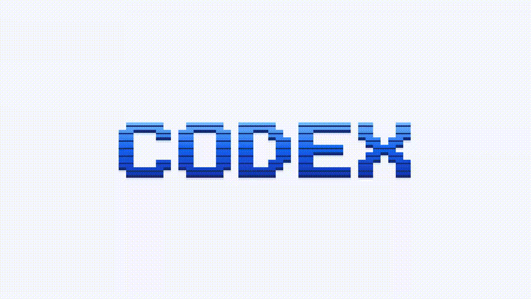](https://cdn.openai.com/devhub/blog/build-a-game-with-modretro-chromatic/build-a-game-with-modretro-chromatic-v8.webm)

[观看原始视频：安装 ModRetro Chromatic 插件、打开模拟器并连接 Chromatic 的操作演示。](https://cdn.openai.com/devhub/blog/build-a-game-with-modretro-chromatic/build-a-game-with-modretro-chromatic-v8.webm)

[原始英文字幕](../../../assets/articles/69e94d3b69ad0a46/03a0d5dcbc2aac09-build-a-game-with-modretro-chromatic.en.vtt)

## 安装插件

1. 在 ChatGPT 桌面应用中，从 **ChatGPT** 下拉菜单中选择 **Codex**。
2. 打开 **Plugins**（插件）并搜索 **ModRetro Chromatic**。选择由 ModRetro 提供的 **ModRetro Chromatic Plugin**，然后点击 **Install**（安装）。
3. 打开一个本地项目文件夹并开始对话。输入 **@** 并选择该插件，让 Codex 知道要使用哪些工具。
4. 让 Codex 设置插件并检查是否缺少任何构建工具。之后你就可以在电脑上构建并游玩你的第一个游戏了。

[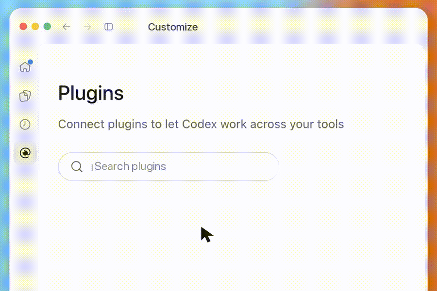](https://cdn.openai.com/devhub/blog/build-a-game-with-modretro-chromatic/install-plugin-66ee162ee0db.webm)

[观看原始视频：在 Codex 中找到 ModRetro Chromatic 插件并安装。](https://cdn.openai.com/devhub/blog/build-a-game-with-modretro-chromatic/install-plugin-66ee162ee0db.webm)

## 用提示词创建你的第一个游戏

在 Codex 对话中选中该插件后，描述你想构建的游戏。如果想跟着视频操作，可以使用下面这个示例提示词。

> 构建一个名为 Lodge Podge 的俯视角冒险游戏，一只像素海狸必须啃倒小树来收集树枝，以便在关卡中央建造一座小屋。

[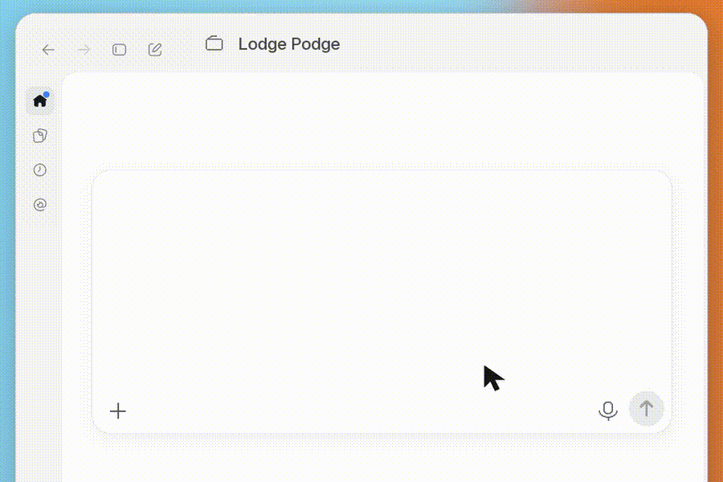](https://cdn.openai.com/devhub/blog/build-a-game-with-modretro-chromatic/prompt-lodge-podge-f69711af7da7.webm)

[观看原始视频：在本地 Codex 对话中提及 ModRetro 插件并提交 Lodge Podge 提示词。](https://cdn.openai.com/devhub/blog/build-a-game-with-modretro-chromatic/prompt-lodge-podge-f69711af7da7.webm)

接下来，让 Codex 构建游戏并打开预览。你也可以让它为你指出 GB Studio 项目文件夹中的这些文件。

- 在 GB Studio 中打开 `.gbsproj` 文件，以编辑场景、角色和事件。
- 在 `assets/` 中查看项目使用的精灵图、背景和音频。
- 在模拟器中运行编译后的 `.gbc` 文件，或将其安装到卡带上。

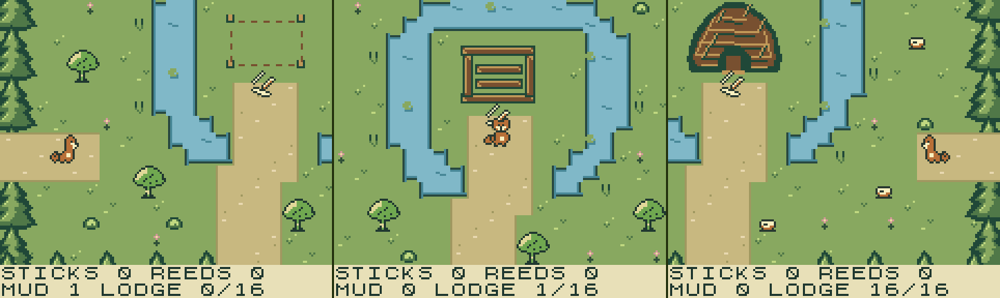

之后，玩上几轮，告诉 Codex 怎样能让游戏更有趣。在 Lodge Podge 中，我让 Codex 把海狸做得更胖乎一些（为了极致的可爱），并要求建造小屋时除了树枝还需要泥土和树叶。

## 插件里有什么

ModRetro Chromatic 插件包含模型可以代你使用的开发者工具。

### 制作角色动画

让 Codex 创建一张精灵图，并把各帧并排展示给你。若要修改动画，指出你想更改的姿势或方向，然后让 Codex 重新构建预览。

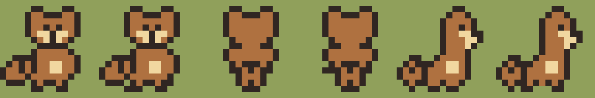

### 构建玩家可以穿行的地图

让 Codex 把场景的背景图和碰撞图并排展示给你。碰撞图标记了哪些图块会阻挡移动。借助背景图确认你所指的区域，然后告诉 Codex 把哪些图块标记为阻挡或可行走。

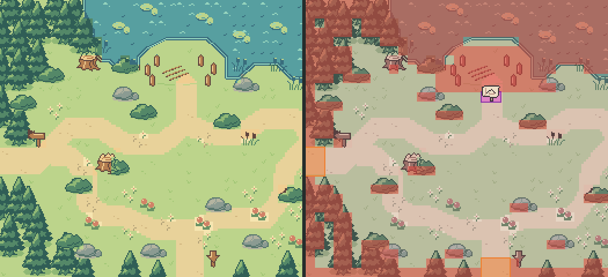

### 在 Codex 中游玩 ROM

让 Codex 在其内置浏览器中打开游戏预览。方向键对应 Game Boy 的十字键，**Z** 对应 **A**，**X** 对应 **B**，**Enter** 对应 **Start**。使用模拟器上方的工具栏可暂停或继续。

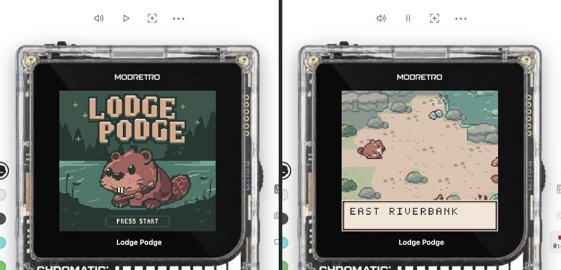

### 指向你想修改的部分

在预览工具栏中选择 **Annotate game**（标注游戏），然后点击游戏画面以冻结一帧。选择你想更改的精灵、图块或区域并描述修改内容。选择 **Resume game**（继续游戏）即可返回模拟器。Codex 完成修改后，让它重新构建 ROM 并重新打开预览。

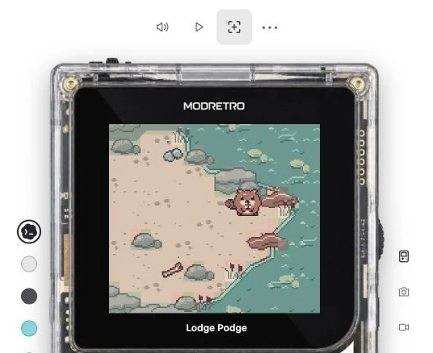

### 让 Codex 测试一连串操作

你也可以在对话中控制模拟器。让 Codex 运行 ROM，发送一连串按键输入，并在每一步之后截取一帧。要求它把各帧并排展示，方便你一起检查。

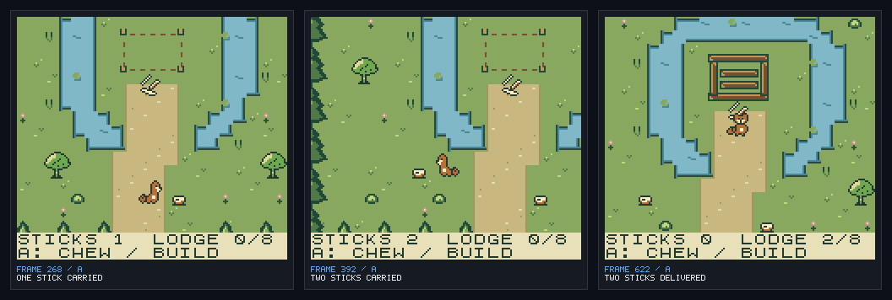

## 在 GB Studio 中编辑

GB Studio 是一个用于制作 Game Boy 游戏的可视化编辑器。打开项目的 `.gbsproj` 文件并选择 **Game World**（游戏世界）。在导航器中选择一个场景，即可在侧边栏查看其属性。你可以把角色拖到新的图块上，或直接在场景中编辑碰撞。保存项目，然后回到 Codex 对话，让它重新构建并打开预览。[GB Studio 场景指南](https://www.gbstudio.dev/docs/project-editor/scenes/)解释了背景、角色和触发器是如何组合在一起的。

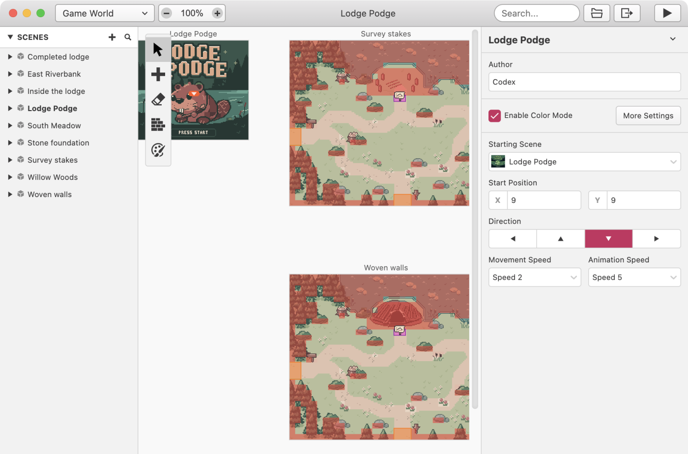

### 其他开发选项

- **扩展 GB Studio 游戏。** 如果内置事件无法覆盖某种机制，你可以用 GBVM（GB Studio 的虚拟机语言）添加自定义事件，或用 C 语言扩展引擎。请参阅 [GB Studio 插件指南](https://www.gbstudio.dev/docs/extending-gbstudio/plugins/)。
- **用 GBDK-2020 以 C 语言编写游戏。** ModRetro 插件可以使用 GBDK 的 `lcc` 编译器编译独立的 C 代码。GBDK 的 [Game Boy API](https://gbdk.org/docs/api/) 让你能够操作按键、精灵、图块和调色板。可以让 Codex 从一个读取十字键并移动单个精灵的游戏主循环开始。
- **编写你自己的引擎。** 你可以让 Codex 从零实现游戏主循环、滚动和碰撞。对于汇编项目，可使用另行安装的工具链（如 [RGBDS](https://rgbds.gbdev.io/)）构建 ROM。然后把生成的 `.gb` 或 `.gbc` 文件交给插件进行检查和试玩测试。

## 部署到设备

你需要一台 Chromatic、一个兼容的可擦写自制卡带，以及一根 USB 数据线。按照 [ModRetro 的快速入门指南](https://support.modretro.com/en_us/chromatic-devday-edition-quickstart-guid-By1iOlcMg)更新固件，并使用你将要连接掌机的电脑激活开发者模式。

1. 插入卡带，将 Chromatic 连接到你的电脑，并在本地 Codex 对话中打开游戏预览。
2. 选择 **Install on Chromatic**（安装到 Chromatic），选择你已连接的设备，然后点击 **Install**（安装）。请仔细阅读确认信息。写入新 ROM 会擦除该卡带上的游戏，并可能擦除其存档。安装程序不会备份卡带。
3. 准备好后选择 **Confirm Install**（确认安装）。在插件报告成功之前保持数据线连接，然后在 Chromatic 上启动游戏。

[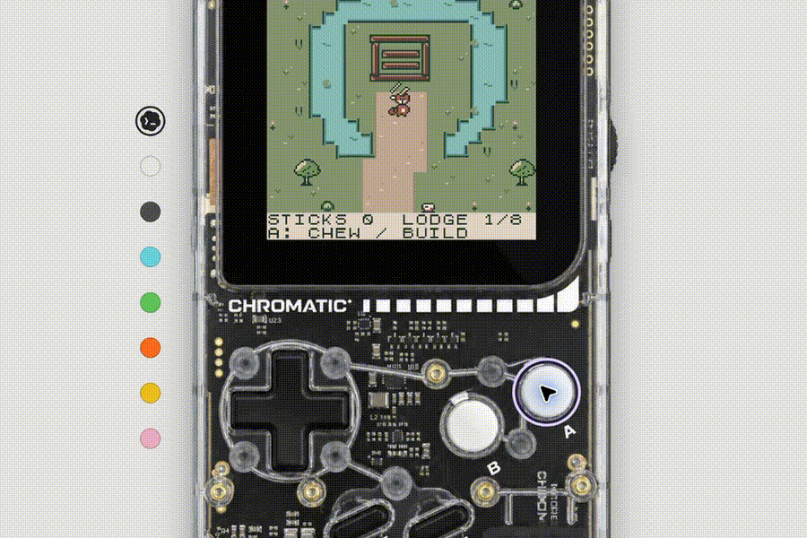](https://cdn.openai.com/devhub/blog/build-a-game-with-modretro-chromatic/deploy-to-chromatic-0e10da89508f.webm)

[观看原始视频：早期的 Flash to device（刷写到设备）流程，可发现已连接的 Chromatic 并显示卡带擦除警告。](https://cdn.openai.com/devhub/blog/build-a-game-with-modretro-chromatic/deploy-to-chromatic-0e10da89508f.webm)

## “科学的力量令人震撼！”

借助适用于 Codex 的 ModRetro 插件，你可以通过提示词创作出原创的 Game Boy Color 游戏，并使用蓬勃发展的 GBC 自制游戏开发生态中的所有工具。这将会非常非常有趣。你可以[订购属于你自己的 ModRetro Chromatic][chromatic-order]，并[探索 ModRetro 的其他项目](https://modretro.com/)。祝你 Game Boy 折腾愉快！

[chromatic-order]: https://openai.com/supply/shop/
