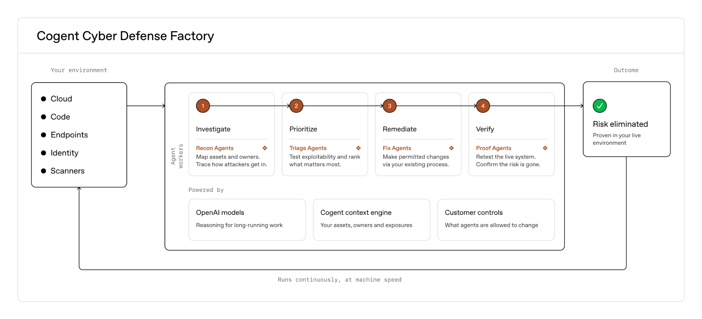

# Cogent 与 OpenAI 为企业打造网络防御工厂（Cogent and OpenAI build cyber defense factories for enterprises）

> 原文：[Cogent and OpenAI build cyber defense factories for enterprises](https://openai.com/index/cogent-security/) · OpenAI · 2026-11-10
> 本文由 Kimi CLI 使用 Kimi K3-256k 全文翻译，并由 Agent 校对；已取得全文翻译和转载授权。

2026年11月10日

初创公司

Cogent 将 OpenAI 模型与企业上下文相结合，借助智能体帮助自动修复漏洞。

公司规模：初创公司

地区：北美

行业：科技

产品：API、Codex、Daybreak

75%

漏洞平均修复时间降低

5x

漏洞分流数量提升

正如 [Cogent Security⁠](https://www.cogent.com/) 所见，企业面临的安全风险前所未有，但它发现最困难的部分并非发现漏洞，而是修复漏洞。修复工作十分复杂，横跨多个团队。它需要对企业环境的上下文理解：攻击者可能如何利用某个漏洞、哪些业务系统会受到影响，以及可以安全地进行哪些变更。

Cogent 为企业构建“网络防御工厂”（Cyber Defense Factories），以自主发现并消除这些风险。这些工厂旨在帮助防御者以机器速度行动，以应对漏洞发现与利用不断加速的趋势。

该公司的 AI 智能体将 GPT‑6.1 Sol 和 GPT‑5.6 与其企业上下文及控制机制相结合，处理从调查到经验证修复的全过程。这些智能体会评估风险暴露、执行获准的变更，并确认风险已被消除。Cogent 还通过 Cyber 和 Daybreak 开展内部研究，探索攻击路径与防御能力。

> “OpenAI 模型支撑长时间运行任务的能力，为企业防御解锁了全新的自主水平：AI 智能体现在可以将工作从调查一直推进到经验证的修复。”

——Geng Sng，Cogent 联合创始人兼首席技术官

## 赋予智能体上下文与行动权限

针对每位客户，Cogent 的上下文引擎（Context Engine）维护一张涵盖资产、漏洞、身份、归属关系和依赖关系的企业知识图谱。专门的后台智能体持续在安全工具和系统之间核对信息，使调查与修复智能体对环境形成共同的理解。

GPT‑6 Astra 负责这些工作的前期规划与复杂推理。正如 Cogent 联合创始人兼首席技术官 Geng Sng 所描述的，这实现了企业的“记忆运行框架”（memory harness）。他说：“我们不必在每次新任务出现时都重新认识这个世界的样貌。”复用上下文降低了延迟、推理成本，并减少了不一致的结果。

Cogent 的智能体策略（Agent Policies）定义了每家企业的允许变更和审批要求，其策略执行引擎 TRACE 会在执行前根据这些策略检查工具调用。这些检查是确定性的，无需额外的模型推理。

智能体网关（Agent Gateway）会独立检查授权，更高风险的工作可以在隔离的沙箱中运行。客户可以委托智能体进行调查、要求变更必须经审批，或允许有边界的自主修复。

## 从漏洞披露到经验证的修复

当用于运行网站的编程语言 PHP 中被披露出名为 PHP2Shell 的严重安全缺陷时，客户们求助于 Cogent 早已部署在其环境中的网络防御工厂。

GPT‑6.1 Sol 和 GPT‑6 Astra 为调查与修复规划提供了深度推理。借助 Cogent 的上下文层，智能体识别受影响的系统、评估风险暴露，并制定出兼顾应用依赖与运维约束的方案。随后，它们通过客户定义的审批与执行工作流来编排修复，并验证问题已得到解决。

Cogent 报告称，客户正在使用其网络防御工厂更快地解决漏洞，并扩展调查能力。借助 Cogent，一家《财富》1000 强汽车客户将严重漏洞的平均修复时间缩短了 75%，一家《财富》500 强 IT 服务客户实现了 5 倍的漏洞分流吞吐量。

全球电子交易平台 MarketAxess 借助 Cogent 强化其基于风险的风险暴露管理方法。MarketAxess 首席信息安全官 Vijay Bala 表示：“Cogent 将漏洞数据、业务上下文、安全控制与攻击路径分析结合在一起，帮助我们验证真实的风险暴露，并在最关键之处优先安排修复。尤其突出的是，Cogent 团队对新兴威胁的响应速度非常快，并能将我们的反馈转化为实用的能力。”

## 为什么 Cogent 选择 OpenAI 模型与 Codex 进行构建

Cogent 持续评估闭源与开源的替代方案，并报告称 OpenAI 模型在长时间运行的安全任务上推理能力更强、保真度更高、在技术代码库上的幻觉更少，执行也更可靠。这些模型可以串行和并行地链接工具调用，同时在修复工作流中保留上下文。

Cogent 针对复杂调查优先考虑推理质量，针对较简单的工作则优先考虑成本。它将 GPT‑6.1 Sol 用于通用执行，将 GPT‑5.6 用于对高级推理要求较低的常规漏洞管理任务。

> “相对于其他供应商，OpenAI 模型的成本效益更高。这对我们来说是一大优势，尤其是当我们要运行这些庞大的智能体集群时。”

——Geng Sng，Cogent 联合创始人兼首席技术官

使用 OpenAI 模型还减少了 Cogent 为修复与打补丁所需构建的支持性软件。“我们过去在智能体运行框架层面必须做的许多工作，如今已不再需要，”Geng 说。他还分享道，OpenAI API“精简了请求路由和智能体编排，大幅降低了内部工程开销，加快了我们复杂安全工作流的上市速度。”

Cogent 的大多数工程师在开发时也选择使用 Codex。Geng 表示，与在开源编码环境中使用同样的模型相比，将 Codex 与 OpenAI 模型搭配使用能带来更高的生产力。“Codex 自带了许多我们无需自行构建的工具，”Geng 说。

## 扩展自主网络防御

通过面向 Cyber 和 Daybreak 的 Trusted Access（可信访问计划），Cogent 获得了针对其内部红队演练与攻击路径研究的技术支持。Daybreak Red 是 Daybreak 内的一个访问层级，为团队提供用于授权攻击性研究和漏洞研究的专门 OpenAI 模型。“良好的防御需要良好的进攻，”Geng 说。

> “通过面向 Cyber 和 Daybreak 的 Trusted Access，我们可以探索漏洞如何跨越身份、资源和网络控制被串联利用。我们利用这些研究来了解智能体可以做什么，以及接下来应该构建哪些防御能力。”

——Geng Sng，Cogent 联合创始人兼首席技术官

Cogent 计划扩展其能力，成为企业构建自有网络防御工厂的关键合作伙伴。其路线图包括日益自主的修复能力，拓展智能体可执行修复的范围与复杂度——从简单的配置变更到横跨不同企业系统的多步骤工作流。

该公司还在开发自主发现与验证能力。其目标是构建一个闭环系统：发现并消除风险，同时持续从每一个漏洞中学习，以改进未来的调查与修复。
