# 将语音智能体推向更远：四个 GPT-Live 构建案例深度解析（Pushing voice agents further: inside four GPT-Live builds）

> 原文：[Pushing voice agents further: inside four GPT-Live builds](https://developers.openai.com/blog/pushing-voice-agents-further) · OpenAI · 2026-11-10
> 本文由 Kimi CLI 使用 Kimi K3-256k 全文翻译，并由 Agent 校对；已取得全文翻译和转载授权。
> 作者：Eva Sasson, Ethan Pereira

GPT-Live 将对话的节奏融入更好的用户体验之中：用户可以插话、改变方向，并随着说话逐步展开一个想法。与那种将语音依次经过独立的转写、语言和语音生成模型的级联式语音系统不同，GPT-Live 能够同时倾听和说话，从而实现更自然的交流——在这种交流中，时机与打断和话语本身同样重要。

在这篇博客文章中，[Juno](https://junocompanion.com/)、[Picsart](https://picsart.com/ai-agents/)、[Treater](https://trytreater.com/) 和 [Weekend](https://www.weekend.com/) 将以他们自己的语言，分享他们如何使用 GPT-Live 进行构建，以及他们在以下方面的收获：

1. 利用线上生产数据改进通话
2. 发现能够建立信任的声音
3. 与后台智能体协同工作
4. 编排协作式语音智能体

我们将了解塑造他们产品的提示词、工作流程和反馈，其中包含其他开发者可以在自己应用中测试的实用思路。

## 创业公司故事


## Juno：使用 GPT-Live 让语音助手对患者来说感觉自然

_作者：联合创始人兼首席执行官 Marshall Gould，以及联合创始人兼首席技术官 Isaac Tolley_

我们正在打造 Juno——一款为长期 COVID、POTS 和 EDS 等慢性疾病患者服务的个人健康助手。

### 我们要构建什么

只有亲身患有慢性疾病，才能真正理解它带来的负担。那不仅仅是剧烈的症状、疲惫、就诊或对病因不明的焦虑——还有行政事务上的负担：记住那次药物续配、阅读最新的研究、追踪症状并将其与每天变化的数百个变量关联起来，与此同时还要努力过上正常的生活。

对于慢性病患者，尤其是受体能限制的疾病患者来说，这些追踪工具本身就是一种负担——手动记录令人精疲力尽，许多人因此放弃了追踪应用，尽管它们确实有帮助。

这就是语音具有革命性意义的原因。只需一句简单的话，Juno 就能同时为你记录许多事情。

[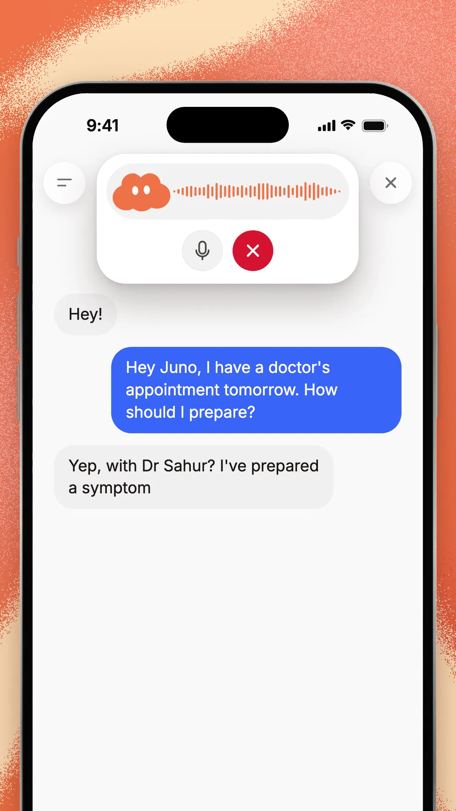](https://cdn.openai.com/devhub/blog/pushing-voice-agents-further/juno-voice-concept.webm)

[观看原始视频：Juno 语音演示：为医生就诊做准备](https://cdn.openai.com/devhub/blog/pushing-voice-agents-further/juno-voice-concept.webm)

[原始英文字幕](../../../assets/articles/0d3aedc15fd9cfcf/cfbece32b12ec30c-juno.en.vtt)

### 语音仍然难在哪里

开箱即用的语音已经相当惊人。它是人们最自然的交流方式，但我们仍在学习如何把它做对。还有一些问题尚未解决：

- 在不打断对话流程的情况下记录症状或调取上下文。
- 在不阻塞对话的情况下将记忆从文本延续到语音。
- 支撑长时间对话。

我把语音模型比作水母。它们反应迅速，但几乎没有自己的方向感。用户刚说了什么，它们就随着漂向哪里，还常常停下来请求确认。文本模型则更加主动，因为它们可以利用广泛得多的上下文，不需要用户每次都解释自己的处境。使用语音时，掌舵的工作必须由你来做。

### 我们改进语音智能体的方法

#### 在不打断流程的情况下记录与记忆

让大多数语音智能体做点什么，它们会把任务发送给某个工具，然后等待答案。这段等待就是尴尬的空白。GPT-Live 可以把工作交给一个委派智能体，但在答案返回期间，这次移交会阻塞对话。在我们的第一个版本中，五分之四的通话都至少出现过一次这样的停顿：一句"请稍等"，然后是大约 10 秒的沉默。

我们的解决办法很简单。每一轮对话之后，一个小而快的模型（[OpenAI 的 Decisions API](https://developers.openai.com/api/docs/guides/decisions)）会在后台回答两个问题：

- 有没有什么需要记录的？属于哪一类？
- 你的历史记录中，哪些与当前时刻相关？

比如说一句"记录一次头痛"，Juno 会立刻被告知已记录，而实际的保存则悄悄在后台进行。它快到什么程度呢？如果你在下一轮就问起那次头痛，它已经被保存好了。

第二个答案负责记忆。历史记录中重要的内容会进入下一轮的上下文，其余一概不放入。这一点很重要，因为语音模型可用的上下文远少于文本模型，所以你必须精心挑选放进去的内容。

[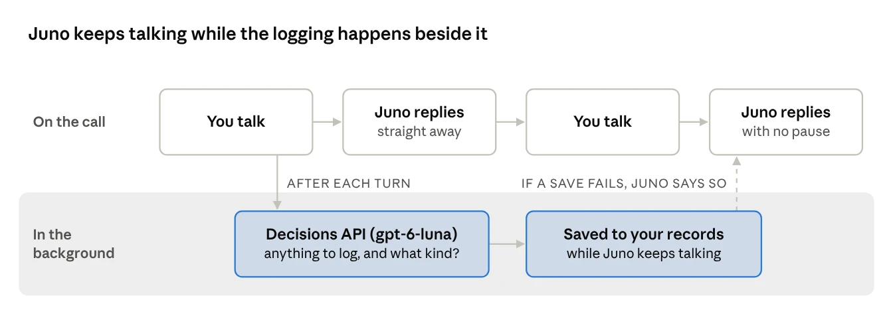](../../../assets/articles/0d3aedc15fd9cfcf/d949e18353e48b47-juno-parallel-logging.webp)

结果是：移交给文本智能体的次数减少了 40%，测试通话中最长的沉默从 9.3 秒降到了 3.2 秒。这就是尴尬的等待与自然的停顿之间的差别。

#### 长时间对话

长时间对话需要同样细致的照料。还记得水母吗：模型几乎没有方向感，所以你必须掌舵。一个"掌舵智能体"会刷新通话的上下文，这样到了第 100 轮，Juno 仍然知道第一轮说过什么，并且在对话冷场时知道接下来该提什么。如果你想要长时间对话，就必须自己构建这套机制，而这很重要：帮助人们理解自身健康状况的规律和趋势，正是在长对话中显现出来的。

### 通过实测找到 Juno 的声音

另一个难题是创造出听起来完美的声音，而这说起来容易做起来难。GPT-Live 开箱即用的效果比它的前代产品有巨大提升，但人们仍然会说某个声音听起来像 AI：你能创造出一个让九成人都满意的声音吗？

一个由慢性病患者组成的焦点小组告诉我们，我们的声音稍微太慢了，而且有点居高临下。这是很重要的反馈，于是我们开展了一项研究来改进它。

利用 GPT-Live 的[提示词生成声音](https://developers.openai.com/api/docs/guides/custom-voices)功能，我们根据简短的文字描述设计了新的声音，并与 290 位美国慢性病成年患者一起，将它们与目前的声音进行了对比测试。每个人听到的都是同样的三句话，为每个声音打分，并选出一个最喜欢的、一个最不喜欢的，以及一个在精疲力尽的日子里想要听到的声音。

在五轮小规模测试中，我们保留了最好的声音，重写了其余的声音。随后，171 位新的参与者将目前的声音与两个最好的新声音进行了对比。

[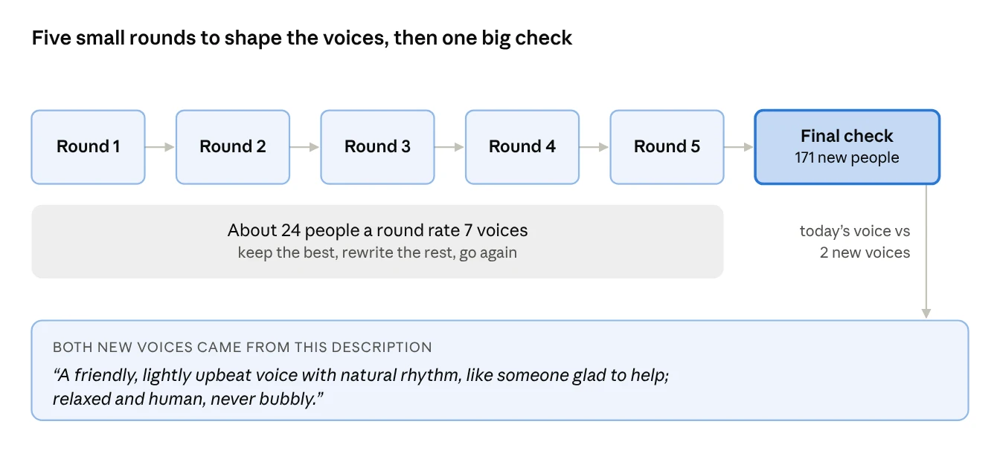](../../../assets/articles/0d3aedc15fd9cfcf/1ee6b0bc88f34ce5-juno-voice-study.webp)

胜出的声音正是由上图中的描述生成的新声音。在最终检验中，将它选为最喜欢声音的人比目前的声音更多，将它选为最不喜欢的人更少，认为它缺少温度的人则少得多。

[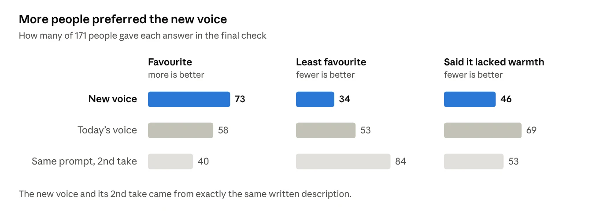](../../../assets/articles/0d3aedc15fd9cfcf/46b2b6c937fccb07-juno-voice-preferences.webp)

这项研究有其局限性：人们只听了三句话，分数差距很小，而且研究毕竟不是真实的通话。接下来，我们将在与首次来电者的真实通话中测试新声音，看看第二天回来使用的人是否更多。

#### 精疲力尽之日的问题

我们还询问了人们在精疲力尽的一天里想要哪个声音。在这个问题上，目前的声音略胜新声音一筹。差距很小，但它引出了一个更大的问题：我们为什么如此执着于找到一个完美的声音？

[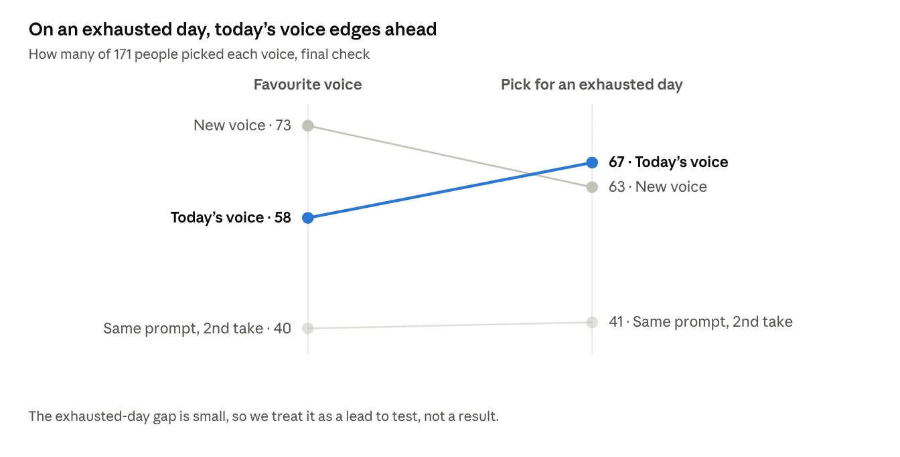](../../../assets/articles/0d3aedc15fd9cfcf/3105e38bfed960d7-juno-exhausted-day.webp)

我们自己的声音并不是固定不变的。我们会根据情境改变语气、语速和音量。那么，如果 Juno 的声音能适应你的感受呢？当声音与人们的语速和响度相匹配时，人们会更加信任它（[Levitan 等人，2016](https://www.cs.columbia.edu/speech/PaperFiles/2016/rivka_interspeech_16.pdf)），而 GPT-Live 已经允许我们在通话中途改变 Juno 的说话方式。这正是我们后续研究要测试的内容。你可以在 [junocompanion.com/voice-study](https://junocompanion.com/voice-study) 听到每一个声音并查看完整结果。

看到语音为慢性病患者解锁了什么、让他们的生活轻松了多少，真是令人难以置信。GPT-Live 是一个很好的基础模型，而在它之上的小小改动就能带来真正的不同。

### 关于作者和公司

我是 [Marshall Gould](https://uk.linkedin.com/in/marshall-gould)，Juno 的创始人。我与一个由三名研究人员组成的团队一起打造了 Juno 的语音：[Isaac Tolley](https://www.linkedin.com/in/isaactolley)、Sean Lees、Dawid Wraga。Juno 是一家使命至上的 AI 公司，帮助人们管理慢性疾病并与之共处。我们很自豪，团队中的大多数成员自己也患有慢性疾病。如今已有数十万人在使用 Juno，我们也期待你的加入，一起延续这份使命。了解更多请访问 [junocompanion.com](https://junocompanion.com)。


## Picsart：让语音与智能体任务保持同步

_作者：Picsart 高级主管工程师 Dmitry Ivanov_

### 我们要构建什么

创意工作的持续时间可能超过一次通话。我们希望用户在任务运行时能自然地与 [Picsart AI 智能体](https://picsart.com/ai-agents/)交谈，或者离开通话，等结果出来后再回来。创意想法并不总是一开始就完全成形：把一种情绪或大致方向聊出来，可能比写一个精确的需求更容易。

[GPT-Live](https://developers.openai.com/api/docs/models/gpt-live-1) 是第一项让我们实现这一愿景的技术。它自然的实时对话让语音感觉像是一种共同打磨想法的方式，而不仅仅是口述指令。它为我们把对话式体验带入 Picsart AI 智能体奠定了基础。

这就是我们选择让语音成为智能体的一个独立界面、同时与文本聊天保持同一对话线程的原因。**我们选择用 GPT-Live 处理实时对话，而我们的智能层负责推理、工具、计划和已保存的上下文。**

[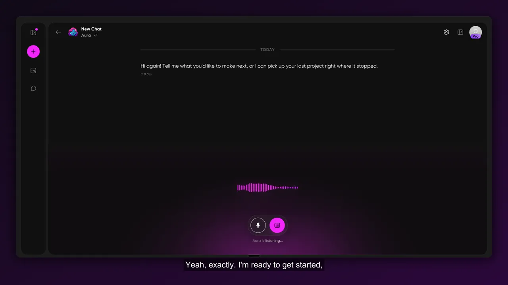](https://cdn.openai.com/devhub/blog/pushing-voice-agents-further/picsart-voice.webm)

[观看原始视频：Picsart 实时语音演示：与 Aura 一起打造咖啡品牌](https://cdn.openai.com/devhub/blog/pushing-voice-agents-further/picsart-voice.webm)

[原始英文字幕](../../../assets/articles/0d3aedc15fd9cfcf/d18cff25c5b5e0d7-picsart.en.vtt)

### 解决方案：将对话与任务分离

[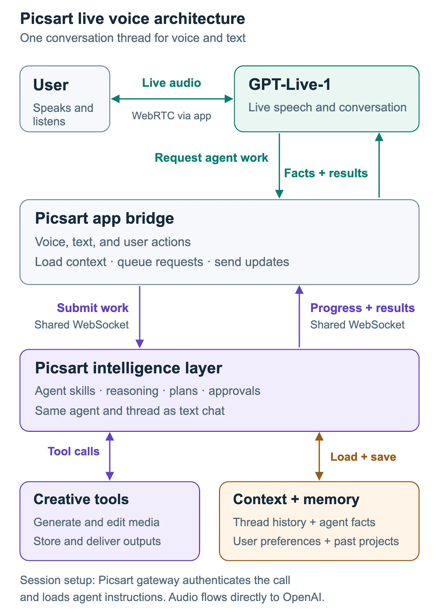](../../../assets/articles/0d3aedc15fd9cfcf/78a676286947dc9c-picsart-voice-architecture.webp)

如图所示，应用将任务发送给智能层，并将上下文和答案返回给 GPT-Live。它使用一个共享的 [WebSocket](https://developers.openai.com/api/docs/guides/voice-websockets) 来发送任务并接收进度和结果。语音和文本使用同一个代理、同一套任务流程和同一套审批规则。

我们的语音网关会使用所选代理的指令来建立会话。实时音频通过 [WebRTC](https://developers.openai.com/api/docs/guides/voice-webrtc) 直接在浏览器与 OpenAI 之间传输。已提交的任务可以在通话结束后继续执行。

#### 向代理发送请求

当 GPT-Live 请求主代理执行某项操作时，我们会将口头请求、最近的消息和附件发送给当前代理和对话线程，并标记为语音模式。我们会在提交时保存该上下文，以便后续的语音不会覆盖已排队的请求。

我们要求主代理为语音而写：回答保持简短、口语化，一次只问一个问题，不要重复语音已经确认过的内容。把任务内容、成本以及需要审批的事项讲清楚。

#### 语音知道什么 vs. 语音说什么

我们向语音提供三类信息：

| 通道         | 我们发送的内容以及语音如何使用它                                            |
| ------------ | --------------------------------------------------------------------------- |
| instructions | 代理身份、何时请求代理工作的规则，以及对话规则                              |
| thinking     | 最近的消息、任务状态、所选工具的数据和用户操作，用作静默上下文              |
| commentary   | 需要大声说出的回答、问题和关键任务更新                                      |

thinking 通道承载的是来自应用的上下文，而非主代理的私有推理。在传递所选工具的结果之前，我们会剥离常见的凭据字段和二进制数据，限制其大小，并标记不完整的结果。

当某个屏幕操作向代理发送请求时，我们会通过 thinking 通道告知语音。这样语音就可以确认该操作，而无需再次询问或重新提交。

[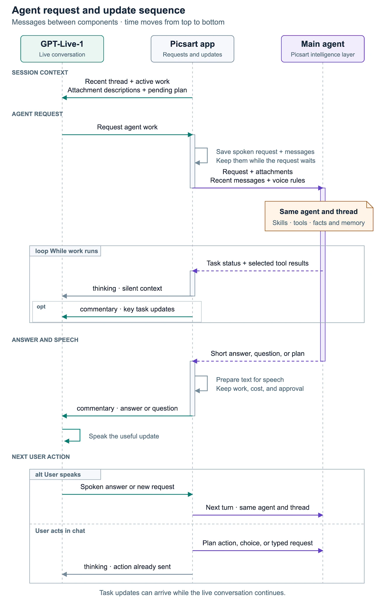](../../../assets/articles/0d3aedc15fd9cfcf/5cd646fd9b08b600-picsart-agent-updates.webp)

常规的工具步骤保持静默。计划开始和任务完成会变成口播更新。我们把流式输出的回答按句子分组，并等待一个停顿之后再发送给语音。当最终答案到达时，我们不会重复已经发送过的文本，但仍会传递更正内容和审批问题。

#### 什么会带入通话，什么会被保存

会话指令定义的是代理的角色，而不是它记住了用户的什么。在通话开始时，我们会加载最近的消息、附件描述、进行中的任务和待审批事项，以便语音能从用户上次停下的地方继续。

长期记忆保留在主代理一侧。启用记忆后，代理可以使用线程历史、摘要、已保存的事实以及用户或项目的偏好。

如果用户说“用我们保存的那个风格”，主代理可以查找该信息或提出澄清问题，然后把答案送回语音。如果记忆不可用，通话也可以在上下文较少的情况下继续。

线程会保存代理请求及其附带的消息，而不是每一句口头交流。在闲聊中提到的偏好，只有在主代理收到并保存它时才会被保留。

#### 工作何时开始、继续或停止

我们会在代理解释完计划之后才口播该计划。只有在代理确认任务已开始之后，我们才会说工作正在进行中。我们把拟执行的工作、其成本和审批问题放在一起呈现。额外的上下文并不意味着可以做更多或花更多钱的许可。

如果我们错过了某个更新，我们会恢复现有任务的状态，而不是重启任务或重播结果和审批问题。

打断语音或离开通话并不会取消工作。停止任务需要一个单独的请求，并且可能无法中止已经在进行中的操作。新请求会保留其原始上下文，并等待当前回合完成，而不是去更改正在运行的工作。

### 经验总结：让语音知道得比说出来的更多

我们从这次集成中得到的实践经验是：

- 在主代理中为语音准备好回答。
- 在每个请求发送时保存其上下文。
- 在语音、文本和屏幕操作之间共享线程和规则。
- 将对话与任务分离。

### 关于 Picsart

Picsart 是一个 [AI 媒体制作与分发平台](https://picsart.com/ai-agents/)，全球超过 1 亿创作者和企业在这里制作、营销内容并从中获利。

14 年多来，它一直在赋能新一代故事讲述者创作、规模化创作，如今更能将视频内容变现。Picsart 将直观的设计工具、AI 驱动的图像与视频创作以及 MCP 和 CLI 功能相结合，在创作者的任何工作场景中与他们相遇。Picsart 拥有超过 1 亿月活跃用户，迄今下载量超过 25 亿次，正在推动一个可扩展、自主创作的新时代——在这里，内容成为身份、影响力和创业精神的燃料。


## Treater：调优语音代理以获得更好的通话结果

_作者：联合创始人兼 CEO Britt O'Daly、联合创始人兼 CTO Ayaz Hafiz，以及软件开发者 Sayd Agzamkhodjaev_

### 通过对话驱动结果

在一次与一家人力资源中介公司的通话中，我们的语音代理与一位企业主交谈，谈到他们的招聘人员在使用排班软件时遇到的挑战。

当这位企业主解释他们之前的解决方案为什么没能奏效时，代理不断插话：“嗯哼”“对，对。”最终，企业主提前结束了对话：

> 算了，直接给我发封邮件吧。

代理其实听懂了企业主在说什么，但它这些插话造成了糟糕的体验。一名销售人员会从这样的互动中吸取教训，并调整今后的谈话方式。我们希望我们的代理也能做到同样的事。

在 [Treater](https://trytreater.com/)，我们构建 AI 代理，帮助企业通过电话、电子邮件和短信触达合作伙伴并与之协作。我们希望我们的代理通过提供卓越的对话体验来达成客户的目标。我们构建了一套学习系统，它可以评估真实对话、发现改进机会，并针对客户的实际结果测试新的代理配置。

下面是我们的代理与多方协作、解决一家杂货店缺货问题的演示。

[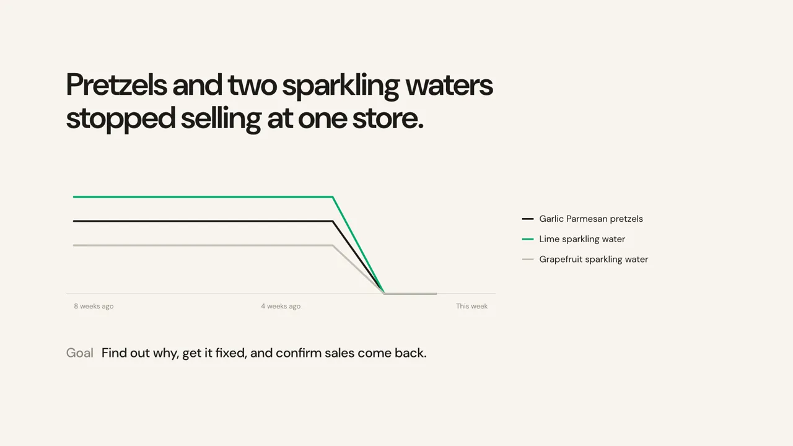](https://cdn.openai.com/devhub/blog/pushing-voice-agents-further/treater-restock.webm)

[观看原始视频：Treater 补货演示](https://cdn.openai.com/devhub/blog/pushing-voice-agents-further/treater-restock.webm)

[原始英文字幕](../../../assets/articles/0d3aedc15fd9cfcf/4e06032f65cd2194-treater.en.vtt)

### 在实战中不断学习的代理

在 [GPT-Live](https://developers.openai.com/api/docs/guides/live) 出现之前，我们把大量时间花在构建和维护一套自研的语音技术栈上。采用它之后，我们几乎砍掉了所有东西，转而使用简单的提示词，反而获得了更好的效果。更长的对话时长与我们客户更好的结果相关联；自从采用 GPT-Live 以来，我们看到对话时长的中位数提升了 26–30%，在第 90 百分位上提升幅度最高达 40%。

**我们客户所关心的目标达成率平均提高了 6 个百分点。**

这让我们得以把更多时间花在“如何让我们的啤酒更好喝”上：在我们所处的这个非平稳（不断变化）的世界里适应与学习。就像人会在自己的岗位上成长一样，我们希望我们的代理能在实战中学会什么叫“出色”。

为了改进代理，我们会沿着多个维度（语音、提示词、语速节奏、可用工具）对每个代理的配置进行采样，并根据我们定义的标准（情绪、已执行的步骤）和客户定义的标准（偏好是否得到遵守、目标完成了多少）对每段对话打分。我们使用多臂老虎机（multi-armed bandit）将流量导向得分较高的配置，表现差的配置会被迅速淘汰。

离线状态下，一个评审系统会读取过去的通话并提出新的配置。每个提案都会针对过去的对话进行回放，我们会预测其上线后的收益，从而砍掉那些不会产生实质影响的改动。改动会提交给客户评审，或者如果客户愿意的话自动上线。

GPT-Live 让许多这类配置变得轻而易举。语气、语速节奏、是否镜像对方的能量、正式程度、附和他人的频率：这些过去都需要在我们的语音技术栈中进行跨层协调。现在，其中大多数只是[提示词](https://developers.openai.com/api/docs/guides/live-prompting)中的一行，因此我们可以干净利落地对比各个版本。

演示：那么，我们的代理从与那位人力资源中介企业主的通话中学到了什么？

[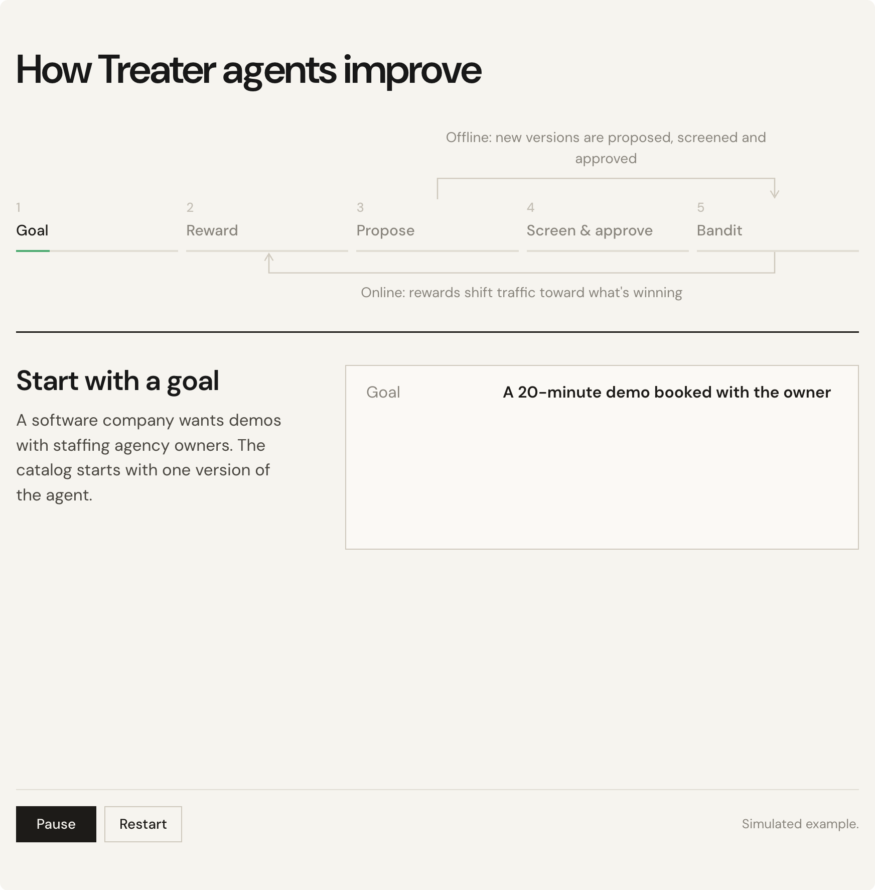](https://developers.openai.com/blog/pushing-voice-agents-further)

*目标*

[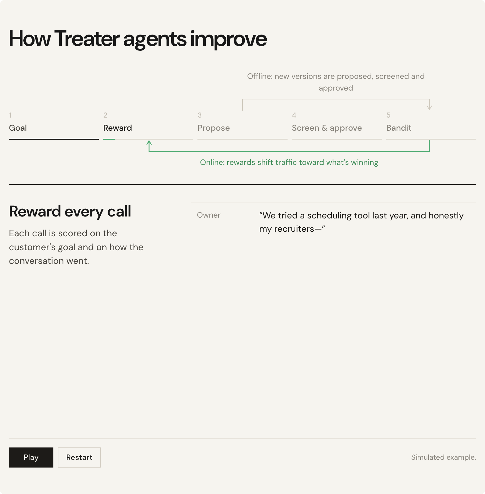](https://developers.openai.com/blog/pushing-voice-agents-further)

*奖励*

[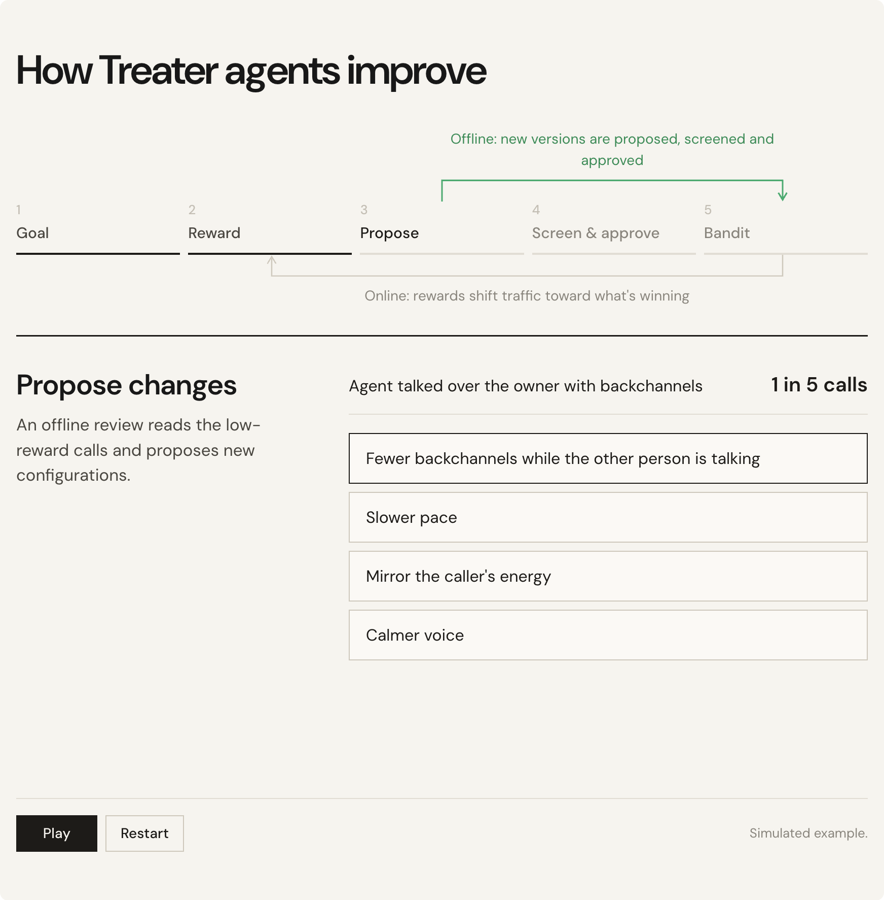](https://developers.openai.com/blog/pushing-voice-agents-further)

*提出*

[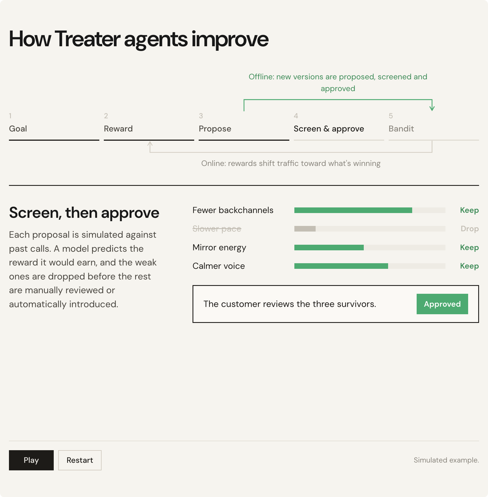](https://developers.openai.com/blog/pushing-voice-agents-further)

*筛选与批准*

[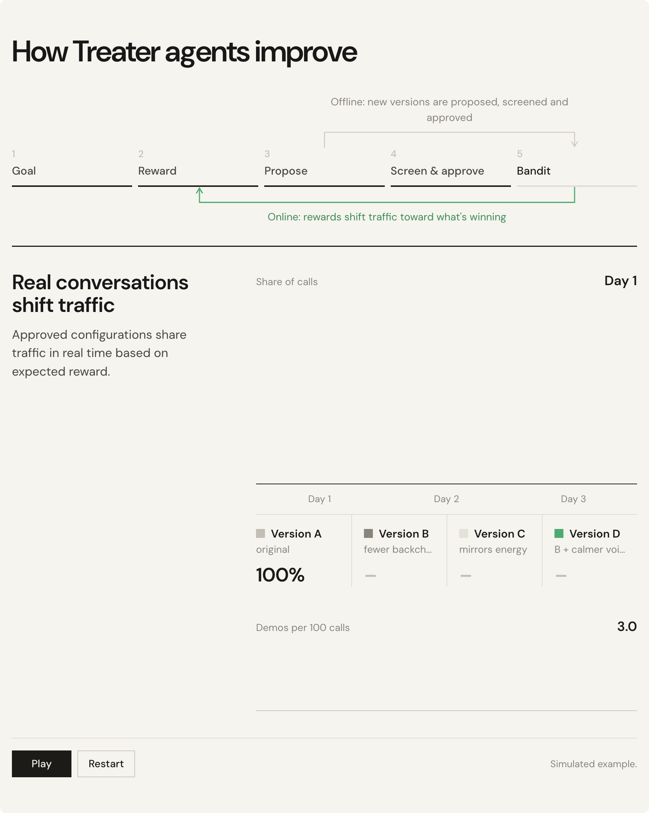](https://developers.openai.com/blog/pushing-voice-agents-further)

*Bandit 算法*

### Treater 代理是如何改进的

离线：提出、筛选并批准新版本

在线：奖励信号将流量导向表现最优者

#### 从一个目标开始

一家软件公司希望与人力资源中介的企业主进行产品演示。目录中起初只有一个版本的代理。

目标与企业主预约一场 20 分钟的产品演示

对象2,000 位人力资源中介企业主

代理A 版本：提示词、语音、语速节奏和附和方式

模拟示例。

> 交互式模拟的状态流转：目标 → 奖励 → 提案 → 筛选与批准 → 老虎机。[打开原始模拟](https://developers.openai.com/blog/pushing-voice-agents-further#treater-optimization-loop)。

这个演示展示了引言中所描述活动的一个匿名化、简化版本：一家公司向人力资源中介预约产品演示，从一个基础代理开始。

- **我们的系统发现了一个机会：** 我们的离线评审系统读取了低奖励的通话并发现了规律，其中包括代理在 20% 的通话中因频繁附和对方而打断了企业主。它由此提出了四个新配置。
- **它提出了改进方案：** 每个提案都针对过去的通话进行了模拟，并按照生产环境中的评估方式被赋予奖励分数。语速较慢的变体得分很差，被立即淘汰；其余变体经过评审并获批。
- **在生产环境中评估：** 流向新版本的流量根据预期奖励进行分配。一天之内，B 版本承接了大部分通话。C 版本始终未能赶上，于第 3 天被关闭。D 版本于第 2 天加入，在第 3 天开始时占据主导，最终承接了约 90% 的通话，而 A 和 B 保留了一小部分份额，以防环境发生变化。每 100 通电话的演示预约量从 3.0 提升至 4.3。

重要的是，这个系统是分层的。对我们共享工具的改进会让每一个用例受益，而某个工作流程学到的东西会成为类似工作流程的起点。

### 我们铭记在心的经验

- 一切都是假设！我们最明显的成功之一，是一位客户希望智能体以他们即将推出的促销活动开场，但以近期产品售罄率上升开场的电话效果好得多。
- 针对信号丰富且真正推动关键指标的结果来设置奖励。当这些奖励需要很长时间才能评估时（例如达成一笔新交易），就投资于能快速衡量的奖励（例如预约下一次会面），但要验证它们确实相关。
- 投资于智能体所处工作环境的可观测性和可衡量性。除非模拟和基准测试能准确反映真实分布，否则它们没有意义。
- 使用 GPT-Live 时，尝试描述性而非指令性的方式。GPT-Live 智能体无需完整脚本，就能很好地适应上下文和一般性指导原则。

借助 GPT-Live，我们不断解锁对话质量的阶跃式提升，我们也非常期待看到梯子接下来的十级台阶会是什么样子！

### 关于 Treater

Treater 与真实世界对话，执行你的业务目标，并把每一次机会都当作最大的机会来对待。我们的平台通过数千个独立智能体运行数十万次通话，过去一年通话量环比增长 25%。我们的客户涵盖上市公司和快速成长的初创企业。更多信息请访问 [trytreater.com](https://trytreater.com)。


## Weekend：两个 GPT-Live 角色如何在 Wit's End 中同台演绎

_作者：Kevin Shen，高级软件工程师；James Wilsterman，Weekend 联合创始人兼 CTO_

### 我们着手构建的目标

我们的游戏 [Wit's End](https://witsend.ai/) 是一款语音优先的奇幻桌面游戏。AI 游戏主持人 Sir Bart 负责讲故事和主持规则，玩家只需要开口说话。GPT-Live 的全双工音频让人感觉就像在真实的游戏桌上：玩家插话、开玩笑、争论，而 Sir Bart 会在他们说话的同时做出反应。

角色阵容曾是薄弱环节。一个 GPT-Live 会话只能用一种声音说话，所以城门处粗鲁的队长和酒馆里受惊的老妇人听起来都像是旁白。我们希望每个场景的主要角色都能为自己说话，拥有自己的声音和个性，同时不失去这款游戏的核心特质：玩家可以说任何话，而故事仍会抵达它的结局。

下面是一个场景如今的演绎方式。队伍抵达 Timberfall 的城门，Sir Bart 完成铺垫后停下："一群神情坚毅的守卫正在站岗，他们的队长走上前来，手按在剑上，上下打量着你们。"Dmitri 队长用低沉沙哑的声音接过话头。他正在追捕一个名叫 Jade 的叛徒，而这支队伍与她同伙的描述相符。一名玩家与他争辩，Dmitri 针锋相对地反驳。另一名玩家偷偷塞给他一枚金币。Sir Bart 插话说骰子正在掷出，讲述贿赂的结果如何，然后把这个时刻交还给 Dmitri，由他做出反应。

[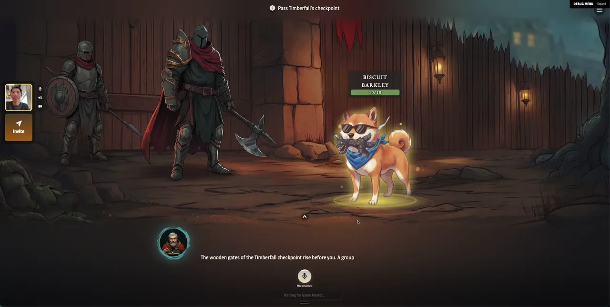](https://cdn.openai.com/devhub/blog/pushing-voice-agents-further/weekend-timberfall-renamed-characters.webm)

[观看原始视频：Sir Bart 和 Wit's End 中的角色们，各自处于自己的 GPT-Live 会话中](https://cdn.openai.com/devhub/blog/pushing-voice-agents-further/weekend-timberfall-renamed-characters.webm)

[原始英文字幕](../../../assets/articles/0d3aedc15fd9cfcf/1243b14990de1399-weekend.en.vtt)

### 解决方案：两个声音，一位导演

[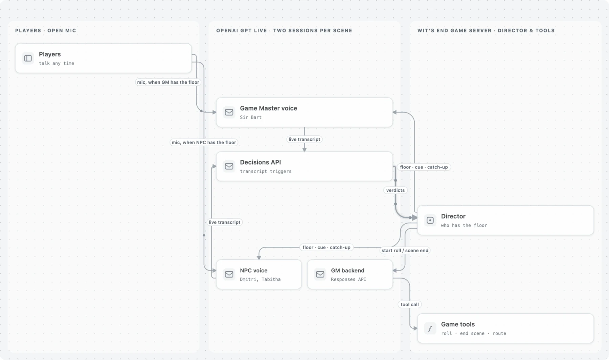](../../../assets/articles/0d3aedc15fd9cfcf/dcbee5aaaa06e931-weekend-two-sessions.webp)

_谁掌握发言权。Decisions API 对两个会话转录文本的判定告诉导演接下来该由谁说话。导演在两个声音之间转移发言权，并在游戏主持人的后端启动掷骰和场景结束。_

每个场景并行运行两个 GPT-Live 会话：一个给 Sir Bart，一个给场景中的角色（城门处的 Dmitri、酒馆里的 Tabitha），各自带有自己的提示词和定制声音。一位导演（运行在我们的游戏服务器上）决定谁掌握发言权，只有发言权持有者能听到玩家。两个会话上的 [Decisions API 转录文本](https://developers.openai.com/api/docs/guides/decisions-voice)触发器会告诉导演对话中正在发生什么。游戏主持人的后端是一个 [Responses 模型](https://developers.openai.com/api/reference/resources/responses/methods/create)，是唯一调用游戏工具的部分：掷骰、场景结束和路由。

#### 两种个性，一个故事

我们把每个角色拆分为属于他们自己的部分和共享的部分。

他们的个性存在于自己的提示词中。

每个提示词还会描述角色的声音，用词与我们设计该声音时所用的完全相同。

**共享场景示例说明**

场景是共享的。Sir Bart 和角色拿到同样的冲突、同样的解决方式和同样的故事节拍，每个节拍都标明由谁来说。Dmitri 自我介绍并说明他在追捕谁；Tabitha 告诉队伍 Jade 将在哪里与他们会面。游戏不会结束一个场景，直到每个节拍都由拥有它的那个声音说完为止。

[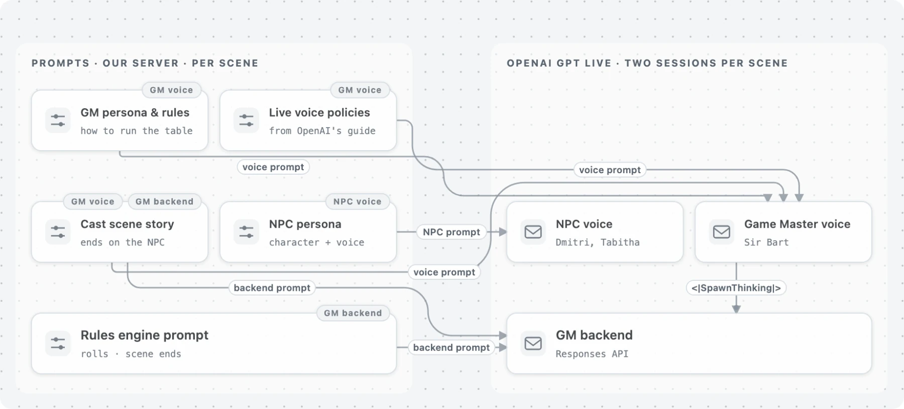](../../../assets/articles/0d3aedc15fd9cfcf/defc816d599f2656-weekend-prompt-structure.webp)

_提示词结构。Sir Bart 的声音和后端共享场景的故事；角色则获得属于自己的角色设定提示词。_

**来自角色的提示词**

```text
You are one actor in a live, spoken scene. A
narrator describes the world; you only ever
speak as yourself, out loud, in first person.
- Never narrate, never describe your own actions
  or voice, and never speak for the travelers or
  the narrator.
- You never decide whether a risky attempt
  works. React to it in one short line and stop;
  the narrator resolves it.
- Speak only when a traveler talks to you or you
  are given the floor.
```

#### 导演如何选择下一个说话者

导演自身不生成语音，它利用 [Decisions API](https://developers.openai.com/api/docs/guides/decisions) 对传入转录文本片段的判定，来识别玩家在对谁说话、某个行动是否需要掷骰，以及何时旁白或角色的收尾台词意味着交接。

[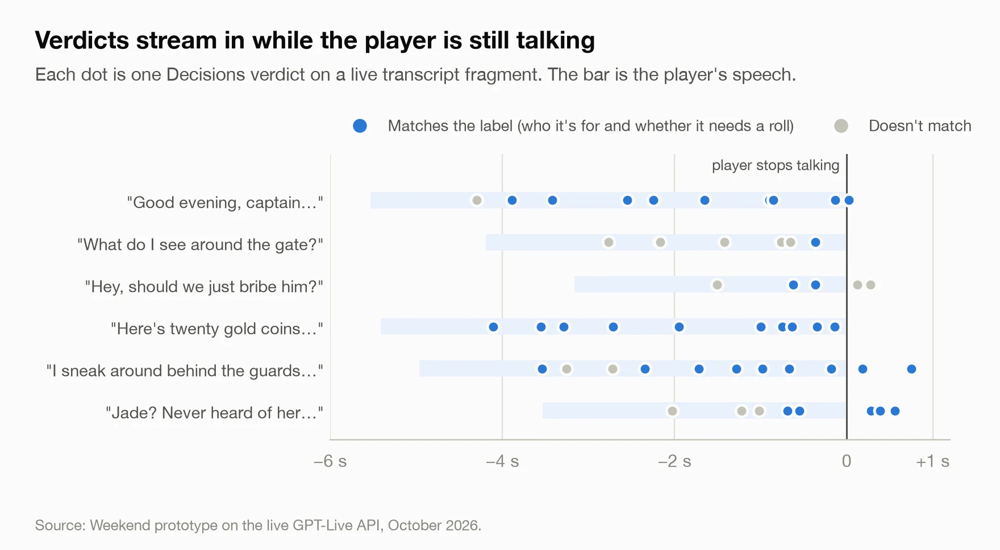](../../../assets/articles/0d3aedc15fd9cfcf/e4c9846d96bf0d3d-weekend-verdict-timing.webp)

_判定会随着玩家说话而演变。导演会等待回合结束时的最终判定来识别说话对象，但风险行动一旦被识别出来就会立即发送给游戏主持人。_

#### 接下来谁说话

| 情形                                                                                                                            | 接下来谁说话                                                                                                                              |
| ------------------------------------------------------------------------------------------------------------------------------- | -------------------------------------------------------------------------------------------------------------------------------------------- |
| Sir Bart 讲完旁白且暗示判定值达到 0.6 或更高，或者他的台词以言语动词结尾（"Tabitha 在你身后喊道"） | 角色                                                                                                                                |
| 玩家在 Sir Bart 掌握发言权时对角色说话                                                                    | 角色，并附上需要回答的台词                                                                                                       |
| 玩家尝试冒险的举动：贿赂、撒谎、偷偷溜过、战斗                                                          | Sir Bart，立即接管，必要时在句中插入。导演在他的后端启动掷骰；他讲述结果，然后把这个时刻交还 |
| 玩家向旁白提问，或描述自己角色的行为                                                     | Sir Bart                                                                                                                                     |
| 玩家们互相交谈                                                                                               | 没有人。当前发言权持有者会收到一条一次性提示，让它放过这段对话                                                                           |
| 角色自己的话结束了他们的部分（"那就去吧。低着头走路。"）                                                 | Sir Bart，在角色说完之后。导演在他的后端启动场景结束                                                       |
| 被授予发言权的一方沉默 2.5 秒                                                                              | 同一说话者，被再次询问                                                                                                                |

#### 完成交接

一次交接会做四件事：

1. 让失去发言权的会话静音，告诉它停止，并丢弃它已排队的所有音频。
1. 为新的发言权持有者补上它错过的内容，作为静默上下文通过 `session.thinking.append` 传入。同样的内容也会进入它的 Decisions 上下文，使它的触发器基于相同的历史进行判断。
1. 解除新发言权持有者的静音，并给它提示信号。
1. 在新说话者的第一句话落地之前保持玩家麦克风静音，最长 8 秒，这样交接就不会被人声盖过。

由于角色的会话已经在运行，一次交接平均 0.84 秒即可到达首个音频，而新开会话需要 1.54 秒。

### 让游戏持续走向结局

声音在即兴发挥。由应用来决定何时有事发生。

[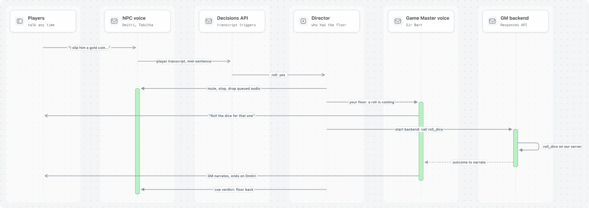](../../../assets/articles/0d3aedc15fd9cfcf/1cdae48c01c69c09-weekend-bribe-sequence.webp)

_Dmitri 掌握发言权时的一次贿赂。掷骰判定在句中到达，导演把发言权交给 Sir Bart 并在他的后端启动掷骰，等 Sir Bart 讲述完结果后，一个暗示判定把发言权交还给 Dmitri。_

- **导演自行发起掷骰和场景结束。**在一次试玩中，Sir Bart 说了“这个你得掷骰子才行”，但从未交接给他的后端，因此掷骰没有执行，他自己编造了结果。现在，导演会直接在他的后端上发起一次响应。语音在运行期间说出一句简短的台词，然后叙述结果。
- **骰子为每个场景定音。**场景 1 以一次成功的掷骰结束。如果 Dmitri 在任何掷骰之前就让步，导演会把玩家的尝试送去掷骰，而不是直接结束场景。
- **角色可以结束自己的部分，由游戏主持人（Game Master）收尾整个场景。**当 Tabitha 告诉小队 Jade 会在精灵祭坛（Sprite Altar）与他们会合时，导演把发言权交给 Sir Bart，他的后端将场景标记为完成，然后他提出两条出路。

### 经验总结

- **只有一个会话应该聆听玩家。**当我们的两个系统都在聆听时，两者会回答每一句测试台词，而且经常互相矛盾：Dmitri 拒绝了贿赂，而游戏主持人却叙述他把贿赂揣进了口袋。
- **静音一个会话并不等于让它安静下来。**要明确告诉它停止，并丢弃其已排队的音频。当它重新获得发言权时，要显式解除“保持沉默”的指令：一位仍受该规则约束的游戏主持人整整一个场景没有回应任何人。
- **让每个声音保持在线。**会话的声音在启动时就已确定，因此每个声音都需要自己的会话。让角色的会话随场景一起启动，每次交接可以节省约 0.7 秒——这正是顺畅交接与尴尬冷场之间的差别。
- **在正确的时机对每个判定采取行动。**判定结果在玩家还在说话时就已到达，最后一个判定在玩家停口后中位数 0.19 秒落定。一旦识别出有风险的举动，就立即发送给游戏主持人；等到回合结束、判定结果稳定后，再决定这句话是说给谁听的。
- **把是/否问题当作谓词来问，根据真实台词设定阈值，并保留一条简单规则作为兜底。**“接下来该 Dmitri 说话吗？”作为谓词问法 12 次答对 11 次，而作为二选一问题只答对 8 次。在 0.4 的阈值下，“这个你得掷骰子才行”被误判为提示语，导致 Dmitri 在掷骰中途拿到了发言权；真正的提示语得分在 0.94 及以上，因此我们使用 0.6。而“Tabitha 在你身后喊道”得分仅 0.04，因此一次言语动词检查就能捕捉那些止于角色台词之处的旁白。
- **让每个结果只归属于一个负责人。**只有游戏主持人的后端调用工具，由应用而非某个声音来发起掷骰和场景结束。这样每个角色都可以自由即兴发挥，而不会扭曲游戏规则。

### 关于作者和公司

[Weekend](https://www.weekend.com/) 团队打造了 Wit's End——一款语音优先的奇幻桌面游戏，由 AI 游戏主持人推进故事，玩家只需开口说话即可游玩，支持浏览器和电视。欢迎访问 [witsend.ai](https://witsend.ai/) 体验。

Weekend（前身为 Volley）为电视打造语音驱动的游戏，让家庭可以把看电视的时间变成相聚的时光，放声畅玩。旗下 25 款以上游戏，包括 Jeopardy!、Wheel of Fortune、Song Quiz 和 Wit's End，可在 Roku、Fire TV、Samsung 和 LG 电视上运行，已进入超过 3000 万家庭。Weekend 的投资方包括微软旗下 M12、Lightspeed Venture Partners 和 Y Combinator。

---

## 语音智能体的下一步

语音的下一步不只是更好的对话，而是能在工作推进的同时持续聆听、跨界面携带上下文、并协调多个声音而不丢失线索的软件。GPT-Live 同时聆听与说话的能力，为开发者奠定了基础，让体验能够跟随对话的节奏，而不是强迫人们排队等待轮到自己发言。

这四个故事展示了在实践中做到这一点需要什么：Juno 让声音与使用它们的人一起测试，Picsart 让对话与后台工作保持同步，Treater 从真实通话中学习，而 Weekend 让每个角色拥有自己的声音，同时不放弃对游戏的掌控。

GPT-Live 为人们与软件交互提供了一种直觉化的方式，把智能体所能做到的事情推向了新的高度。人们可以在交谈中打磨创意想法、指导进行中的工作，或者走进一个故事并影响接下来的发展。当对话成为软件运作方式的一部分时，这些构建只是开发者所能创造的开端。

要开始构建你自己的体验，请查阅 [GPT-Live 入门指南](https://developers.openai.com/api/docs/guides/live)以及[委派与工具文档](https://developers.openai.com/api/docs/guides/live-delegation)。
